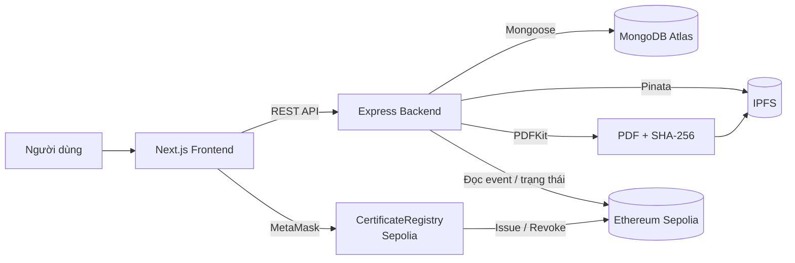

# Raccoon University — Verify Certification

[](https://github.com/son3005/VC/actions/workflows/ci.yml)
[](https://github.com/son3005/VC/actions/workflows/security.yml)

Hệ thống cấp, lưu trữ và xác thực văn bằng/chứng chỉ của **Raccoon University** trên Ethereum Sepolia.

PDF là artifact gốc. SHA-256 của PDF được neo on-chain, metadata lưu MongoDB, file gốc lưu IPFS. Người xem có thể tra cứu bằng mã chứng chỉ, họ tên, MSSV hoặc xác thực trực tiếp file PDF.

## Liên kết

| Thành phần | URL |
|---|---|
| Frontend | https://frontend-amber-iota-gefhderu5i.vercel.app/ |
| Backend API | https://vc-api-a3i5.onrender.com |
| Health check | https://vc-api-a3i5.onrender.com/api/health |
| Smart Contract | [0xE939E96E210A4eC13eF85F45193022e5b235fA56](https://sepolia.etherscan.io/address/0xE939E96E210A4eC13eF85F45193022e5b235fA56) |
| Network | Sepolia — `11155111` (`0xaa36a7`) |

## Tính năng

### Người xem / tuyển dụng

- Tra cứu văn bằng theo mã, họ tên hoặc MSSV.
- Xem chi tiết văn bằng công khai tại `/c/[certificateId]`.
- Xác thực file PDF bằng SHA-256 ngay trên trình duyệt.
- Xem trạng thái on-chain: `active` / `revoked`.
- Quét QR trên văn bằng để mở trang xác thực.
- Hiển thị đúng nội dung cho 4 loại chứng chỉ:
  - Bằng tốt nghiệp (`degree`)
  - Chứng chỉ khóa học (`course`)
  - Chứng chỉ tín chỉ (`credit`)
  - Chứng chỉ khác (`other`)

### Đơn vị cấp / Issuer

- Đăng nhập bằng email + mật khẩu + ví MetaMask khớp tài khoản.
- Cấp chứng chỉ theo quy trình 4 bước:
  1. Nhập thông tin và tạo PDF.
  2. Chuẩn bị metadata + hash + pin IPFS.
  3. Ký `issueCertificate` bằng MetaMask.
  4. Xác nhận với backend để lưu DB.
- Xem danh sách chứng chỉ đã cấp.
- Thu hồi chứng chỉ on-chain.
- Tải PDF từ IPFS.

### Quản trị viên

- Dashboard thống kê.
- Quản lý danh sách đơn vị cấp.
- Thêm issuer on-chain và tạo tài khoản đăng nhập issuer.
- Xem toàn bộ chứng chỉ.
- Thu hồi khẩn cấp.

### Bảo mật / vận hành

- JWT cho API.
- Phân quyền `admin` / `issuer`; kiểm tra quyền ở backend.
- Đăng nhập yêu cầu **email + mật khẩu + địa chỉ ví khớp**; sai bất kỳ phần nào trả cùng một lỗi chung, không tiết lộ tài khoản/ví.
- CORS allowlist theo `FRONTEND_ORIGIN`.
- Helmet security headers, rate limit, validation bằng Zod.
- Không lưu private key trong backend; giao dịch do MetaMask ký.
- Global loading overlay cho các thao tác thay đổi dữ liệu.
- CI: test, build, secret scan và dependency audit.

## Kiến trúc



### Luồng cấp chứng chỉ

```text
Issuer nhập form
  → POST /api/certificates/prepare
      → Backend tạo PDF
      → SHA-256 PDF
      → Pin PDF lên IPFS (Pinata)
      → Trả certificateId, cid, fileHash, template
  → MetaMask ký issueCertificate(...)
  → POST /api/certificates/confirm
      → Backend xác minh transaction/event
      → Lưu metadata vào MongoDB
  → Chứng chỉ xuất hiện ở trang tra cứu + QR
```

## Công nghệ

| Layer | Stack |
|---|---|
| Smart contract | Solidity, Hardhat, OpenZeppelin, Ethers |
| Backend | Node.js, Express, TypeScript, Mongoose, Zod, JWT, PDFKit, Pinata SDK |
| Frontend | Next.js 15 App Router, React 19, TypeScript, Tailwind CSS v4, TanStack Query, React Hook Form, Zod |
| Wallet | MetaMask, Ethers v6 |
| Database | MongoDB Atlas |
| Storage | IPFS / Pinata |
| Deploy | Render (backend), Vercel (frontend), Sepolia (contract) |

## Cấu trúc repository

```text
.
├── contracts/            # Solidity contract, test, script deploy/add issuer
├── backend/              # Express API, PDF service, Pinata, MongoDB
├── frontend/             # Next.js App Router
├── docs/                 # API reference, thiết kế, runbook, kế hoạch
├── scripts/              # Script tiện ích (brand assets)
├── docker-compose.yml    # Backend dev container
├── render.yaml           # Render blueprint
└── README.md
```

## Chạy local

### Yêu cầu

- Node.js 20+
- npm
- Docker Desktop (nếu chạy backend bằng Docker)
- MetaMask + SepoliaETH
- MongoDB Atlas, Pinata, Etherscan API key (nếu deploy/cấp chứng chỉ)

### 1. Clone và cấu hình env

```bash
git clone https://github.com/son3005/VC.git
cd VC

cp .env.example .env
cp .env.example backend/.env
cp frontend/.env.example frontend/.env.local
```

Điền giá trị thật vào các file `.env` / `.env.local`. **Không commit các file này.**

Các nhóm biến quan trọng:

| Nhóm | Biến |
|---|---|
| Chain | `CHAIN_ID`, `SEPOLIA_RPC_URL`, `CONTRACT_ADDRESS`, `DEPLOY_BLOCK` |
| MongoDB | `MONGODB_URI`, `MONGODB_DB` |
| Pinata | `PINATA_JWT`, `PINATA_GATEWAY` |
| Backend | `PORT`, `FRONTEND_ORIGIN`, `JWT_SECRET`, `JWT_EXPIRES_IN` |
| Seed | `SEED_ADMIN_EMAIL`, `SEED_ADMIN_PASSWORD`, `SEED_ISSUER_EMAIL`, `SEED_ISSUER_PASSWORD` |
| Frontend | Toàn bộ biến `NEXT_PUBLIC_*` |

### 2. Backend

```bash
cd backend
npm install
npm run seed
npm run dev
```

API mặc định:

```text
http://localhost:4000
```

Kiểm tra:

```bash
curl http://localhost:4000/api/health
```

### 3. Frontend

```bash
cd frontend
npm install
npm run dev
```

Mở:

```text
http://localhost:3000
```

Frontend local cần trỏ đúng backend:

```env
NEXT_PUBLIC_API_URL=http://localhost:4000
```

### 4. Docker cho backend

```bash
docker compose up -d --build
docker compose logs -f api
```

Docker chỉ dùng cho backend. Frontend vẫn chạy bằng `npm run dev`.

### 5. Smart contract

```bash
cd contracts
npm install
npm run compile
npm test
```

Deploy Sepolia:

```bash
npm run deploy:sepolia
```

Thêm issuer:

```bash
npm run add-issuer:sepolia
```

## Đăng nhập

Hệ thống không chỉ kiểm tra email/mật khẩu mà còn kiểm tra ví:

```text
Email + Mật khẩu + Địa chỉ ví MetaMask
```

Cả ba phải khớp với cùng một tài khoản. Nếu sai bất kỳ phần nào, API trả:

```json
{
  "success": false,
  "error": {
    "code": "UNAUTHORIZED",
    "message": "Tài khoản, mật khẩu hoặc ví không đúng"
  }
}
```

Tài khoản demo được tạo bởi `npm run seed` theo biến `SEED_*` trong `backend/.env`.

> Người xem công khai **không cần đăng nhập** để tra cứu/xác thực chứng chỉ. Đăng nhập chỉ dành cho admin và issuer.

## API chính

| Method | Endpoint | Mô tả |
|---|---|---|
| `GET` | `/api/health` | Health check |
| `POST` | `/api/auth/login` | Đăng nhập email + mật khẩu + ví |
| `GET` | `/api/auth/me` | Thông tin tài khoản hiện tại |
| `GET` | `/api/public/certificates` | Tìm kiếm chứng chỉ công khai |
| `GET` | `/api/public/certificates/recent` | Chứng chỉ mới nhất |
| `GET` | `/api/public/certificates/:id` | Chi tiết chứng chỉ |
| `GET` | `/api/public/filters` | Danh sách năm/ngành cho bộ lọc |
| `GET` | `/api/public/verify?hash=...` | Xác thực theo SHA-256 file |
| `POST` | `/api/certificates/prepare` | Tạo PDF, hash, pin IPFS |
| `POST` | `/api/certificates/confirm` | Xác nhận giao dịch và lưu DB |
| `GET` | `/api/certificates` | Danh sách chứng chỉ của issuer |
| `POST` | `/api/certificates/:id/revoke` | Thu hồi chứng chỉ |
| `GET` | `/api/admin/stats` | Thống kê admin |
| `GET` | `/api/admin/certificates` | Toàn bộ chứng chỉ |
| `GET` | `/api/issuers` | Danh sách issuer |
| `POST` | `/api/issuers` | Thêm issuer + tạo tài khoản issuer |

Chi tiết request/response: [API Reference](docs/api-reference.md).

## Kiểm thử

```bash
# Backend
cd backend
npm test
npm run build

# Frontend
cd frontend
npm run lint
npm run build

# Contracts
cd contracts
npx hardhat test
```

Kết quả hiện tại:

```text
Backend: 12 test suites, 58 tests pass
Frontend: lint pass, production build pass (13 routes)
```

## Deploy

### Smart contract

Contract đã deploy trên Sepolia:

```text
CertificateRegistry: 0xE939E96E210A4eC13eF85F45193022e5b235fA56
Deploy block:        11953245
```

### Backend — Render

Service: `https://vc-api-a3i5.onrender.com`

Biến môi trường bắt buộc:

```env
NODE_ENV=production
PORT=4000
MONGODB_URI=...
JWT_SECRET=...
CONTRACT_ADDRESS=0xE939E96E210A4eC13eF85F45193022e5b235fA56
DEPLOY_BLOCK=11953245
SEPOLIA_RPC_URL=...
PINATA_JWT=...
FRONTEND_ORIGIN=https://frontend-amber-iota-gefhderu5i.vercel.app
```

`FRONTEND_ORIGIN` phải là origin chính xác, không có dấu `/` cuối. Nhiều origin thì ngăn bằng dấu phẩy.

### Frontend — Vercel

- Root Directory: `frontend`
- Framework: Next.js
- Biến môi trường:

```env
NEXT_PUBLIC_API_URL=https://vc-api-a3i5.onrender.com
NEXT_PUBLIC_CHAIN_ID=11155111
NEXT_PUBLIC_CHAIN_ID_HEX=0xaa36a7
NEXT_PUBLIC_CHAIN_NAME=Sepolia
NEXT_PUBLIC_RPC_URL=https://ethereum-sepolia-rpc.publicnode.com
NEXT_PUBLIC_EXPLORER_URL=https://sepolia.etherscan.io
NEXT_PUBLIC_CONTRACT_ADDRESS=0xE939E96E210A4eC13eF85F45193022e5b235fA56
NEXT_PUBLIC_DEPLOY_BLOCK=11953245
NEXT_PUBLIC_IPFS_GATEWAY=https://gateway.pinata.cloud/ipfs/
```

Sau khi đổi biến `NEXT_PUBLIC_*`, phải **redeploy Vercel** vì giá trị được nhúng lúc build.

### Lưu ý QR / domain

- QR trong PDF dùng `FRONTEND_ORIGIN`, không dùng domain request hiện tại.
- Phải cập nhật `FRONTEND_ORIGIN` sang domain production trước khi cấp chứng chỉ.
- Vercel Deployment Protection phải tắt hoặc chỉ áp dụng cho preview; nếu không, người quét QR sẽ bị chuyển sang trang đăng nhập Vercel.
- Không dùng URL preview có hash cho QR.
- PDF đã pin IPFS là bất biến; sau khi đổi domain phải cấp chứng chỉ mới để QR đúng.

## Bảo mật

- Không commit `.env`, private key, JWT secret, Pinata JWT.
- Frontend chỉ dùng biến `NEXT_PUBLIC_*`; không có secret server.
- Backend không giữ private key; giao dịch do MetaMask ký.
- Login kiểm tra email + mật khẩu + ví, trả lỗi chung để tránh enumeration.
- CORS chỉ cho phép origin trong `FRONTEND_ORIGIN`.
- Helmet, rate limit, Zod validation, JWT.
- CI chạy secret scan (Gitleaks) và dependency audit.

## CI/CD

- PR vào `main`:
  - Contracts compile/test
  - Backend build/test
  - Frontend lint/build
  - Secret scan
  - Dependency audit
- Render deploy khi checks pass (`autoDeployTrigger: checksPass`).
- Deploy contract chạy thủ công qua workflow `Deploy Contract` + environment `sepolia`.
- GitHub Ruleset trên `main`: bắt buộc PR, required checks, không force push.

## Tài liệu

- [API Reference](docs/api-reference.md)
- [Class Diagram](docs/class-diagram.md)
- [Database Schema Design](docs/database-schema-design.md)
- [Smart Contract Design](docs/smart-contract-design.md)
- [Security & Privacy Plan](docs/security-privacy-plan.md)
- [Testing & QA Plan](docs/testing-qa-plan.md)
- [Deployment Runbook](docs/deployment-runbook.md)
- [CI/CD Plan](docs/cicd-plan.md)
- [Frontend Plan](docs/frontend-plan.md)
- [Kế hoạch tổng thể](docs/ke-hoach-verify-certification.md)
- [Plan Index](docs/plan-index.md)

## Ghi chú

- Đây là hệ thống demo trên **Ethereum Sepolia testnet**, không dùng ETH thật.
- Người xem chỉ cần trình duyệt để tra cứu; không cần MetaMask.
- Admin/issuer cần MetaMask có ví khớp tài khoản và SepoliaETH để trả gas.
- Chứng chỉ đã thu hồi vẫn tra cứu được nhưng hiển thị trạng thái `revoked`.
