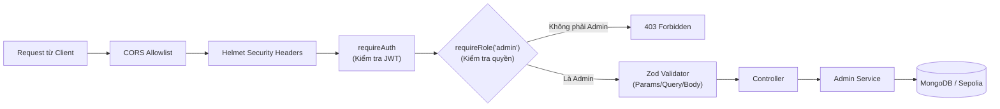

# Đặc tả Kiến trúc & Logic Tuyến đường Quản trị (`backend/src/routes/admin.routes.ts`)

Tài liệu kỹ thuật này mô tả chi tiết kiến trúc bảo mật, luồng phân quyền, đặc tả từng endpoint và phân tích mã nguồn của module tuyến đường quản trị [`backend/src/routes/admin.routes.ts`](file:///d:/VC_Blockchain/VC/backend/src/routes/admin.routes.ts).

---

## 1. Tổng quan Module Tuyến đường Quản trị

Tệp tin `admin.routes.ts` thiết lập toàn bộ các điểm cuối API (RESTful endpoints) phục vụ cho giao diện **Admin Portal** của hệ thống **Raccoon University — Verify Certification**.

### Thông tin cơ bản:
- **Tiền tố đường dẫn (Base Path)**: `/api/admin` (được đăng ký tại [`backend/src/app.ts`](file:///d:/VC_Blockchain/VC/backend/src/app.ts)).
- **Đối tượng sử dụng**: Ban Giám hiệu, Phòng Quản lý Đào tạo và Quản trị viên hệ thống.
- **Thẩm quyền cốt lõi**:
  - Xem báo cáo thống kê tổng thể toàn trường.
  - Quản lý và tra cứu toàn bộ văn bằng/chứng chỉ đã phát hành.
  - Quyền thu hồi văn bằng khẩn cấp khi phát hiện gian lận hoặc sai sót nghiêm trọng.
  - Giám sát độ trễ khối và chủ động kích hoạt quét đồng bộ dữ liệu blockchain Sepolia.

---

## 2. Kiến trúc Bảo mật & Pipeline Xử lý Request

Mọi yêu cầu gửi tới các route thuộc `/api/admin` đều phải đi qua hàng rào bảo mật nhiều lớp:



### Chi tiết các Middleware bảo vệ toàn cục:
1. **`requireAuth`**:
   - Trích xuất token từ header `Authorization: Bearer <TOKEN>`.
   - Giải mã và xác thực chữ ký JWT bí mật (`env.JWT_SECRET`).
   - Gắn thông tin người dùng đã giải mã vào `req.user`. Nếu token không hợp lệ hoặc hết hạn, trả về `401 Unauthorized`.
2. **`requireRole("admin")`**:
   - Kiểm tra `req.user.role === "admin"`.
   - Nếu người dùng có vai trò là `issuer` hoặc vai trò khác, request lập tức bị từ chối với mã lỗi `403 Forbidden`.

```typescript
// Áp dụng bảo vệ toàn bộ router:
router.use(requireAuth, requireRole("admin"));
```

---

## 3. Đặc tả Chi tiết các Endpoint Quản trị

Module cung cấp 6 endpoints được phân bổ vào 3 nhóm nghiệp vụ chính:

### 3.1. Nhóm 1: Thống kê & Báo cáo Dashboard

#### `GET /api/admin/stats`
- **Bộ điều khiển**: `adminStatsController`
- **Mục đích**: Cung cấp các chỉ số tổng quan phục vụ màn hình chính Dashboard.
- **Dữ liệu phản hồi mẫu (Response 200 OK)**:
  ```json
  {
    "success": true,
    "data": {
      "totalCertificates": 1540,
      "activeCertificates": 1520,
      "revokedCertificates": 12,
      "lockedCertificates": 8,
      "totalIssuers": 15,
      "activeIssuers": 14
    }
  }
  ```

---

### 3.2. Nhóm 2: Quản lý Văn bằng & Chứng chỉ Toàn trường

#### `GET /api/admin/certificates`
- **Bộ điều khiển**: `adminCertificatesController`
- **Mục đích**: Lấy danh sách văn bằng trên quy mô toàn trường với khả năng lọc và tìm kiếm nâng cao.
- **Tham số truy vấn (Query Parameters)**:
  - `page`: Trang hiện tại (mặc định: `1`).
  - `limit`: Số bản ghi mỗi trang (mặc định: `20`, tối đa: `100`).
  - `status`: Lọc theo trạng thái (`active`, `revoked`, `locked`).
  - `certificateType`: Lọc theo loại bằng (`degree`, `course`, `credit`, `other`).
  - `issuerWallet`: Lọc theo địa chỉ ví của đơn vị cấp cụ thể.
  - `search`: Từ khóa tìm kiếm theo tên sinh viên hoặc mã sinh viên.
  - `graduationYear`: Lọc theo năm tốt nghiệp.

#### `GET /api/admin/certificates/:id`
- **Bộ điều khiển**: `adminCertificateDetailController`
- **Mục đích**: Xem chi tiết toàn bộ thông tin của một chứng chỉ (bao gồm dữ liệu cá nhân PII của sinh viên, điểm GPA, mã băm SHA-256 PDF, CID IPFS và lịch sử giao dịch).
- **Tham số đường dẫn**: `:id` (hỗ trợ cả `certificateId` dạng `"UIT-DEG-2026-0001"` lẫn MongoDB `_id`).

#### `POST /api/admin/certificates/:id/revoke`
- **Bộ điều khiển**: `adminRevokeCertificateController`
- **Mục đích**: Thu hồi khẩn cấp một văn bằng từ cấp quản trị viên.
- **Dữ liệu gửi lên (Request Body)**:
  ```json
  {
    "reason": "Phát hiện gian lận hồ sơ đầu vào theo quyết định kỷ luật số 123/QĐ-ĐH",
    "txHash": "0x7f9fad1c0d57a7af66d40... (Giao dịch thu hồi on-chain)"
  }
  ```
- **Nguyên lý hoạt động**:
  - Admin ký giao dịch gọi hàm `revokeCertificate(certificateId)` trên Smart Contract Sepolia bằng ví Owner.
  - Gửi `txHash` về backend qua endpoint này để cập nhật trạng thái `revoked` ngay lập tức trong MongoDB mà không cần chờ worker nền quét block.

---

### 3.3. Nhóm 3: Giám sát & Điều khiển Đồng bộ Blockchain (Indexer / Sync)

#### `GET /api/admin/sync/status`
- **Bộ điều khiển**: `syncStatusController`
- **Mục đích**: Kiểm tra tình trạng hoạt động của worker đồng bộ giữa Ethereum Sepolia và cơ sở dữ liệu.
- **Dữ liệu phản hồi mẫu**:
  ```json
  {
    "success": true,
    "data": {
      "currentBlock": 7512400,
      "lastSyncedBlock": 7512398,
      "lagBlocks": 2,
      "contractAddress": "0xe939e96e210a4ec13ef85f45193022e5b235fa56",
      "chainId": 11155111
    }
  }
  ```

#### `POST /api/admin/sync`
- **Bộ điều khiển**: `triggerSyncController`
- **Mục đích**: Cho phép Quản trị viên kích hoạt tiến trình quét và bù sự kiện thủ công (Manual Backfill).
- **Dữ liệu gửi lên tùy chọn (Request Body)**:
  ```json
  {
    "fromBlock": 7500000,
    "toBlock": 7510000
  }
  ```
- **Ứng dụng**: Rất hữu ích khi mạng lưới Sepolia gặp sự cố nghẽn mạng tạm thời hoặc khi quản trị viên muốn kiểm tra đối soát lại một khoảng khối xác định.

---

## 4. Mã nguồn Đầy đủ có Chú thích Chi tiết

Dưới đây là mã nguồn của [`backend/src/routes/admin.routes.ts`](file:///d:/VC_Blockchain/VC/backend/src/routes/admin.routes.ts) với hệ thống chú thích đầy đủ:

```typescript
import { Router } from "express";
import {
  adminCertificateDetailController,
  adminCertificatesController,
  adminRevokeCertificateController,
  adminStatsController,
  syncStatusController,
  triggerSyncController,
} from "../controllers/admin.controller";
import { requireAuth, requireRole } from "../middleware/auth";

/**
 * Express Router quản lý toàn bộ các tuyến đường API dành riêng cho Quản trị viên (Admin Portal).
 *
 * Tiền tố đường dẫn (Base Path): `/api/admin` (được gắn tại `backend/src/app.ts`).
 *
 * Kiến trúc Bảo mật & Phân quyền:
 * - `requireAuth`: Bắt buộc request phải có Header `Authorization: Bearer <JWT_TOKEN>` hợp lệ.
 * - `requireRole("admin")`: Kiểm tra payload của JWT, chỉ tài khoản có vai trò `admin` mới được truy cập.
 *   Mọi truy cập từ người dùng thông thường hoặc `issuer` đều bị chặn với mã lỗi 403 Forbidden.
 */
const router = Router();

// Áp dụng middleware kiểm tra xác thực và quyền Admin toàn cục cho toàn bộ router này
router.use(requireAuth, requireRole("admin"));

// -----------------------------------------------------------------------------
// 1. DASHBOARD & THỐNG KÊ TỔNG QUAN
// -----------------------------------------------------------------------------

/**
 * GET /api/admin/stats
 * Lấy dữ liệu thống kê tổng hợp toàn hệ thống:
 * - Tổng số chứng chỉ đã phát hành
 * - Số lượng chứng chỉ theo trạng thái (active, locked, revoked)
 * - Tổng số đơn vị cấp (Issuers) đang hoạt động
 */
router.get("/stats", adminStatsController);

// -----------------------------------------------------------------------------
// 2. QUẢN LÝ VĂN BẰNG & CHỨNG CHỈ TOÀN TRƯỜNG
// -----------------------------------------------------------------------------

/**
 * GET /api/admin/certificates
 * Lấy danh sách toàn bộ chứng chỉ trên phạm vi toàn trường:
 * - Hỗ trợ lọc đa điều kiện: theo trạng thái (status), loại chứng chỉ (type), ví đơn vị cấp (issuerWallet)
 * - Hỗ trợ tìm kiếm toàn văn theo tên sinh viên, mã số sinh viên (studentCode)
 * - Phân trang dữ liệu (pagination: page, limit)
 */
router.get("/certificates", adminCertificatesController);

/**
 * GET /api/admin/certificates/:id
 * Xem thông tin chi tiết đầy đủ của một chứng chỉ cụ thể theo mã certificateId hoặc MongoDB _id:
 * - Bao gồm dữ liệu định danh PII của sinh viên, thông tin chi tiết (details)
 * - Thông tin giao dịch blockchain (txHash, blockNumber) và địa chỉ IPFS CID
 */
router.get("/certificates/:id", adminCertificateDetailController);

/**
 * POST /api/admin/certificates/:id/revoke
 * Thu hồi khẩn cấp một chứng chỉ từ cấp quản trị viên:
 * - Cho phép Admin can thiệp thu hồi chứng chỉ khi phát hiện gian lận hoặc sai sót nghiêm trọng
 * - Yêu cầu xác thực giao dịch thu hồi on-chain tương ứng
 */
router.post("/certificates/:id/revoke", adminRevokeCertificateController);

// -----------------------------------------------------------------------------
// 3. GIÁM SÁT & ĐIỀU KHIỂN TIẾN TRÌNH ĐỒNG BỘ BLOCKCHAIN (SYNC / INDEXER)
// -----------------------------------------------------------------------------

/**
 * GET /api/admin/sync/status
 * Kiểm tra trạng thái sức khỏe của tiến trình đồng bộ dữ liệu blockchain:
 * - Khối blockchain hiện tại trên mạng Sepolia (currentBlock)
 * - Khối đã đồng bộ gần nhất vào MongoDB (lastSyncedBlock)
 * - Độ trễ khối (block lag) nếu worker bị gián đoạn
 */
router.get("/sync/status", syncStatusController);

/**
 * POST /api/admin/sync
 * Kích hoạt quét và đồng bộ thủ công các sự kiện smart contract (Manual Backfill):
 * - Cho phép chỉ định khoảng khối tùy chọn: `fromBlock` đến `toBlock` trong Request Body
 * - Nếu không truyền tham số, hệ thống sẽ tự động quét từ `lastSyncedBlock + 1` đến khối mới nhất
 */
router.post("/sync", triggerSyncController);

export { router as adminRouter };
```

---

## 5. Tổng kết

Module `admin.routes.ts` là thành phần bảo mật trọng yếu, kiểm soát toàn bộ các tác vụ có đặc quyền cao nhất trong hệ thống. Với cơ chế phân quyền kép (`requireAuth` + `requireRole`), kiểm thực dữ liệu chặt chẽ qua Zod Schemas và tích hợp đối soát đồng bộ với Smart Contract Sepolia, module đảm bảo sự minh bạch, an toàn và toàn vẹn của dữ liệu văn bằng đại học.
