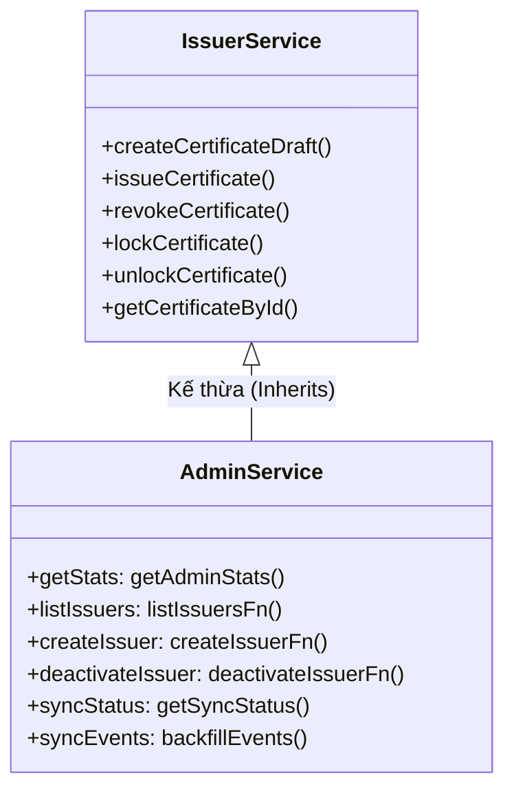
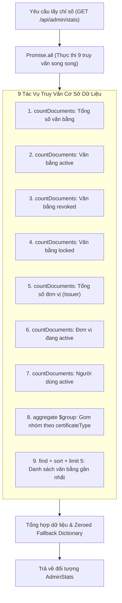

# Kiến Trúc Dịch Vụ Quản Trị và Phân Tích Dữ Liệu (Admin Service Architecture & Analytics)

Tài liệu này đặc tả chi tiết kiến trúc, mô hình kế thừa hướng đối tượng, cơ chế tối ưu hóa truy vấn song song và quy trình tổng hợp chỉ số thống kê của dịch vụ quản trị hệ thống tại [backend/src/services/admin.service.ts](file:///d:/VC_Blockchain/VC/backend/src/services/admin.service.ts).

---

## 1. Tổng Quan Kiến Trúc (Architecture Overview)

Trong giải pháp Verifiable Credentials, [admin.service.ts](file:///d:/VC_Blockchain/VC/backend/src/services/admin.service.ts) là trung tâm điều phối và quản trị cấp cao nhất của hệ thống. Dịch vụ này giải quyết hai bài toán then chốt:
1. **Phân tích và trực quan hóa chỉ số hệ thống (Dashboard Analytics)**: Thu thập, tổng hợp và phân loại toàn bộ dữ liệu văn bằng, đơn vị cấp phát và người dùng trong thời gian thực.
2. **Quản trị toàn quyền thông qua Kế thừa phân cấp (Hierarchical Service Inheritance)**: Quản trị viên (Super-Admin) kế thừa toàn bộ năng lực của đơn vị phát hành ([IssuerService](file:///d:/VC_Blockchain/VC/backend/src/services/issuer.service.ts)), đồng thời mở rộng thêm các quyền hạn quản lý đơn vị và giám sát đồng bộ Blockchain.



---

## 2. Mô Hình Kế Thừa Hướng Đối Tượng (Service Inheritance Pattern)

Thay vì tạo ra các lớp dịch vụ độc lập gây phân mảnh và trùng lặp mã nguồn, `AdminService` được thiết kế theo nguyên lý **Mở rộng vai trò (Role Specialization)**:

```typescript
export class AdminService extends IssuerService {
  getStats = getAdminStats;
  listIssuers = listIssuersFn;
  createIssuer = createIssuerFn;
  deactivateIssuer = deactivateIssuerFn;
  syncStatus = getSyncStatus;
  syncEvents = backfillEvents;
}
```

### Lợi ích kiến trúc:
- **Tái sử dụng 100% logic nghiệp vụ văn bằng**: Quản trị viên có thể trực tiếp thực hiện mọi thao tác của một Issuer (tạo nháp, phát hành, thu hồi, tải PDF) mà không cần viết lại mã nguồn hoặc gọi vòng qua các controller khác.
- **Tách biệt rõ ràng các mối quan tâm (Separation of Concerns)**: Các tác vụ quản trị chuyên biệt (như quản lý Issuer và đồng bộ Blockchain) được tổ chức thành các hàm chuyên trách (`issuer.service`, `sync.service`) và được gom lại thông qua `AdminService` theo mẫu Facade Pattern.

---

## 3. Phân Tích Logic Thu Thập Chỉ Số Thống Kê (`getAdminStats`)

Hàm `getAdminStats()` chịu trách nhiệm cung cấp dữ liệu tức thì cho Bảng điều khiển quản trị (Admin Dashboard).



### 3.1. Tối ưu hóa hiệu năng với `Promise.all`
Nếu thực thi 9 truy vấn MongoDB một cách tuần tự (Sequential `await`), thời gian phản hồi sẽ bằng tổng thời gian của từng truy vấn:
$$T_{\text{sequential}} = \sum_{i=1}^{9} t_i \approx 9 \times 15\text{ms} = 135\text{ms}$$

Bằng cách gom vào `Promise.all`, toàn bộ 9 câu lệnh được gửi đồng thời qua Connection Pool của Mongoose, giảm thời gian phản hồi xuống xấp xỉ thời gian của truy vấn chậm nhất:
$$T_{\text{parallel}} = \max(t_1, t_2, \dots, t_9) \approx 20\text{ms} - 35\text{ms}$$

### 3.2. Gom nhóm theo loại văn bằng với MongoDB Aggregation Pipeline
Truy vấn số lượng văn bằng theo từng loại (`degree`, `course`, `credit`, `other`) được thực hiện bằng một pipeline tối ưu:
```typescript
Certificate.aggregate<{ _id: CertificateType; count: number }>([
  { $group: { _id: "$certificateType", count: { $sum: 1 } } },
])
```

### 3.3. Cơ chế Khởi tạo giá trị mặc định (Zeroed Fallback Dictionary)
Khi hệ thống chưa có văn bằng thuộc một phân loại nào đó (ví dụ: chưa có chứng chỉ `credit`), kết quả của câu lệnh `$group` sẽ không chứa bản ghi cho loại đó. Nếu truyền trực tiếp về client, giao diện người dùng có thể gặp lỗi `undefined`.

Hàm giải quyết triệt để vấn đề này bằng cách khởi tạo trước bảng ánh xạ mặc định:
```typescript
const byType: Record<CertificateType, number> = {
  degree: 0,
  course: 0,
  credit: 0,
  other: 0,
};

for (const row of byTypeAgg) {
  byType[row._id] = row.count;
}
```

### 3.4. Chuẩn hóa dữ liệu ngày tháng (ISO 8601 Formatting)
Danh sách 5 văn bằng gần nhất được lấy qua `Certificate.find({}).sort({ issuedAt: -1 }).limit(5)`. Trường `issuedAt` (đối tượng Date của JavaScript) được chuẩn hóa thành chuỗi thời gian tiêu chuẩn quốc tế:
```typescript
issuedAt: cert.issuedAt.toISOString()
```

---

## 4. Ma Trận Chức Năng Của Lớp `AdminService`

| Thuộc tính / Phương thức | Nguồn gốc | Mô tả chức năng | Quyền hạn áp dụng |
| :--- | :--- | :--- | :--- |
| **`getStats`** | `getAdminStats` | Thống kê số lượng chứng chỉ, issuer, user và loại bằng | Chỉ dành cho Admin |
| **`listIssuers`** | `issuer.service.ts` | Tìm kiếm, phân trang và lọc danh sách đơn vị phát hành | Chỉ dành cho Admin |
| **`createIssuer`** | `issuer.service.ts` | Phê duyệt đơn vị mới kèm liên kết ví và tài khoản | Chỉ dành cho Admin |
| **`deactivateIssuer`** | `issuer.service.ts` | Vô hiệu hóa đơn vị trên DB và đối chiếu giao dịch chuỗi | Chỉ dành cho Admin |
| **`syncStatus`** | `sync.service.ts` | Xem trạng thái đồng bộ khối và mốc checkpoint | Chỉ dành cho Admin |
| **`syncEvents`** | `sync.service.ts` | Quét bù các sự kiện Blockchain từ quá khứ đến hiện tại | Chỉ dành cho Admin |
| **`createCertificateDraft`** | Kế thừa `IssuerService` | Tạo nháp hồ sơ văn bằng | Admin / Issuer |
| **`issueCertificate`** | Kế thừa `IssuerService` | Phát hành văn bằng lên Blockchain & IPFS | Admin / Issuer |
| **`revokeCertificate`** | Kế thừa `IssuerService` | Thu hồi văn bằng đã phát hành | Admin / Issuer sở hữu |

---

## 5. Thể Hiện Đơn Thể (Singleton Pattern)

Dịch vụ được xuất bản dưới dạng một thể hiện duy nhất:
```typescript
export const adminService = new AdminService();
```
Việc này đảm bảo:
- Không tạo thừa các đối tượng dịch vụ trong bộ nhớ.
- Dễ dàng tiêm phụ thuộc (Dependency Injection) hoặc mock trong môi trường kiểm thử Jest (`jest.mock("../services/admin.service")`).

---

## 6. Kiểm Thử Đơn Vị Liên Quan

Quy trình thống kê của dịch vụ này được kiểm thử toàn diện tại [backend/src/services/__tests__/admin.service.test.ts](file:///d:/VC_Blockchain/VC/backend/src/services/__tests__/admin.service.test.ts), bao gồm:
- Kiểm tra tính toán chính xác các chỉ số đa chiều và danh sách văn bằng gần đây.
- Kiểm tra cơ chế khởi tạo giá trị 0 khi cơ sở dữ liệu trống.
