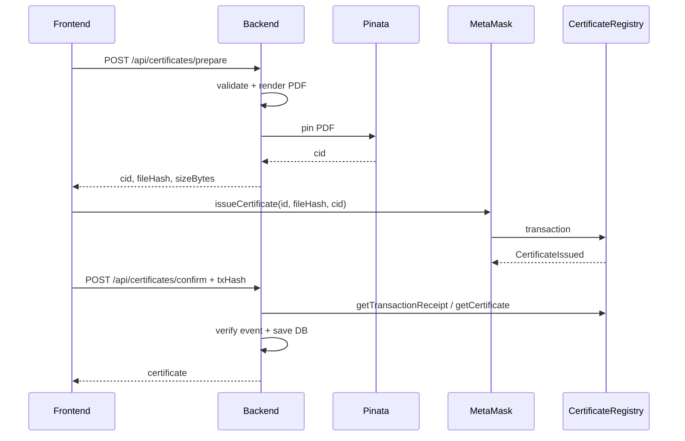

# API Reference — Verify Certification

> Backend Express + TypeScript. Mọi response dùng chung một envelope.
>
> Base URL dev: `http://localhost:4000` · Production: `https://<render-service>.onrender.com`

---

## 1. Quy ước chung

### 1.1 Response thành công

```json
{
  "success": true,
  "data": {}
}
```

Danh sách có thêm `meta`:

```json
{
  "success": true,
  "data": [],
  "meta": {
    "page": 1,
    "limit": 20,
    "total": 1,
    "totalPages": 1
  }
}
```

### 1.2 Response lỗi

```json
{
  "success": false,
  "error": {
    "code": "VALIDATION_ERROR",
    "message": "Dữ liệu không hợp lệ",
    "details": []
  }
}
```

### 1.3 Authentication

Gửi JWT trong header:

```http
Authorization: Bearer <token>
```

Lấy token từ `POST /api/auth/login`.

### 1.4 Role

| Role | Quyền |
|---|---|
| `issuer` | Tạo PDF, cấp chứng chỉ, xem/thu hồi chứng chỉ của mình |
| `admin` | Toàn bộ quyền issuer + quản lý issuer, xem tất cả chứng chỉ, thu hồi khẩn cấp, sync chain |

### 1.5 Mã lỗi

| Code | HTTP | Ý nghĩa |
|---|---|---|
| `VALIDATION_ERROR` | 400 | Body/query sai schema |
| `UNAUTHORIZED` | 401 | Thiếu/sai/hết hạn token |
| `FORBIDDEN` | 403 | Sai role hoặc không sở hữu tài nguyên |
| `NOT_FOUND` | 404 | Route không tồn tại |
| `USER_NOT_FOUND` | 404 | Không tìm thấy user |
| `CERTIFICATE_NOT_FOUND` | 404 | Không tìm thấy chứng chỉ |
| `ISSUER_EXISTS` | 409 | Mã issuer đã tồn tại |
| `WALLET_IN_USE` | 409 | Ví đã gắn tài khoản/issuer khác |
| `EMAIL_IN_USE` | 409 | Email đã dùng cho tài khoản khác |
| `CERTIFICATE_EXISTS` | 409 | Mã chứng chỉ đã tồn tại |
| `HASH_EXISTS` | 409 | File hash đã được cấp |
| `ALREADY_REVOKED` | 409 | Chứng chỉ đã thu hồi |
| `TX_INVALID` | 422 | Tx/receipt/event không khớp |
| `ISSUER_NOT_ACTIVE` | 422 | Issuer chưa active on-chain |
| `UPLOAD_INVALID` | 400 | File sai định dạng/quá lớn |
| `PINATA_ERROR` | 502 | Pinata lỗi |
| `CHAIN_ERROR` | 502 | RPC/contract lỗi |
| `RATE_LIMITED` | 429 | Quá nhiều lần đăng nhập |
| `INTERNAL_ERROR` | 500 | Lỗi server |

---

## 2. Health

### `GET /api/health`

Public. Dùng cho Render health check.

**200 OK**

```json
{
  "success": true,
  "data": {
    "status": "ok",
    "db": "connected",
    "blockNumber": 11952894,
    "chainId": 11155111,
    "contract": "0xE939E96E210A4eC13eF85F45193022e5b235fA56",
    "deployBlock": 11953245,
    "uptimeSeconds": 120,
    "timestamp": "2026-10-19T08:00:00.000Z"
  }
}
```

Trả `503` nếu DB hoặc RPC không sẵn sàng.

---

## 3. Auth

### `POST /api/auth/login`

Public. Rate limit **5 lần/phút/IP**.

**Body**

```json
{
  "email": "issuer@verifycert.local",
  "password": "Issuer@123456"
}
```

**200 OK**

```json
{
  "success": true,
  "data": {
    "token": "eyJ...",
    "user": {
      "id": "6ad6...",
      "email": "issuer@verifycert.local",
      "displayName": "Khoa Công nghệ Thông tin",
      "role": "issuer",
      "walletAddress": "0xf009863379f6b0056c1d828fde2827fd94202a1b"
    }
  }
}
```

Sai mật khẩu → `401 UNAUTHORIZED`.

### `GET /api/auth/me`

Cần Bearer token.

**200 OK**

```json
{
  "success": true,
  "data": {
    "user": {
      "id": "6ad6...",
      "email": "issuer@verifycert.local",
      "displayName": "Khoa Công nghệ Thông tin",
      "role": "issuer",
      "walletAddress": "0xf009863379f6b0056c1d828fde2827fd94202a1b"
    }
  }
}
```

---

## 4. Issuers — admin

### `GET /api/issuers`

Admin.

**Query**

| Field | Kiểu | Mặc định | Ghi chú |
|---|---|---|---|
| `q` | string | — | Tìm theo tên/mã/ví |
| `active` | boolean | — | `true` / `false` |
| `page` | number | 1 | |
| `limit` | number | 20 | Tối đa 100 |

**200 OK**

```json
{
  "success": true,
  "data": [
    {
      "id": "6ad6...",
      "name": "Khoa Công nghệ Thông tin",
      "code": "CNTT",
      "walletAddress": "0xf009863379f6b0056c1d828fde2827fd94202a1b",
      "logoUrl": null,
      "website": null,
      "isActive": true,
      "onChainActive": true
    }
  ],
  "meta": { "page": 1, "limit": 20, "total": 1, "totalPages": 1 }
}
```

### `POST /api/issuers`

Admin. Lưu issuer **sau khi** đã gọi `addIssuer` on-chain.

**Body**

```json
{
  "name": "Khoa Công nghệ Thông tin",
  "code": "CNTT",
  "walletAddress": "0xf009863379F6B0056C1D828fDE2827fD94202a1B",
  "email": "issuer@fit.uit.edu.vn",
  "password": "StrongPass123",
  "txHash": "0x64fe83cf267a0c390be06c5ea0abfd32627f8211d8c7e435c46048ad72ac3b9c",
  "logoUrl": null,
  "website": null
}
```

Truyền **một trong hai**:

- `email` + `password`: backend tự tạo User role `issuer` và gán ví.
- `userId`: gán issuer cho User đã tồn tại (User phải role `issuer`, chưa gắn ví khác).

Không truyền đồng thời cả hai. Mật khẩu tối thiểu 8 ký tự.

Backend kiểm tra:

1. Mã/ví chưa tồn tại.
2. Ví chưa thuộc user khác.
3. Event `IssuerUpdated` khớp `issuer`, `name`, `active = true`.
4. `getIssuer()` on-chain đang active.
5. Tạo User issuer mới (nếu dùng `email`/`password`) hoặc dùng User có sẵn (`userId`).
6. Tạo issuer + gán ví cho user.

**201 Created**

```json
{
  "success": true,
  "data": {
    "id": "6ad6...",
    "name": "Khoa Công nghệ Thông tin",
    "code": "CNTT",
    "walletAddress": "0xf009863379f6b0056c1d828fde2827fd94202a1b",
    "logoUrl": null,
    "website": null,
    "isActive": true,
    "onChainActive": true
  }
}
```

---

## 5. Upload IPFS

### `POST /api/uploads`

Issuer đang active. `multipart/form-data`.

| Field | Kiểu | Bắt buộc |
|---|---|---|
| `file` | PDF / PNG / JPEG | ✅ |

Giới hạn: `MAX_FILE_SIZE_MB` (mặc định 10MB).

Backend:

1. Kiểm tra magic bytes, không tin `Content-Type`.
2. Tính SHA-256.
3. Pin Pinata.
4. Trả CID + hash.

**200 OK**

```json
{
  "success": true,
  "data": {
    "cid": "QmUtYcoXUvXcWyAY7wBWHupxfPH4AKADKFeQK5DnbAKN8A",
    "fileHash": "sha256:ad58bbb325d3f3dd08096d1651d7b2610c4bc49e70362e46757a13950a3fd29d",
    "sizeBytes": 497,
    "mimeType": "application/pdf",
    "filename": "cert.pdf"
  }
}
```

---

## 6. Certificates — issuer

### `POST /api/certificates/prepare`

Issuer đang active. Sinh PDF từ template, tính hash, pin IPFS. **Không ghi DB.**

**Body — degree**

```json
{
  "certificateType": "degree",
  "certificateId": "UIT-DEG-2026-0002",
  "studentName": "Nguyễn Văn An",
  "studentCode": "2311095",
  "details": {
    "degreeTitle": "Cử nhân",
    "major": "Kỹ thuật phần mềm",
    "graduationYear": 2026,
    "gpa": 3.45,
    "classification": "Giỏi",
    "studyMode": "Chính quy"
  }
}
```

Body cho `course`, `credit`, `other` xem [certificate-template-plan.md](certificate-template-plan.md).

**201 Created**

```json
{
  "success": true,
  "data": {
    "cid": "QmTT4XqhZYAo8u3yE59SAEgSAjXQS5EDCbsvkt4Jq7EtPb",
    "fileHash": "sha256:d2ce22c815831cffd00a610943b6c3deb38fbe14671e761ddc45ec234065e91c",
    "sizeBytes": 34499,
    "templateId": "degree-v1",
    "templateVersion": "1.0.0",
    "filename": "UIT-DEG-2026-0002.pdf"
  }
}
```

Sau đó dùng `fileHash` + `cid` để ký `issueCertificate` on-chain.

### `POST /api/certificates/confirm`

Alias của `POST /api/certificates`. Issuer đang active.

Lưu metadata **sau khi** tx confirmed.

**Body**

```json
{
  "certificateType": "degree",
  "certificateId": "UIT-DEG-2026-0002",
  "studentName": "Nguyễn Văn An",
  "studentCode": "2311095",
  "details": {
    "degreeTitle": "Cử nhân",
    "major": "Kỹ thuật phần mềm",
    "graduationYear": 2026,
    "gpa": 3.45,
    "classification": "Giỏi",
    "studyMode": "Chính quy"
  },
  "fileHash": "sha256:d2ce...",
  "ipfsCid": "QmTT...",
  "artifactType": "pdf",
  "mimeType": "application/pdf",
  "filename": "UIT-DEG-2026-0002.pdf",
  "sizeBytes": 34499,
  "templateId": "degree-v1",
  "templateVersion": "1.0.0",
  "txHash": "0x35995c93d4969fc2c3543212339171eebd4c23791eebceaee504c971bf4787b6"
}
```

Backend xác minh event `CertificateIssued`:

- `certificateId` khớp
- `fileHash` khớp
- `issuer` = ví issuer đang đăng nhập
- log phát ra từ đúng contract

**201 Created**

```json
{
  "success": true,
  "data": {
    "certificateId": "UIT-DEG-2026-0002",
    "certificateType": "degree",
    "studentName": "Nguyễn Văn An",
    "studentCode": "2311095",
    "status": "active",
    "issuedAt": "2026-10-19T08:00:00.000Z",
    "txHash": "0x3599...",
    "revokedAt": null,
    "revokeTxHash": null
  }
}
```

### `POST /api/certificates`

Tương tự `/confirm`; giữ để tương thích.

### `GET /api/certificates`

Issuer đang active. Chỉ trả chứng chỉ do issuer đó cấp.

**Query**: `q`, `status`, `type`, `page`, `limit`.

### `GET /api/certificates/:id`

Issuer sở hữu hoặc admin.

**200 OK** trả `CertificateIssuerDTO`.

### `POST /api/certificates/:id/revoke`

Issuer đã cấp hoặc admin.

**Body**

```json
{ "txHash": "0x..." }
```

Điều kiện:

- Tx ký bằng ví issuer đã cấp **hoặc** ví owner/admin.
- Event `CertificateRevoked` có `idHash` khớp.
- `getCertificate()` on-chain trả `isRevoked = true`.

**200 OK** trả certificate với `status: "revoked"`.

---

## 7. Public

Không cần auth.

### `GET /api/public/certificates`

Tìm kiếm công khai.

**Query**

| Field | Kiểu | Ghi chú |
|---|---|---|
| `q` | string | Tên, MSSV, mã chứng chỉ |
| `year` | number | Năm tốt nghiệp |
| `major` | string | Ngành |
| `type` | enum | `degree\|course\|credit\|other` |
| `status` | enum | `active\|revoked` |
| `studentCode` | string | MSSV chính xác |
| `page` | number | Mặc định 1 |
| `limit` | number | Mặc định 20 |

**200 OK**

```json
{
  "success": true,
  "data": [
    {
      "certificateId": "UIT-DEG-2026-0001",
      "certificateType": "degree",
      "studentName": "Nguyễn Văn An",
      "studentCode": "2311095",
      "major": "Kỹ thuật phần mềm",
      "graduationYear": 2026,
      "gpa": 3.45,
      "classification": "Giỏi",
      "issuedAt": "2026-10-19T08:00:00.000Z",
      "status": "active",
      "verifyUrl": "/c/UIT-DEG-2026-0001"
    }
  ],
  "meta": { "page": 1, "limit": 20, "total": 1, "totalPages": 1 }
}
```

### `GET /api/public/certificates/recent?limit=6`

Widget recent. Che PII:

```json
{
  "certificateId": "UIT-DEG-2026-0001",
  "studentNameMasked": "Nguyễn V. A.",
  "studentCodeMasked": "2311***",
  "major": "Kỹ thuật phần mềm",
  "graduationYear": 2026,
  "issuedAt": "2026-10-19T08:00:00.000Z",
  "status": "active",
  "txHash": "0x...",
  "blockNumber": 11952840
}
```

### `GET /api/public/certificates/:id`

Trang `/c/[id]`.

Trạng thái lấy từ chain, không tin DB cache.

**200 OK**: `CertificateDetailDTO`, gồm `details`, `ipfsCid`, `txHash`, `statusSource: "chain"`.

### `GET /api/public/verify?hash=sha256:...`

Xác thực file hash.

**200 OK**

```json
{
  "success": true,
  "data": {
    "exists": true,
    "valid": true,
    "certificateId": "UIT-DEG-2026-0001",
    "issuer": "0xf009...",
    "issuedAt": "2026-10-19T08:00:00.000Z",
    "certificate": {}
  }
}
```

Hash không tồn tại:

```json
{
  "exists": false,
  "valid": false,
  "certificateId": null,
  "issuer": null,
  "issuedAt": null,
  "certificate": null
}
```

### `GET /api/public/filters`

```json
{
  "success": true,
  "data": {
    "years": [2026],
    "majors": ["Kỹ thuật phần mềm"],
    "types": ["degree"]
  }
}
```

---

## 8. Admin

Tất cả yêu cầu role `admin`.

### `GET /api/admin/stats`

```json
{
  "success": true,
  "data": {
    "certificates": { "total": 1, "active": 1, "revoked": 0 },
    "issuers": { "total": 1, "active": 1 },
    "users": 2,
    "byType": { "degree": 1, "course": 0, "credit": 0, "other": 0 },
    "recent": [
      {
        "certificateId": "UIT-DEG-2026-0001",
        "studentName": "Nguyễn Văn An",
        "studentCode": "2311095",
        "certificateType": "degree",
        "status": "active",
        "issuedAt": "2026-10-19T08:00:00.000Z"
      }
    ]
  }
}
```

### `GET /api/admin/certificates`

Query: `q`, `status`, `type`, `issuerWallet`, `year`, `page`, `limit`.

Trả toàn bộ chứng chỉ, không giới hạn theo issuer.

### `GET /api/admin/certificates/:id`

Chi tiết bất kỳ chứng chỉ.

### `POST /api/admin/certificates/:id/revoke`

Thu hồi khẩn cấp. Body `{ "txHash": "0x..." }`.

Tx phải được ký bằng ví owner/admin.

### `GET /api/admin/sync/status`

```json
{
  "success": true,
  "data": {
    "key": "certificate_registry",
    "lastSyncedBlock": 11952894,
    "currentBlock": 11952894,
    "contractAddress": "0x156...",
    "chainId": 11155111
  }
}
```

### `POST /api/admin/sync`

Backfill thủ công.

**Body** (optional)

```json
{
  "fromBlock": 11952880,
  "toBlock": 11952890
}
```

**200 OK**

```json
{
  "success": true,
  "data": {
    "fromBlock": 11952880,
    "toBlock": 11952890,
    "processed": 0,
    "issued": 0,
    "revoked": 0,
    "issuers": 0,
    "skipped": 0
  }
}
```

---

## 9. Luồng cấp chứng chỉ



---

## 10. Ghi chú tích hợp

- Backend **không ký tx**; mọi tx do MetaMask của issuer/admin ký.
- `tx.to` có thể là forwarder; backend kiểm tra **log address** là contract.
- `POST /prepare` không ghi DB; nếu hủy, file vẫn nằm trên IPFS.
- `certificateId` phải đúng prefix: `UIT-DEG`, `UIT-CRS`, `UIT-CRE`, `UIT-OTH`.
- Không đưa PII không cần thiết vào PDF hoặc chain.
