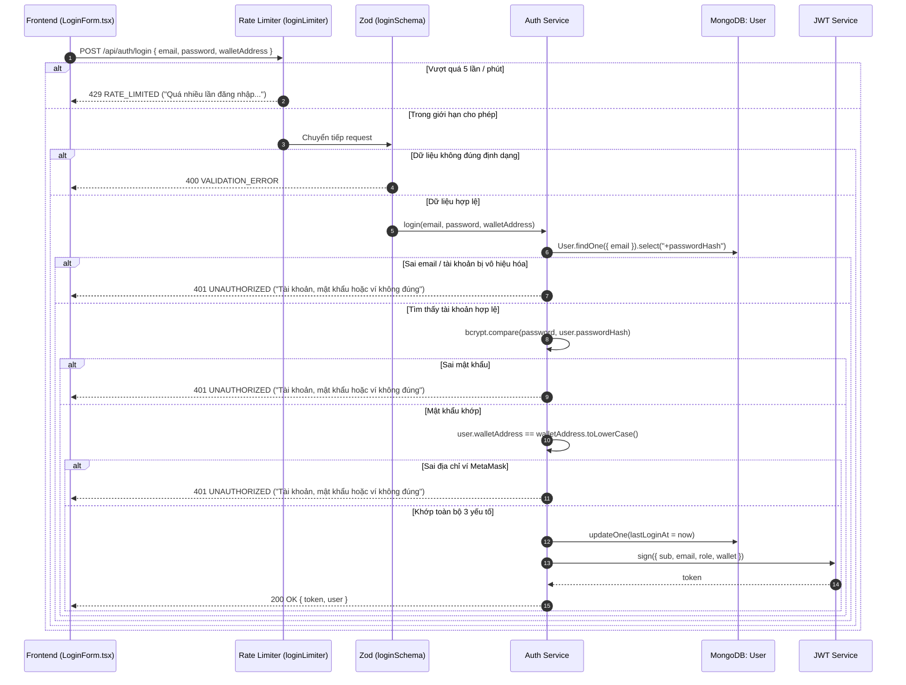

# Đặc tả Kiến trúc & Logic Tuyến đường Xác thực (`backend/src/routes/auth.routes.ts`)

Tài liệu này mô tả chi tiết kiến trúc xác thực lai (Hybrid Web2 + Web3), cơ chế phòng thủ chống tấn công Brute-force, đặc tả các API endpoints và phân tích mã nguồn của tệp tin [`backend/src/routes/auth.routes.ts`](file:///d:/VC_Blockchain/VC/backend/src/routes/auth.routes.ts).

---

## 1. Tổng quan Module Xác thực

Tệp tin `auth.routes.ts` định nghĩa các điểm cuối API phục vụ công tác **Xác thực danh tính (Authentication)** và **Quản lý phiên làm việc (Session Management)** cho toàn bộ người dùng có đặc quyền trong hệ thống (gồm Quản trị viên trường học và Cán bộ đơn vị cấp văn bằng).

### Thông số kỹ thuật cốt lõi:
- **Tiền tố đường dẫn (Base Path)**: `/api/auth` (được gắn tại [`backend/src/app.ts`](file:///d:/VC_Blockchain/VC/backend/src/app.ts)).
- **Cơ chế nhận diện**: Kết hợp mật khẩu băm (`bcryptjs`) và địa chỉ ví Ethereum (`MetaMask`).
- **Cơ chế cấp quyền**: Cấp mã truy cập JSON Web Token (`JWT`) có thời hạn (mặc định 24h).
- **Hàng rào phòng vệ**: Giới hạn tần suất gọi API (`express-rate-limit`) ngăn chặn tấn công tự động.

---

## 2. Kiến trúc Xác thực Lai (Hybrid Web2 + Web3 Authentication)

Khác với các ứng dụng Web thông thường chỉ dựa vào mật khẩu hoặc ứng dụng DApp thuần túy chỉ dựa vào ví, hệ thống triển khai mô hình **Xác thực Lai Đa yếu tố**:



### Các lớp phòng thủ an ninh:
1. **Phòng chống Brute-force & Credential Stuffing**:
   - `loginLimiter` giới hạn tối đa 5 lần gửi yêu cầu trong vòng 1 phút trên mỗi địa chỉ IP. Khi vượt ngưỡng, hệ thống lập tức trả về `429 Too Many Requests`.
2. **Chống dò quét tài khoản (Anti-Enumeration)**:
   - Dù sai email (tài khoản không tồn tại), sai mật khẩu, hay địa chỉ ví MetaMask không khớp, backend **luôn trả về cùng một thông báo lỗi duy nhất**: *"Tài khoản, mật khẩu hoặc ví không đúng"*.
   - Kẻ tấn công không thể phân biệt được lỗi do sai mật khẩu hay do email không tồn tại.

---

## 3. Đặc tả Chi tiết các Endpoint

Module cung cấp 2 endpoints trọng yếu:

### 3.1. `POST /api/auth/login` (Đăng nhập hệ thống)
- **Mục đích**: Xác thực người dùng và cấp phát JWT token.
- **Middleware áp dụng**: `loginLimiter`.
- **Dữ liệu gửi lên (Request Body)**:
  ```json
  {
    "email": "admin@uit.edu.vn",
    "password": "SuperSecretPassword123@",
    "walletAddress": "0x1234567890abcdef1234567890abcdef12345678"
  }
  ```
- **Ràng buộc Zod Schema (`loginSchema`)**:
  - `email`: Chuẩn hóa email, tự động chuyển về chữ thường, tối đa 150 ký tự.
  - `password`: Tối thiểu 8 ký tự, tối đa 128 ký tự.
  - `walletAddress`: Định dạng 40 ký tự hex bắt đầu bằng `0x`, tự động chuyển về chữ thường.
- **Dữ liệu phản hồi thành công (Response 200 OK)**:
  ```json
  {
    "success": true,
    "data": {
      "token": "eyJhbGciOiJIUzI1NiIsInR5cCI6IkpXVCJ9...",
      "user": {
        "id": "67a3f81e8b23c91d4e5f6a7b",
        "email": "admin@uit.edu.vn",
        "displayName": "Phòng Quản lý Đào tạo",
        "role": "admin",
        "walletAddress": "0x1234567890abcdef1234567890abcdef12345678"
      }
    }
  }
  ```

---

### 3.2. `GET /api/auth/me` (Lấy hồ sơ người dùng hiện tại)
- **Mục đích**: Kiểm tra tính hợp lệ của token và lấy thông tin hồ sơ tài khoản mới nhất từ cơ sở dữ liệu.
- **Middleware áp dụng**: `requireAuth`.
- **Yêu cầu Headers**: `Authorization: Bearer <JWT_TOKEN>`.
- **Ứng dụng thực tế trên Frontend**:
  - Khi người dùng bấm F5 hoặc mở lại trình duyệt, Frontend gọi endpoint này để khôi phục trạng thái phiên đăng nhập (`useAuth.tsx`), cập nhật quyền hạn `admin` hoặc `issuer` trên thanh điều hướng.
- **Dữ liệu phản hồi (Response 200 OK)**:
  ```json
  {
    "success": true,
    "data": {
      "user": {
        "id": "67a3f81e8b23c91d4e5f6a7b",
        "email": "admin@uit.edu.vn",
        "displayName": "Phòng Quản lý Đào tạo",
        "role": "admin",
        "walletAddress": "0x1234567890abcdef1234567890abcdef12345678"
      }
    }
  }
  ```

---

## 4. Mã nguồn Đầy đủ có Chú thích Chi tiết

Dưới đây là mã nguồn của [`backend/src/routes/auth.routes.ts`](file:///d:/VC_Blockchain/VC/backend/src/routes/auth.routes.ts) với hệ thống chú thích đầy đủ:

```typescript
import { Router } from "express";
import rateLimit from "express-rate-limit";
import {
  loginController,
  meController,
} from "../controllers/auth.controller";
import { requireAuth } from "../middleware/auth";

/**
 * Express Router quản lý các tuyến đường Xác thực & Phiên làm việc (Authentication & Session).
 *
 * Tiền tố đường dẫn (Base Path): `/api/auth` (được gắn tại `backend/src/app.ts`).
 *
 * Chức năng cốt lõi:
 * 1. Đăng nhập hệ thống (POST /login): Xác thực tài khoản kết hợp đa yếu tố (Email + Mật khẩu + Địa chỉ ví).
 * 2. Lấy thông tin phiên làm việc hiện tại (GET /me): Xác thực token JWT và trả về hồ sơ người dùng.
 */
const router = Router();

/**
 * Middleware giới hạn tần suất gọi API đăng nhập (Rate Limiter).
 *
 * Biện pháp phòng vệ chống tấn công:
 * - Brute-force: Ngăn chặn dò mật khẩu tự động.
 * - Credential Stuffing: Ngăn chặn thử danh sách tài khoản bị rò rỉ trên diện rộng.
 * - Quy định: Tối đa 5 lần thử đăng nhập thất bại trong cửa sổ thời gian 1 phút (60,000ms) trên mỗi IP.
 */
const loginLimiter = rateLimit({
  windowMs: 60_000, // Cửa sổ giới hạn: 1 phút
  limit: 5, // Tối đa 5 yêu cầu / 1 phút / IP
  standardHeaders: true, // Trả về thông tin giới hạn trong headers `RateLimit-*` chuẩn RFC
  legacyHeaders: false, // Tắt các header cũ `X-RateLimit-*`
  message: {
    success: false,
    error: {
      code: "RATE_LIMITED",
      message: "Quá nhiều lần đăng nhập, thử lại sau 1 phút",
    },
  },
});

// -----------------------------------------------------------------------------
// ĐỊNH TUYẾN (ROUTE DEFINITIONS)
// -----------------------------------------------------------------------------

/**
 * POST /api/auth/login
 * Đăng nhập vào hệ thống dành cho Quản trị viên (Admin) và Cán bộ đơn vị cấp (Issuer):
 * - Được bảo vệ bởi `loginLimiter` chống tấn công brute-force.
 * - Yêu cầu Request Body hợp lệ theo `loginSchema`: { email, password, walletAddress }.
 * - Kiểm tra khớp cả 3 yếu tố: tài khoản tồn tại, mật khẩu bcrypt đúng và ví MetaMask khớp với hồ sơ.
 * - Trả về mã JWT Token (thời hạn 24h) và thông tin cơ bản của User (DTO).
 */
router.post("/login", loginLimiter, loginController);

/**
 * GET /api/auth/me
 * Lấy thông tin tài khoản người dùng đang đăng nhập:
 * - Được bảo vệ bởi `requireAuth`: bắt buộc gửi kèm Header `Authorization: Bearer <JWT_TOKEN>`.
 * - Giải mã JWT để lấy user id, sau đó truy vấn DB để trả về thông tin mới nhất của người dùng.
 * - Dùng để khôi phục phiên đăng nhập khi người dùng tải lại trang trên giao diện Frontend.
 */
router.get("/me", requireAuth, meController);

export { router as authRouter };
```

---

## 5. Tổng kết

Module `auth.routes.ts` thiết lập nền tảng bảo mật cho toàn bộ hệ thống bằng việc kết hợp **xác thực mật khẩu truyền thống** với **địa chỉ ví Web3**, bảo vệ chống các kỹ thuật tấn công brute-force thông qua **Rate Limiting** và ngăn chặn rò rỉ thông tin người dùng với cơ chế **Anti-Enumeration**. Đây là điểm tựa an toàn cho mọi giao dịch và quyền hạn trên hệ thống văn bằng blockchain.
