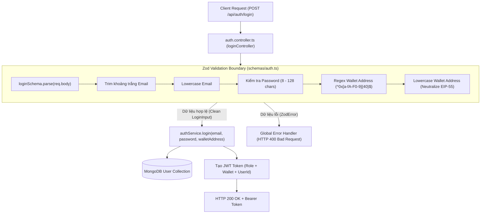

# Kiến Trúc và Logic Xác Thực Dữ Liệu Đăng Nhập (Auth Schema Validation)

Tài liệu này đặc tả chi tiết kiến trúc, các quy tắc bảo mật (Security Invariants), quy trình làm sạch/chuẩn hóa dữ liệu (Sanitization & Normalization Pipeline) và suy diễn kiểu tĩnh (Static Type Inference) được cài đặt tại [backend/src/schemas/auth.ts](file:///d:/VC_Blockchain/VC/backend/src/schemas/auth.ts).

---

## 1. Tổng Quan Kiến Trúc (Architecture Overview)

Hệ thống Verifiable Credentials áp dụng mô hình định danh kết hợp **Hybrid Authentication (Web2 + Web3)**:
- Người dùng đăng nhập không chỉ bằng cặp thông tin Web2 truyền thống (`email` + `password`), mà còn bắt buộc phải cung cấp địa chỉ ví Blockchain (`walletAddress`).
- Việc kết hợp này đảm bảo quyền phát hành hoặc quản trị chứng chỉ số luôn gắn liền với một khóa công khai (Public Key / EVM Address) nhất quán trên mạng lưới Blockchain.



---

## 2. Chi Tiết Các Quy Tắc Xác Thực (Field-Level Validation & Invariants)

### 2.1. Trường `email`
```typescript
email: z
  .string()
  .trim()
  .email("Email không hợp lệ")
  .max(150)
  .transform((value) => value.toLowerCase())
```
- **`.string()` & `.trim()`**: Đảm bảo kiểu dữ liệu là chuỗi và loại bỏ mọi khoảng trắng vô tình bị chèn vào ở đầu hoặc cuối khi người dùng sao chép/dán.
- **`.email("Email không hợp lệ")`**: Kiểm tra định dạng tuân thủ quy chuẩn RFC email, ngăn chặn các chuỗi không phải địa chỉ thư điện tử.
- **`.max(150)`**: Giới hạn độ dài tối đa 150 ký tự, ngăn chặn các cuộc tấn công DoS / ReDoS thông qua các chuỗi email dài bất thường.
- **`.transform((value) => value.toLowerCase())`**: Chuyển toàn bộ ký tự thành chữ thường. Điều này cực kỳ quan trọng vì hệ thống cơ sở dữ liệu MongoDB phân biệt chữ hoa/chữ thường khi truy vấn (ví dụ: `Admin@uit.edu.vn` và `admin@uit.edu.vn` sẽ được chuẩn hóa đồng nhất về `admin@uit.edu.vn`).

---

### 2.2. Trường `password`
```typescript
password: z.string().min(8, "Mật khẩu tối thiểu 8 ký tự").max(128)
```
- **`.min(8, "Mật khẩu tối thiểu 8 ký tự")`**: Thiết lập chính sách bảo mật cơ bản, từ chối các mật khẩu quá ngắn dễ bị vét cạn (brute-force) hoặc tấn công từ điển (dictionary attack).
- **`.max(128)`**: Giới hạn độ dài tối đa 128 ký tự. 
  > [!IMPORTANT]
  > **Phòng chống tấn công Bcrypt Denial of Service (DoS):**
  > Thuật toán băm mật khẩu `bcrypt` tiêu tốn tài nguyên CPU theo hàm số mũ khi chuỗi đầu vào quá lớn (mặc dù bcrypt chỉ xử lý 72 bytes đầu tiên nhưng hàm xử lý trước có thể làm nghẽn Event Loop). Việc chặn sớm ở 128 ký tự tại tầng schema bảo vệ server trước các payload cố ý gây quá tải CPU.

---

### 2.3. Trường `walletAddress`
```typescript
walletAddress: z
  .string()
  .trim()
  .regex(/^0x[a-fA-F0-9]{40}$/, "Địa chỉ ví không hợp lệ")
  .transform((value) => value.toLowerCase())
```
- **`.regex(/^0x[a-fA-F0-9]{40}$/)`**: Kiểm tra chặt chẽ cấu trúc địa chỉ ví Ethereum (EVM standard): bắt đầu bằng tiền tố `0x` và theo sau bởi chính xác 40 ký tự thập lục phân (hexadecimal, không phân biệt hoa thường).
- **`.transform((value) => value.toLowerCase())`**:
  - Chuẩn hóa toàn bộ địa chỉ về dạng chữ thường.
  - Loại bỏ hoàn toàn sự không đồng nhất giữa định dạng địa chỉ thường và định dạng Checksum EIP-55 (ví dụ: `0x9B8DF93F...` chuyển thành `0x9b8df93f...`).
  - Giúp việc so sánh giữa địa chỉ ví của User trong database và địa chỉ ví ký giao dịch trên Smart Contract luôn chính xác 100%.

---

## 3. Suy Diễn Kiểu Tĩnh (Static Type Inference)

```typescript
export type LoginInput = z.infer<typeof loginSchema>;
```

Thông qua tính năng `z.infer`, TypeScript tự động tạo ra interface kiểu dữ liệu tĩnh:

```typescript
type LoginInput = {
  email: string;
  password: string;
  walletAddress: string;
};
```

Bất kỳ thay đổi nào trong `loginSchema` sẽ ngay lập tức được phản ánh vào kiểu `LoginInput` mà không cần phải bảo trì thủ công một file `types/auth.d.ts` riêng biệt.

---

## 4. Minh Họa Quy Trình Làm Sạch Dữ Liệu (Transformation Demo)

Bảng đối chiếu dữ liệu thô người dùng gửi lên và dữ liệu đã qua xử lý bởi `loginSchema.parse()`:

| Trường | Dữ liệu đầu vào (Raw Input) | Dữ liệu sau chuẩn hóa (Parsed Output) | Thao tác thực hiện |
| :--- | :--- | :--- | :--- |
| `email` | `"  Admin@VerifyCert.Local  "` | `"admin@verifycert.local"` | Trim khoảng trắng + Lowercase |
| `password` | `"Admin@123456"` | `"Admin@123456"` | Kiểm tra độ dài 8–128 ký tự |
| `walletAddress` | `"0x9B8DF93F172AAEB67C31BE257C9E4A55A8DF1B3B"` | `"0x9b8df93f172aaeb67c31be257c9e4a55a8df1b3b"` | Regex EVM 42 ký tự + Lowercase |

---

## 5. Kiểm Thử Đơn Vị (Unit Testing)

Bộ schema này được kiểm thử toàn diện tại file [backend/src/schemas/__tests__/auth.test.ts](file:///d:/VC_Blockchain/VC/backend/src/schemas/__tests__/auth.test.ts), bao gồm 3 trường hợp:
1. **Kiểm tra chuẩn hóa**: Xác minh email và walletAddress được trim và lowercase chính xác.
2. **Kiểm tra bắt buộc**: safeParse trả về `success: false` khi thiếu `walletAddress`.
3. **Kiểm tra định dạng ví**: safeParse trả về `success: false` khi chuỗi `walletAddress` không đúng chuẩn EVM.
