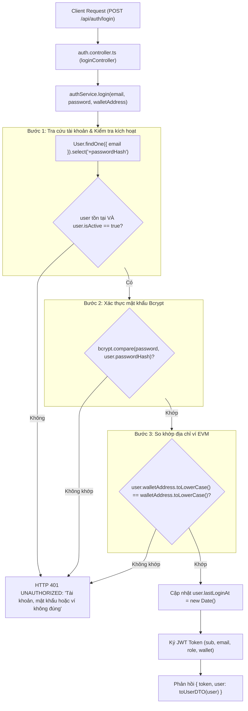

# Kiến Trúc Dịch Vụ Xác Thực và An Ninh Định Danh (Auth Service Architecture & Security)

Tài liệu này đặc tả chi tiết kiến trúc bảo mật, mô hình định danh kết hợp Web2 & Web3 (Hybrid Dual-Identity Authentication), cơ chế phòng chống tấn công dò quét người dùng (Anti-User Enumeration) và quản lý phiên làm việc không trạng thái (Stateless JWT Session) tại [backend/src/services/auth.service.ts](file:///d:/VC_Blockchain/VC/backend/src/services/auth.service.ts).

---

## 1. Tổng Quan Kiến Trúc (Architecture Overview)

Trong hệ thống chứng thực số Verifiable Credentials, việc bảo vệ tài khoản của Đơn vị cấp phát (Issuer) và Quản trị viên (Admin) đòi hỏi mức độ an toàn cao hơn nhiều so với các ứng dụng Web thông thường. Kẻ tấn công nếu chiếm đoạt được tài khoản Issuer có thể phát hành văn bằng giả mạo hoặc phá hoại tính toàn vẹn của dữ liệu học tập.

Do đó, [auth.service.ts](file:///d:/VC_Blockchain/VC/backend/src/services/auth.service.ts) được thiết kế theo mô hình **Định danh kép 3 yếu tố (3-Factor Dual-Identity)**:
1. **Yếu tố 1 (Định danh Web2)**: Tài khoản thư điện tử (`email`).
2. **Yếu tố 2 (Bí mật Web2)**: Mật khẩu người dùng được băm qua thuật toán Bcrypt (`password`).
3. **Yếu tố 3 (Sở hữu Web3)**: Địa chỉ ví cá nhân Ethereum (`walletAddress`) đã được liên kết và ủy quyền trên Smart Contract.



---

## 2. Phân Tích Các Cơ Chế Bảo Mật Chuyên Sâu

### 2.1. Phòng chống tấn công dò quét tài khoản (Anti-User Enumeration)
Trong nhiều hệ thống bảo mật kém, máy chủ thường trả về các thông điệp lỗi khác nhau:
- *"Email không tồn tại"* $\rightarrow$ Kẻ tấn công biết email này chưa được đăng ký.
- *"Mật khẩu không chính xác"* $\rightarrow$ Kẻ tấn công biết email này tồn tại và bắt đầu vét cạn mật khẩu (brute-force).
- *"Địa chỉ ví không khớp với tài khoản"* $\rightarrow$ Kẻ tấn công biết mật khẩu đã đúng, chỉ thiếu địa chỉ ví.

> [!IMPORTANT]
> **Giải pháp bảo mật của `auth.service.ts`:**
> Toàn bộ 3 bước kiểm tra (Email, Password, Wallet) đều dùng chung một hằng số lỗi duy nhất:
> ```typescript
> const INVALID_LOGIN_MESSAGE = "Tài khoản, mật khẩu hoặc ví không đúng";
> ```
> Kẻ tấn công bên ngoài hoàn toàn không thể phân biệt được yêu cầu đăng nhập thất bại do sai email, sai mật khẩu hay sai ví, triệt tiêu nguy cơ thu thập danh sách tài khoản (Username Harvesting).

---

### 2.2. Bảo vệ mật khẩu với thuật toán Bcrypt
- Mật khẩu người dùng không bao giờ được lưu trữ dưới dạng bản rõ (plaintext).
- MongoDB Model thiết lập trường `passwordHash` với thuộc tính `select: false` để mặc định các câu lệnh `find()` không bao giờ lấy trường này lên bộ nhớ.
- Khi cần xác thực, dịch vụ chỉ định rõ `.select("+passwordHash")` và đối chiếu bằng hàm bất đồng bộ an toàn:
  ```typescript
  const passwordMatches = await bcrypt.compare(password, user.passwordHash);
  ```
- Thuật toán Bcrypt tự động sử dụng Salt ngẫu nhiên và có chi phí tính toán cao (Cost Factor), chống lại các bảng tra cứu trước (Rainbow Tables) và các cuộc tấn công tăng tốc bằng phần cứng GPU/ASIC.

---

### 2.3. Trung hòa Checksum EIP-55 cho địa chỉ ví
Chuẩn Ethereum EIP-55 cho phép địa chỉ ví chứa cả chữ hoa và chữ thường nhằm mục đích kiểm tra lỗi gõ phím (ví dụ: `0x9B8DF93F172AAEB67C31BE257C9E4A55A8DF1B3B`). 

Tuy nhiên, người dùng có thể kết nối ví từ các tiện ích mở rộng khác nhau (MetaMask, Rabby, Coinbase Wallet) với các định dạng chữ hoa/thường khác nhau. Dịch vụ chuẩn hóa cả hai chuỗi về chữ thường trước khi so khớp:
```typescript
const walletMatches =
  !!user.walletAddress &&
  user.walletAddress.toLowerCase() === walletAddress.toLowerCase();
```
Điều này đảm bảo người dùng luôn đăng nhập thành công dù ví gửi lên theo định dạng Checksum hay lowercase thuần túy.

---

### 2.4. Ngăn chặn rò rỉ dữ liệu qua DTO (`toUserDTO`)
Trước khi trả dữ liệu người dùng về Client, hàm `toUserDTO` bóc tách chỉ các trường cần thiết:
```typescript
export function toUserDTO(user: UserDocument): UserDTO {
  return {
    id: user._id.toString(),
    email: user.email,
    displayName: user.displayName,
    role: user.role,
    walletAddress: user.walletAddress ?? null,
  };
}
```
Loại bỏ hoàn toàn nguy cơ vô tình serialize các thuộc tính nhạy cảm như `passwordHash`, `salt` hoặc metadata nội bộ của Mongoose (`__v`) vào JSON response.

---

## 3. Cơ Chế Quản Lý Phiên Làm Việc Không Trạng Thái (Stateless JWT Session)

Hệ thống sử dụng chuẩn **JSON Web Token (JWT)** để quản lý phiên làm việc mà không cần duy trì session trên bộ nhớ máy chủ (Stateless), giúp hệ thống dễ dàng mở rộng theo chiều ngang (Horizontally Scalable).

### 3.1. Cấu trúc Payload của Token (`AuthTokenPayload`)
```typescript
export interface AuthTokenPayload extends jwt.JwtPayload {
  sub: string;           // Subject: ID duy nhất của người dùng
  email: string;         // Email đăng nhập
  role: UserRole;        // Quyền hạn: 'admin' | 'issuer' | 'student'
  wallet: string | null; // Địa chỉ ví liên kết
}
```

### 3.2. Ký phát hành Token (`jwt.sign`)
```typescript
const token = jwt.sign(
  {
    sub: user._id.toString(),
    email: user.email,
    role: user.role,
    wallet: user.walletAddress ?? null,
  },
  env.JWT_SECRET,
  { expiresIn: env.JWT_EXPIRES_IN as SignOptions["expiresIn"] }
);
```
- Khóa bí mật `JWT_SECRET` bắt buộc phải có độ dài tối thiểu 32 ký tự (được kiểm soát bởi Zod trong `config/env.ts`).
- Thời hạn `JWT_EXPIRES_IN` (mặc định 7 ngày hoặc 24 giờ) giới hạn thời gian hoạt động của token nếu bị lộ.

### 3.3. Thẩm định và giải mã Token (`verifyToken`)
```typescript
export function verifyToken(token: string): AuthTokenPayload {
  try {
    return jwt.verify(token, env.JWT_SECRET) as AuthTokenPayload;
  } catch {
    throw new HttpError(401, "UNAUTHORIZED", "Token không hợp lệ hoặc đã hết hạn");
  }
}
```
Hàm được sử dụng trực tiếp bởi Middleware xác thực `authenticateJWT` để kiểm tra từng request gửi lên Header `Authorization: Bearer <token>`.

---

## 4. Ma Trận Chức Năng Của Lớp `AuthService`

| Phương thức | Tham số đầu vào | Kết quả trả về | Mục đích áp dụng |
| :--- | :--- | :--- | :--- |
| **`login`** | `email, password, walletAddress` | `Promise<LoginResult>` | Đăng nhập định danh kép Web2 & Web3, cấp phát JWT |
| **`getUserById`** | `id: string` | `Promise<UserDTO>` | Lấy thông tin tài khoản hiện tại cho endpoint `/me` |
| **`verifyToken`** | `token: string` | `AuthTokenPayload` | Xác thực chữ ký và giải mã phiên làm việc cho middleware |

---

## 5. Thể Hiện Đơn Thể (Singleton Pattern)

Dịch vụ được khởi tạo và xuất bản dưới dạng Singleton:
```typescript
export const authService = new AuthService();
```
Đảm bảo tính nhất quán và tối ưu hóa tài nguyên trong toàn bộ tiến trình ứng dụng.
