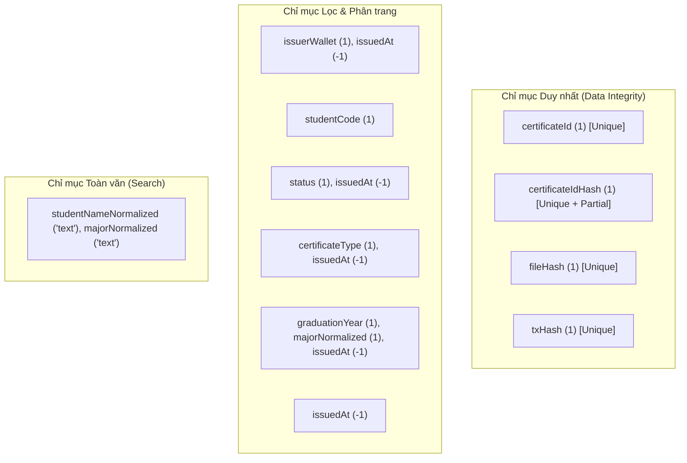

# Giải thích Chi tiết Logic & Mã nguồn `backend/src/models/Certificate.ts`

Tài liệu này giải thích toàn diện vai trò, kiến trúc dữ liệu, các ràng buộc xác thực, chiến lược đánh chỉ mục (indexing) và phân tích từng dòng mã nguồn của file [`backend/src/models/Certificate.ts`](file:///d:/VC_Blockchain/VC/backend/src/models/Certificate.ts).

---

## 1. Vai trò và Vị trí trong Hệ thống

File `Certificate.ts` định nghĩa **Mongoose Schema & Model** cho thực thể văn bằng/chứng chỉ được lưu trữ trong cơ sở dữ liệu MongoDB Atlas của hệ thống **Raccoon University — Verify Certification**.

### Bài toán cốt lõi mà Model giải quyết:
1. **Phân tách PII (Personally Identifiable Information) và On-chain data**:
   - Dữ liệu định danh cá nhân của sinh viên (Họ tên, MSSV, Điểm GPA, Ngành học) **tuyệt đối không** đưa lên blockchain Ethereum Sepolia nhằm tuân thủ quy định bảo vệ quyền riêng tư (GDPR, quyền được lãng quên).
   - Thay vào đó, toàn bộ dữ liệu này được lưu trữ an toàn trong MongoDB.
2. **Neo dữ liệu vào Blockchain (Blockchain Anchor)**:
   - Lưu trữ các khóa đối soát bất biến: `fileHash` (SHA-256 của file PDF), `ipfsCid` (CID trên Pinata/IPFS), `txHash` (mã băm giao dịch cấp bằng), `blockNumber`, `logIndex`.
   - Giúp hệ thống có thể đối soát chéo bất kỳ lúc nào: File PDF trên IPFS $\leftrightarrow$ Mã băm SHA-256 trên Smart Contract $\leftrightarrow$ Bản ghi chi tiết trong MongoDB.
3. **Quản lý vòng đời trạng thái đa cấp**:
   - Theo dõi trạng thái đồng bộ với On-chain: `active` (hợp lệ), `locked` (tạm khóa điều tra), `revoked` (thu hồi vĩnh viễn), kèm theo các timestamp và transaction hash tương ứng.

---

## 2. Phân tích Cấu trúc Dữ liệu `ICertificate`

Mô hình dữ liệu bao gồm 7 nhóm trường logic:

| Nhóm trường | Tên trường | Kiểu dữ liệu | Ý nghĩa & Vai trò |
|---|---|---|---|
| **Định danh & Phân loại** | `certificateId` | `string` | Mã chứng chỉ công khai (VD: `UIT-DEG-2026-0001`), duy nhất toàn hệ thống. |
| | `certificateIdHash` | `string?` | Keccak-256 hash của mã chứng chỉ (`0x...`), dùng để tra cứu nhanh theo indexed topic của Event trên Ethereum. |
| | `certificateType` | `CertificateType` | Phân loại: `degree` (bằng tốt nghiệp), `course` (khóa học), `credit` (tín chỉ), `other` (khác). |
| | `details` | `Mixed` | Dữ liệu linh hoạt theo loại bằng (danh sách môn học, số tín chỉ, đơn vị đào tạo liên kết,...). |
| **Phôi văn bằng** | `templateId` | `string` | Định danh mẫu phôi đồ họa sinh chứng chỉ PDF. |
| | `templateVersion` | `string` | Phiên bản mẫu phôi văn bằng. |
| **File PDF & IPFS** | `fileHash` | `string` | Mã băm SHA-256 của file PDF gốc (`sha256:<64 hex>`), trùng khớp với giá trị neo trên Smart Contract. |
| | `ipfsCid` | `string` | CID v0/v1 của file PDF lưu trữ phân tán trên IPFS thông qua Pinata. |
| | `artifactType` | `ArtifactType` | Định dạng artifact (`pdf`, `image`, `web`), mặc định là `pdf`. |
| | `mimeType` | `string` | Định dạng MIME (`application/pdf`). |
| | `filename` | `string` | Tên tệp tin hiển thị khi người dùng tải về. |
| | `sizeBytes` | `number` | Dung lượng tệp tin (bytes). |
| | `previewCid` | `string?` | CID của hình ảnh xem trước (thumbnail). |
| **Đơn vị cấp (Issuer)** | `issuerId` | `Types.ObjectId` | Tham chiếu quan hệ tới bảng `Issuer` trong MongoDB. |
| | `issuerWallet` | `string` | Địa chỉ ví Ethereum của đơn vị cấp bằng (viết thường 40 ký tự hex). |
| | `issuerName` | `string` | Tên khoa/phòng ban tại thời điểm cấp bằng. |
| **Thông tin Sinh viên (PII)** | `studentName` | `string` | Họ tên đầy đủ có dấu của sinh viên. |
| | `studentNameNormalized` | `string` | Họ tên viết thường, đã loại bỏ dấu tiếng Việt để phục vụ tìm kiếm toàn văn. |
| | `studentCode` | `string` | Mã số sinh viên (6-12 chữ số). |
| | `major` / `majorNormalized` | `string?` | Tên chuyên ngành (bản có dấu và bản chuẩn hóa không dấu). |
| | `graduationYear` | `number?` | Năm tốt nghiệp (giới hạn từ 2000 đến 2100). |
| | `gpa` | `number?` | Điểm trung bình tích lũy theo thang 4.0. |
| | `classification` | `string?` | Xếp loại tốt nghiệp (Xuất sắc, Giỏi, Khá,...). |
| **Giao dịch Blockchain** | `issuedAt` | `Date` | Thời điểm cấp bằng (tính theo `block.timestamp` trên blockchain). |
| | `txHash` | `string` | Mã băm giao dịch Ethereum gọi hàm `issueCertificate`. |
| | `blockNumber` | `number` | Số khối chứa giao dịch cấp. |
| | `logIndex` | `number` | Thứ tự event log trong khối. |
| **Vòng đời & Trạng thái** | `status` | `CertificateStatus` | Trạng thái: `active` \| `revoked` \| `locked`. |
| | `revokedAt`, `revokeTxHash`, `revokeBlockNumber` | `Date?`, `string?`, `number?` | Lưu vết thời điểm và giao dịch thu hồi bằng trên blockchain. |
| | `lockedAt`, `lockTxHash`, `lockBlockNumber` | `Date?`, `string?`, `number?` | Lưu vết thời điểm và giao dịch tạm khóa văn bằng để điều tra khiếu nại. |
| | `metadataHash` | `string?` | Hash SHA-256 của toàn bộ metadata JSON. |

---

## 3. Chiến lược Đánh Chỉ mục (Indexing Strategy)

Các chỉ mục được thiết kế tối ưu cho mọi nghiệp vụ truy vấn trong hệ thống:



### Chi tiết kỹ thuật từng loại chỉ mục:

1. **`{ certificateId: 1 }` (Unique)**:
   - Đảm bảo mỗi văn bằng chỉ có một mã chứng chỉ duy nhất.
   - Hỗ trợ xem chi tiết văn bằng theo route `/c/:certificateId` với độ phức tạp $O(1)$.

2. **`{ certificateIdHash: 1 }` (Unique + `partialFilterExpression`)**:
   - Sử dụng `partialFilterExpression: { certificateIdHash: { $type: "string" } }`.
   - **Lý do**: Trường này có thể mang giá trị `null` đối với các bản ghi cũ hoặc khi chưa tính hash. MongoDB mặc định sẽ coi nhiều giá trị `null` là vi phạm ràng buộc Unique. Partial filter index giải quyết triệt để lỗi này bằng cách chỉ đánh chỉ mục duy nhất cho các bản ghi có giá trị thực sự là chuỗi.

3. **`{ fileHash: 1 }` (Unique)**:
   - Đảm bảo mỗi file PDF (SHA-256) chỉ tương ứng với một văn bằng duy nhất, chống việc cấp trùng lặp file.
   - Tối ưu tra cứu khi người dùng tải file PDF lên trang `/verify`.

4. **`{ txHash: 1 }` (Unique)**:
   - Đảm bảo tính lũy thừa (**Idempotency**): Worker đồng bộ sự kiện blockchain (`sync.service.ts`) nếu quét lại các block cũ sẽ không ghi đè hoặc tạo bản ghi trùng lặp.

5. **`{ issuerWallet: 1, issuedAt: -1 }` (Compound)**:
   - Hỗ trợ màn hình Dashboard của Issuer: lọc danh sách văn bằng do chính ví của đơn vị đó cấp, sắp xếp từ mới nhất đến cũ nhất.

6. **`{ studentCode: 1 }`**:
   - Hỗ trợ sinh viên và nhà tuyển dụng tra cứu tất cả các chứng chỉ thuộc về một Mã số sinh viên.

7. **Chỉ mục Text Search `certificate_text_search`**:
   - `{ studentNameNormalized: "text", majorNormalized: "text" }` với `default_language: "none"`.
   - Bằng việc chuẩn hóa chuỗi không dấu (ví dụ: "nguyen van a") và đặt `default_language: "none"`, MongoDB sẽ không áp dụng từ điển gốc tiếng Anh (English stemming) mà tìm kiếm chính xác các từ tố tiếng Việt.

---

## 4. Mã nguồn Đầy đủ có Chú thích Chi tiết

Dưới đây là mã nguồn của [`backend/src/models/Certificate.ts`](file:///d:/VC_Blockchain/VC/backend/src/models/Certificate.ts) với hệ thống chú thích đầy đủ:

```typescript
import {
  Schema,
  model,
  type HydratedDocument,
  type Model,
  type Types,
} from "mongoose";
import type {
  ArtifactType,
  CertificateDetails,
  CertificateStatus,
  CertificateType,
} from "../types/certificate";

/**
 * Interface định nghĩa cấu trúc dữ liệu của một chứng chỉ/văn bằng lưu trữ trong MongoDB.
 *
 * Mô hình này là lớp off-chain lưu trữ song song với smart contract on-chain:
 * - Dữ liệu PII (tên sinh viên, MSSV, GPA, ngành học) được lưu tại đây để bảo vệ quyền riêng tư.
 * - Các giá trị băm (fileHash, ipfsCid, txHash) dùng để đối soát và bảo đảm tính toàn vẹn với blockchain.
 */
export interface ICertificate {
  // --- Định danh & Loại văn bằng ---
  /** Mã chứng chỉ công khai (VD: "UIT-DEG-2026-0001"), duy nhất trên toàn hệ thống */
  certificateId: string;
  /** Keccak-256 hash của certificateId dạng hex (0x...), dùng để tra cứu nhanh theo event on-chain */
  certificateIdHash?: string | null;
  /** Loại chứng chỉ: degree (văn bằng), course (khóa học), credit (tín chỉ), other (khác) */
  certificateType: CertificateType;
  /** Chi tiết mở rộng phụ thuộc vào loại chứng chỉ (VD: số tín chỉ, danh sách môn, xếp loại,...) */
  details: CertificateDetails;

  // --- Mẫu phôi chứng chỉ ---
  /** Mã định danh mẫu giao diện phôi văn bằng */
  templateId: string;
  /** Phiên bản của mẫu phôi văn bằng */
  templateVersion: string;

  // --- File artifact & Lưu trữ IPFS ---
  /** Mã băm SHA-256 của file PDF gốc ("sha256:<64 hex chars>"), dùng đối soát với on-chain */
  fileHash: string;
  /** Content Identifier (CID) của file PDF lưu trên mạng IPFS (Pinata) */
  ipfsCid: string;
  /** Định dạng artifact gốc (pdf, image, web) */
  artifactType: ArtifactType;
  /** MIME type của file (thường là "application/pdf") */
  mimeType: string;
  /** Tên file khi tải về (VD: "UIT-DEG-2026-0001.pdf") */
  filename: string;
  /** Kích thước file tính theo bytes */
  sizeBytes: number;
  /** CID ảnh thumbnail/preview (nếu có) */
  previewCid?: string | null;

  // --- Đơn vị cấp (Issuer) ---
  /** ObjectId liên kết tới bảng Issuer trong MongoDB */
  issuerId: Types.ObjectId;
  /** Địa chỉ ví Ethereum (checksum/lowercase) của đơn vị cấp chứng chỉ */
  issuerWallet: string;
  /** Tên đơn vị cấp chứng chỉ tại thời điểm cấp (VD: "Khoa Công nghệ Thông tin") */
  issuerName: string;

  // --- Thông tin người nhận & PII (Chỉ lưu Off-chain) ---
  /** Họ tên đầy đủ có dấu của sinh viên */
  studentName: string;
  /** Họ tên đã chuẩn hóa (bỏ dấu tiếng Việt, viết thường) phục vụ tìm kiếm không dấu */
  studentNameNormalized: string;
  /** Mã số sinh viên (6-12 chữ số) */
  studentCode: string;
  /** Chuyên ngành đào tạo có dấu */
  major?: string | null;
  /** Chuyên ngành đào tạo đã chuẩn hóa không dấu phục vụ tìm kiếm và lọc */
  majorNormalized?: string | null;
  /** Năm tốt nghiệp */
  graduationYear?: number | null;
  /** Điểm trung bình tích lũy thang 4.0 */
  gpa?: number | null;
  /** Xếp loại tốt nghiệp (Xuất sắc, Giỏi, Khá,...) */
  classification?: string | null;

  // --- Giao dịch cấp On-chain (Blockchain Anchor) ---
  /** Thời điểm cấp văn bằng (ghi nhận theo block.timestamp của Ethereum) */
  issuedAt: Date;
  /** Hash giao dịch gọi hàm issueCertificate trên Ethereum Sepolia */
  txHash: string;
  /** Số hiệu khối chứa giao dịch cấp văn bằng */
  blockNumber: number;
  /** Thứ tự vị trí log event CertificateIssued trong khối */
  logIndex: number;

  // --- Trạng thái văn bằng & Vòng đời ---
  /** Trạng thái hiện tại: active (hợp lệ), revoked (thu hồi vĩnh viễn), locked (tạm khóa) */
  status: CertificateStatus;
  /** Thời điểm bị thu hồi (nếu có) */
  revokedAt?: Date | null;
  /** Hash giao dịch thu hồi trên blockchain */
  revokeTxHash?: string | null;
  /** Số hiệu khối của giao dịch thu hồi */
  revokeBlockNumber?: number | null;

  // --- Thông tin tạm khóa (Locking) ---
  /** Thời điểm bị tạm khóa phục vụ điều tra sai sót */
  lockedAt?: Date | null;
  /** Hash giao dịch gọi hàm lockCertificate */
  lockTxHash?: string | null;
  /** Số hiệu khối của giao dịch khóa */
  lockBlockNumber?: number | null;

  // --- Toàn vẹn metadata ---
  /** Mã hash SHA-256 của toàn bộ metadata JSON */
  metadataHash?: string | null;

  // --- Timestamps ---
  /** Thời điểm bản ghi được tạo trong MongoDB */
  createdAt: Date;
  /** Thời điểm bản ghi được cập nhật gần nhất */
  updatedAt: Date;
}

export type CertificateDocument = HydratedDocument<ICertificate>;

/**
 * Mongoose Schema định nghĩa cấu trúc và ràng buộc dữ liệu cho Certificate.
 */
const certificateSchema = new Schema<ICertificate>(
  {
    // --- Định danh văn bằng ---
    certificateId: {
      type: String,
      required: true,
      trim: true,
      maxlength: 64,
      match: /^[A-Z0-9-]+$/, // Chỉ cho phép ký tự in hoa, số và dấu gạch ngang
    },
    certificateIdHash: {
      type: String,
      default: null,
      lowercase: true,
      match: /^0x[a-f0-9]{64}$/, // Keccak-256 hash dạng 32 bytes hex
    },
    certificateType: {
      type: String,
      required: true,
      enum: ["degree", "course", "credit", "other"],
    },
    details: {
      type: Schema.Types.Mixed,
      required: true,
    },

    // --- Mẫu phôi văn bằng ---
    templateId: {
      type: String,
      required: true,
      maxlength: 40,
    },
    templateVersion: {
      type: String,
      required: true,
      maxlength: 20,
    },

    // --- File artifact & Lưu trữ IPFS ---
    fileHash: {
      type: String,
      required: true,
      match: /^sha256:[a-f0-9]{64}$/, // Bắt buộc tiền tố "sha256:" và 64 ký tự hex
    },
    ipfsCid: {
      type: String,
      required: true,
      maxlength: 100,
    },
    artifactType: {
      type: String,
      required: true,
      enum: ["pdf", "image", "web"],
      default: "pdf",
    },
    mimeType: {
      type: String,
      required: true,
      maxlength: 100,
    },
    filename: {
      type: String,
      required: true,
      maxlength: 120,
    },
    sizeBytes: {
      type: Number,
      required: true,
      min: 1,
    },
    previewCid: {
      type: String,
      default: null,
      maxlength: 100,
    },

    // --- Đơn vị cấp ---
    issuerId: {
      type: Schema.Types.ObjectId,
      ref: "Issuer",
      required: true,
    },
    issuerWallet: {
      type: String,
      required: true,
      lowercase: true,
      match: /^0x[a-f0-9]{40}$/, // Định dạng địa chỉ ví Ethereum 20 bytes hex
    },
    issuerName: {
      type: String,
      required: true,
      maxlength: 100,
    },

    // --- Thông tin sinh viên & Học tập ---
    studentName: {
      type: String,
      required: true,
      trim: true,
      maxlength: 100,
    },
    studentNameNormalized: {
      type: String,
      required: true,
      maxlength: 100,
    },
    studentCode: {
      type: String,
      required: true,
      match: /^[0-9]{6,12}$/, // Mã sinh viên gồm 6 đến 12 số
    },
    major: {
      type: String,
      default: null,
      maxlength: 100,
    },
    majorNormalized: {
      type: String,
      default: null,
      maxlength: 100,
    },
    graduationYear: {
      type: Number,
      default: null,
      min: 2000,
      max: 2100,
    },
    gpa: {
      type: Number,
      default: null,
      min: 0,
      max: 4,
    },
    classification: {
      type: String,
      default: null,
      maxlength: 50,
    },

    // --- Dữ liệu neo Blockchain ---
    issuedAt: {
      type: Date,
      required: true,
    },
    txHash: {
      type: String,
      required: true,
      lowercase: true,
      match: /^0x[a-f0-9]{64}$/, // Giao dịch hash Ethereum 32 bytes hex
    },
    blockNumber: {
      type: Number,
      required: true,
      min: 0,
    },
    logIndex: {
      type: Number,
      required: true,
      min: 0,
    },

    // --- Trạng thái & Vòng đời ---
    status: {
      type: String,
      required: true,
      enum: ["active", "revoked", "locked"],
      default: "active",
    },
    revokedAt: {
      type: Date,
      default: null,
    },
    revokeTxHash: {
      type: String,
      default: null,
      lowercase: true,
    },
    revokeBlockNumber: {
      type: Number,
      default: null,
    },

    // --- Trạng thái tạm khóa ---
    lockedAt: {
      type: Date,
      default: null,
    },
    lockTxHash: {
      type: String,
      default: null,
      lowercase: true,
    },
    lockBlockNumber: {
      type: Number,
      default: null,
    },

    metadataHash: {
      type: String,
      default: null,
      maxlength: 100,
    },
  },
  {
    timestamps: true, // Tự động quản lý createdAt và updatedAt
    versionKey: false, // Bỏ trường __v không cần thiết của Mongoose
  }
);

// -----------------------------------------------------------------------------
// CHIẾN LƯỢC ĐÁNH CHỈ MỤC (INDEXING STRATEGY)
// -----------------------------------------------------------------------------

// 1. Chỉ mục Unique: Đảm bảo tính duy nhất và toàn vẹn dữ liệu
certificateSchema.index({ certificateId: 1 }, { unique: true });
// Partial filter index cho certificateIdHash: Chỉ đánh index khi giá trị là chuỗi (tránh lỗi duplicate null)
certificateSchema.index(
  { certificateIdHash: 1 },
  {
    unique: true,
    partialFilterExpression: { certificateIdHash: { $type: "string" } },
  }
);
// Mỗi file PDF chỉ được cấp cho đúng một chứng chỉ
certificateSchema.index({ fileHash: 1 }, { unique: true });
// Mỗi giao dịch blockchain cấp chứng chỉ chỉ được đồng bộ một lần (Idempotency)
certificateSchema.index({ txHash: 1 }, { unique: true });

// 2. Chỉ mục phục vụ truy vấn lọc, phân trang và sắp xếp
// Lọc danh sách chứng chỉ theo ví issuer, sắp xếp theo thời gian mới nhất
certificateSchema.index({ issuerWallet: 1, issuedAt: -1 });
// Tra cứu nhanh theo mã số sinh viên
certificateSchema.index({ studentCode: 1 });
// Lọc theo trạng thái (active, locked, revoked) và phân trang
certificateSchema.index({ status: 1, issuedAt: -1 });
// Lọc theo loại văn bằng (bằng tốt nghiệp, chứng chỉ khóa học,...)
certificateSchema.index({ certificateType: 1, issuedAt: -1 });
// Lọc kết hợp theo năm tốt nghiệp, chuyên ngành và thời gian cấp
certificateSchema.index({ graduationYear: 1, majorNormalized: 1, issuedAt: -1 });
// Danh sách chứng chỉ mới nhất toàn trường trên trang chủ/search
certificateSchema.index({ issuedAt: -1 });

// 3. Chỉ mục tìm kiếm toàn văn (Text Search)
// Hỗ trợ người dùng tra cứu theo họ tên hoặc chuyên ngành không dấu, không phân biệt ngôn ngữ
certificateSchema.index(
  { studentNameNormalized: "text", majorNormalized: "text" },
  { name: "certificate_text_search", default_language: "none" }
);

export const Certificate: Model<ICertificate> = model<ICertificate>(
  "Certificate",
  certificateSchema
);
```

---

## 5. Mối quan hệ giữa Certificate Model và Smart Contract

| Thuộc tính nghiệp vụ | Lưu trữ On-chain (`CertificateRegistry.sol`) | Lưu trữ Off-chain (`Certificate.ts`) |
|---|---|---|
| Mã chứng chỉ | `string certificateId` | `certificateId` (Index Unique) |
| SHA-256 PDF | `string fileHash` | `fileHash` (Index Unique) |
| Địa chỉ IPFS | `string ipfsCid` | `ipfsCid` |
| Ví người cấp | `address issuer` | `issuerWallet` |
| Thời điểm cấp | `uint64 issuedAt` | `issuedAt` |
| Cờ thu hồi | `bool isRevoked` | `status === 'revoked'`, `revokedAt`, `revokeTxHash` |
| Cờ tạm khóa | `bool isLocked` | `status === 'locked'`, `lockedAt`, `lockTxHash` |
| Thông tin sinh viên (PII) | ❌ Không lưu | ✅ `studentName`, `studentCode`, `gpa`, `major`,... |
| Mẫu phôi giao diện | ❌ Không lưu | ✅ `templateId`, `templateVersion` |
| Dữ liệu giao dịch | Sự kiện Block log | `txHash`, `blockNumber`, `logIndex` |

Sự kết hợp này đảm bảo hệ thống đạt được cả 3 tiêu chí: **Tính minh bạch bất biến của Blockchain**, **Hiệu năng truy vấn cao của MongoDB**, và **Bảo mật quyền riêng tư cho người học**.
