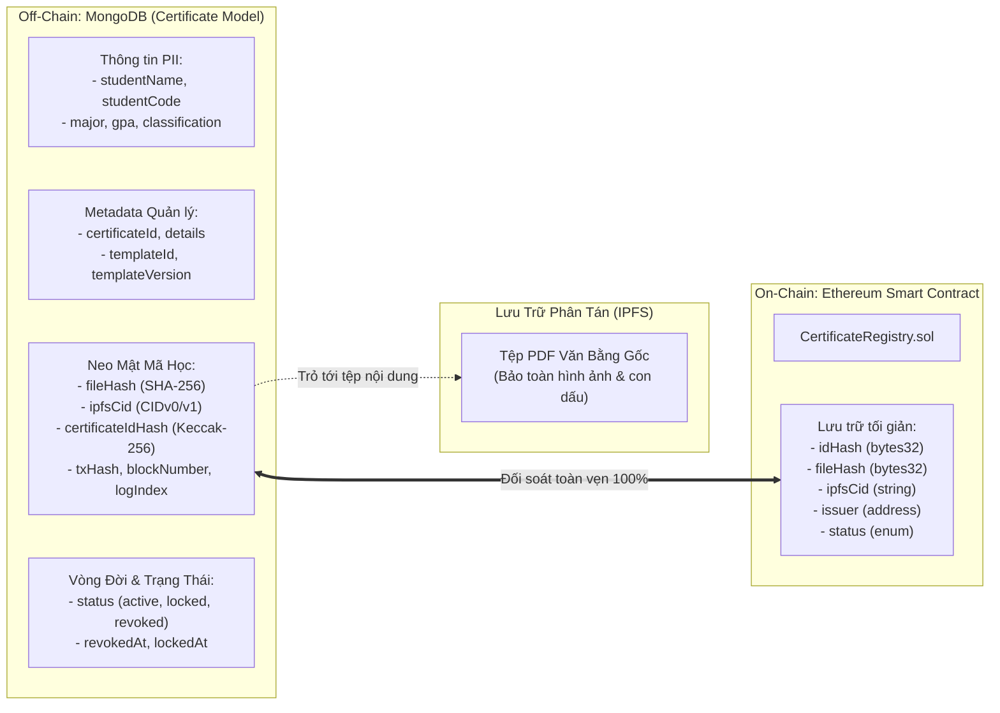
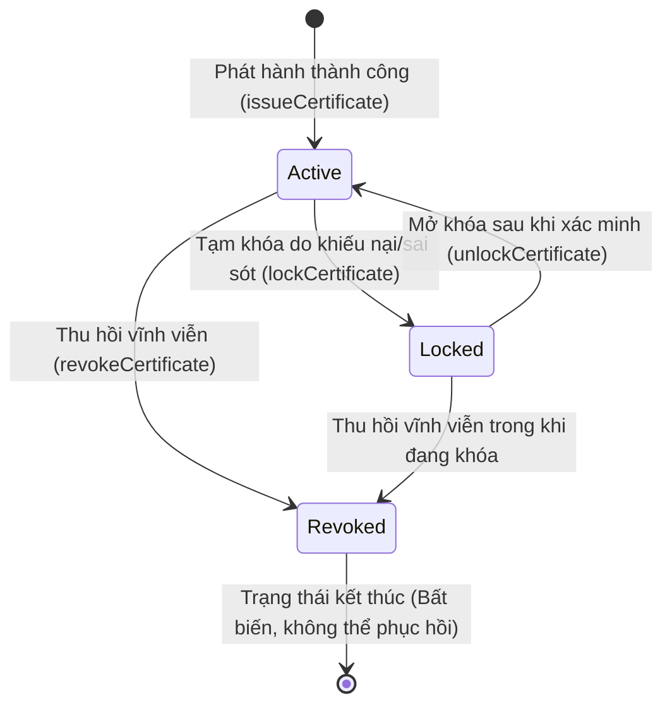

# Kiến Trúc Mô Hình Dữ Liệu và Chiến Lược Đánh Chỉ Mục Văn Bằng (Certificate Model & Indexing Architecture)

Tài liệu này đặc tả chi tiết thiết kế mô hình dữ liệu Mongoose cho văn bằng / chứng chỉ số, các ràng buộc dữ liệu nghiêm ngặt, chiến lược bảo vệ thông tin định danh cá nhân (PII), cơ chế đối soát toàn vẹn với Blockchain và cấu trúc chỉ mục (Indexing Strategy) tại [backend/src/models/Certificate.ts](file:///d:/VC_Blockchain/VC/backend/src/models/Certificate.ts).

---

## 1. Tổng Quan Kiến Trúc Mô Hình Dữ Liệu (Model Overview)

Trong giải pháp văn bằng số xác thực trên nền tảng Blockchain (Verifiable Credentials), việc lưu trữ dữ liệu đòi hỏi sự cân bằng khắt khe giữa:
- **Tính bất biến & Minh bạch công khai (On-chain)**: Đảm bảo văn bằng không thể bị làm giả hoặc sửa đổi sau khi cấp.
- **Bảo mật quyền riêng tư cá nhân (Off-chain PII Compliance)**: Các thông tin nhạy cảm của người học (họ tên, điểm GPA, mã sinh viên, xếp loại) không được phép công khai trực tiếp lên sổ cái phân tán vĩnh viễn nhằm tuân thủ các quy định bảo vệ dữ liệu cá nhân (như GDPR, Nghị định 13/2023/NĐ-CP).

Mô hình dữ liệu `Certificate` trong MongoDB đóng vai trò là **Kho lưu trữ siêu dữ liệu ngoại tuyến (Off-chain Metadata Repository)**, kết nối chặt chẽ với Smart Contract thông qua các giá trị neo mật mã học (Cryptographic Anchors):



---

## 2. Đặc Tả Các Nhóm Thuộc Tính & Quy Tắc Xác Thực (Validation Rules)

Mỗi trường dữ liệu trong `certificateSchema` được kiểm soát nghiêm ngặt bằng biểu thức chính quy (Regex), giới hạn độ dài và kiểu dữ liệu chuẩn:

### 2.1. Nhóm Định Danh & Loại Văn Bằng
- `certificateId`: Mã chứng chỉ công khai (VD: `UIT-DEG-2026-0001`). Bắt buộc (`required: true`), độ dài tối đa 64 ký tự, chuẩn hóa bằng Regex `^[A-Z0-9-]+$` (chỉ chữ in hoa, chữ số và gạch ngang).
- `certificateIdHash`: Mã băm Keccak-256 của `certificateId` dạng hex `0x...` (32 bytes). Dùng để đối soát trực tiếp với sự kiện on-chain, định dạng `^0x[a-f0-9]{64}$`.
- `certificateType`: Phân loại chứng chỉ theo enum `["degree", "course", "credit", "other"]`.
- `details`: Đối tượng tự do (`Schema.Types.Mixed`) chứa các thuộc tính động theo từng loại phôi bằng (danh sách môn học, số tín chỉ tích lũy, hội đồng xét duyệt).

### 2.2. Nhóm Tệp Tin & Lưu Trữ Phân Tán (IPFS)
- `fileHash`: Mã băm SHA-256 của tệp PDF gốc. Bắt buộc có tiền tố `sha256:` theo sau bởi 64 ký tự hex (`^sha256:[a-f0-9]{64}$`).
- `ipfsCid`: Mã định danh nội dung (CID) trả về từ dịch vụ ghim tệp Pinata IPFS (độ dài tối đa 100 ký tự).
- `artifactType`: Định dạng artifact lưu trữ (`"pdf" | "image" | "web"`, mặc định là `"pdf"`).
- `mimeType`, `filename`, `sizeBytes`: Siêu dữ liệu nhị phân của tệp, đảm bảo tính toàn vẹn khi người dùng tải tệp về.

### 2.3. Nhóm Đơn Vị Phát Hành (Issuer)
- `issuerId`: Khóa ngoại tham chiếu (`ref: "Issuer"`) tới bảng quản lý đơn vị đào tạo.
- `issuerWallet`: Địa chỉ ví Ethereum 20 bytes hex (`^0x[a-f0-9]{40}$`), lưu dưới dạng chữ thường (`lowercase: true`) để loại trừ lỗi phân biệt hoa thường khi tìm kiếm.
- `issuerName`: Tên định danh của cơ quan cấp chứng chỉ tại thời điểm ký kết.

### 2.4. Nhóm Thông Tin Người Học & Tối Ưu Tìm Kiếm (PII & Search)
- `studentName` & `studentCode`: Họ tên đầy đủ có dấu và mã số sinh viên (chuẩn 6-12 chữ số theo Regex `^[0-9]{6,12}$`).
- `studentNameNormalized` & `majorNormalized`: Họ tên và chuyên ngành đã được loại bỏ dấu tiếng Việt và chuyển sang chữ thường (qua hàm `normalizeVietnameseText`). Trường này giúp hệ thống tìm kiếm siêu nhanh bằng chỉ mục toàn văn mà không bị ảnh hưởng bởi lỗi nhập liệu bộ gõ.
- `graduationYear`: Giới hạn từ năm 2000 đến 2100.
- `gpa`: Điểm trung bình tích lũy hệ 4.0 (ràng buộc từ $0$ đến $4.0$).
- `classification`: Xếp loại tốt nghiệp (Xuất sắc, Giỏi, Khá, Trung bình).

### 2.5. Nhóm Neo Chuỗi Khối (Blockchain Anchor)
- `issuedAt`: Thời điểm phát hành văn bằng ghi nhận chính xác theo thời gian khối của mạng Ethereum (`block.timestamp`).
- `txHash`: Mã giao dịch khởi tạo văn bằng trên Ethereum Sepolia (`^0x[a-f0-9]{64}$`).
- `blockNumber`, `logIndex`: Vị trí khối và thứ tự log của sự kiện `CertificateIssued` trong khối, tạo thành cặp định danh duy nhất chống đồng bộ trùng lặp.

---

## 3. Vòng Đời Văn Bằng & Máy Trạng Thái (State Machine)

Văn bằng trong hệ thống tuân theo vòng đời chặt chẽ với 3 trạng thái cốt lõi:



- **Active**: Văn bằng có hiệu lực pháp lý đầy đủ, hiển thị công khai trên cổng tra cứu.
- **Locked**: Văn bằng bị tạm khóa phục vụ điều tra sai sót thông tin. Ghi nhận `lockedAt`, `lockTxHash`, `lockBlockNumber`. Các cổng tra cứu công cộng sẽ cảnh báo văn bằng đang bị khóa.
- **Revoked**: Văn bằng bị thu hồi vĩnh viễn do sai phạm nghiêm trọng hoặc gian lận học thuật. Ghi nhận `revokedAt`, `revokeTxHash`, `revokeBlockNumber`, đồng thời tự động xóa sạch các trường trạng thái khóa (`lockedAt: null...`). **Trạng thái này là vĩnh viễn và không thể đảo ngược**.

---

## 4. Chiến Lược Đánh Chỉ Mục Chuyên Sâu (Indexing Strategy)

Để đáp ứng khối lượng hàng triệu bản ghi với thời gian phản hồi API dưới $20\text{ms}$, `Certificate` cài đặt chiến lược đa chỉ mục:

### 4.1. Chỉ Mục Duy Nhất (Unique Constraints)
1. `{ certificateId: 1 }` (`unique: true`): Đảm bảo mã văn bằng là duy nhất trên toàn hệ thống.
2. `{ certificateIdHash: 1 }` (`unique: true`, `partialFilterExpression: { certificateIdHash: { $type: "string" } }`):
   - **Tối ưu hóa**: Tránh lỗi trùng lặp giá trị `null` (`duplicate key error`) cho các bản ghi văn bằng cũ trước khi chạy tiến trình migration hash.
3. `{ fileHash: 1 }` (`unique: true`): Đảm bảo mỗi tệp PDF văn bằng chỉ được phát hành đúng một lần, chống cấp trùng tệp.
4. `{ txHash: 1 }` (`unique: true`): Đảm bảo tính Idempotent cho tiến trình đồng bộ Blockchain Indexer.

### 4.2. Chỉ Mục Phức Hợp Cho Lọc & Phân Trang (Compound Indexes)
1. `{ issuerWallet: 1, issuedAt: -1 }`: Tối ưu hóa trang quản trị của đơn vị cấp bằng (truy vấn danh sách văn bằng theo ví và phân trang giảm dần theo thời gian).
2. `{ status: 1, issuedAt: -1 }`: Hỗ trợ bộ lọc nhanh theo trạng thái (văn bằng hợp lệ, đã thu hồi, đang khóa).
3. `{ certificateType: 1, issuedAt: -1 }`: Hỗ trợ lọc theo loại hình văn bằng (bằng tốt nghiệp đại học, chứng chỉ chuyên đề).
4. `{ graduationYear: 1, majorNormalized: 1, issuedAt: -1 }`: Hỗ trợ nghiệp vụ báo cáo thống kê tốt nghiệp theo năm và ngành đào tạo của Bộ/Trường.
5. `{ studentCode: 1 }`: Tra cứu hồ sơ văn bằng của sinh viên theo MSSV.
6. `{ issuedAt: -1 }`: Danh sách chứng chỉ mới nhất phục vụ trang chủ cổng xác thực công khai.

### 4.3. Chỉ Mục Toàn Văn (Full-Text Search Index)
```typescript
certificateSchema.index(
  { studentNameNormalized: "text", majorNormalized: "text" },
  { name: "certificate_text_search", default_language: "none" }
);
```
- Sử dụng tùy chọn `default_language: "none"` để vô hiệu hóa bộ phân tích từ khóa theo ngôn ngữ chuẩn (Stopwords/Stemming của tiếng Anh), kết hợp với chuỗi đã chuẩn hóa không dấu giúp tra cứu chính xác tuyệt đối tên người học và ngành học tiếng Việt.
