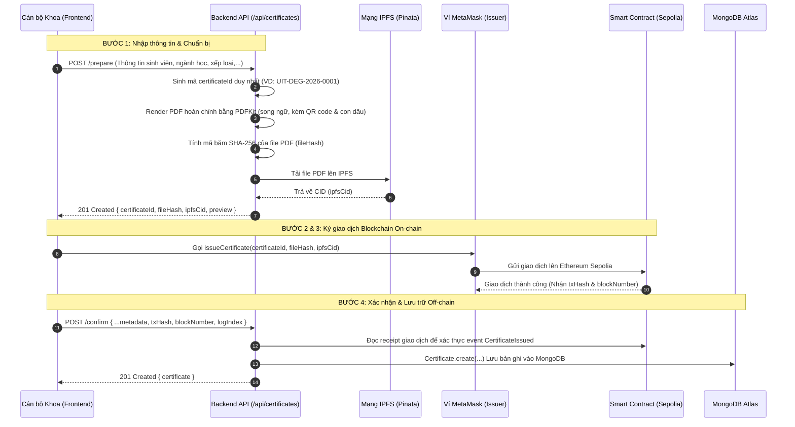
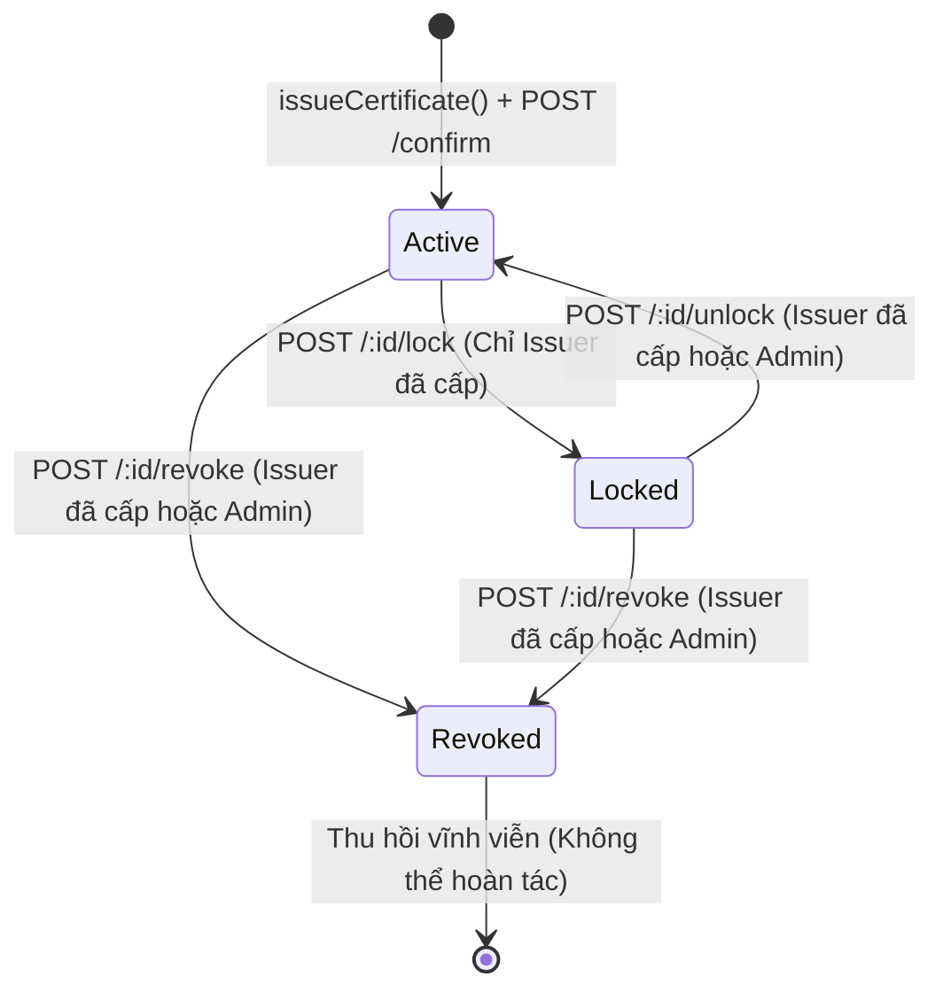

# Đặc tả Kiến trúc & Logic Tuyến đường Văn bằng (`backend/src/routes/certificate.routes.ts`)

Tài liệu này giải thích chi tiết quy trình phát hành văn bằng 4 bước, cơ chế phân quyền theo chủ thể (Actor-based Authorization), vòng đời chuyển đổi trạng thái và phân tích mã nguồn của tệp tin [`backend/src/routes/certificate.routes.ts`](file:///d:/VC_Blockchain/VC/backend/src/routes/certificate.routes.ts).

---

## 1. Tổng quan Module Tuyến đường Văn bằng

Tệp tin `certificate.routes.ts` là trục xương sống điều phối toàn bộ các nghiệp vụ liên quan đến **Phát hành, Tra cứu, Tạm khóa, Mở khóa và Thu hồi văn bằng/chứng chỉ** trong hệ thống **Raccoon University — Verify Certification**.

### Thông số kỹ thuật:
- **Tiền tố đường dẫn (Base Path)**: `/api/certificates` (được gắn tại [`backend/src/app.ts`](file:///d:/VC_Blockchain/VC/backend/src/app.ts)).
- **Đối tượng sử dụng**: Cán bộ đơn vị cấp văn bằng (Issuer) và Quản trị viên (Admin).
- **Hạ tầng tích hợp**: Smart Contract Sepolia [`CertificateRegistry.sol`](file:///d:/VC_Blockchain/VC/contracts/contracts/CertificateRegistry.sol), IPFS Pinata, Mongoose MongoDB.

---

## 2. Quy trình Phát hành Văn bằng 4 Bước (4-Step Issuance Protocol)

Nhằm bảo đảm backend không lưu giữ private key của người dùng và giao dịch bắt buộc phải do ví MetaMask của đơn vị cấp ký, hệ thống áp dụng quy trình phát hành 4 bước phân tách rõ ràng:



> [!IMPORTANT]
> **Nguyên tắc "Blockchain First"**: Backend **tuyệt đối không** lưu bản ghi văn bằng vào MongoDB trước khi giao dịch on-chain được đào vào khối thành công. Điều này ngăn ngừa hoàn toàn hiện tượng dữ liệu ma (ghost data) khi giao dịch bị từ chối hoặc người dùng hủy ký MetaMask.

---

## 3. Quản lý Vòng đời & Trạng thái Văn bằng (Lifecycle State Transitions)

Văn bằng trong hệ thống vận hành theo chu trình trạng thái 3 cấp linh hoạt:



### Phân quyền theo Chủ thể (Actor-based Authorization):
Hệ thống sử dụng interface `CertificateActor` (`{ id, role, walletAddress }`) để kiểm tra quyền hạn chặt chẽ trong tầng Service:

| Thao tác | Endpoint | Thẩm quyền thực hiện | Ghi chú nghiệp vụ |
|---|---|---|---|
| **Xem chi tiết** | `GET /:id` | Issuer đã cấp **HOẶC** Admin | Issuer chỉ xem được bằng của khoa mình. Admin có quyền xem bằng của bất kỳ khoa nào. |
| **Tạm khóa** | `POST /:id/lock` | **Chỉ Issuer** đã cấp văn bằng | Tạm ngưng hiệu lực chứng chỉ để điều tra khiếu nại sai sót. Yêu cầu gửi kèm `txHash` của giao dịch `lockCertificate` on-chain. |
| **Mở khóa** | `POST /:id/unlock` | Issuer đã cấp **HOẶC** Admin | Phục hồi trạng thái `active`. Admin được phép mở khóa để cấp cứu sự cố. Yêu cầu `txHash` của giao dịch `unlockCertificate`. |
| **Thu hồi** | `POST /:id/revoke` | Issuer đã cấp **HOẶC** Admin | Vô hiệu hóa vĩnh viễn văn bằng. Yêu cầu `txHash` của giao dịch `revokeCertificate`. |

---

## 4. Đặc tả Chi tiết các Endpoint

### 4.1. `GET /api/certificates`
- **Mục đích**: Lấy danh sách văn bằng do chính đơn vị cấp của tài khoản đăng nhập phát hành.
- **Middleware**: `requireAuth`, `requireActiveIssuer`.
- **Tham số truy vấn (Query Params)**:
  - `page`, `limit`: Phân trang.
  - `status`: Lọc theo `active`, `locked`, `revoked`.
  - `type`: Lọc theo loại `degree`, `course`, `credit`, `other`.
  - `search`: Tìm kiếm theo tên hoặc mã sinh viên.
  - `graduationYear`: Lọc theo năm tốt nghiệp.

### 4.2. `POST /api/certificates/prepare`
- **Mục đích**: Sinh phôi PDF, băm SHA-256 và pin lên IPFS.
- **Middleware**: `requireAuth`, `requireActiveIssuer`.
- **Request Body mẫu**:
  ```json
  {
    "certificateType": "degree",
    "studentName": "Nguyễn Văn A",
    "studentCode": "20520001",
    "major": "Khoa học Máy tính",
    "graduationYear": 2026,
    "gpa": 3.85,
    "classification": "Xuất sắc",
    "templateId": "uit-standard-degree",
    "templateVersion": "1.0",
    "details": {
      "credits": 140,
      "decisionNumber": "456/QĐ-ĐH"
    }
  }
  ```
- **Response 201 Created**:
  ```json
  {
    "success": true,
    "data": {
      "certificateId": "UIT-DEG-2026-0001",
      "fileHash": "sha256:7f9fad1c0d57a7af66d40...",
      "ipfsCid": "bafybeigdyrzt5sfp7udm7hu...",
      "filename": "UIT-DEG-2026-0001.pdf",
      "sizeBytes": 145230,
      "previewUrl": "https://gateway.pinata.cloud/ipfs/..."
    }
  }
  ```

### 4.3. `POST /api/certificates/confirm`
- **Mục đích**: Xác nhận giao dịch on-chain đã thành công và lưu bản ghi vào MongoDB.
- **Middleware**: `requireAuth`, `requireActiveIssuer`.
- **Request Body**: Toàn bộ dữ liệu của bước `prepare` kèm thêm:
  - `txHash`: Hash giao dịch `issueCertificate` vừa đào vào mạng Sepolia.
  - `blockNumber`: Số hiệu khối chứa giao dịch.
  - `logIndex`: Thứ tự event log trong khối.

### 4.4. `POST /api/certificates/:id/lock`, `:id/unlock`, `:id/revoke`
- **Mục đích**: Cập nhật trạng thái văn bằng sau khi thực hiện thao tác tương ứng trên Smart Contract.
- **Request Body**:
  ```json
  {
    "txHash": "0xabc123... (Giao dịch on-chain lock / unlock / revoke)"
  }
  ```

---

## 5. Mã nguồn Đầy đủ có Chú thích Chi tiết

Dưới đây là mã nguồn của [`backend/src/routes/certificate.routes.ts`](file:///d:/VC_Blockchain/VC/backend/src/routes/certificate.routes.ts) với hệ thống chú thích đầy đủ:

```typescript
import { Router } from "express";
import {
  createCertificateController,
  getCertificateController,
  listCertificatesController,
  lockCertificateController,
  prepareCertificateController,
  revokeCertificateController,
  unlockCertificateController,
} from "../controllers/certificate.controller";
import { requireAuth } from "../middleware/auth";
import { requireActiveIssuer } from "../middleware/issuer";

/**
 * Express Router quản lý toàn bộ quy trình Vòng đời Văn bằng & Chứng chỉ (Certificate Lifecycle).
 *
 * Tiền tố đường dẫn (Base Path): `/api/certificates` (được gắn tại `backend/src/app.ts`).
 *
 * Kiến trúc Phân quyền & Bảo mật:
 * 1. `requireAuth`: Bắt buộc người dùng phải đăng nhập hợp lệ (có mã JWT trong Header Authorization).
 * 2. `requireActiveIssuer`: Áp dụng cho các thao tác phát hành văn bằng. Bắt buộc tài khoản phải có vai trò
 *    `issuer`, đã gắn địa chỉ ví Ethereum và cả 2 cờ `isActive` (DB) lẫn `onChainActive` (hợp đồng) đều đang bật.
 * 3. Phân quyền theo Chủ thể (Actor-based Authorization): Với các thao tác tra cứu chi tiết, tạm khóa,
 *    mở khóa và thu hồi, Service kiểm tra thẩm quyền: chỉ Issuer đã cấp chứng chỉ đó hoặc Admin hệ thống mới được phép.
 */
const router = Router();

// Toàn bộ các tuyến đường trong router này bắt buộc phải đăng nhập
router.use(requireAuth);

// -----------------------------------------------------------------------------
// 1. NGHIỆP VỤ PHÁT HÀNH VĂN BẰNG (DÀNH CHO ISSUER ĐANG HOẠT ĐỘNG)
// -----------------------------------------------------------------------------

/**
 * GET /api/certificates
 * Lấy danh sách văn bằng do chính đơn vị cấp của người dùng phát hành:
 * - Hỗ trợ lọc theo trạng thái (status), loại chứng chỉ (type), năm tốt nghiệp (graduationYear)
 * - Hỗ trợ tìm kiếm theo tên hoặc mã sinh viên (search)
 * - Phân trang dữ liệu (pagination: page, limit)
 */
router.get("/", requireActiveIssuer, listCertificatesController);

/**
 * POST /api/certificates/prepare
 * Bước 1 & 2 trong quy trình cấp bằng (Chuẩn bị dữ liệu & Artifact):
 * - Nhận thông tin sinh viên và văn bằng từ form giao diện (validate qua `prepareCertificateSchema`)
 * - Sinh mã định danh chứng chỉ duy nhất (certificateId)
 * - Tạo file PDF hoàn chỉnh bằng PDFKit (song ngữ, kèm QR code và con dấu điện tử)
 * - Tính mã băm SHA-256 của file PDF và ghim (pin) file lên mạng phân tán IPFS qua Pinata
 * - Trả về `fileHash`, `ipfsCid`, `certificateId` để Frontend sẵn sàng ký giao dịch bằng MetaMask
 */
router.post("/prepare", requireActiveIssuer, prepareCertificateController);

/**
 * POST /api/certificates/confirm (hoặc POST /api/certificates)
 * Bước 4 trong quy trình cấp bằng (Xác nhận lưu cơ sở dữ liệu sau khi ký on-chain):
 * - Frontend gửi thông tin đã prepare kèm theo mã giao dịch `txHash` vừa ký thành công qua MetaMask
 * - Backend kiểm tra giao dịch trên Ethereum Sepolia để xác thực event `CertificateIssued` đã phát ra
 * - Lưu bản ghi đầy đủ vào MongoDB và trả về dữ liệu chứng chỉ đã tạo thành công
 */
router.post("/confirm", requireActiveIssuer, createCertificateController);
router.post("/", requireActiveIssuer, createCertificateController);

// -----------------------------------------------------------------------------
// 2. QUẢN LÝ VÒNG ĐỜI TRẠNG THÁI VĂN BẰNG (ACTOR-BASED: ISSUER SỞ HỮU HOẶC ADMIN)
// -----------------------------------------------------------------------------

/**
 * GET /api/certificates/:id
 * Xem thông tin chi tiết đầy đủ của một chứng chỉ:
 * - Issuer chỉ xem được chứng chỉ do đơn vị mình phát hành
 * - Admin có quyền xem chứng chỉ của bất kỳ đơn vị nào
 */
router.get("/:id", getCertificateController);

/**
 * POST /api/certificates/:id/revoke
 * Thu hồi vĩnh viễn một văn bằng (sau khi đã ký `revokeCertificate` on-chain):
 * - Thẩm quyền: Chỉ chính Issuer đã phát hành chứng chỉ hoặc Quản trị viên trường học (Admin)
 * - Cập nhật trạng thái `revoked`, lưu vết `revokeTxHash` và thời điểm thu hồi
 */
router.post("/:id/revoke", revokeCertificateController);

/**
 * POST /api/certificates/:id/lock
 * Tạm khóa một văn bằng đang hợp lệ để chờ xác minh/điều tra khiếu nại sai sót:
 * - Thẩm quyền: Chỉ chính Issuer đã phát hành chứng chỉ
 * - Yêu cầu mã giao dịch gọi hàm `lockCertificate` trên smart contract
 * - Cập nhật trạng thái `locked`, lưu vết `lockTxHash`
 */
router.post("/:id/lock", lockCertificateController);

/**
 * POST /api/certificates/:id/unlock
 * Mở khóa văn bằng, đưa chứng chỉ trở lại trạng thái hợp lệ (`active`):
 * - Thẩm quyền: Issuer đã cấp hoặc Admin hệ thống (xử lý sự cố khẩn cấp)
 * - Yêu cầu mã giao dịch gọi hàm `unlockCertificate` trên smart contract
 */
router.post("/:id/unlock", unlockCertificateController);

export { router as certificateRouter };
```

---

## 6. Tổng kết

Module `certificate.routes.ts` thiết lập một mô hình phát hành văn bằng an toàn, phi tập trung và minh bạch:
- Tách bạch giữa khâu **chuẩn bị phôi (off-chain)** và **ký xác nhận (on-chain)**.
- Phân quyền theo vai trò kết hợp kiểm tra quyền sở hữu (`requireActiveIssuer` + `Actor-based`).
- Hỗ trợ toàn diện các trạng thái nghiệp vụ thực tế: Cấp mới $\rightarrow$ Tạm khóa điều tra $\rightarrow$ Mở khóa $\rightarrow$ Thu hồi vĩnh viễn.
