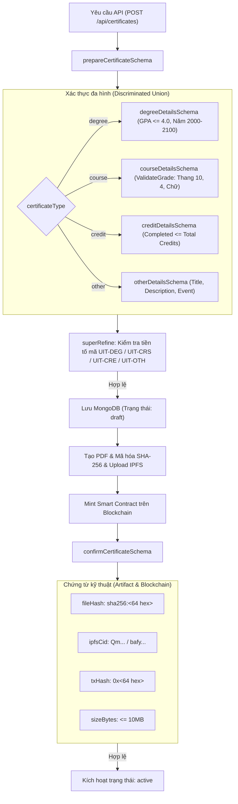

# Kiến Trúc và Logic Xác Thực Dữ Liệu Văn Bằng (Certificate Schema Validation)

Tài liệu này đặc tả chi tiết kiến trúc, các bất biến nghiệp vụ (Business Invariants), mô hình xác thực đa hình (Polymorphic Validation) và quy chuẩn chứng từ kỹ thuật được cài đặt tại [backend/src/schemas/certificate.ts](file:///d:/VC_Blockchain/VC/backend/src/schemas/certificate.ts).

---

## 1. Tổng Quan Kiến Trúc (Architecture Overview)

Trong giải pháp Verifiable Credentials trên nền tảng Blockchain, văn bằng số là tài sản kỹ thuật số cốt lõi. Một văn bằng khi đã được neo băm (Anchored/Minted) lên Smart Contract sẽ trở thành vĩnh viễn và không thể đảo ngược. 

Do đó, [certificate.ts](file:///d:/VC_Blockchain/VC/backend/src/schemas/certificate.ts) đóng vai trò là **tầng thẩm định ranh giới (Validation Gateway)** nghiêm ngặt nhất của hệ thống, kiểm soát 2 giai đoạn:
1. **Giai đoạn tạo nháp (Preparation / Draft)**: Thẩm định thông tin người học, mã định danh, thang điểm và phân loại văn bằng.
2. **Giai đoạn phát hành chính thức (Confirmation / Issuance)**: Kiểm tra chữ ký băm mật mã học (SHA-256), mã CID trên mạng lưu trữ phân tán IPFS, và mã giao dịch Blockchain (TxHash).



---

## 2. Mô Hình Xác Thực Đa Hình (Polymorphic Validation)

Hệ thống sử dụng cơ chế `z.discriminatedUnion("certificateType", [...])` để tự động chuyển đổi cấu trúc thuộc tính `details` theo từng phân loại chứng chỉ cụ thể:

### 2.1. Văn bằng tốt nghiệp (`degree`)
* **Schema**: `degreeDetailsSchema`
* **Các trường**: `degreeTitle`, `major`, `graduationYear`, `gpa`, `classification`, `studyMode`, `thesisTitle`.
* **Ràng buộc**:
  - `gpa`: Bắt buộc nằm trong thang $0.0 \le \text{GPA} \le 4.0$.
  - `graduationYear`: Phải là số nguyên nằm trong khoảng từ năm $2000$ đến $2100$.

### 2.2. Chứng chỉ môn học / học phần (`course`)
* **Schema**: `courseDetailsSchema`
* **Các trường**: `courseCode`, `courseName`, `credits`, `semester`, `grade`, `gradeScale`, `grade4`, `durationHours`, `instructor`.
* **Ràng buộc**: Số tín chỉ từ 1 đến 10; điểm số (`grade`) được kiểm tra động theo `gradeScale`.

### 2.3. Chứng chỉ tích lũy tín chỉ (`credit`)
* **Schema**: `creditDetailsSchema`
* **Các trường**: `programName`, `totalCredits`, `completedCredits`, `gpa`, `gradeScale`, `modules`.
* **Bất biến logic nghiệp vụ**:
  $$\text{completedCredits} \le \text{totalCredits} \le 300$$
  Hàm `superRefine` sẽ chặn ngay lập tức nếu số tín chỉ hoàn thành lớn hơn tổng số tín chỉ. Từng module con trong mảng `modules` cũng được tái sử dụng hàm `validateGrade`.

### 2.4. Chứng nhận hoạt động khác / Workshop (`other`)
* **Schema**: `otherDetailsSchema`
* **Các trường**: `title`, `description`, `organizer`, `eventDate`, `role`, `result`, `validUntil`.

---

## 3. Các Quy Tắc Nghiệp Vụ Chuyên Sâu (Business Rules & Invariants)

### 3.1. Ràng buộc tiền tố mã định danh văn bằng (Identifier Prefix Invariants)
Mỗi loại văn bằng khi phát hành trong hệ thống trường Đại học Công nghệ Thông tin (UIT) bắt buộc phải có tiền tố tương ứng nhằm tránh việc trùng lặp hoặc nhầm lẫn loại văn bằng:

| Loại chứng chỉ (`certificateType`) | Tiền tố bắt buộc (`certificateId`) | Ví dụ hợp lệ |
| :--- | :--- | :--- |
| **`degree`** | `UIT-DEG` | `UIT-DEG-2026-0001` |
| **`course`** | `UIT-CRS` | `UIT-CRS-2026-0142` |
| **`credit`** | `UIT-CRE` | `UIT-CRE-2026-0035` |
| **`other`** | `UIT-OTH` | `UIT-OTH-2026-0007` |

Quy tắc này được thực thi tự động qua `superRefine`:
```typescript
const prefix = {
  degree: "UIT-DEG",
  course: "UIT-CRS",
  credit: "UIT-CRE",
  other: "UIT-OTH",
};
if (!value.certificateId.startsWith(prefix[value.certificateType])) {
  ctx.addIssue({ ... });
}
```

### 3.2. Hàm thẩm định điểm số linh hoạt (`validateGrade`)
Hệ thống giáo dục đại học sử dụng đồng thời 3 hệ thang điểm:
1. **Thang điểm 10**: $0.0 \le \text{điểm} \le 10.0$ (phải là số).
2. **Thang điểm 4**: $0.0 \le \text{điểm} \le 4.0$ (phải là số).
3. **Thang điểm chữ (`letter`)**: Phải khớp biểu thức chính quy `/^[A-F][+-]?$/` (các giá trị hợp lệ: `A`, `B+`, `B`, `C+`, `C`, `D`, `F`).

---

## 4. Xác Thực Chứng Từ Kỹ Thuật (`confirmCertificateSchema`)

Khi chuyển đổi văn bằng từ trạng thái `draft` sang `active`, hệ thống yêu cầu đầy đủ các bằng chứng mã hóa:
- **`fileHash`**: Bắt buộc tuân theo định dạng chuẩn SHA-256 (`sha256:[a-f0-9]{64}`).
- **`ipfsCid`**: Định dạng Content Identifier hợp lệ của IPFS (chuẩn CIDv0 bắt đầu bằng `Qm...` hoặc CIDv1 bắt đầu bằng `bafy...`).
- **`txHash`**: Mã băm giao dịch Ethereum 32 bytes (`0x[a-f0-9]{64}`).
- **`sizeBytes`**: Giới hạn kích thước file PDF không quá $10\text{MB}$ ($10 \times 1024 \times 1024\text{ bytes}$).
- **`templateId` & `templateVersion`**: Phiên bản mẫu giao diện PDF đã được phê duyệt.

---

## 5. Danh Mục Schemas Bổ Trợ

| Tên Schema | Mục đích sử dụng | Đặc điểm chính |
| :--- | :--- | :--- |
| **`revokeCertificateSchema`** | Thu hồi văn bằng đã phát hành | Bắt buộc phải có `txHash` của giao dịch thu hồi trên Smart Contract. |
| **`certificateListQuerySchema`** | Tìm kiếm & phân trang danh sách chứng chỉ | Kế thừa `paginationSchema`, hỗ trợ tìm kiếm chuỗi `q`, lọc theo `status` và `type`. |
| **`adminCertificateListQuerySchema`** | Bộ lọc nâng cao dành cho Quản trị viên | Mở rộng thêm bộ lọc theo địa chỉ ví Issuer (`issuerWallet`) và năm tốt nghiệp (`year`). |

---

## 6. Kiểm Thử Đơn Vị Liên Quan

Tất cả các trường hợp biên (Edge Cases), từ chối dữ liệu sai lệch và chấp nhận dữ liệu chuẩn của schema này được kiểm thử toàn diện tại [backend/src/schemas/__tests__/certificate.test.ts](file:///d:/VC_Blockchain/VC/backend/src/schemas/__tests__/certificate.test.ts) (11 test cases pass 100%).
