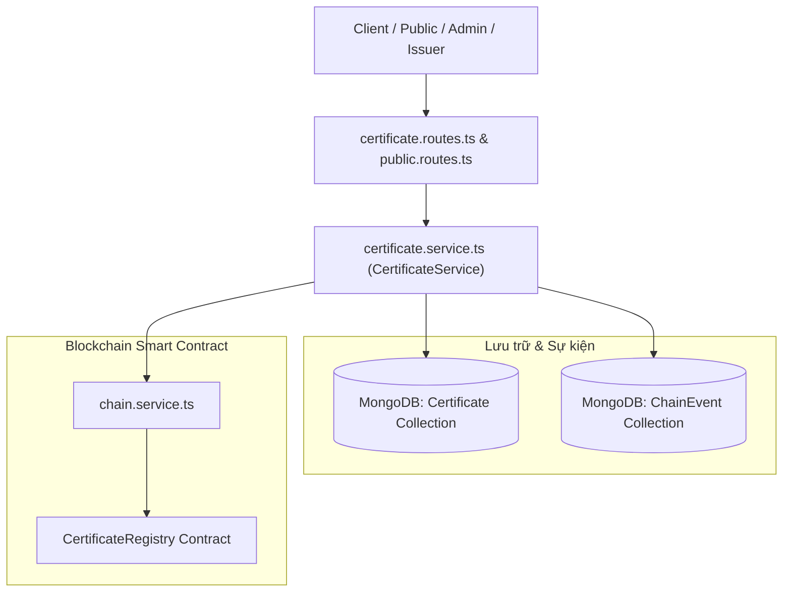
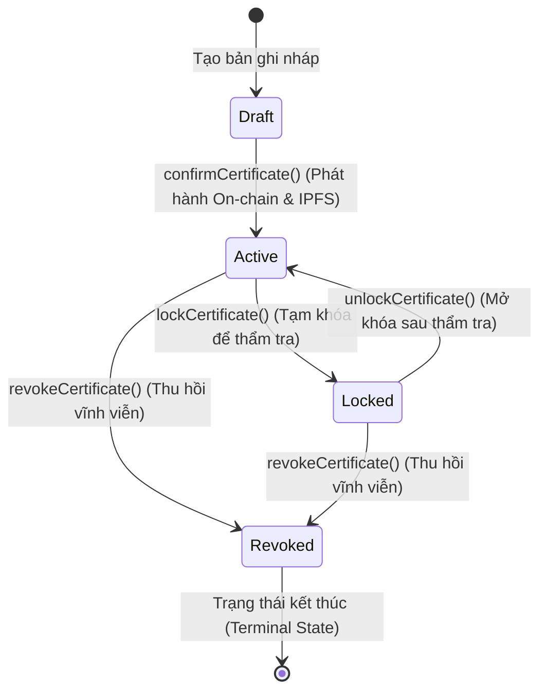

# Kiến Trúc Dịch Vụ Văn Bằng và Quản Trị Vòng Đời (Certificate Service Architecture & Lifecycle)

Tài liệu này đặc tả chi tiết kiến trúc, máy trạng thái hữu hạn (Finite State Machine), cơ chế đối chiếu bất biến On-chain và công cụ tra cứu thông minh tại [backend/src/services/certificate.service.ts](file:///d:/VC_Blockchain/VC/backend/src/services/certificate.service.ts).

---

## 1. Tổng Quan Kiến Trúc (Architecture Overview)

Trong giải pháp Verifiable Credentials, [certificate.service.ts](file:///d:/VC_Blockchain/VC/backend/src/services/certificate.service.ts) là trái tim xử lý nghiệp vụ của toàn bộ hệ thống. Dịch vụ này thực thi hai nhiệm vụ cốt lõi:
1. **Quản trị toàn vẹn vòng đời văn bằng số**: Điều phối các giai đoạn từ tạo nháp, xác nhận phát hành lên Blockchain/IPFS, tạm khóa thẩm tra, mở khóa đến thu hồi vĩnh viễn.
2. **Cung cấp động cơ tra cứu và thẩm định công khai**: Phục vụ nhu cầu xác minh văn bằng tức thì của nhà tuyển dụng và cộng đồng thông qua mã chứng chỉ, mã băm SHA-256 hoặc mã số sinh viên.

---

## 2. Máy Trạng Thái Vòng Đời Văn Bằng (State Machine)

Mỗi văn bằng trong hệ thống tuân theo mô hình máy trạng thái nghiêm ngặt nhằm đảm bảo tính bất biến và độ tin cậy pháp lý:

### Các trạng thái và quy tắc chuyển dịch:
- **`draft`**: Bản ghi tạm thời trên cơ sở dữ liệu, chưa đưa lên chuỗi.
- **`active`**: Đã được ký và neo băm (Anchored) trên Smart Contract; tệp PDF đã lưu trữ phân tán trên IPFS. Văn bằng có hiệu lực đầy đủ.
- **`locked`**: Trạng thái tạm khóa. Chỉ đơn vị phát hành (Issuer) sở hữu mới có quyền khóa khi phát hiện nghi vấn hoặc cần đính chính thông tin. Trong thời gian khóa, cổng xác minh công khai sẽ báo chứng chỉ không hợp lệ (`valid: false`).
- **`revoked`**: Trạng thái thu hồi vĩnh viễn do sai phạm nghiêm trọng hoặc thu hồi bằng cấp. **Đây là trạng thái kết thúc (Terminal State)**, một khi đã thu hồi thì không thể kích hoạt lại trên Blockchain.

---

## 3. Phân Tích Logic Nghiệp Vụ Cốt Lõi

### 3.1. Xác nhận phát hành (`confirmCertificate`)
Thực hiện chuyển đổi chứng chỉ sang trạng thái `active`:
1. **Kiểm tra trùng lặp kép**:
   - Nếu `certificateId` đã tồn tại: kiểm tra nếu cùng `txHash` thì trả về bản ghi hiện có (Idempotent), nếu khác `txHash` báo lỗi 409 `CERTIFICATE_EXISTS`.
   - Nếu `fileHash` (SHA-256) đã tồn tại: báo lỗi 409 `HASH_EXISTS` (mỗi file PDF chỉ được cấp bằng một lần duy nhất).
2. **Đối chiếu sự kiện On-chain**:
   Gọi hàm `findCertificateIssuedEvent(txHash, ...)` để đảm bảo giao dịch phát hành thực sự đã thành công trên Ethereum với đúng mã bằng, mã file hash và ví của Issuer.
3. **Trích xuất thuộc tính tìm kiếm đa hình (`extractSearchFields`)**:
   Tự động bóc tách các trường `major`, `graduationYear`, `gpa`, `classification` dựa trên phân loại `degree`, `course`, `credit`, `other`.
4. **Lưu trữ đồng bộ**:
   Lưu vào bảng `Certificate` đồng thời ghi log vào bảng `ChainEvent` phục vụ kiểm toán (Auditing).

---

### 3.2. Thu hồi văn bằng (`revokeCertificate`)
1. **Phân quyền chặt chẽ**:
   Chỉ Quản trị viên (`role: "admin"`) hoặc chính Đơn vị đã phát hành (`actor.walletAddress === doc.issuerWallet`) mới có quyền thu hồi. Người lạ bị chặn với lỗi 403 `FORBIDDEN`.
2. **Tính lũy thừa (Idempotency)**:
   Nếu bằng đã ở trạng thái `revoked` và gửi lại cùng một `txHash`, hàm trả về kết quả thành công ngay mà không ghi trùng dữ liệu. Nếu gửi với một `txHash` khác, báo lỗi 409 `ALREADY_REVOKED`.
3. **Đối chiếu Smart Contract**:
   Gọi `getCertificateOnChain(certificateId)` để đảm bảo cờ `isRevoked` trên chuỗi đã chuyển thành `true`. Nếu giao dịch trên chuỗi thất bại hoặc revert, hàm lập tức ném lỗi 422 `TX_INVALID`.

---

### 3.3. Tạm khóa và Mở khóa (`lockCertificate` & `unlockCertificate`)
- **`lockCertificate`**: Chỉ cho phép Issuer sở hữu thực hiện tạm khóa. Trạng thái chuyển thành `locked`, lưu `lockTxHash` và `lockedAt`.
- **`unlockCertificate`**: Cho phép Issuer hoặc Admin mở khóa sau khi hoàn tất kiểm tra. Xóa sạch các trường khóa (`lockedAt = null`, `lockTxHash = null`) và đưa trạng thái trở lại `active`.

---

## 4. Động Cơ Tra Cứu và Thẩm Định Công Khai (Public Query Engine)

### 4.1. Nhận diện từ khóa thông minh (`searchPublicCertificates`)
Hàm tự động phân tích cấu trúc của từ khóa tìm kiếm `q` để tối ưu hóa truy vấn MongoDB:
- **Chuỗi số 6–12 ký tự (`/^[0-9]{6,12}$/`)**: Tự động gán vào điều kiện tìm kiếm theo Mã số sinh viên (`studentCode = q`).
- **Mã định dạng UIT (`/^UIT-[A-Z]+-[0-9]{4}-[0-9]{4}$/i`)**: Tự động chuyển hoa và tìm chính xác theo `certificateId`.
- **Từ khóa văn bản thông thường**: Chuẩn hóa không dấu qua hàm `normalizeText` và tìm kiếm bằng biểu thức chính quy (Regex `$or`) trên hai trường `studentNameNormalized` và `majorNormalized`.

### 4.2. Thẩm định tệp qua mã băm SHA-256 (`verifyCertificateHash`)
- Cho phép người dùng tải file PDF lên để xác minh tính toàn vẹn.
- Gọi hàm `verifyHashOnChain(fileHash)` trực tiếp trên Smart Contract.
- Nếu mã băm tồn tại trên chuỗi, hàm kết hợp dữ liệu on-chain với bản ghi database để trả về kết quả thẩm định toàn diện:
  $$\text{valid} = \text{exists} \land (\neg \text{isRevoked}) \land (\neg \text{isLocked})$$

### 4.3. Bảo vệ quyền riêng tư danh sách gần đây (`listRecentCertificates`)
Để tránh lộ lọt thông tin cá nhân của người học trên trang chủ công khai, hàm sử dụng các tiện ích làm mờ:
- Họ tên: `maskName("Nguyễn Văn An")` $\rightarrow$ `"N*****n V*n A*"`
- MSSV: `maskCode("2311095")` $\rightarrow$ `"231****"`

---

## 5. Ma Trận Phân Quyền Nghiệp Vụ (Access Control Matrix)

| Chức năng | Khách vãng lai (Public) | Người học (Student) | Đơn vị cấp bằng (Issuer) | Quản trị viên (Admin) |
| :--- | :---: | :---: | :---: | :---: |
| Tra cứu danh sách công khai | ✅ | ✅ | ✅ | ✅ |
| Thẩm định tệp qua mã băm SHA-256 | ✅ | ✅ | ✅ | ✅ |
| Xem chi tiết văn bằng công khai | ✅ | ✅ | ✅ | ✅ |
| Xem danh sách văn bằng đã cấp | ❌ | ❌ | ✅ (Chỉ bằng của mình) | ✅ (Toàn hệ thống) |
| Phát hành văn bằng mới | ❌ | ❌ | ✅ | ✅ |
| Tạm khóa văn bằng (`lock`) | ❌ | ❌ | ✅ (Chỉ bằng của mình) | ❌ |
| Mở khóa văn bằng (`unlock`) | ❌ | ❌ | ✅ (Chỉ bằng của mình) | ✅ |
| Thu hồi văn bằng (`revoke`) | ❌ | ❌ | ✅ (Chỉ bằng của mình) | ✅ (Mọi văn bằng) |

---

## 6. Kiểm Thử Đơn Vị Tương Ứng

Tất cả các kịch bản của dịch vụ này được kiểm thử tự động tại:
- [certificate.service.test.ts](file:///d:/VC_Blockchain/VC/backend/src/services/__tests__/certificate.service.test.ts): Kiểm thử 8 kịch bản thu hồi và phân quyền.
- [admin-certificates.test.ts](file:///d:/VC_Blockchain/VC/backend/src/services/__tests__/admin-certificates.test.ts): Kiểm thử phân trang và bộ lọc quản trị.
