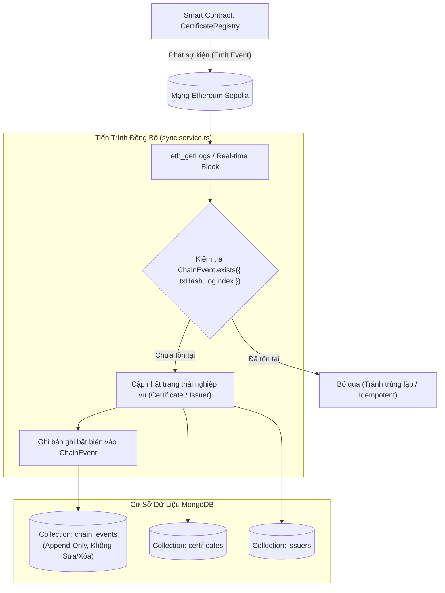

# Kiến Trúc Mô Hình Nhật Ký Sự Kiện Blockchain và Kiểm Toán Bất Biến (ChainEvent Model & Audit Trail Architecture)

Tài liệu này đặc tả chi tiết thiết kế mô hình dữ liệu Mongoose cho nhật ký sự kiện chuỗi khối (Blockchain Event Log), cơ chế ghi dữ liệu chỉ thêm mới (Append-Only), giải pháp chống trùng lặp sự kiện (Idempotency) và khả năng tái lập trạng thái (Event Sourcing) tại [backend/src/models/ChainEvent.ts](file:///d:/VC_Blockchain/VC/backend/src/models/ChainEvent.ts).

---

## 1. Tổng Quan Kiến Trúc (Architecture Overview)

Trong kiến trúc hệ thống xác thực văn bằng trên nền tảng Web3, dữ liệu trạng thái trên cơ sở dữ liệu off-chain (MongoDB) phản ánh trực tiếp các sự kiện thực tế đã diễn ra trên Smart Contract.

Mô hình `ChainEvent` đóng hai vai trò cốt lõi:
1. **Sổ Lưu Vết Bất Biến (Immutable Audit Trail)**: Lưu trữ trung thực, nguyên bản toàn bộ các sự kiện thô (raw logs & payloads) do hợp đồng thông minh `CertificateRegistry` phát ra, phục vụ kiểm toán độc lập và giải quyết tranh chấp pháp lý.
2. **Kho Chống Trùng Lặp (Idempotency Store)**: Hoạt động như một bộ lọc chốt chặn (Deduplication Guard) ngăn ngừa việc áp dụng một sự kiện nhiều lần vào cơ sở dữ liệu khi hệ thống quét bù (backfill) hoặc khi có hiện tượng tái phát log từ node RPC.



---

## 2. Đặc Tả Dữ Liệu & Quy Tắc Xác Thực (Schema & Validation Rules)

Mô hình `chainEventSchema` được thiết kế tối ưu với tính chất **chỉ thêm mới (Append-Only)**:
- Không tạo trường `updatedAt` (`timestamps: { createdAt: true, updatedAt: false }`), khẳng định sự kiện chuỗi khối là bất biến, không thể bị chỉnh sửa sau khi đã ghi nhận.
- Vô hiệu hóa trường phiên bản `__v` (`versionKey: false`) nhằm giảm thiểu phụ tải lưu trữ.

### 2.1. Danh Mục Thuộc Tính
| Thuộc Tính | Kiểu Dữ Liệu | Ràng Buộc & Định Dạng | Ý Nghĩa Kỹ Thuật |
| :--- | :--- | :--- | :--- |
| `txHash` | `String` | Bắt buộc, chữ thường, Regex `^0x[a-f0-9]{64}$` | Mã băm giao dịch Ethereum (32 bytes hex) chứa sự kiện. |
| `logIndex` | `Number` | Bắt buộc, `min: 0` | Thứ tự vị trí của event log trong giao dịch (Transaction Receipt). |
| `blockNumber` | `Number` | Bắt buộc, `min: 0` | Số hiệu khối trên chuỗi khối chứa giao dịch. |
| `eventType` | `String` | Bắt buộc, Enum 6 loại sự kiện | Định danh loại sự kiện được phát ra từ Smart Contract. |
| `payload` | `Mixed` | Bắt buộc | Đối số chi tiết của sự kiện (đã giải mã qua ABI và chuẩn hóa BigInt sang String). |
| `contractAddress` | `String` | Bắt buộc, chữ thường, Regex `^0x[a-f0-9]{40}$` | Địa chỉ ví của Smart Contract nguồn phát ra sự kiện. |
| `processedAt` | `Date` | Mặc định `new Date()` | Thời điểm tiến trình backend hoàn tất xử lý sự kiện. |
| `createdAt` | `Date` | Tự động sinh | Thời điểm bản ghi được chèn vào MongoDB. |

### 2.2. Phân Loại Sự Kiện (`ChainEventType`)
1. `CertificateIssued`: Đơn vị cấp phát hành thành công văn bằng mới lên Blockchain.
2. `CertificateRevoked`: Văn bằng bị thu hồi vĩnh viễn bởi đơn vị cấp hoặc quản trị viên hợp đồng.
3. `CertificateLocked`: Văn bằng bị tạm khóa phục vụ công tác thanh tra / giải quyết khiếu nại.
4. `CertificateUnlocked`: Văn bằng được mở khóa, khôi phục trạng thái hoạt động bình thường.
5. `IssuerUpdated`: Đơn vị cấp bằng được đăng ký mới, kích hoạt lại hoặc thu hồi quyền cấp bằng on-chain.
6. `OwnershipTransferred`: Quyền quản trị tối cao của Smart Contract được chuyển nhượng.

---

## 3. Cơ Chế Đảm Bảo Tính Lũy Thừa (Idempotency Guard)

Trong môi trường mạng phân tán và Blockchain, rủi ro nhận trùng lặp sự kiện (Duplicate Events) có thể phát sinh do:
- Tiến trình quét bù lịch sử (`backfillEvents`) quét lại các dải khối giao thoa.
- Trình lắng nghe thời gian thực (`onBlock`) nhận cùng lúc với truy vấn RPC định kỳ.
- Hiện tượng Reorg (tổ chức lại khối ở mức độ nhẹ) trên mạng thử nghiệm.

Để triệt tiêu hoàn toàn rủi ro này, `ChainEvent` áp dụng **Chỉ mục phức hợp duy nhất (Compound Unique Index)**:
```typescript
chainEventSchema.index({ txHash: 1, logIndex: 1 }, { unique: true });
```

### Tại sao cần cặp `(txHash, logIndex)`?
- Trong chuẩn EVM (Ethereum Virtual Machine), một giao dịch duy nhất có thể kích hoạt nhiều sự kiện liên tiếp (ví dụ: cấp đồng loạt nhiều văn bằng trong cùng một hàm batch hoặc vừa cập nhật đơn vị phát hành vừa cấp bằng).
- Do đó, riêng `txHash` là chưa đủ để định danh một sự kiện. Sự kết hợp giữa `txHash` và `logIndex` (chỉ số của log trong receipt) tạo thành **mã định danh toàn cục duy nhất trên toàn mạng lưới Ethereum**.

---

## 4. Hỗ Trợ Tái Thiết Lập Trạng Thái (Event Sourcing & Replayability)

Nhờ việc lưu trữ đầy đủ `payload` nguyên bản của từng sự kiện, hệ thống sở hữu năng lực **Event Sourcing**:
- **Khôi phục thảm họa (Disaster Recovery)**: Nếu cơ sở dữ liệu `certificates` hoặc `issuers` bị sai lệch trạng thái hoặc lỗi dữ liệu nghiêm trọng, hệ thống có thể hoàn toàn tái lập lại 100% dữ liệu chính xác bằng cách duyệt lại toàn bộ các bản ghi trong `chain_events` theo thứ tự:
  $$\text{Sort: } \text{blockNumber ASC, logIndex ASC}$$
- **Kiểm toán độc lập (Independent Audit)**: Bất kỳ bên thứ ba nào cũng có thể kiểm chứng tính trung thực của dữ liệu hệ thống bằng cách so sánh từng bản ghi `ChainEvent` trong MongoDB với log thực tế trên Blockchain Explorer (Etherscan/Sepolia).

---

## 5. Chiến Lược Đánh Chỉ Mục (Indexing Strategy)

Để đảm bảo hiệu năng tối ưu cho cả tác vụ ghi và truy vấn kiểm toán:

1. **`{ txHash: 1, logIndex: 1 }` (`unique: true`)**:
   - Tối ưu hóa truy vấn kiểm tra trùng lặp `ChainEvent.exists({ txHash, logIndex })` đạt độ phức tạp $O(1)$.
   - Khóa chặn cứng ở tầng Database không cho phép bất kỳ dữ liệu trùng lặp nào được ghi vào.
2. **`{ blockNumber: 1 }`**:
   - Phục vụ truy vấn phân dải khối khi kiểm toán dữ liệu phát sinh trong một khoảng thời gian nhất định (tương ứng với dải block).
3. **`{ eventType: 1, blockNumber: -1 }`**:
   - Phục vụ các màn hình giám sát và Dashboard quản trị: ví dụ xem danh sách 50 văn bằng bị thu hồi gần nhất (`eventType = "CertificateRevoked"`) sắp xếp theo khối mới nhất.
