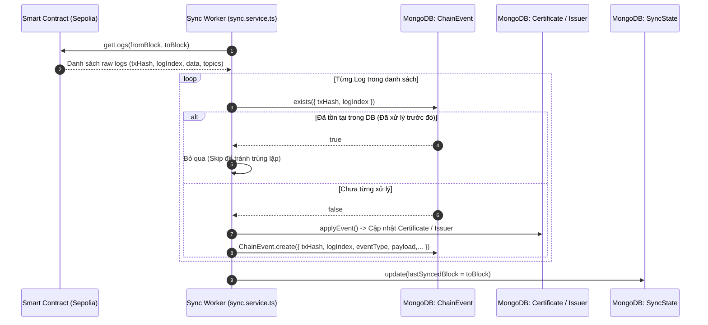

# Giải thích Chi tiết Logic & Mã nguồn `backend/src/models/ChainEvent.ts`

Tài liệu này giải thích chi tiết vai trò, kiến trúc dữ liệu, cơ chế bảo đảm tính lũy thừa (Idempotency), chiến lược đánh chỉ mục và mã nguồn của file [`backend/src/models/ChainEvent.ts`](file:///d:/VC_Blockchain/VC/backend/src/models/ChainEvent.ts).

---

## 1. Vai trò và Vị trí trong Hệ thống

Trong kiến trúc của hệ thống **Verify Certification**, blockchain Ethereum Sepolia là **Nguồn Chân Lý (Single Source of Truth)** cho mọi trạng thái của văn bằng và đơn vị cấp. Tuy nhiên, việc liên tục truy vấn trực tiếp lên RPC node của Ethereum mỗi khi người dùng tải trang sẽ gây chậm trễ (độ trễ cao) và tốn kém chi phí hạ tầng.

File `ChainEvent.ts` đóng vai trò là **Audit Trail (Nhật ký kiểm toán)** và **Idempotency Store (Kho lưu trữ đảm bảo tính lũy thừa)** cho toàn bộ sự kiện smart contract:
1. **Lưu vết thô bất biến (Raw Event Store)**: Lưu trữ trung thực mọi sự kiện phát ra từ hợp đồng [`CertificateRegistry.sol`](file:///d:/VC_Blockchain/VC/contracts/contracts/CertificateRegistry.sol).
2. **Đảm bảo tính lũy thừa (Idempotency Guard)**: Ngăn chặn việc xử lý trùng lặp một sự kiện khi worker đồng bộ (`sync.service.ts`) quét lại các khối cũ hoặc khi mạng lưới bị fork/re-org nhẹ.
3. **Khả năng phục hồi sau sự cố (Disaster Recovery)**: Nếu dữ liệu nghiệp vụ trong bảng `Certificate` hoặc `Issuer` bị sai lệch, quản trị viên có thể replay lại toàn bộ luồng sự kiện từ `DEPLOY_BLOCK` để tái tạo lại trạng thái dữ liệu chính xác 100%.

---

## 2. Luồng Đồng bộ Sự kiện (Event Synchronization Flow)

Sơ đồ dưới đây minh họa cách `ChainEvent` phối hợp cùng `sync.service.ts` và smart contract:



---

## 3. Phân tích Cấu trúc Dữ liệu `IChainEvent`

Mỗi bản ghi trong collection `chainevents` đại diện cho một log event duy nhất trên Ethereum:

| Tên trường | Kiểu dữ liệu | Bắt buộc | Ý nghĩa & Vai trò kỹ thuật |
|---|---|---|---|
| `txHash` | `string` | Có | Hash của giao dịch Ethereum (32 bytes hex bắt đầu bằng `0x`). Được chuẩn hóa viết thường (`lowercase: true`) để tránh lỗi phân biệt hoa thường khi tìm kiếm. |
| `logIndex` | `number` | Có | Thứ tự vị trí của event log trong giao dịch đó (bắt đầu từ `0`). |
| `blockNumber` | `number` | Có | Số thứ tự khối chứa giao dịch (giúp kiểm soát tiến trình đồng bộ). |
| `eventType` | `ChainEventType` | Có | Tên sự kiện: `CertificateIssued`, `CertificateRevoked`, `CertificateLocked`, `CertificateUnlocked`, `IssuerUpdated`, `OwnershipTransferred`. |
| `payload` | `Record<string, unknown>` | Có | Dữ liệu chi tiết của sự kiện đã được giải mã thông qua ABI parser (chuyển đổi `BigInt` thành `string` an toàn). |
| `contractAddress` | `string` | Có | Địa chỉ smart contract phát ra sự kiện, dùng để lọc đúng contract của hệ thống. |
| `processedAt` | `Date` | Không (Mặc định `now`) | Thời điểm backend hoàn tất việc áp dụng nghiệp vụ và lưu sự kiện vào MongoDB. |
| `createdAt` | `Date` | Tự động | Thời điểm bản ghi được tạo trong MongoDB (nhờ `timestamps: { createdAt: true, updatedAt: false }`). |

> [!NOTE]
> `ChainEvent` được cấu hình **Append-Only** (`updatedAt: false`): Một khi sự kiện trên blockchain đã được xác nhận và ghi vào MongoDB, nó là bất biến và **không bao giờ được phép sửa đổi**.

---

## 4. Chiến lược Đánh Chỉ mục (Indexing Strategy)

Các chỉ mục trong `ChainEvent` được thiết kế tối ưu cho 3 bài toán chính:

### 4.1. Chỉ mục Unique phức hợp `{ txHash: 1, logIndex: 1 }`
- **Bài toán**: Tại sao chỉ dùng `txHash` làm khóa duy nhất là **sai**?
  - Trong Ethereum, một giao dịch có thể phát ra **nhiều sự kiện khác nhau** (ví dụ: cấp nhiều chứng chỉ trong một hàm batch, hoặc vừa phát ra event nghiệp vụ vừa phát ra event nội bộ).
  - Vì vậy, một `txHash` có thể xuất hiện nhiều lần với các `logIndex` khác nhau (`logIndex = 0, 1, 2,...`).
- **Giải pháp**: Cặp `(txHash, logIndex)` là định danh duy nhất tuyệt đối trong toàn bộ mạng lưới EVM.
- **Tác dụng**: Giúp hàm `processEvent` kiểm tra tồn tại cực nhanh ($O(1)$) và ngăn chặn hoàn toàn hiện tượng duplicate data kể cả khi có nhiều worker chạy đồng thời.

### 4.2. Chỉ mục `{ blockNumber: 1 }`
- **Tác dụng**:
  - Hỗ trợ tra cứu xem các sự kiện của một khoảng block cụ thể đã được đồng bộ đầy đủ hay chưa.
  - Phục vụ việc kiểm tra phát hiện "lỗ hổng block" (block gap detection).

### 4.3. Chỉ mục kép `{ eventType: 1, blockNumber: -1 }`
- **Tác dụng**:
  - Tối ưu hóa các câu truy vấn lọc theo loại sự kiện cụ thể (ví dụ: lấy 50 sự kiện `CertificateRevoked` gần nhất để hiển thị nhật ký cảnh báo trên Admin Dashboard).
  - Sắp xếp `blockNumber: -1` giúp lấy ngay các sự kiện mới nhất mà không phải duyệt qua toàn bộ bảng.

---

## 5. Mã nguồn Đầy đủ có Chú thích Chi tiết

Dưới đây là mã nguồn của [`backend/src/models/ChainEvent.ts`](file:///d:/VC_Blockchain/VC/backend/src/models/ChainEvent.ts) với hệ thống chú thích đầy đủ:

```typescript
import {
  Schema,
  model,
  type HydratedDocument,
  type Model,
} from "mongoose";

/**
 * Các loại sự kiện (Event) được phát ra từ Smart Contract CertificateRegistry trên blockchain:
 * - CertificateIssued: Đơn vị cấp phát hành một văn bằng mới.
 * - CertificateRevoked: Văn bằng bị thu hồi vĩnh viễn (bởi Issuer hoặc Owner).
 * - CertificateLocked: Văn bằng bị tạm khóa phục vụ điều tra sai sót.
 * - CertificateUnlocked: Văn bằng được gỡ khóa trở lại trạng thái hợp lệ.
 * - IssuerUpdated: Đơn vị cấp được thêm mới, kích hoạt lại hoặc vô hiệu hóa quyền cấp.
 * - OwnershipTransferred: Quyền quản trị viên hợp đồng được chuyển giao.
 */
export type ChainEventType =
  | "CertificateIssued"
  | "CertificateRevoked"
  | "CertificateLocked"
  | "CertificateUnlocked"
  | "IssuerUpdated"
  | "OwnershipTransferred";

/**
 * Interface định nghĩa dữ liệu của một sự kiện Blockchain đã được lưu vết trong MongoDB.
 *
 * Mô hình này hoạt động như một Audit Trail (Nhật ký kiểm toán) và Idempotency Store:
 * - Lưu giữ toàn bộ lịch sử thô (raw events) của smart contract để truy vết và phục hồi dữ liệu khi cần.
 * - Đảm bảo tính lũy thừa (Idempotency): mỗi event chỉ được xử lý đúng một lần duy nhất.
 */
export interface IChainEvent {
  /** Mã băm giao dịch Ethereum (32 bytes hex bắt đầu bằng 0x) */
  txHash: string;
  /** Vị trí (index) của log event trong giao dịch, phân biệt các event phát ra trong cùng một tx */
  logIndex: number;
  /** Số hiệu khối (block number) trên blockchain chứa sự kiện */
  blockNumber: number;
  /** Tên sự kiện smart contract tương ứng */
  eventType: ChainEventType;
  /** Dữ liệu chi tiết của sự kiện (các đối số arguments đã được giải mã từ ABI) */
  payload: Record<string, unknown>;
  /** Địa chỉ hợp đồng thông minh phát ra sự kiện */
  contractAddress: string;
  /** Thời điểm backend xử lý và lưu sự kiện vào cơ sở dữ liệu */
  processedAt: Date;
  /** Thời điểm bản ghi được tạo trong MongoDB */
  createdAt: Date;
}

export type ChainEventDocument = HydratedDocument<IChainEvent>;

/**
 * Mongoose Schema định nghĩa cấu trúc và ràng buộc cho ChainEvent.
 */
const chainEventSchema = new Schema<IChainEvent>(
  {
    // Hash giao dịch trên blockchain, viết thường và đúng định dạng 64 ký tự hex
    txHash: {
      type: String,
      required: true,
      lowercase: true,
      match: /^0x[a-f0-9]{64}$/,
    },
    // Vị trí của event log trong giao dịch
    logIndex: {
      type: Number,
      required: true,
      min: 0,
    },
    // Số thứ tự khối chứa giao dịch
    blockNumber: {
      type: Number,
      required: true,
      min: 0,
    },
    // Loại sự kiện phát ra từ smart contract
    eventType: {
      type: String,
      required: true,
      enum: [
        "CertificateIssued",
        "CertificateRevoked",
        "CertificateLocked",
        "CertificateUnlocked",
        "IssuerUpdated",
        "OwnershipTransferred",
      ],
    },
    // Dữ liệu giải mã của event (JSON linh hoạt lưu trữ các tham số của sự kiện)
    payload: {
      type: Schema.Types.Mixed,
      required: true,
    },
    // Địa chỉ hợp đồng thông minh phát ra event (20 bytes hex)
    contractAddress: {
      type: String,
      required: true,
      lowercase: true,
      match: /^0x[a-f0-9]{40}$/,
    },
    // Thời điểm backend hoàn thành việc xử lý nghiệp vụ của event
    processedAt: {
      type: Date,
      default: () => new Date(),
    },
  },
  {
    // Sự kiện blockchain là bất biến (append-only), chỉ cần createdAt, không có updatedAt
    timestamps: { createdAt: true, updatedAt: false },
    versionKey: false,
  }
);

// -----------------------------------------------------------------------------
// CHIẾN LƯỢC ĐÁNH CHỈ MỤC (INDEXING STRATEGY)
// -----------------------------------------------------------------------------

// 1. Chỉ mục Unique phức hợp: Đảm bảo tính lũy thừa (Idempotency)
// Cặp (txHash, logIndex) là định danh duy nhất trên toàn mạng Ethereum cho từng event log.
// Ngăn chặn hoàn toàn việc xử lý lại một sự kiện khi backfill hoặc quét lại các block cũ.
chainEventSchema.index({ txHash: 1, logIndex: 1 }, { unique: true });

// 2. Chỉ mục theo khối: Phục vụ tra cứu, phân đoạn và kiểm toán theo khoảng block
chainEventSchema.index({ blockNumber: 1 });

// 3. Chỉ mục kép: Phục vụ truy vấn lịch sử theo loại sự kiện, sắp xếp theo block mới nhất
chainEventSchema.index({ eventType: 1, blockNumber: -1 });

export const ChainEvent: Model<IChainEvent> = model<IChainEvent>(
  "ChainEvent",
  chainEventSchema
);
```

---

## 6. Tổng kết

Model `ChainEvent` là thành phần bảo vệ tính tin cậy cốt lõi trong kiến trúc đồng bộ giữa Blockchain và Cơ sở dữ liệu Off-chain. Bằng cách kết hợp giữa mô hình **Append-Only**, định danh phức hợp `(txHash, logIndex)` và cơ chế kiểm tra trước khi ghi (`exists check`), hệ thống đảm bảo dữ liệu luôn đạt trạng thái nhất quán cao nhất, không bị trùng lặp và sẵn sàng cho công tác kiểm toán độc lập.
