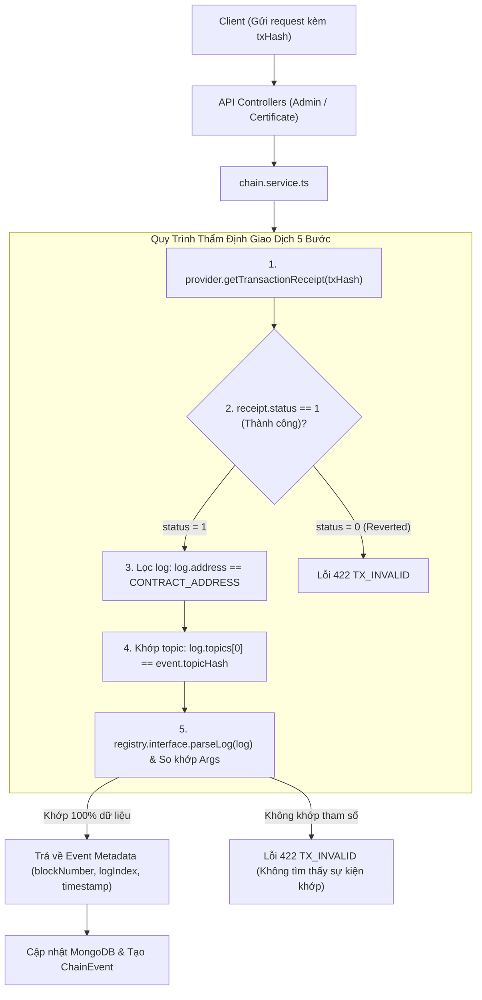

# Kiến Trúc Tích Hợp Blockchain và Dịch Vụ Chuỗi (Chain Service Architecture)

Tài liệu này đặc tả chi tiết kiến trúc tích hợp Web3, quy trình thẩm tra biên lai giao dịch (Receipt Verification Pipeline), cơ chế giải mã log sự kiện (Event Parsing) và đối chiếu dữ liệu Smart Contract tại [backend/src/services/chain.service.ts](file:///d:/VC_Blockchain/VC/backend/src/services/chain.service.ts).

---

## 1. Tổng Quan Kiến Trúc (Architecture Overview)

Trong một hệ thống cấp phát và xác minh văn bằng phi tập trung, Backend API không được phép tự ý thay đổi trạng thái văn bằng chỉ dựa vào tham số mà Client gửi lên. Để đảm bảo tính toàn vẹn và bất biến, [chain.service.ts](file:///d:/VC_Blockchain/VC/backend/src/services/chain.service.ts) hoạt động như một **lớp cổng kiểm tra tính xác thực (Oracle / Blockchain Bridge)**:
- Mọi thao tác quan trọng (phê duyệt Issuer, cấp bằng, thu hồi, tạm khóa, mở khóa) đều yêu cầu Client thực hiện giao dịch trên Ethereum trước.
- Backend tiếp nhận mã băm giao dịch (`txHash`), truy vấn trực tiếp lên mạng lưới Sepolia qua JSON-RPC Provider, trích xuất biên lai giao dịch (Transaction Receipt) và giải mã Log sự kiện để đối chiếu với dữ liệu nghiệp vụ.



---

## 2. Thiết Lập Kết Nối & Khởi Tạo Smart Contract

### 2.1. JSON-RPC Provider
```typescript
export const provider = new JsonRpcProvider(env.SEPOLIA_RPC_URL, env.CHAIN_ID, {
  staticNetwork: true,
});
```
- Sử dụng cấu hình `staticNetwork: true` nhằm tối ưu hóa hiệu năng: Ethers.js sẽ không cần gửi thêm lệnh `eth_chainId` để kiểm tra mạng ở mỗi request, giảm 50% số lượng truy vấn RPC node.

### 2.2. Hợp đồng thông minh `CertificateRegistry`
```typescript
export const registry = new Contract(env.CONTRACT_ADDRESS, abi, provider);
```
- Khởi tạo thực thể Contract chỉ đọc (Read-only Instance) kết hợp với file ABI [CertificateRegistry.json](file:///d:/VC_Blockchain/VC/backend/src/abi/CertificateRegistry.json), cho phép gọi các hàm `view` và giải mã logs.

---

## 3. Chi Tiết Các Chức Năng Xác Minh & Đọc Dữ Liệu

### 3.1. Xác minh sự kiện phê duyệt Đơn vị phát hành (`findIssuerUpdatedEvent`)
- **Mục đích**: Đảm bảo địa chỉ ví của đơn vị cấp phát đã được Quản trị viên hợp đồng thêm vào Smart Contract.
- **Tiêu chí so khớp**:
  - `receipt.status === 1`
  - `issuer.toLowerCase() === wallet.toLowerCase()`
  - `active === expectedActive`
  - `name === expectedName`
- **Kết quả**: Trả về `blockNumber`, `logIndex`, `name`, `active`.

---

### 3.2. Xác minh sự kiện phát hành văn bằng (`findCertificateIssuedEvent`)
- **Mục đích**: Xác nhận giao dịch mint chứng chỉ số đã được thực thi thành công bởi chính đơn vị cấp bằng.
- **Tiêu chí so khớp**:
  - Khớp mã chứng chỉ: `parsed.args.certificateId === expected.certificateId`
  - Khớp mã băm tệp PDF: `parsed.args.fileHash === expected.fileHash`
  - Khớp địa chỉ ví phát hành: `parsed.args.issuer.toLowerCase() === expected.issuerWallet.toLowerCase()`
- **Kết quả**: Trả về `blockNumber`, `logIndex` và mốc thời gian khối `issuedAt`.

---

### 3.3. Đọc dữ liệu văn bằng On-chain (`getCertificateOnChain`)
- Gọi hàm view `registry.getCertificate(certificateId)`.
- **Xử lý ngoại lệ thân thiện**:
  Nếu chứng chỉ chưa từng được phát hành trên chuỗi, Smart Contract sẽ ném lỗi revert (Ethers báo `CALL_EXCEPTION` hoặc `BAD_DATA`). Hàm bắt lỗi này và trả về `null` thay vì làm sập ứng dụng:
  ```typescript
  if (code === "CALL_EXCEPTION" || code === "BAD_DATA") {
    return null;
  }
  ```

---

### 3.4. Xác minh sự kiện thu hồi văn bằng (`findCertificateRevokedEvent`)
- Trên Smart Contract, sự kiện `CertificateRevoked` lưu trữ định danh dưới dạng mã băm Keccak-256 (`bytes32 indexed idHash`).
- Hàm tự động tính toán mã băm tương ứng:
  ```typescript
  const expectedIdHash = keccak256(toUtf8Bytes(certificateId));
  ```
- Duyệt logs và so khớp `parsed.args.idHash.toLowerCase() === expectedIdHash.toLowerCase()`.

---

### 3.5. Xác minh sự kiện Tạm khóa & Mở khóa (`findCertificateLockEvent`)
Hàm trợ giúp dùng chung cho cả hai nghiệp vụ khóa (`CertificateLocked`) và mở khóa (`CertificateUnlocked`):
```typescript
async function findCertificateLockEvent(
  txHash: string,
  certificateId: string,
  eventName: "CertificateLocked" | "CertificateUnlocked",
  timestampArg: "lockedAt" | "unlockedAt"
): Promise<CertificateLockEvent>
```
Giúp tái sử dụng mã nguồn, giảm trùng lặp logic kiểm tra receipt và duyệt logs.

---

### 3.6. Thẩm định tệp trực tiếp trên chuỗi (`verifyHashOnChain`)
```typescript
export async function verifyHashOnChain(fileHash: string)
```
- Gọi trực tiếp hàm view `verifyByHash(fileHash)` của Smart Contract.
- Phản hồi tức thì trạng thái:
  - `exists`: Mã băm có tồn tại trên Blockchain hay không.
  - `valid`: Chứng chỉ có đang hợp lệ hay không (phải thỏa mãn: `exists == true` VÀ `!isRevoked` VÀ `!isLocked`).
  - `certificateId`, `issuer`, `issuedAt`.

---

## 4. Ma Trận Xử Lý Lỗi Phân Tầng (Error Handling Strategy)

| Mã lỗi HTTP | Tên mã lỗi | Tình huống phát sinh | Giải thích ý nghĩa |
| :---: | :--- | :--- | :--- |
| **`422`** | `TX_INVALID` | Giao dịch revert (`status = 0`) hoặc không khớp log | Dữ liệu giao dịch không hợp lệ hoặc người dùng cung cấp sai transaction hash |
| **`502`** | `CHAIN_ERROR` | Lỗi kết nối RPC node, timeout hoặc mạng Sepolia nghẽn | Lỗi hạ tầng mạng Blockchain bên ngoài, khuyến khích thử lại |
| **`500`** | `INTERNAL_ERROR` | File ABI thiếu định nghĩa sự kiện | Lỗi cấu hình nội bộ hệ thống giữa file ABI và Smart Contract |

---

## 5. Bảng Ánh Xạ Sự Kiện Smart Contract

| Tên sự kiện On-chain | Các tham số sự kiện | Hàm thẩm định tương ứng |
| :--- | :--- | :--- |
| **`IssuerUpdated`** | `address indexed issuer, string name, bool active` | `findIssuerUpdatedEvent` |
| **`CertificateIssued`** | `bytes32 indexed idHash, string certificateId, string fileHash, address indexed issuer, uint256 issuedAt` | `findCertificateIssuedEvent` |
| **`CertificateRevoked`** | `bytes32 indexed idHash, address indexed issuer, uint256 revokedAt` | `findCertificateRevokedEvent` |
| **`CertificateLocked`** | `bytes32 indexed idHash, address indexed issuer, uint256 lockedAt` | `findCertificateLockedEvent` |
| **`CertificateUnlocked`** | `bytes32 indexed idHash, address indexed issuer, uint256 unlockedAt` | `findCertificateUnlockedEvent` |
