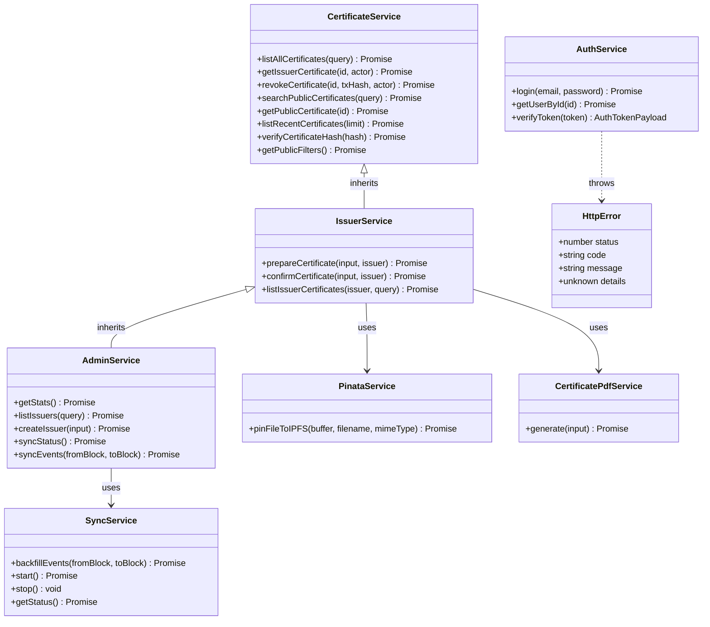
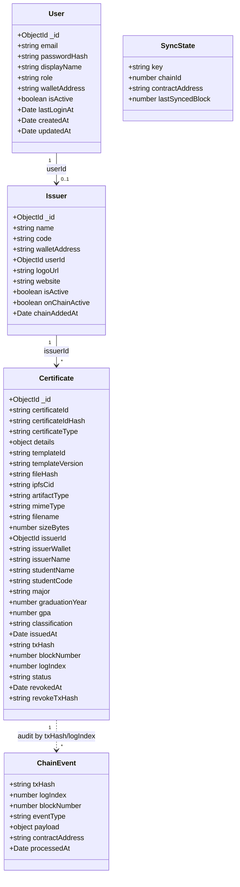
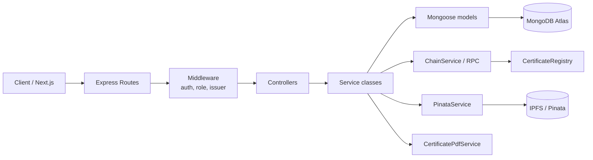
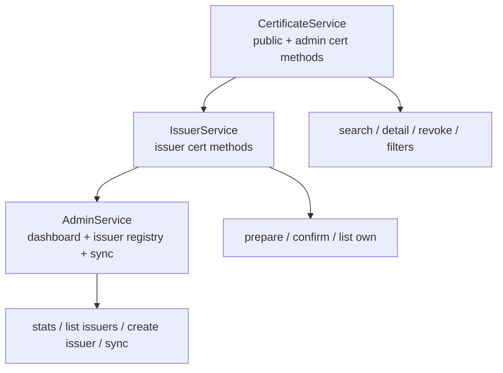
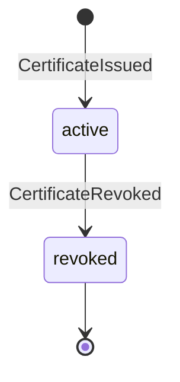

# Class Diagram — Verify Certification

> Sơ đồ lớp tầng service và mô hình dữ liệu.
>
> Code: `backend/src/services` · Models: `backend/src/models`

---

## 1. Service classes

> Ghi chú: `AdminService` kế thừa toàn bộ method của `IssuerService` và `CertificateService`. Việc kế thừa **không cấp quyền on-chain**; route/middleware và contract vẫn quyết định quyền thực tế.

---

## 2. Domain models

### Ràng buộc chính

| Model | Unique |
|---|---|
| `User` | `email`, `walletAddress` (sparse) |
| `Issuer` | `code`, `walletAddress`, `userId` (sparse) |
| `Certificate` | `certificateId`, `certificateIdHash`, `fileHash`, `txHash` |
| `ChainEvent` | `{ txHash, logIndex }` |
| `SyncState` | `key` |

---

## 3. Kiến trúc phân lớp

Controller vẫn là function module, không phải class. Class diagram tập trung vào **service layer** — nơi chứa nghiệp vụ.

---

## 4. Quan hệ kế thừa

`AdminService` có thể gọi:

- `prepareCertificate()`
- `confirmCertificate()`
- `listIssuerCertificates()`
- `revokeCertificate()`
- `getIssuerCertificate()`

nhưng route admin không expose `POST /api/certificates`; quyền vẫn bị giới hạn bởi middleware và contract.

---

## 5. Trạng thái chứng chỉ

- `status` trong DB là cache.
- Trang public đọc lại `isRevoked` từ chain.
- Event được đồng bộ bởi listener/backfill.
