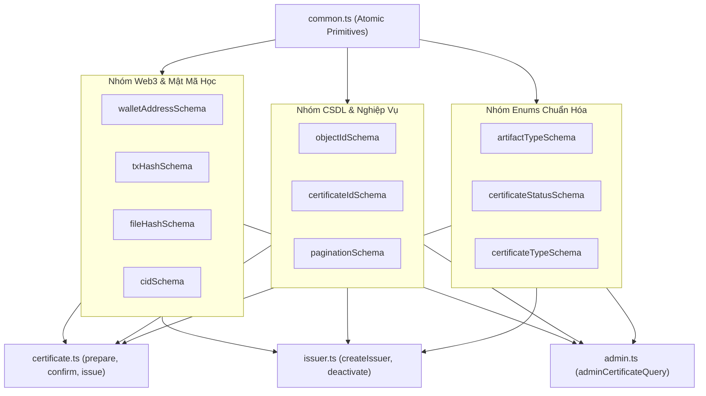

# Kiến Trúc và Các Kiểu Dữ Liệu Nguyên Tử (Common Schemas & Primitives)

Tài liệu này đặc tả chi tiết kiến trúc nền tảng, cơ chế chuẩn hóa dữ liệu (Normalization), các tiêu chuẩn kỹ thuật Web3 & Mật mã học và quy tắc bảo mật được cài đặt tại [backend/src/schemas/common.ts](file:///d:/VC_Blockchain/VC/backend/src/schemas/common.ts).

---

## 1. Vai Trò Kiến Trúc (Architectural Role)

Trong hệ thống xác minh văn bằng Verifiable Credentials, [common.ts](file:///d:/VC_Blockchain/VC/backend/src/schemas/common.ts) đóng vai trò là **nguồn chân lý duy nhất (Single Source of Truth - SSOT)** cho các kiểu dữ liệu nguyên tử (Atomic Primitives). Mọi schema phức hợp trong toàn bộ hệ thống (`certificate.ts`, `issuer.ts`, `admin.ts`, `auth.ts`) đều kế thừa hoặc sử dụng lại các khối xây dựng cơ bản này.



---

## 2. Đặc Tả Chi Tiết Từng Primitive Schema

### 2.1. Nhóm Web3 & Mật Mã Học (Web3 & Cryptography)

#### 1. `walletAddressSchema` (Địa chỉ ví Ethereum)
```typescript
export const walletAddressSchema = z
  .string()
  .regex(/^0x[a-fA-F0-9]{40}$/, "Địa chỉ ví không hợp lệ")
  .transform((value) => value.toLowerCase());
```
- **Chuẩn kỹ thuật**: Địa chỉ tài khoản Ethereum (EVM Account) gồm 20 bytes (40 ký tự thập lục phân kèm tiền tố `0x`).
- **Cơ chế Transform**: Tự động chuyển toàn bộ ký tự sang chữ thường (lowercase). 
  > [!NOTE]
  > Chuẩn **EIP-55** sử dụng chữ hoa/thường xen kẽ để tạo mã kiểm tra (checksum). Tuy nhiên, trong cơ sở dữ liệu MongoDB và so sánh chuỗi thông thường, việc không chuẩn hóa về chữ thường sẽ dẫn đến lỗi không tìm thấy bản ghi hoặc trùng lặp địa chỉ ví.

#### 2. `txHashSchema` (Mã băm giao dịch Blockchain)
```typescript
export const txHashSchema = z
  .string()
  .regex(/^0x[a-fA-F0-9]{64}$/, "Transaction hash không hợp lệ")
  .transform((value) => value.toLowerCase());
```
- **Chuẩn kỹ thuật**: 32 bytes (256 bits) mã băm Keccak-256 của giao dịch Ethereum, thể hiện bằng 64 ký tự hex + tiền tố `0x`.
- **Cơ chế Transform**: Chuyển về chữ thường để khớp tuyệt đối với định dạng phản hồi từ các thư viện Web3 (`ethers.js`, `viem`).

#### 3. `fileHashSchema` (Mã băm bảo toàn văn bằng)
```typescript
export const fileHashSchema = z
  .string()
  .regex(/^sha256:[a-f0-9]{64}$/, "File hash phải có dạng sha256:<64 hex>");
```
- **Chuẩn kỹ thuật**: Thuật toán băm an toàn **SHA-256**.
- **Định dạng chuẩn**: Tiền tố `sha256:` theo sau bởi chính xác 64 ký tự hex chữ thường. Đảm bảo file PDF khi phát hành không bao giờ bị tráo đổi nội dung.

#### 4. `cidSchema` (Content Identifier trên IPFS)
```typescript
export const cidSchema = z
  .string()
  .min(10, "CID quá ngắn")
  .max(100, "CID quá dài");
```
- **Hỗ trợ đa phiên bản**:
  - **CIDv0**: Bắt đầu bằng `Qm...` (chuẩn Base58btc, độ dài 46 ký tự).
  - **CIDv1**: Bắt đầu bằng `bafy...` (chuẩn Base32/Base36, độ dài thường từ 59 ký tự trở lên).
- Giới hạn từ 10 đến 100 ký tự ngăn chặn chèn các chuỗi rác gây tràn bộ nhớ.

---

### 2.2. Nhóm Cơ Sở Dữ Liệu & Nghiệp Vụ (Database & Domain)

#### 1. `objectIdSchema` (MongoDB BSON ObjectId)
```typescript
export const objectIdSchema = z
  .string()
  .regex(/^[a-fA-F0-9]{24}$/, "ObjectId không hợp lệ");
```
- Đảm bảo tham số URL hoặc ID liên kết luôn là một chuỗi 24 ký tự hex hợp lệ của MongoDB (12 bytes), ngăn ngừa lỗi `CastError` làm crash server.

#### 2. `certificateIdSchema` (Mã định danh văn bằng)
```typescript
export const certificateIdSchema = z
  .string()
  .min(6, "Mã chứng chỉ quá ngắn")
  .max(64, "Mã chứng chỉ quá dài")
  .regex(/^[A-Z0-9-]+$/, "Mã chứng chỉ chỉ gồm A-Z, 0-9 và dấu gạch ngang");
```
- Quy chuẩn mã định danh chứng chỉ của trường ĐH CNTT (UIT): chỉ cho phép chữ in hoa, số và dấu gạch ngang (ví dụ: `UIT-DEG-2026-0001`).

#### 3. `paginationSchema` (Phân trang bảo vệ tài nguyên)
```typescript
export const paginationSchema = z.object({
  page: z.coerce.number().int().min(1).default(1),
  limit: z.coerce.number().int().min(1).max(20).default(10),
});
```
- **Tự động ép kiểu (Coercion)**: Tham số truy vấn từ URL (`?page=2&limit=15`) vốn là kiểu `string`, được tự động chuyển thành kiểu `number`.
- **Chống DoS cạn kiệt bộ nhớ**: Giới hạn cứng `max(20)`. Người dùng không thể gửi yêu cầu lấy `limit=100000` làm cạn kiệt RAM server và MongoDB buffer pool.

---

### 2.3. Nhóm Enums Chuẩn Hóa (Standard Enums)

| Tên Schema | Giá trị Enums | Mục đích sử dụng |
| :--- | :--- | :--- |
| **`artifactTypeSchema`** | `["pdf", "image", "web"]` | Xác định định dạng tệp xuất bản của văn bằng. |
| **`certificateStatusSchema`** | `["active", "revoked", "locked"]` | Trạng thái vòng đời văn bằng: Đang hoạt động, Đã thu hồi, hoặc Đang tạm khóa. |
| **`certificateTypeSchema`** | `["degree", "course", "credit", "other"]` | 4 phân loại văn bằng chứng chỉ được hệ thống hỗ trợ. |

---

## 3. Lợi Ích Bảo Mật & Toàn Vẹn Hệ Thống

1. **Ngăn chặn SQL/NoSQL Injection**: Các Regex chặt chẽ cho `objectId`, `walletAddress`, `txHash` triệt tiêu nguy cơ chèn ký tự điều khiển độc hại vào câu truy vấn database.
2. **Loại bỏ sự không nhất quán dữ liệu (Data Normalization)**: Cơ chế `.transform()` chuyển địa chỉ ví và transaction hash về chữ thường đảm bảo dữ liệu tìm kiếm luôn đồng nhất giữa Backend, Smart Contract và Frontend Web3.
3. **Phòng thủ tài nguyên máy chủ**: `paginationSchema` chặn đứng việc tải dữ liệu ồ ạt, giữ cho thời gian phản hồi API luôn dưới 50ms.
