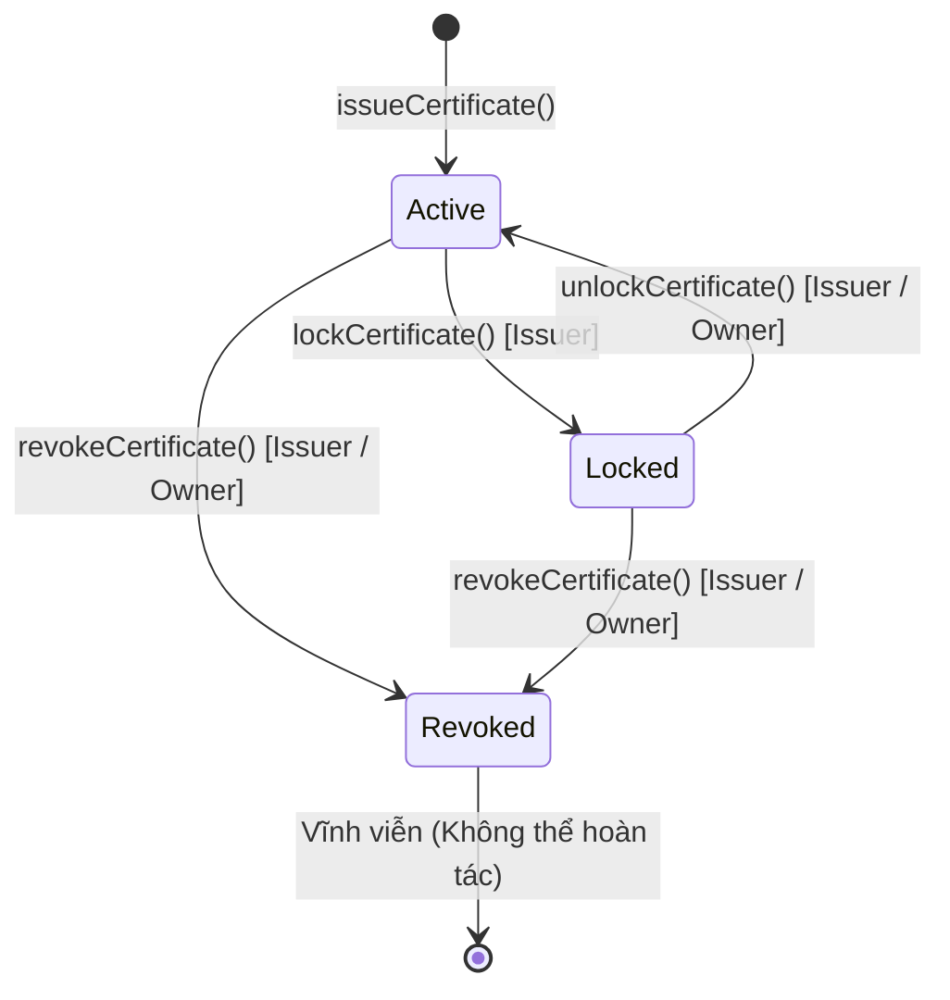

# Giải thích Chi tiết Logic Thư mục Contracts (`contracts/`)

Tài liệu này giải thích toàn diện kiến trúc, mô hình dữ liệu, luồng nghiệp vụ và logic mã nguồn của thư mục `contracts/` trong hệ thống **Raccoon University — Verify Certification**.

---

## 1. Tổng quan thư mục `contracts/`

Thư mục `contracts/` chứa toàn bộ mã nguồn hợp đồng thông minh (Smart Contract), script triển khai, cấu hình Hardhat và bộ kiểm thử tự động (Unit Tests) chạy trên môi trường EVM (Ethereum Sepolia).

### Thông số kỹ thuật cốt lõi
- **Ngôn ngữ**: Solidity `^0.8.24`
- **EVM Target**: `shanghai`
- **Compiler Optimizer**: Enabled, `runs: 200`
- **Framework phát triển**: Hardhat + TypeChain + Ethers v6
- **Mạng thử nghiệm**: Ethereum Sepolia (`chainId: 11155111`)
- **Triển khai thực tế**: [`0xE939E96E210A4eC13eF85F45193022e5b235fA56`](https://sepolia.etherscan.io/address/0xE939E96E210A4eC13eF85F45193022e5b235fA56)

---

## 2. Cấu trúc cây thư mục

```
contracts/
├── contracts/
│   ├── interfaces/
│   │   └── ICertificateRegistry.sol   # Interface chuẩn khai báo struct, event, errors, hàm
│   └── CertificateRegistry.sol        # Smart contract chính thực thi toàn bộ logic
├── deployments/
│   └── sepolia.json                   # Lưu vết thông tin deploy mạng Sepolia (address, block, txHash)
├── scripts/
│   ├── deploy.ts                      # Script deploy contract lên mạng blockchain
│   └── add-issuer.ts                  # Script phân quyền cho đơn vị cấp (Issuer) ban đầu
├── test/
│   └── CertificateRegistry.test.ts    # Bộ unit test toàn diện (100% coverage các nhánh logic)
├── hardhat.config.ts                  # Cấu hình compiler, network Sepolia, Etherscan API key
├── package.json                       # Dependencies & scripts thực thi (compile, test, deploy)
└── README.md                          # Hướng dẫn thao tác nhanh cho developer
```

---

## 3. Kiến trúc & Nguyên tắc Thiết kế Smart Contract

1. **Không lưu trữ PII (Personally Identifiable Information) on-chain**:
   - Tên sinh viên, ngày sinh, điểm số, chuyên ngành **không** lưu trên smart contract nhằm tuân thủ quy định bảo vệ dữ liệu cá nhân (GDPR/quyền riêng tư).
   - Smart contract chỉ lưu: mã định danh chứng chỉ (`certificateId`), mã băm SHA-256 của file PDF (`fileHash`), CID trên IPFS (`ipfsCid`), địa chỉ ví cấp (`issuer`), thời gian cấp (`issuedAt`), và các cờ trạng thái (`isRevoked`, `isLocked`).

2. **Blockchain là Nguồn Chân Lý (Source of Truth)**:
   - Tính hợp lệ của chứng chỉ được quyết định bởi blockchain. Nếu một chứng chỉ bị thu hồi on-chain, mọi tra cứu hay xác thực trên frontend/backend đều phản ánh trạng thái này.

3. **Tra cứu hai chiều hiệu quả với độ phức tạp $O(1)$**:
   - Hỗ trợ tra cứu bằng `certificateId` (tra cứu theo số hiệu văn bằng).
   - Hỗ trợ tra cứu trực tiếp bằng `fileHash` (kéo thả file PDF để kiểm tra tức thì mà không cần biết mã chứng chỉ trước).

4. **Tối ưu hóa Gas & Bảo mật**:
   - Sử dụng Custom Errors (`error NotOwner();`, `error CertificateExists();`,...) thay vì `require(..., "string")` giúp tiết kiệm gas đáng kể khi revert.
   - Giới hạn kích thước đầu vào bằng các hằng số: `MAX_ID_LEN = 64`, `MAX_HASH_LEN = 80`, `MAX_CID_LEN = 100`, `MAX_NAME_LEN = 100` để ngăn tấn công DOS qua kích thước calldata.
   - Dùng `keccak256(bytes)` làm khóa tìm kiếm trong `mapping(bytes32 => ...)` thay vì lưu `string` làm key.

---

## 4. Mô hình Dữ liệu & Lưu trữ (Storage Layout)

### 4.1. Structs ([`ICertificateRegistry.sol`](file:///d:/VC_Blockchain/VC/contracts/contracts/interfaces/ICertificateRegistry.sol))

```solidity
struct Certificate {
    string certificateId; // Ví dụ: "UIT-DEG-2026-0001"
    string fileHash;      // Dạng "sha256:<hex-hash-64-ký-tự>"
    string ipfsCid;       // CID v1/v0 trên IPFS của file PDF
    address issuer;       // Địa chỉ ví của Khoa/Phòng ban đã cấp
    uint64 issuedAt;      // Timestamp Unix thời điểm cấp (block.timestamp)
    bool isRevoked;       // Đã bị thu hồi vĩnh viễn chưa
    bool isLocked;        // Đang bị tạm khóa (chờ xác minh/điều tra) hay không
}

struct Issuer {
    string name;          // Tên khoa/phòng ban (VD: "Khoa Công nghệ Thông tin")
    bool active;          // Trạng thái còn quyền cấp chứng chỉ hay không
    uint64 addedAt;       // Thời điểm được cấp quyền lần đầu
}
```

### 4.2. Storage Mappings & Biến trạng thái ([`CertificateRegistry.sol`](file:///d:/VC_Blockchain/VC/contracts/contracts/CertificateRegistry.sol))

- `address private _owner`: Địa chỉ chủ sở hữu hợp đồng (Thường là ví Quản trị viên/Phòng Đào tạo của Trường).
- `uint256 private _totalCertificates`: Tổng số lượng chứng chỉ đã cấp trên toàn hệ thống.
- `mapping(address => uint256) private _issuedCount`: Số lượng chứng chỉ mà từng ví issuer đã cấp.
- `mapping(address => Issuer) private _issuers`: Danh sách các đơn vị cấp và trạng thái hoạt động.
- `mapping(bytes32 => Certificate) private _certificates`: Ánh xạ từ `keccak256(certificateId)` sang struct `Certificate`.
- `mapping(bytes32 => bytes32) private _hashToCert`: Ánh xạ từ `keccak256(fileHash)` sang `idKey` (`keccak256(certificateId)`). Đây là bảng tra cứu ngược để verify bằng file hash với chi phí $O(1)$.

---

## 5. Chi tiết Logic Các Hàm Nghiệp vụ

### 5.1. Quản trị & Phân quyền (Owner Only)
- **`addIssuer(address who, string calldata name)`**:
  - Chỉ `_owner` được gọi (`onlyOwner`).
  - Kiểm tra `who != address(0)` và độ dài `name` trong khoảng `[1, MAX_NAME_LEN]`.
  - Nếu issuer lần đầu được thêm: ghi nhận `addedAt = uint64(block.timestamp)`. Nếu đã tồn tại từ trước (kích hoạt lại): giữ nguyên `addedAt` ban đầu.
  - Đặt `active = true` và phát sự kiện `IssuerUpdated(who, name, true)`.
- **`removeIssuer(address who)`**:
  - Thu hồi quyền cấp chứng chỉ của đơn vị bằng cách set `issuer.active = false`.
  - **Lưu ý**: Việc gỡ issuer **không** làm mất hiệu lực của các chứng chỉ mà ví này đã từng cấp trong quá khứ.
  - Phát sự kiện `IssuerUpdated(who, name, false)`.
- **`transferOwnership(address newOwner)`**:
  - Chuyển quyền quản trị viên cao nhất sang ví mới (`newOwner != address(0)` và `newOwner != _owner`).
  - Phát sự kiện `OwnershipTransferred(previousOwner, newOwner)`.

### 5.2. Nghiệp vụ Cấp Chứng chỉ (`issueCertificate`)
- **Điều kiện**: Chỉ các ví nằm trong danh sách `_issuers` và có `active == true` mới được thực thi (`onlyActiveIssuer`).
- **Quy trình kiểm tra (Checks)**:
  1. Kiểm tra không rỗng và không vượt quá giới hạn độ dài cho `certificateId`, `fileHash`, `ipfsCid`.
  2. Băm `certificateId` thành `idKey = keccak256(bytes(certificateId))`. Kiểm tra `_certificates[idKey].issuer == address(0)` (chứng chỉ chưa từng tồn tại). Nếu trùng thì revert `CertificateExists()`.
  3. Băm `fileHash` thành `hashKey = keccak256(bytes(fileHash))`. Kiểm tra `_hashToCert[hashKey] == bytes32(0)` (file PDF này chưa từng được cấp cho bất kỳ ai). Nếu trùng thì revert `HashAlreadyUsed()`.
- **Thực thi (Effects)**:
  1. Ghi struct `Certificate` vào `_certificates[idKey]`.
  2. Lưu ánh xạ `_hashToCert[hashKey] = idKey`.
  3. Tăng bộ đếm: `_totalCertificates += 1` và `_issuedCount[msg.sender] += 1`.
  4. Phát sự kiện `CertificateIssued(idKey, certificateId, fileHash, msg.sender, issuedAt)`.

### 5.3. Vòng đời Trạng thái: Thu hồi, Khóa & Mở khóa

Hệ thống cung cấp cơ chế quản lý trạng thái 3 cấp linh hoạt:



1. **Thu hồi vĩnh viễn (`revokeCertificate`)**:
   - **Thẩm quyền**: Chỉ ví issuer đã cấp chứng chỉ đó **hoặc** ví `_owner` mới có quyền thu hồi.
   - **Logic**: Kiểm tra tồn tại -> kiểm tra chưa bị thu hồi -> set `cert.isRevoked = true; cert.isLocked = false;`.
   - **Hiệu lực**: Vĩnh viễn, không có hàm nào cho phép bỏ cờ `isRevoked`.
   - Phát sự kiện `CertificateRevoked(idKey, cert.issuer, timestamp)`.

2. **Tạm khóa (`lockCertificate`)**:
   - **Mục đích**: Áp dụng khi cần tạm dừng giá trị văn bằng để điều tra khiếu nại hoặc nghi vấn sai sót trước khi có kết luận chính thức.
   - **Thẩm quyền**: Chỉ chính ví issuer đã cấp mới được khóa (`msg.sender == cert.issuer`).
   - **Logic**: Kiểm tra tồn tại, chưa thu hồi, chưa bị khóa -> set `cert.isLocked = true`.
   - Phát sự kiện `CertificateLocked(...)`.

3. **Mở khóa (`unlockCertificate`)**:
   - **Thẩm quyền**: Ví issuer đã cấp **hoặc** ví `_owner` (cho phép cấp cứu sự cố từ cấp quản trị).
   - **Logic**: Đang bị khóa (`cert.isLocked == true`) và chưa bị thu hồi -> set `cert.isLocked = false`.
   - Phát sự kiện `CertificateUnlocked(...)`.

### 5.4. Truy vấn & Xác thực công khai (Read-only, Zero Gas)
- **`verifyByHash(string calldata fileHash)`**:
  - Đầu vào: Chuỗi hash SHA-256 của file PDF.
  - Tìm `idKey` qua mapping `_hashToCert`.
  - Trả về tuple: `(exists, valid, certificateId, issuer, issuedAt)`.
  - Trong đó `valid = true` khi và chỉ khi: `exists == true && !isRevoked && !isLocked`.
- **`isValid(string calldata certificateId)`**:
  - Trả về `bool`: Kiểm tra nhanh mã văn bằng có tồn tại và đang ở trạng thái hợp lệ hay không.
- **`getCertificate(string calldata certificateId)`**:
  - Trả về toàn bộ dữ liệu struct `Certificate`. Nếu không tìm thấy, revert `CertificateNotFound()`.
- **`getIssuer(address who)`**:
  - Trả về thông tin tên đơn vị, trạng thái `active`, ngày thêm vào hệ thống.

---

## 6. Scripts & Kiểm thử

### 6.1. Script Triển khai (`scripts/deploy.ts`)
- Lấy ví deployer từ private key cấu hình trong file `.env`.
- Triển khai hợp đồng `CertificateRegistry`.
- Tự động ghi lại metadata kết quả vào `deployments/<network>.json` bao gồm: `chainId`, `address`, `blockNumber`, `txHash`, `deployer`, `deployedAt`, `compiler`. File này được backend và frontend dùng để đồng bộ địa chỉ hợp đồng.

### 6.2. Script Khởi tạo Issuer (`scripts/add-issuer.ts`)
- Đọc địa chỉ hợp đồng từ `deployments/<network>.json`.
- Gọi hàm `addIssuer` với địa chỉ ví được cấu hình qua biến môi trường `INITIAL_ISSUER_ADDRESS` để sẵn sàng hoạt động ngay sau khi deploy.

### 6.3. Bộ Kiểm thử Tự động (`test/CertificateRegistry.test.ts`)
Sử dụng Hardhat Network Helpers và Chai Matchers để test toàn diện:
- **Deployment**: Kiểm tra khởi tạo owner đúng, số lượng ban đầu là 0, version chuẩn `"1.0.0"`.
- **Issuer Management**: Kiểm tra thêm, sửa, gỡ issuer, chặn non-owner, chặn zero address, chặn tên quá dài, kiểm tra giữ nguyên `addedAt` khi kích hoạt lại.
- **Issuance**: Kiểm tra quyền cấp của issuer hoạt động, chặn issuer không hoạt động, chặn mã trùng, chặn hash trùng, kiểm tra giới hạn kích thước chuỗi.
- **Revocation**: Kiểm tra thu hồi bởi chính issuer, thu hồi bởi owner, chặn người lạ, chặn thu hồi chứng chỉ không tồn tại hoặc đã thu hồi rồi.
- **Lock & Unlock**: Kiểm tra chu trình khóa và mở khóa, kiểm tra thẩm quyền của issuer và owner, kiểm tra tính toán trạng thái `valid`.
- **Verification**: Kiểm tra `verifyByHash` với hash tồn tại, hash không tồn tại, hash của văn bằng đã bị thu hồi hoặc bị khóa.

---

## 7. Tổng kết

Thư mục `contracts/` cung cấp lớp cốt lõi bất biến và tin cậy cao cho toàn bộ hệ thống xác minh văn bằng. Với thiết kế tách biệt PII, cơ chế tra cứu hai chiều $O(1)$, kiểm soát quyền truy cập chặt chẽ và chu trình xử lý trạng thái đầy đủ (Issue $\rightarrow$ Lock/Unlock $\rightarrow$ Revoke), smart contract đảm bảo tính toàn vẹn dữ liệu và tối ưu chi phí vận hành trên mạng Ethereum.

