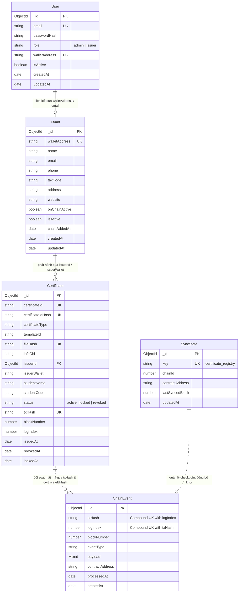

# Kiến Trúc Lớp Mô Hình Dữ Liệu và Điểm Xuất Khẩu Tập Trung (Database Models Architecture & Barrel Pattern)

Tài liệu này đặc tả chi tiết kiến trúc của lớp mô hình dữ liệu (Data Access Layer / ODM), mẫu thiết kế Barrel Pattern (điểm xuất khẩu tập trung), lược đồ quan hệ thực thể (ERD) và cách tổ chức các Mongoose Model tại [backend/src/models/index.ts](file:///d:/VC_Blockchain/VC/backend/src/models/index.ts).

---

## 1. Tổng Quan Kiến Trúc & Mẫu Thiết Kế Barrel Pattern

Trong kiến trúc Backend theo mô hình phân lớp (Layered Architecture: Controller $\rightarrow$ Service $\rightarrow$ Model), tầng Dữ liệu đóng vai trò quản lý trạng thái, bảo đảm tính toàn vẹn dữ liệu off-chain và tương thích với sổ cái phi tập trung Blockchain.

Tệp [backend/src/models/index.ts](file:///d:/VC_Blockchain/VC/backend/src/models/index.ts) áp dụng mẫu thiết kế **Barrel Pattern** nhằm:
1. **Điểm nhập cảnh duy nhất (Single Source of Truth)**: Toàn bộ controller, service, middleware và test suite chỉ cần import từ thư mục gốc `../models`:
   ```typescript
   import { Certificate, Issuer, User, ChainEvent, SyncState } from "../models";
   ```
2. **Ẩn giấu chi tiết cài đặt (Encapsulation)**: Các tầng nghiệp vụ bên ngoài không cần quan tâm đến cấu trúc phân chia tệp chi tiết bên trong thư mục `models/`.
3. **Tối ưu hóa Tree Shaking & Phân tách Type**: Sử dụng cú pháp `export { type I... }` rõ ràng cho các định nghĩa kiểu dữ liệu TypeScript, cho phép trình biên dịch loại bỏ hoàn toàn các kiểu dữ liệu khi chuyển mã sang JavaScript runtime mà không gây phình dung lượng bundle.
4. **Phòng ngừa phụ thuộc vòng (Circular Dependency Prevention)**: Tập trung hóa việc khởi tạo và nạp các model Mongoose.

---

## 2. Bản Đồ Quan Hệ Thực Thể (Entity Relationship Diagram - ERD)

Dưới đây là sơ đồ quan hệ giữa 5 thực thể cốt lõi trong hệ thống:



---

## 3. Danh Mục Các Thực Thể Được Xuất Khẩu

### 3.1. Người Dùng Hệ Thống (`User`)
- **Tệp nguồn**: [backend/src/models/User.ts](file:///d:/VC_Blockchain/VC/backend/src/models/User.ts)
- **Các thành phần xuất khẩu**:
  - `User`: Mongoose Model để thao tác với bộ sưu tập `users`.
  - `IUser`: Interface định nghĩa cấu trúc dữ liệu người dùng.
  - `UserDocument`: Kiểu HydratedDocument đại diện cho một bản ghi thực thể người dùng.
  - `UserRole`: Kiểu liên hiệp các vai trò (`"admin" | "issuer"`).
- **Trách nhiệm**: Xác thực người dùng (JWT Authentication), mã hóa mật khẩu bằng `bcryptjs`, quản lý phân quyền (RBAC) và liên kết ví Web3 MetaMask.

### 3.2. Đơn Vị Phát Hành Văn Bằng (`Issuer`)
- **Tệp nguồn**: [backend/src/models/Issuer.ts](file:///d:/VC_Blockchain/VC/backend/src/models/Issuer.ts)
- **Các thành phần xuất khẩu**:
  - `Issuer`: Mongoose Model quản lý bộ sưu tập `issuers`.
  - `IIssuer`: Interface thuộc tính pháp lý và trạng thái cấp phép.
  - `IssuerDocument`: Kiểu HydratedDocument của Issuer.
- **Trách nhiệm**: Lưu trữ hồ sơ định danh của các Khoa, Viện, Trường đại học; đồng bộ cờ trạng thái on-chain (`onChainActive`) và trạng thái nội bộ (`isActive`).

### 3.3. Văn Bằng & Chứng Chỉ Số (`Certificate`)
- **Tệp nguồn**: [backend/src/models/Certificate.ts](file:///d:/VC_Blockchain/VC/backend/src/models/Certificate.ts)
- **Các thành phần xuất khẩu**:
  - `Certificate`: Mongoose Model quản lý bộ sưu tập `certificates`.
  - `ICertificate`: Interface mô tả đầy đủ thông tin định danh người học (PII), phôi bằng, liên kết IPFS và neo blockchain.
  - `CertificateDocument`: Kiểu HydratedDocument của văn bằng.
- **Trách nhiệm**: Thực thể trung tâm của giải pháp Verifiable Credentials. Cung cấp hệ thống chỉ mục đa chiều (Unique, Compound, Full-Text Search) và bảo vệ máy trạng thái (`active` $\leftrightarrow$ `locked` $\rightarrow$ `revoked`).

### 3.4. Nhật Ký Sự Kiện Chuỗi Khối (`ChainEvent`)
- **Tệp nguồn**: [backend/src/models/ChainEvent.ts](file:///d:/VC_Blockchain/VC/backend/src/models/ChainEvent.ts)
- **Các thành phần xuất khẩu**:
  - `ChainEvent`: Mongoose Model quản lý bộ sưu tập `chain_events`.
  - `IChainEvent`: Interface ghi vết sự kiện thô từ Smart Contract.
  - `ChainEventDocument`: Kiểu HydratedDocument của sự kiện chuỗi khối.
  - `ChainEventType`: Danh mục các sự kiện smart contract hỗ trợ (`CertificateIssued`, `CertificateRevoked`, `CertificateLocked`, `CertificateUnlocked`, `IssuerUpdated`, `OwnershipTransferred`).
- **Trách nhiệm**: Lưu trữ Append-Only (không cập nhật/xóa), bảo đảm tính lũy thừa (Idempotency) dựa trên chỉ mục duy nhất `{ txHash: 1, logIndex: 1 }` và phục vụ Event Sourcing.

### 3.5. Trạng Thái Đồng Bộ Chuỗi Khối (`SyncState`)
- **Tệp nguồn**: [backend/src/models/SyncState.ts](file:///d:/VC_Blockchain/VC/backend/src/models/SyncState.ts)
- **Các thành phần xuất khẩu**:
  - `SyncState`: Mongoose Model quản lý bộ sưu tập `sync_states`.
  - `ISyncState`: Interface trạng thái checkpoint đồng bộ.
  - `SyncStateDocument`: Kiểu HydratedDocument của checkpoint.
- **Trách nhiệm**: Ghi nhớ khối cuối cùng đã quét thành công (`lastSyncedBlock`), cho phép tiến trình worker `sync.service.ts` tiếp tục quét bù (backfill) mà không bị trùng lặp hay bỏ sót khối.

---

## 4. Thực Tiễn Phân Biệt Kiểu Dữ Liệu TypeScript Trong Barrel Export

Để đảm bảo an toàn kiểu dữ liệu cao nhất và tránh nhầm lẫn trong quá trình phát triển:

| Tiền Tố / Hậu Tố | Ví Dụ | Ý Nghĩa Kỹ Thuật |
| :--- | :--- | :--- |
| `I...` | `ICertificate`, `IIssuer` | **Data Contract Interface**: Mô tả dữ liệu thuần túy (POJO - Plain Old JavaScript Object), độc lập với Mongoose, dùng cho DTO và Payload. |
| `...Document` | `CertificateDocument` | **Hydrated Mongoose Document**: Kế thừa từ `HydratedDocument<I...>`, chứa đầy đủ các phương thức phiên bản Mongoose như `.save()`, `.populate()`, `._id`. |
| Danh từ đơn | `Certificate`, `User` | **Mongoose Runtime Model**: Lớp khởi tạo (Class constructor) dùng để gọi các truy vấn tĩnh như `.find()`, `.findOne()`, `.create()`, `.updateOne()`. |
| `...Type` / `...Role` | `ChainEventType`, `UserRole` | **Type Aliases / Enums**: Ràng buộc các giá trị hằng số cố định trong nghiệp vụ logic. |
