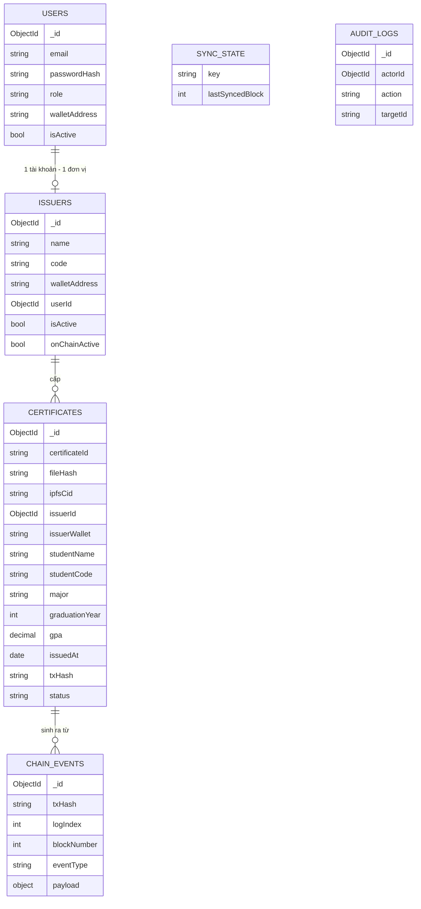

# Phân tích Schema — Verify Certification (MongoDB Atlas)

> Phạm vi: một trường · Backend Node/Express + Mongoose · Atlas M0 (512MB)
>
> Nguyên tắc: **Blockchain là nguồn sự thật** cho `fileHash` và trạng thái hiệu lực; MongoDB là nơi lưu metadata, tài khoản và phục vụ tìm kiếm.

---

## 1. Vì sao cần database khi đã có blockchain?

| Câu hỏi | Blockchain | MongoDB |
|---|---|---|
| File này có phải chứng chỉ thật? | ✅ | ❌ |
| Chứng chỉ đã bị thu hồi chưa? | ✅ | cache |
| Ai cấp, khi nào? | ✅ | cache |
| Tên sinh viên, ngành, GPA? | ❌ (không nên lưu) | ✅ |
| Đăng nhập, phân quyền? | ❌ | ✅ |
| Tìm kiếm theo tên / ngành / khóa? | ❌ | ✅ |
| File PDF gốc? | ❌ | IPFS (không phải Mongo) |

Nếu chỉ có blockchain: tra cứu được nhưng không tìm kiếm, không đăng nhập, không hiển thị tên.
Nếu chỉ có MongoDB: sửa được database là sửa được chứng chỉ → mất ý nghĩa.

---

## 2. Sáu collection

```
users          → tài khoản đăng nhập (admin, issuer)
issuers        → đơn vị cấp bằng (khoa/phòng), gắn ví
certificates   → metadata chứng chỉ + cache trạng thái on-chain
chain_events   → log sự kiện đã xử lý (chống trùng, backfill)
sync_state     → tiến độ đồng bộ blockchain
audit_logs     → vết thao tác quản trị
```

Không có collection `files` — file nằm trên IPFS, chỉ lưu CID.

---

## 3. ERD



---

## 4. Chi tiết từng collection

### 4.1 `users`

Tài khoản đăng nhập dashboard. Không lưu private key.

| Field | Type | Ràng buộc | Ghi chú |
|---|---|---|---|
| `_id` | ObjectId | | |
| `email` | string | unique, lowercase, trim | |
| `passwordHash` | string | required, `select: false` | bcrypt cost 10–12 |
| `role` | string | enum `admin`, `issuer` | |
| `displayName` | string | required, ≤ 100 | |
| `walletAddress` | string | unique sparse, lowercase, regex | ví dùng để ký |
| `isActive` | bool | default true | khóa tài khoản |
| `lastLoginAt` | Date | nullable | |
| `createdAt` | Date | auto | |
| `updatedAt` | Date | auto | |

**Quy tắc:**
- Email luôn lowercase trước khi lưu và trước khi so sánh.
- `walletAddress` lưu lowercase; hiển thị dùng checksum ở frontend.
- Không bao giờ trả `passwordHash` trong API (`select: false` + transform).

---

### 4.2 `issuers`

Đơn vị cấp bằng: Khoa CNTT, Phòng đào tạo, Trung tâm…

| Field | Type | Ràng buộc | Ghi chú |
|---|---|---|---|
| `_id` | ObjectId | | |
| `name` | string | required, ≤ 100 | "Khoa Công nghệ Thông tin" |
| `code` | string | unique, uppercase | "CNTT" |
| `walletAddress` | string | unique, lowercase | ví cấp chứng chỉ |
| `userId` | ObjectId | ref `users`, nullable | tài khoản đăng nhập |
| `logoUrl` | string | nullable | |
| `website` | string | nullable | |
| `isActive` | bool | default true | trạng thái trong app |
| `onChainActive` | bool | default false | đồng bộ từ contract |
| `chainAddedAt` | Date | nullable | |
| `createdAt` / `updatedAt` | Date | auto | |

**Quan hệ:** 1 user ↔ 1 issuer. Admin không có issuer.

**Đồng bộ:** `onChainActive` chỉ là cache. API verify đọc `isIssuer()` từ contract nếu cần.

---

### 4.3 `certificates` — collection trung tâm

| Field | Type | Ràng buộc | Nguồn |
|---|---|---|---|
| `_id` | ObjectId | | |
| `certificateId` | string | **unique**, ≤ 64 | chain |
| `fileHash` | string | **unique**, regex `^sha256:[a-f0-9]{64}$` | chain |
| `ipfsCid` | string | required, ≤ 100 | chain |
| `certificateType` | string | enum `degree`, `course`, `credit`, `other`; index | DB |
| `details` | object | field riêng theo loại (xem 4.3.2) | DB |
| `templateId` | string | `degree-v1`, `course-v1`… | DB |
| `templateVersion` | string | `1.0.0` | DB |
| `artifactType` | string | enum `web`, `pdf`, `image`; index | DB |
| `mimeType` | string | `text/html`, `application/pdf`, `image/png`… | DB |
| `filename` | string | ≤ 120 | DB |
| `sizeBytes` | int | ≥ 1 | DB |
| `previewCid` | string | nullable (thumbnail) | DB |
| `issuerId` | ObjectId | ref `issuers` | DB |
| `issuerWallet` | string | lowercase, index | chain |
| `issuerName` | string | snapshot | DB |
| `studentName` | string | required, ≤ 100 | DB |
| `studentNameNormalized` | string | index | DB (bỏ dấu, lowercase) |
| `studentCode` | string | required, index | DB |
| `major` | string | **conditional** (degree/course), ≤ 100 | DB |
| `majorNormalized` | string | index, bỏ dấu + lowercase | DB |
| `graduationYear` | int | 2000–2100, nullable, index | DB |
| `gpa` | decimal | **thang 4**, 0–4, nullable | DB |
| `classification` | string | nullable | "Giỏi", "Khá"… |
| `issuedAt` | Date | required | chain (timestamp) |
| `txHash` | string | unique sparse | chain |
| `blockNumber` | int | index | chain |
| `logIndex` | int | | chain |
| `status` | string | enum `active`, `revoked` | suy ra từ chain |
| `revokedAt` | Date | nullable | chain |
| `revokeTxHash` | string | nullable | chain |
| `revokeBlockNumber` | int | nullable | chain |
| `metadataHash` | string | nullable | P1 |
| `createdAt` / `updatedAt` | Date | auto | |

**Ví dụ document:**

```json
{
  "_id": "66f1c2...",
  "certificateId": "UIT-DEG-2026-0001",
  "fileHash": "sha256:9f86d081884c7d659a2feaa0c55ad015a3bf4f1b2b0b822cd15d6c15b0f00a08",
  "ipfsCid": "bafybeigdyrzt...",
  "certificateType": "degree",
  "details": {
    "degreeTitle": "Cử nhân",
    "major": "Kỹ thuật phần mềm",
    "graduationYear": 2026,
    "gpa": 3.45,
    "classification": "Giỏi",
    "studyMode": "Chính quy"
  },
  "templateId": "degree-v1",
  "templateVersion": "1.0.0",
  "artifactType": "pdf",
  "mimeType": "application/pdf",
  "filename": "UIT-DEG-2026-0001.pdf",
  "sizeBytes": 245760,
  "previewCid": "bafybeihinh...",
  "issuerId": "66f1b9...",
  "issuerWallet": "0x9b8df93f172aaeb67c31be257c9e4a55a8df1b3b",
  "issuerName": "Khoa Công nghệ Thông tin",
  "studentName": "Nguyễn Văn An",
  "studentNameNormalized": "nguyen van an",
  "studentCode": "2311095",
  "major": "Kỹ thuật phần mềm",
  "majorNormalized": "ky thuat phan mem",
  "graduationYear": 2026,
  "gpa": 3.45,
  "classification": "Giỏi",
  "issuedAt": "2026-10-19T08:00:00.000Z",
  "txHash": "0xabc...",
  "blockNumber": 11948000,
  "logIndex": 12,
  "status": "active",
  "revokedAt": null,
  "revokeTxHash": null,
  "createdAt": "2026-10-19T08:00:05.000Z",
  "updatedAt": "2026-10-19T08:00:05.000Z"
}
```

**Vì sao lưu `issuerName` dù đã có `issuerId`?**
Snapshot tại thời điểm cấp. Nếu sau này đổi tên khoa hoặc xóa issuer, chứng chỉ cũ vẫn hiển thị đúng tên lúc cấp.

**Vì sao `status` là cache?**
Danh sách cần nhanh, không thể gọi chain cho từng dòng. Trang chi tiết và API verify **luôn đọc chain** để lấy trạng thái thật.

---

### 4.3.1 Mô hình phân phối: 1 PDF gốc + 1 link tra cứu

Người được cấp nhận **hai hình thức**, nhưng chỉ **một file** được lưu trên IPFS:

| Hình thức | Bản chất | Lưu ở đâu | Tốn Pinata? |
|---|---|---|---|
| **Link tra cứu** `/c/<certificateId>` | Trang động, render từ DB + đọc trạng thái từ chain | Không lưu | ❌ Không |
| **File PDF tải về** | Artifact gốc, hash được neo on-chain | IPFS (Pinata) | ✅ Có |

Nhờ vậy mỗi chứng chỉ chỉ tốn **một PDF** (~100–500 KB), không tốn thêm HTML snapshot. Với 1 GB free, lưu được khoảng **2.000–10.000 chứng chỉ** — quá đủ cho đồ án.

#### Link tra cứu hoạt động thế nào?

```
Người dùng mở /c/UIT-2024-CS-0001
        ↓
Backend đọc metadata (Mongo) + gọi contract.getCertificate(id)
        ↓
Hiển thị: tên, ngành, ngày cấp, issuer, trạng thái hiện tại
        ↓
Nút "Tải PDF gốc" → https://gateway.pinata.cloud/ipfs/<cid>
```

Trang này **không** được băm và **không** lưu IPFS. Nó chỉ là giao diện đọc dữ liệu.

#### Quy tắc: trạng thái luôn lấy từ chain

File PDF là ảnh chụp tĩnh tại thời điểm cấp. Sau khi revoke, PDF vẫn tồn tại và vẫn ghi “còn hiệu lực” nếu thiết kế in trạng thái vào đó.

Vì vậy:

- **Không** in badge “còn hiệu lực” vào PDF, hoặc in kèm dòng “kiểm tra trạng thái tại link”.
- Trang `/c/[id]` **luôn** gọi `isValid(id)` trên chain.
- Khi revoke: link đổi sang “đã thu hồi”, PDF không thể xóa nhưng không còn giá trị chứng minh.

#### `artifactType` trong v1

| Giá trị | Có dùng? | Ghi chú |
|---|---|---|
| `pdf` | ✅ mặc định | Artifact gốc |
| `image` | 🟡 tùy chọn | Nếu trường cấp ảnh thay PDF |
| `web` | ❌ P2 | Chỉ khi muốn đóng băng HTML thành artifact riêng |

Nếu sau này cần bản web tĩnh độc lập, thêm artifact `web` với hash riêng — contract không đổi, chỉ tốn thêm dung lượng Pinata.

#### Ảnh hưởng tới verify

| Người dùng tải lên | Cách kiểm tra |
|---|---|
| PDF gốc | Băm file → so `fileHash` on-chain |
| Ảnh gốc (nếu có) | Băm file → so `fileHash` on-chain |
| Trang `/c/[id]` | Không băm; đọc trạng thái trực tiếp từ chain |
| File PDF đã bị sửa | Hash khác → không tìm thấy trên chain |

---

### 4.3.2 Bốn loại chứng chỉ & `details`

`certificateType` quyết định schema của `details`:

| Loại | Prefix ID | Field chính trong `details` |
|---|---|---|
| `degree` | `UIT-DEG` | degreeTitle, major, graduationYear, gpa, classification, studyMode, thesisTitle |
| `course` | `UIT-CRS` | courseCode, courseName, credits, semester, grade, gradeScale, durationHours, instructor |
| `credit` | `UIT-CRE` | programName, totalCredits, completedCredits, gpa, modules[] |
| `other` | `UIT-OTH` | title, description, organizer, eventDate, role, result, validUntil |

**Quy tắc:**

- `major`, `graduationYear`, `gpa`, `classification` ở cấp cao nhất chỉ là **cache phục vụ tìm kiếm**, có thể null với `other`.
- `details` là nguồn dữ liệu đầy đủ để render PDF.
- `modules` giới hạn 8 phần tử.
- `certificateId` phải khớp prefix của loại.
- `templateId` = `degree-v1`, `course-v1`, `credit-v1`, `other-v1`.

**Ví dụ `course`:**

```json
{
  "certificateType": "course",
  "details": {
    "courseCode": "CS409",
    "courseName": "Lập trình Blockchain",
    "credits": 3,
    "semester": "HK1 2025–2026",
    "grade": 8.5,
    "gradeScale": "10",
    "grade4": 3.4,
    "durationHours": 45,
    "instructor": "TS. Trần Văn B"
  }
}
```

**Quy ước điểm:**

| Field | Hệ | Ghi chú |
|---|---|---|
| `gpa` (cấp certificate) | **4** | 0–4, dùng cho degree/credit |
| `details.grade` | theo `gradeScale` | 0–10, 0–4 hoặc A–F |
| `details.gradeScale` | `10` \| `4` \| `letter` | bắt buộc với course/credit |
| `details.grade4` | 4 | quy đổi, tùy chọn |

Không lưu `8.5` mà thiếu `gradeScale` — không thể hiển thị đúng.

---

### 4.4 `chain_events`

Nhật ký sự kiện đã xử lý — “hộp thư đến” của backend.

| Field | Type | Ràng buộc |
|---|---|---|
| `_id` | ObjectId | |
| `txHash` | string | required |
| `logIndex` | int | required |
| `blockNumber` | int | required, index |
| `eventType` | string | `CertificateIssued`, `CertificateRevoked`, `IssuerUpdated` |
| `payload` | object | args đã decode |
| `contractAddress` | string | lowercase |
| `processedAt` | Date | |
| `createdAt` | Date | |

**Unique compound:** `{ txHash: 1, logIndex: 1 }` — chống xử lý trùng khi restart hoặc backfill.

---

### 4.5 `sync_state`

Một document cho mỗi contract.

| Field | Type | Ghi chú |
|---|---|---|
| `_id` | ObjectId | |
| `key` | string | unique, `certificate_registry` |
| `chainId` | int | 11155111 |
| `contractAddress` | string | lowercase |
| `lastSyncedBlock` | int | resume backfill |
| `updatedAt` | Date | |

---

### 4.6 `audit_logs`

| Field | Type | Ghi chú |
|---|---|---|
| `_id` | ObjectId | |
| `actorId` | ObjectId | ref users |
| `actorWallet` | string | |
| `action` | string | `LOGIN`, `ISSUE`, `REVOKE`, `ADD_ISSUER` |
| `targetType` | string | `certificate`, `issuer`, `user` |
| `targetId` | string | |
| `metadata` | object | snapshot nhỏ |
| `ip` | string | |
| `userAgent` | string | |
| `createdAt` | Date | TTL 180 ngày (tùy chọn) |

---

## 5. Index

| Collection | Index | Loại | Mục đích |
|---|---|---|---|
| users | `{ email: 1 }` | unique | đăng nhập |
| users | `{ walletAddress: 1 }` | unique sparse | ánh xạ ví |
| issuers | `{ code: 1 }` | unique | mã khoa |
| issuers | `{ walletAddress: 1 }` | unique | tra issuer |
| issuers | `{ userId: 1 }` | sparse | quan hệ user |
| certificates | `{ certificateId: 1 }` | unique | tra chính |
| certificates | `{ fileHash: 1 }` | unique | chống trùng file |
| certificates | `{ txHash: 1 }` | unique sparse | idempotent |
| certificates | `{ issuerWallet: 1, issuedAt: -1 }` | compound | dashboard |
| certificates | `{ studentCode: 1 }` | | tra chính xác MSSV |
| certificates | `{ status: 1, issuedAt: -1 }` | compound | lọc trạng thái |
| certificates | `{ issuedAt: -1 }` | | widget “cấp gần đây” |
| certificates | `{ artifactType: 1, issuedAt: -1 }` | compound | lọc theo định dạng |
| certificates | `{ certificateType: 1, issuedAt: -1 }` | compound | lọc theo loại chứng chỉ |
| certificates | `{ graduationYear: 1, majorNormalized: 1, issuedAt: -1 }` | compound | tra theo năm + ngành |
| certificates | `{ studentNameNormalized: "text", majorNormalized: "text" }` | text | tìm theo tên/ngành |
| chain_events | `{ txHash: 1, logIndex: 1 }` | unique | chống trùng |
| chain_events | `{ blockNumber: 1 }` | | backfill |
| sync_state | `{ key: 1 }` | unique | singleton |
| audit_logs | `{ createdAt: -1 }` | | truy vấn log |
| audit_logs | `{ createdAt: 1 }` | TTL 180d | tự dọn (tùy chọn) |

### Vì sao cần `studentNameNormalized`?

MongoDB text index không xử lý tốt tiếng Việt có dấu. Khi lưu, chuẩn hóa:

```
"Nguyễn Văn An" → "nguyen van an"
```

Tìm kiếm cũng chuẩn hóa input trước khi query. Index text trên trường này cho kết quả ổn định hơn.

---

## 6. JSON Schema validation

Nên bật validator ở tầng collection, không chỉ Mongoose, để chặn dữ liệu sai từ mọi nguồn.

```js
db.createCollection("certificates", {
  validator: {
    $jsonSchema: {
      bsonType: "object",
      required: [
        "certificateId", "fileHash", "ipfsCid", "certificateType",
        "details", "templateId", "templateVersion", "artifactType",
        "issuerWallet", "studentName", "studentCode",
        "issuedAt", "txHash", "status"
      ],
      properties: {
        certificateId: { bsonType: "string", maxLength: 64 },
        fileHash: {
          bsonType: "string",
          pattern: "^sha256:[a-f0-9]{64}$"
        },
        ipfsCid: { bsonType: "string", maxLength: 100 },
        certificateType: { enum: ["degree", "course", "credit", "other"] },
        details: { bsonType: "object" },
        templateId: { bsonType: "string", maxLength: 40 },
        templateVersion: { bsonType: "string", maxLength: 20 },
        artifactType: { enum: ["web", "pdf", "image"] },
        mimeType: { bsonType: "string", maxLength: 100 },
        sizeBytes: { bsonType: "int", minimum: 1 },
        issuerWallet: {
          bsonType: "string",
          pattern: "^0x[a-f0-9]{40}$"
        },
        graduationYear: { bsonType: "int", minimum: 2000, maximum: 2100 },
        gpa: { bsonType: ["double", "decimal", "null"], minimum: 0, maximum: 4 },
        status: { enum: ["active", "revoked"] }
      }
    }
  },
  validationLevel: "strict",
  validationAction: "error"
});
```

---

## 7. Luồng ghi dữ liệu

### 7.1 Cấp chứng chỉ

```
1. Upload file → Pinata → CID
2. Backend tự tính SHA-256, so khớp hash client gửi
3. Frontend gọi issueCertificate(...) → MetaMask ký
4. Chờ receipt status = 1
5. Xác minh event chứa đúng id + hash + issuer
6. Ghi chain_events (unique txHash+logIndex)
7. Upsert certificates (unique certificateId)
8. Ghi audit_logs
```

Bước 6 trước bước 7: nếu crash giữa chừng, lần sync sau đọc lại event và upsert tiếp. Không mất dữ liệu, không tạo trùng.

### 7.2 Thu hồi

```
1. Gọi revokeCertificate(id)
2. Receipt status = 1
3. Cập nhật certificates.status = revoked, revokedAt, revokeTxHash
4. Ghi chain_events + audit_logs
```

### 7.3 Đồng bộ khi restart

```
1. Đọc sync_state.lastSyncedBlock
2. queryFilter(CertificateIssued, from lastSyncedBlock, to latest, chunk 5000)
3. Với mỗi event: upsert chain_events → upsert certificates
4. Cập nhật lastSyncedBlock
```

### 7.4 Tra cứu công khai

Trang cho phép lọc **toàn bộ chứng chỉ** theo năm, ngành, MSSV, tên sinh viên.

**Endpoint:** `GET /api/public/certificates`

| Query param | Kiểu | Bắt buộc | Ghi chú |
|---|---|---|---|
| `year` | int | ❌ | `graduationYear` chính xác |
| `major` | string | ❌ | mã/tên ngành đã chuẩn hóa |
| `studentCode` | string | ❌ | **khớp chính xác**, dùng index |
| `q` | string | ❌ | tên sinh viên, bỏ dấu, tìm gần đúng |
| `status` | string | ❌ | `active` / `revoked` / bỏ trống = tất cả |
| `page` | int | ❌ | mặc định 1 |
| `limit` | int | ❌ | mặc định 10, **tối đa 20** |
| `sort` | string | ❌ | mặc định `issuedAt:desc` |

**Quy tắc truy vấn:**

```
Nếu có studentCode → filter chính xác (index)
Nếu có year      → filter graduationYear
Nếu có major     → filter majorNormalized
Nếu có q         → $text trên studentNameNormalized + majorNormalized
Luôn phân trang, không trả toàn bộ collection
```

**Response DTO công khai:**

```json
{
  "success": true,
  "data": [
    {
      "certificateId": "UIT-2024-CS-0001",
      "studentName": "Nguyễn Văn An",
      "studentCode": "2311095",
      "major": "Kỹ thuật phần mềm",
      "graduationYear": 2026,
      "gpa": 3.45,
      "classification": "Giỏi",
      "issuedAt": "2026-10-19T08:00:00.000Z",
      "status": "active",
      "artifactType": "pdf",
      "issuerName": "Khoa Công nghệ Thông tin",
      "verifyUrl": "/c/UIT-2024-CS-0001"
    }
  ],
  "meta": { "page": 1, "limit": 10, "total": 248, "totalPages": 25 }
}
```

**Không trả về:** `_id`, `issuerId`, `issuerWallet`, `txHash`, `blockNumber`, `previewCid`, `studentNameNormalized`.

**API phụ trợ cho bộ lọc:**

```
GET /api/public/filters
→ { years: [2024, 2025, 2026], majors: [{ code, name }] }
```

Dùng `distinct('graduationYear')` và `distinct('major')`, cache 5 phút.

**Chống lạm dụng:**

- Rate limit 30 request/phút/IP cho endpoint công khai.
- `limit` tối đa 20, không có API export hàng loạt.
- Nếu phát hiện quét tuần tự, trả 429.

### 7.5 Widget “Chứng chỉ cấp gần đây”

**Endpoint:**

```
GET /api/public/certificates/recent?limit=6
```

| Param | Mặc định | Tối đa |
|---|---|---|
| `limit` | 6 | 12 |

**Truy vấn:**

```js
db.certificates
  .find({}, { certificateId: 1, studentName: 1, studentCode: 1,
              major: 1, graduationYear: 1, issuedAt: 1,
              status: 1, txHash: 1, blockNumber: 1 })
  .sort({ issuedAt: -1 })
  .limit(limit)
```

Dùng index `{ issuedAt: -1 }`.

**Vì sao không query trực tiếp blockchain?**

- `queryFilter` giới hạn block range, chậm khi tải trang.
- Event `CertificateIssued` không chứa tên SV, ngành, GPA.
- Backend đã index event vào `certificates`, nên đọc Mongo là đủ.

Mỗi item vẫn kèm `txHash` + `blockNumber` để người xem mở Etherscan kiểm chứng.

**Response (đã che PII):**

```json
{
  "data": [
    {
      "certificateId": "UIT-2024-CS-0001",
      "studentNameMasked": "Nguyễn V. A.",
      "studentCodeMasked": "2311***",
      "major": "Kỹ thuật phần mềm",
      "graduationYear": 2026,
      "issuedAt": "2026-10-19T08:00:00.000Z",
      "status": "active",
      "txHash": "0xabc...",
      "blockNumber": 11948000
    }
  ]
}
```

**Che PII ở backend, không ở frontend:**

- Backend tạo `studentNameMasked` / `studentCodeMasked` trước khi trả.
- Không bao giờ gửi tên đầy đủ cho widget.
- Trang `/search` và `/c/[id]` mới trả đầy đủ.

**Cache:**

```
Cache-Control: public, max-age=30, stale-while-revalidate=60
```

Widget tự refresh mỗi 30 giây. Không cần WebSocket.

---

## 8. Nguồn sự thật & đối soát

| Dữ liệu | Nguồn sự thật | Cache |
|---|---|---|
| `fileHash` | Chain | certificates |
| `ipfsCid` | Chain | certificates |
| `issuerWallet` | Chain | certificates |
| `issuedAt` | Chain | certificates |
| `isRevoked` / `status` | Chain | certificates |
| Tên SV, MSSV, ngành, GPA | MongoDB | — |
| Tài khoản, role | MongoDB | — |

**Đối soát định kỳ (P2):**

```
Với mỗi certificate trong DB:
  đọc contract.getCertificate(id)
  nếu status khác → log warning + sửa cache
```

---

## 9. Bảo mật & riêng tư

| Vấn đề | Cách xử lý |
|---|---|
| PII | Chỉ lưu MongoDB, không lên chain |
| **Tra cứu công khai** | Hiển thị **đầy đủ** tên + MSSV để phục vụ tra cứu theo yêu cầu |
| Chống quét dữ liệu | Rate limit 30 req/phút/IP, `limit` ≤ 20, không API export |
| Issuer đã đăng nhập | Trả đầy đủ + thông tin nội bộ |
| Password | bcrypt, không bao giờ trả về |
| Wallet | Chỉ dùng để định danh, không lưu private key |
| Injection | Validate zod + Mongoose cast |
| Lộ DB | Atlas IP allowlist; user riêng, quyền tối thiểu |
| Audit | Ghi log mọi thao tác quản trị |

**Ghi chú về riêng tư:**

Yêu cầu “tra cứu theo MSSV và tên sinh viên” đồng nghĩa tên và MSSV **phải công khai**. Đây là đánh đổi có chủ đích, cần ghi rõ trong báo cáo:

- Phạm vi công khai: chỉ chứng chỉ do trường cấp, không phải toàn bộ hồ sơ sinh viên.
- Không công khai: điểm từng môn, ngày sinh, địa chỉ, số CCCD.
- Nếu sau này cần riêng tư hơn: thêm cờ `isPublic` theo từng chứng chỉ, hoặc chỉ cho tra cứu khi nhập **đúng cả MSSV + mã chứng chỉ**.

**Không nên** che tên/MSSV ở trang danh sách nhưng lại cho tìm theo tên — vừa vô nghĩa vừa gây khó hiểu.

---

## 10. Giới hạn dung lượng Atlas M0 (512MB)

| Collection | Ước tính mỗi document | 1.000 chứng chỉ |
|---|---|---|
| certificates | ~1 KB | ~1 MB |
| chain_events | ~0.5 KB | ~0.5 MB |
| audit_logs | ~0.3 KB | ~0.3 MB |

Rất thoải mái. Rủi ro duy nhất là lưu file/base64 — **không làm**.

---

## 11. Những gì không lưu

| Dữ liệu | Lý do |
|---|---|
| File PDF/ảnh | Đã có IPFS; Mongo chỉ chứa CID |
| Private key | Không bao giờ lưu ở server |
| Password plaintext | Chỉ hash |
| Bản sao dữ liệu on-chain đầy đủ | Không cần; cache đủ trường |
| Log request chi tiết | Tốn dung lượng, không cần cho đồ án |

---

## 12. Kiểm tra schema trước khi code

- [ ] `certificateId` unique
- [ ] `fileHash` unique + đúng regex
- [ ] `certificateType` bắt buộc, enum `degree|course|credit|other`
- [ ] `details` đúng schema theo loại
- [ ] `templateId` + `templateVersion` bắt buộc
- [ ] `artifactType` bắt buộc, enum `web|pdf|image`
- [ ] `gpa` nằm trong 0–4 (thang 4)
- [ ] Có `majorNormalized` + index cho lọc ngành
- [ ] Có index `{ graduationYear, majorNormalized, issuedAt }`
- [ ] Endpoint public có phân trang, `limit` ≤ 20
- [ ] `txHash + logIndex` unique ở `chain_events`
- [ ] `walletAddress` lowercase ở mọi nơi
- [ ] `email` lowercase
- [ ] Có `studentNameNormalized`
- [ ] Có `sync_state` singleton
- [ ] Không có field chứa file binary
- [ ] Validator collection bật `strict`
- [ ] Index được tạo tự động khi khởi động (Mongoose `syncIndexes` hoặc script)
