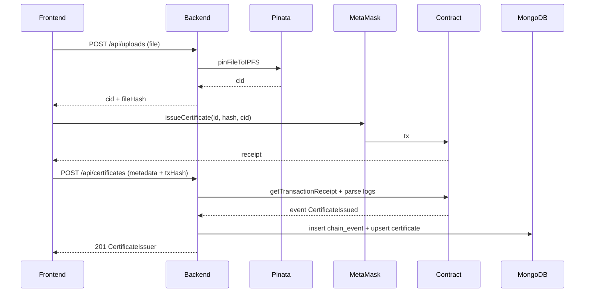
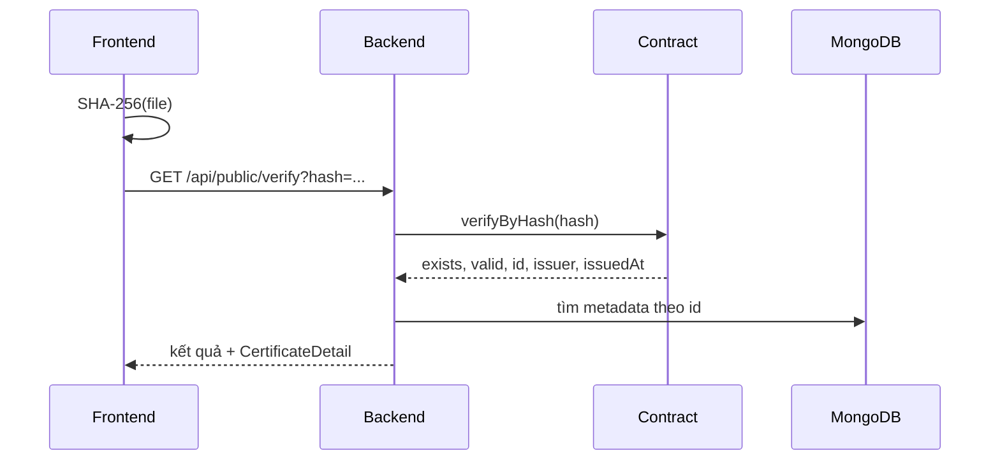
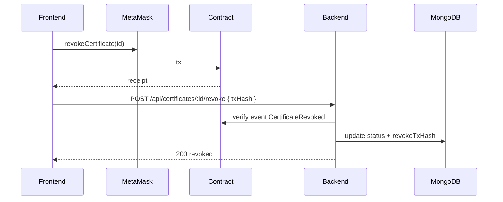
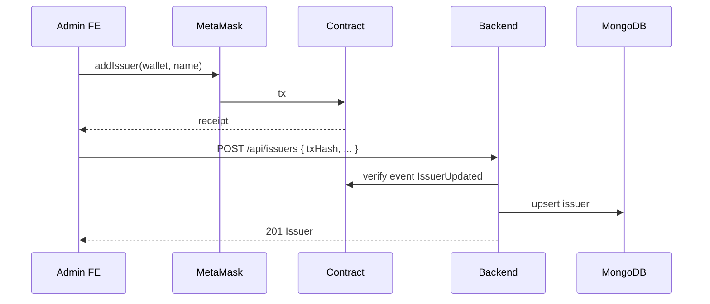

# Integration & API Contract — Verify Certification

> Chốt hợp đồng giao tiếp giữa **Frontend ↔ Backend ↔ Smart Contract ↔ IPFS**.
>
> Mọi thay đổi breaking phải cập nhật file này trước khi sửa code.

---

## 1. Thành phần & ranh giới

```
┌──────────────┐    HTTPS/JSON     ┌──────────────┐
│  Frontend    │ ────────────────► │   Backend    │
│  Next.js     │ ◄──────────────── │   Express    │
└──────┬───────┘                   └───┬──────┬───┘
       │                               │      │
       │ ethers + MetaMask             │      │ Pinata API
       ▼                               ▼      ▼
┌──────────────┐                   ┌──────┐ ┌───────┐
│  Sepolia     │ ◄──── đọc/ghi ────│ RPC  │ │ IPFS  │
│  Contract    │                   │Infura│ │Pinata │
└──────────────┘                   └──────┘ └───────┘
                                         │
                                    ┌────▼────┐
                                    │ MongoDB │
                                    └─────────┘
```

| Thành phần | Sở hữu dữ liệu gì | Không được làm |
|---|---|---|
| Frontend | UI state, ví | Không giữ private key, không gọi Pinata trực tiếp |
| Backend | Metadata, auth, index event | Không ký tx, không lưu file gốc |
| Contract | Hash, CID, issuer, thời gian, trạng thái | Không lưu PII |
| IPFS | File PDF gốc | Không chứa secret |
| MongoDB | Tài khoản, tên, MSSV, GPA, cache | Không thay thế blockchain |

---

## 2. Quy ước chung

### 2.1 Base URL

| Môi trường | Backend | Frontend |
|---|---|---|
| Local | `http://localhost:4000` | `http://localhost:3000` |
| Production | `https://<service>.onrender.com` | `https://<project>.vercel.app` |

Tất cả endpoint dưới `/api`.

### 2.2 Định dạng

| Loại | Quy ước |
|---|---|
| Content-Type | `application/json` (trừ upload `multipart/form-data`) |
| Ngày giờ | ISO 8601 UTC, ví dụ `2026-10-19T08:00:00.000Z` |
| Địa chỉ ví | lowercase trong JSON, checksum khi hiển thị |
| Hash file | `sha256:<64 hex lowercase>` |
| CID | chuỗi CIDv1 từ Pinata |
| GPA | number, 0–4, tối đa 2 chữ số thập phân |
| Status | `active` \| `revoked` |
| Artifact type | `pdf` \| `image` \| `web` |
| Tiền tố API | `/api` |

### 2.3 Response envelope

Thành công:

```json
{
  "success": true,
  "data": {},
  "meta": { "page": 1, "limit": 10, "total": 248, "totalPages": 25 }
}
```

Lỗi:

```json
{
  "success": false,
  "error": {
    "code": "CERTIFICATE_NOT_FOUND",
    "message": "Không tìm thấy chứng chỉ",
    "details": null
  }
}
```

`meta` chỉ có ở endpoint phân trang.

### 2.4 Auth

```
Authorization: Bearer <JWT>
```

- JWT HS256, hết hạn 7 ngày.
- Payload: `{ sub, role, wallet, iat, exp }`.
- Thiếu/sai token → `401 UNAUTHORIZED`.
- Sai role → `403 FORBIDDEN`.

### 2.5 Phân trang

Request:

```
page=1&limit=10
```

- `page` ≥ 1, mặc định 1.
- `limit` 1–20, mặc định 10.
- `totalPages = ceil(total / limit)`.

### 2.6 Idempotency

- `POST /certificates` với cùng `txHash` đã xử lý → trả **200** kèm certificate hiện có, không tạo mới.
- `POST /certificates` trùng `certificateId` nhưng khác tx → **409** `CERTIFICATE_EXISTS`.
- `chain_events` unique `{txHash, logIndex}`.

---

## 3. Mã lỗi

| Code | HTTP | Khi nào | Frontend xử lý |
|---|---|---|---|
| `VALIDATION_ERROR` | 400 | zod fail | Hiện lỗi từng field |
| `UPLOAD_INVALID` | 400 | MIME/size sai | Thông báo file không hợp lệ |
| `UNAUTHORIZED` | 401 | thiếu/sai token | Xóa token, về `/login` |
| `FORBIDDEN` | 403 | sai role | “Bạn không có quyền” |
| `NOT_FOUND` | 404 | route sai | Trang 404 |
| `CERTIFICATE_NOT_FOUND` | 404 | không có cert | Hiện ⚠️ không tìm thấy |
| `CERTIFICATE_EXISTS` | 409 | trùng mã | Báo mã đã tồn tại |
| `HASH_EXISTS` | 409 | trùng hash | Báo file đã được cấp |
| `TX_INVALID` | 422 | receipt fail hoặc event không khớp | “Giao dịch không hợp lệ” |
| `ALREADY_REVOKED` | 409 | revoke lần 2 | “Đã thu hồi trước đó” |
| `PINATA_ERROR` | 502 | upload IPFS lỗi | “Không thể lưu file, thử lại” |
| `CHAIN_ERROR` | 502 | RPC lỗi | “Không kết nối được blockchain” |
| `RATE_LIMITED` | 429 | vượt giới hạn | “Thử lại sau ít phút” |
| `INTERNAL_ERROR` | 500 | lỗi không lường trước | “Đã có lỗi xảy ra” |

---

## 4. DTO

### 4.1 `User`

```ts
interface User {
  id: string;
  email: string;
  displayName: string;
  role: 'admin' | 'issuer';
  walletAddress: string | null;
}
```

### 4.2 `Issuer`

```ts
interface Issuer {
  id: string;
  name: string;
  code: string;
  walletAddress: string;
  logoUrl: string | null;
  website: string | null;
  isActive: boolean;
  onChainActive: boolean;
}
```

### 4.3 `CertificateSummary` — dùng cho search

```ts
type CertificateType = 'degree' | 'course' | 'credit' | 'other';

interface CertificateSummary {
  certificateId: string;
  certificateType: CertificateType;
  studentName: string;
  studentCode: string;
  major: string | null;
  graduationYear: number | null;
  gpa: number | null;
  classification: string | null;
  issuedAt: string;
  status: 'active' | 'revoked';
  verifyUrl: string;
}
```

### 4.4 `CertificateDetail` — dùng cho `/c/[id]`

```ts
interface CertificateDetail extends CertificateSummary {
  details: Record<string, unknown>; // schema riêng theo certificateType
  templateId: string;
  templateVersion: string;
  issuerName: string;
  artifactType: 'pdf' | 'image' | 'web';
  mimeType: string;
  filename: string;
  sizeBytes: number;
  ipfsCid: string;
  txHash: string;
  blockNumber: number;
  statusSource: 'chain';
}
```

### 4.5 `RecentCertificate` — widget, đã che PII

```ts
interface RecentCertificate {
  certificateId: string;
  studentNameMasked: string;
  studentCodeMasked: string;
  major: string;
  graduationYear: number;
  issuedAt: string;
  status: 'active' | 'revoked';
  txHash: string;
  blockNumber: number;
}
```

### 4.6 `CertificateIssuer` — dashboard

```ts
interface CertificateIssuer {
  certificateId: string;
  studentName: string;
  studentCode: string;
  major: string;
  graduationYear: number;
  gpa: number | null;
  classification: string | null;
  artifactType: 'pdf' | 'image' | 'web';
  filename: string;
  status: 'active' | 'revoked';
  issuedAt: string;
  txHash: string;
  revokedAt: string | null;
  revokeTxHash: string | null;
}
```

---

## 5. Endpoints

### 5.1 `POST /api/auth/login`

Request:

```json
{ "email": "issuer@verifycert.local", "password": "Issuer@123456" }
```

Response 200:

```json
{
  "success": true,
  "data": {
    "token": "eyJ...",
    "user": {
      "id": "66f...",
      "email": "issuer@verifycert.local",
      "displayName": "Khoa CNTT",
      "role": "issuer",
      "walletAddress": "0x9b8d..."
    }
  }
}
```

Lỗi: `401 UNAUTHORIZED` — message chung “Email hoặc mật khẩu không đúng”.

### 5.2 `GET /api/auth/me`

Auth: Bearer.

Response 200:

```json
{ "success": true, "data": { "user": { "...": "..." } } }
```

### 5.3 `GET /api/public/certificates`

Auth: không.

Query:

| Param | Kiểu | Ghi chú |
|---|---|---|
| `q` | string | MSSV, tên, mã, ngành |
| `year` | int | |
| `major` | string | tên hoặc mã ngành |
| `studentCode` | string | khớp chính xác |
| `status` | `active\|revoked` | |
| `page` | int | mặc định 1 |
| `limit` | int | mặc định 10, max 20 |

Response 200:

```json
{
  "success": true,
  "data": [
    {
      "certificateId": "UIT-2024-CS-0001",
      "studentName": "Nguyễn Văn An",
      "studentCode": "2311095",
      "major": "Kỹ thuật phần mềm",
      "graduationYear": 2026,
      "gpa": 3.45,
      "classification": "Giỏi",
      "issuedAt": "2026-10-19T08:00:00.000Z",
      "status": "active",
      "verifyUrl": "/c/UIT-2024-CS-0001"
    }
  ],
  "meta": { "page": 1, "limit": 10, "total": 12, "totalPages": 2 }
}
```

### 5.4 `GET /api/public/certificates/recent`

Auth: không.

Query: `limit` mặc định 6, max 12.

Response: mảng `RecentCertificate`.

> Route này phải khai báo trước `/:id`.

### 5.5 `GET /api/public/certificates/:id`

Auth: không. `:id` là `certificateId`, không phải ObjectId.

Response 200: `CertificateDetail`.

Lỗi: `404 CERTIFICATE_NOT_FOUND`.

### 5.6 `GET /api/public/verify?hash=`

Auth: không.

`hash` phải đúng format `sha256:<64 hex>`.

Response 200:

```json
{
  "success": true,
  "data": {
    "exists": true,
    "valid": true,
    "certificateId": "UIT-2024-CS-0001",
    "issuer": "0x9b8d...",
    "issuedAt": "2026-10-19T08:00:00.000Z",
    "status": "active",
    "certificate": { "...": "CertificateDetail" }
  }
}
```

Không tồn tại:

```json
{
  "success": true,
  "data": { "exists": false, "valid": false, "certificate": null }
}
```

Không dùng 404 cho “không tìm thấy hash” — đây là kết quả hợp lệ.

### 5.7 `GET /api/public/filters`

Response:

```json
{
  "success": true,
  "data": {
    "years": [2024, 2025, 2026],
    "majors": [
      { "code": "CNTT", "name": "Công nghệ thông tin" },
      { "code": "KTPM", "name": "Kỹ thuật phần mềm" }
    ]
  }
}
```

### 5.8 `POST /api/uploads`

Auth: issuer.

`multipart/form-data`, field `file`.

Response 200:

```json
{
  "success": true,
  "data": {
    "cid": "bafy...",
    "fileHash": "sha256:...",
    "sizeBytes": 245760,
    "mimeType": "application/pdf",
    "filename": "UIT-2024-CS-0001.pdf"
  }
}
```

Lỗi: `UPLOAD_INVALID`, `PINATA_ERROR`.

### 5.9 `POST /api/certificates`

Auth: issuer.

Request:

```json
{
  "certificateType": "degree",
  "certificateId": "UIT-DEG-2026-0001",
  "studentName": "Nguyễn Văn An",
  "studentCode": "2311095",
  "details": {
    "degreeTitle": "Cử nhân",
    "major": "Kỹ thuật phần mềm",
    "graduationYear": 2026,
    "gpa": 3.45,
    "classification": "Giỏi",
    "studyMode": "Chính quy"
  },
  "fileHash": "sha256:...",
  "ipfsCid": "bafy...",
  "artifactType": "pdf",
  "mimeType": "application/pdf",
  "filename": "UIT-DEG-2026-0001.pdf",
  "sizeBytes": 245760,
  "txHash": "0xabc..."
}
```

> Nếu dùng template sinh PDF tự động, thay endpoint này bằng `POST /certificates/prepare` + `POST /certificates/confirm` (xem [certificate-template-plan.md](certificate-template-plan.md)). `prepare` sinh PDF, hash, upload IPFS; `confirm` xác minh tx và lưu metadata.

Response 201: `CertificateIssuer`.

Lỗi:

- `422 TX_INVALID` — tx không khớp.
- `409 CERTIFICATE_EXISTS` / `HASH_EXISTS`.
- `403 FORBIDDEN` — issuer không sở hữu ví đã ký.

### 5.10 `GET /api/certificates`

Auth: issuer/admin.

Query: `q`, `status`, `page`, `limit`.

Issuer chỉ thấy chứng chỉ do mình cấp. Admin thấy tất cả.

Response: mảng `CertificateIssuer` + `meta`.

### 5.11 `GET /api/certificates/:id`

Auth: issuer/admin.

Response: `CertificateIssuer`.

### 5.12 `POST /api/certificates/:id/revoke`

Auth: issuer/admin.

Request:

```json
{ "txHash": "0xdef..." }
```

Backend xác minh event `CertificateRevoked` khớp `certificateId`.

Response 200:

```json
{
  "success": true,
  "data": {
    "certificateId": "UIT-2024-CS-0001",
    "status": "revoked",
    "revokedAt": "2026-10-20T09:00:00.000Z",
    "revokeTxHash": "0xdef..."
  }
}
```

Lỗi: `409 ALREADY_REVOKED`, `422 TX_INVALID`.

### 5.13 `GET /api/issuers`

Auth: admin.

Response: mảng `Issuer`.

### 5.14 `POST /api/issuers`

Auth: admin.

Request:

```json
{
  "name": "Khoa Công nghệ Thông tin",
  "code": "CNTT",
  "walletAddress": "0x...",
  "userId": "66f...",
  "txHash": "0x..."
}
```

Backend xác minh event `IssuerUpdated(wallet, name, true)` trước khi lưu.

Response 201: `Issuer`.

### 5.15 `GET /api/health`

Auth: không.

```json
{
  "success": true,
  "data": {
    "status": "ok",
    "db": "connected",
    "blockNumber": 11948000,
    "contract": "0x...",
    "uptime": 3600
  }
}
```

---

## 6. Luồng tích hợp

### 6.1 Cấp chứng chỉ



**Điều kiện tiên quyết:**

- FE đã có `cid` + `fileHash` từ BE.
- FE đã ký và chờ receipt.
- BE xác minh event trước khi lưu.

### 6.2 Tra cứu theo file



### 6.3 Thu hồi



### 6.4 Thêm issuer



---

## 7. Mapping dữ liệu

| Contract | MongoDB | API | UI |
|---|---|---|---|
| `certificateId` | `certificateId` | `certificateId` | mã hiển thị |
| `fileHash` | `fileHash` | `fileHash` | hash |
| `ipfsCid` | `ipfsCid` | `ipfsCid` | link tải |
| `issuer` | `issuerWallet` | — (public) | tên issuer |
| `issuedAt` (uint64 giây) | `issuedAt` (Date) | ISO string | ngày cấp |
| `isRevoked` (bool) | `status` (enum) | `status` | badge |
| — | `studentName` | `studentName` | tên SV |
| — | `studentCode` | `studentCode` | MSSV |
| — | `major` | `major` | ngành |
| — | `gpa` | `gpa` | GPA |

**Chuyển đổi thời gian:**

```ts
new Date(Number(event.args.issuedAt) * 1000)
```

---

## 8. Hợp đồng với Smart Contract

### 8.1 Hàm dùng

| Hàm | Dùng ở |
|---|---|
| `issueCertificate(id, fileHash, cid)` | FE ký |
| `revokeCertificate(id)` | FE ký |
| `getCertificate(id)` | BE đọc |
| `verifyByHash(hash)` | BE đọc |
| `isValid(id)` | BE/FE đọc |
| `getIssuer(addr)` | BE đọc |
| `totalCertificates()` | Landing |

### 8.2 Event dùng

| Event | Backend xử lý |
|---|---|
| `CertificateIssued(bytes32 idHash, string id, string fileHash, address issuer, uint64 issuedAt)` | Tạo/ cập nhật cert |
| `CertificateRevoked(bytes32 idHash, address issuer, uint64 revokedAt)` | Cập nhật status |
| `IssuerUpdated(address issuer, string name, bool active)` | Đồng bộ issuer |

### 8.3 Quy ước bắt buộc

- `certificateId` gửi lên contract **giống hệt** chuỗi lưu DB.
- `fileHash` là chuỗi `sha256:<hex>`, không phải bytes32.
- `issuedAt` là giây, không phải milli giây.
- Địa chỉ so sánh bằng `lowercase`.
- ABI copy nguyên từ artifact Hardhat, không sửa tay.

---

## 9. Thứ tự tích hợp

| Giai đoạn | Việc | Điều kiện qua |
|---|---|---|
| A | Deploy contract, export ABI + address | Contract verified |
| B | Backend skeleton + `/api/health` | Render trả 200 |
| C | FE đọc health + cấu hình API URL | Trang hiện “online” |
| D | Auth login | FE lưu token, gọi `/auth/me` |
| E | Upload | FE nhận CID + hash |
| F | Issue | Cert xuất hiện trong DB + Etherscan |
| G | Public search + detail | Search ra kết quả, `/c/[id]` mở được |
| H | Revoke | Badge đổi đỏ, chain khớp |
| I | Recent + filters | Widget chạy, không lộ PII |

**Gate:** mỗi giai đoạn phải có test E2E tương ứng trước khi sang giai đoạn sau.

---

## 10. Mock cho Frontend

Khi backend chưa xong, dùng fixture:

```ts
// lib/mocks/certificate.ts
export const mockCertificate: CertificateDetail = {
  certificateId: 'UIT-2024-CS-0001',
  studentName: 'Nguyễn Văn An',
  studentCode: '2311095',
  major: 'Kỹ thuật phần mềm',
  graduationYear: 2026,
  gpa: 3.45,
  classification: 'Giỏi',
  issuedAt: '2026-10-19T08:00:00.000Z',
  status: 'active',
  verifyUrl: '/c/UIT-2024-CS-0001',
  issuerName: 'Khoa Công nghệ Thông tin',
  artifactType: 'pdf',
  mimeType: 'application/pdf',
  filename: 'UIT-2024-CS-0001.pdf',
  sizeBytes: 245760,
  ipfsCid: 'bafy...',
  txHash: '0xabc...',
  blockNumber: 11948000,
  statusSource: 'chain',
};
```

Quy tắc: mock **cùng shape** với API thật, không tạo shape riêng.

---

## 11. Checklist tích hợp

- [ ] ABI + address được copy tự động, không sửa tay
- [ ] `CONTRACT_ADDRESS` giống nhau ở BE và FE
- [ ] `CHAIN_ID` = 11155111 ở cả hai
- [ ] Hash format thống nhất `sha256:<hex>`
- [ ] Thời gian: chain giây → JS milli giây
- [ ] Địa chỉ lowercase khi so sánh
- [ ] CORS cho đúng origin
- [ ] `NEXT_PUBLIC_API_URL` không có dấu `/` cuối
- [ ] Response envelope thống nhất
- [ ] Lỗi `TX_INVALID` được map sang message tiếng Việt
- [ ] Route `/recent` đứng trước `/:id`
- [ ] `verify` không trả 404 khi không tìm thấy hash
- [ ] Recent widget không trả tên đầy đủ
- [ ] Health check trả block number thật
- [ ] Seed tạo đúng admin + issuer + ví

---

## 12. Quy trình thay đổi

1. Sửa file này trước.
2. Cập nhật backend + frontend cùng lúc.
3. Chạy test E2E liên quan.
4. Ghi ngày + người thay đổi ở cuối file.

| Ngày | Thay đổi | Người |
|---|---|---|
| 2026-10-19 | Phiên bản đầu | — |
