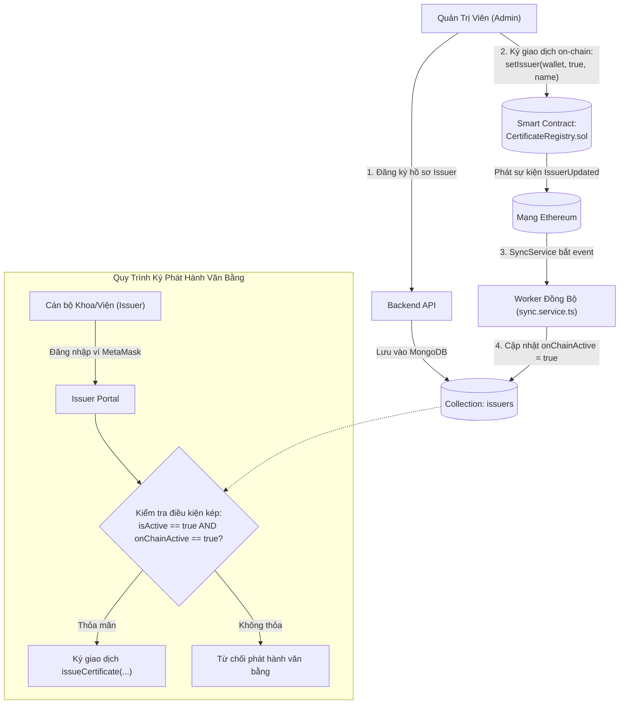

# Kiến Trúc Mô Hình Đơn Vị Phát Hành và Cơ Chế Ủy Quyền Kép (Issuer Model & Authorization Architecture)

Tài liệu này đặc tả chi tiết thiết kế mô hình dữ liệu Mongoose cho Đơn vị phát hành văn bằng (Issuer), cơ chế trạng thái kép (Dual Status: Off-chain & On-chain), chiến lược chỉ mục một-một tùy chọn (Partial Unique Index) và quy trình cấp phép tại [backend/src/models/Issuer.ts](file:///d:/VC_Blockchain/VC/backend/src/models/Issuer.ts).

---

## 1. Tổng Quan Kiến Trúc (Architecture Overview)

Trong giải pháp văn bằng số xác thực trên nền tảng Blockchain, **Issuer (Đơn vị phát hành)** đại diện cho một pháp nhân có thẩm quyền cấp phát văn bằng hoặc chứng chỉ học thuật (Khoa, Viện, Trung tâm đào tạo, Phòng Đào tạo đại học).

Mô hình `Issuer` kết nối chặt chẽ giữa hai thế giới:
1. **Thế giới Quản trị Truyền thống (Off-chain Enterprise)**: Quản lý tên khoa/viện, mã định danh nội bộ, thông tin liên hệ, logo hiển thị và liên kết tài khoản người dùng (`userId`) để đăng nhập vào cổng thông tin (Issuer Portal).
2. **Thế giới Mật mã học Web3 (On-chain Decentralized Ledger)**: Quản lý địa chỉ ví Ethereum (`walletAddress`) được đăng ký trong danh sách ủy quyền (`authorizedIssuers`) của Smart Contract `CertificateRegistry`.



---

## 2. Cơ Chế Trạng Thái Kép (Dual Status Mechanism)

Một trong những đặc điểm kiến trúc quan trọng nhất của `Issuer` là cơ chế trạng thái kép, phân tách rõ ràng quyền quản trị phần mềm và quyền thực thi trên chuỗi khối:

| Thuộc Tính | Phạm Vi Lưu Trữ | Vai Trò & Thẩm Quyền Điều Khiển | Mục Đích Kỹ Thuật |
| :--- | :--- | :--- | :--- |
| `isActive` | **Off-chain (MongoDB)** | Quản trị viên hệ thống (Admin) | Cho phép Admin tạm đình chỉ quyền truy cập cổng thông tin của đơn vị phát hành ngay lập tức mà **không cần thực hiện giao dịch blockchain** (tiết kiệm chi phí phí gas và độ trễ chờ xác nhận block). |
| `onChainActive` | **On-chain (Smart Contract)** | Đồng bộ tự động từ Blockchain | Phản ánh chính xác trạng thái quyền hạn của địa chỉ ví trên Smart Contract. Smart contract sẽ từ chối hàm `issueCertificate` nếu địa chỉ ví này không có `authorizedIssuers[wallet] == true`. |

### Điều kiện hợp lệ để cấp phát văn bằng:
Một đơn vị cấp bằng chỉ được phép thực hiện quy trình phát hành khi thỏa mãn điều kiện logic:
$$\text{CanIssue} = \text{isActive} \land \text{onChainActive}$$

---

## 3. Đặc Tả Dữ Liệu & Quy Tắc Xác Thực (Schema & Validation Rules)

Mô hình `issuerSchema` cài đặt các ràng buộc dữ liệu chặt chẽ nhằm bảo vệ tính toàn vẹn thông tin:

### 3.1. Danh Mục Thuộc Tính
- `name`: Tên đầy đủ của đơn vị (VD: "Khoa Công nghệ Thông tin"). Bắt buộc, tối đa 100 ký tự, tự động cắt khoảng trắng thừa (`trim: true`).
- `code`: Mã định danh viết tắt (VD: "FIT", "OAA"). Bắt buộc, tự động viết hoa (`uppercase: true`), độ dài tối đa 20 ký tự, tuân thủ Regex `^[A-Z0-9_-]+$`.
- `walletAddress`: Địa chỉ ví Ethereum 20 bytes hex (`^0x[a-f0-9]{40}$`), bắt buộc lưu ở dạng chữ thường (`lowercase: true`) nhằm tránh xung đột tìm kiếm do định dạng checksum.
- `userId`: Khóa ngoại liên kết tùy chọn (`ref: "User"`) tới tài khoản người dùng tương ứng.
- `logoUrl` & `website`: Thông tin nhận diện thương hiệu hiển thị trên phôi văn bằng số và giao diện xác thực công cộng (tối đa 300 ký tự).
- `chainAddedAt`: Thời điểm khối blockchain ghi nhận ví này được cấp quyền issuer lần đầu tiên.

---

## 4. Chiến Lược Đánh Chỉ Mục Chuyên Sâu (Indexing Strategy)

Để tối ưu hóa hiệu năng và bảo đảm toàn vẹn quan hệ dữ liệu, `issuerSchema` thiết lập 3 chỉ mục duy nhất:

### 4.1. Chỉ Mục Mã Định Danh Duy Nhất
```typescript
issuerSchema.index({ code: 1 }, { unique: true });
```
Đảm bảo mỗi đơn vị đào tạo trong toàn trường có một mã định danh duy nhất (VD: không thể tồn tại hai khoa cùng có mã `FIT`).

### 4.2. Chỉ Mục Địa Chỉ Ví Duy Nhất
```typescript
issuerSchema.index({ walletAddress: 1 }, { unique: true });
```
Mỗi địa chỉ ví Web3 chỉ đại diện cho một đơn vị phát hành duy nhất, triệt tiêu nguy cơ một ví bị gán nhầm cho nhiều đơn vị khác nhau.

### 4.3. Chỉ Mục Duy Nhất Có Điều Kiện (Partial Filter Index)
```typescript
issuerSchema.index(
  { userId: 1 },
  {
    unique: true,
    partialFilterExpression: { userId: { $type: "objectId" } },
  }
);
```

#### Vấn đề kỹ thuật:
- Mối quan hệ giữa `User` và `Issuer` là quan hệ **1-1 tùy chọn (Optional One-to-One)**: Một User chỉ được liên kết tối đa với một Issuer, nhưng một Issuer có thể chưa có tài khoản User liên kết (`userId = null`).
- Trong MongoDB chuẩn, nếu tạo chỉ mục unique thông thường `{ userId: 1 }` (`unique: true`), khi có từ 2 Issuer trở lên có giá trị `userId: null`, hệ thống sẽ ném lỗi trùng khóa:
  $$\text{MongoServerError: E11000 duplicate key error collection: issuers index: userId\_1 dup key: \{ userId: null \}}$$

#### Giải pháp Partial Filter Index:
- Tùy chọn `partialFilterExpression: { userId: { $type: "objectId" } }` chỉ áp dụng quy tắc duy nhất (`unique`) đối với các bản ghi mà trường `userId` thực sự có kiểu dữ liệu là `objectId`.
- Nhờ đó, nhiều đơn vị phát hành có thể đồng thời mang giá trị `userId = null` mà hoàn toàn không xảy ra xung đột dữ liệu.
