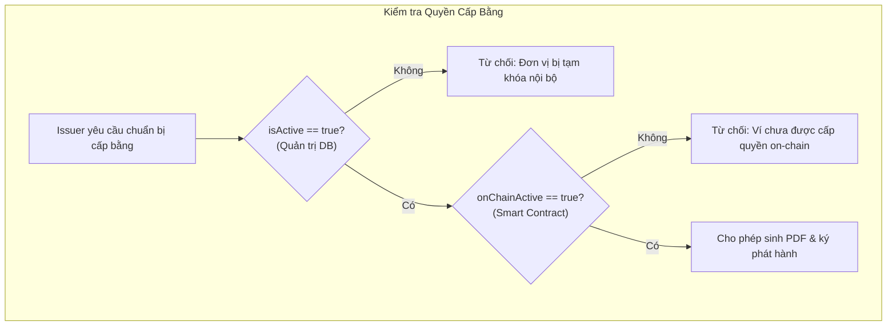
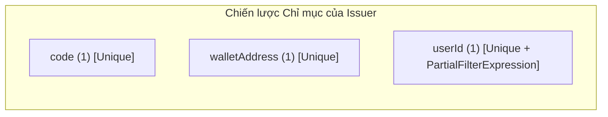

# Giải thích Chi tiết Logic & Mã nguồn `backend/src/models/Issuer.ts`

Tài liệu này giải thích chi tiết vai trò, kiến trúc dữ liệu, cơ chế trạng thái kép (Dual Status), chiến lược đánh chỉ mục và phân tích mã nguồn của file [`backend/src/models/Issuer.ts`](file:///d:/VC_Blockchain/VC/backend/src/models/Issuer.ts).

---

## 1. Vai trò và Vị trí trong Hệ thống

Trong hệ thống **Raccoon University — Verify Certification**, **Issuer (Đơn vị cấp văn bằng)** đại diện cho một đơn vị trực thuộc trường đại học được ủy quyền cấp chứng chỉ, ví dụ: *Khoa Công nghệ Thông tin*, *Viện Đào tạo Quốc tế*, *Phòng Quản lý Đào tạo*.

### Vị trí cầu nối trung tâm:
1. **Liên kết Định danh Web3 (On-chain)**:
   - Mỗi Issuer nắm giữ một địa chỉ ví Ethereum (`walletAddress`). Ví này được gán quyền gọi hàm `issueCertificate` và `revokeCertificate` trên smart contract [`CertificateRegistry.sol`](file:///d:/VC_Blockchain/VC/contracts/contracts/CertificateRegistry.sol).
2. **Liên kết Tài khoản Đăng nhập (Off-chain)**:
   - Issuer có thể được gắn kết với một tài khoản người dùng (`userId` tham chiếu tới bảng [`User`](file:///d:/VC_Blockchain/VC/backend/src/models/User.ts)), cho phép cán bộ của khoa đăng nhập vào cổng thông tin Issuer Portal bằng Email + Mật khẩu + Ví MetaMask.
3. **Cung cấp Nhận diện Thương hiệu trên Chứng chỉ**:
   - Lưu trữ tên đầy đủ (`name`), mã khoa (`code`), logo (`logoUrl`) và website (`website`) để nhúng vào phôi PDF và trang xem chi tiết văn bằng công khai (`/c/:certificateId`).

---

## 2. Cơ chế Trạng thái Kép (Dual Status Mechanism)

Hệ thống triển khai cơ chế kiểm soát trạng thái hai lớp độc lập nhằm bảo đảm tính an toàn tối đa:



| Cờ trạng thái | Phạm vi | Nguồn cập nhật | Ý nghĩa nghiệp vụ |
|---|---|---|---|
| `isActive` | **Off-chain** (MongoDB) | Quản trị viên hệ thống qua Admin Portal | Cho phép Admin tạm dừng quyền phát hành của một khoa trong nội bộ ứng dụng ngay lập tức mà **không cần tốn phí gas** giao dịch blockchain. |
| `onChainActive` | **On-chain** (Smart Contract) | Tự động đồng bộ bởi worker (`sync.service.ts`) khi bắt sự kiện `IssuerUpdated` | Thể hiện quyền hạn thực tế của địa chỉ ví trên blockchain Sepolia. Nếu `false`, hợp đồng sẽ revert lỗi `NotIssuer()`. |

> [!IMPORTANT]
> Một đơn vị chỉ được phép phát hành văn bằng mới khi và chỉ khi cả hai cờ đều đạt trạng thái kích hoạt: `isActive === true && onChainActive === true`.

---

## 3. Phân tích Cấu trúc Dữ liệu `IIssuer`

| Tên trường | Kiểu dữ liệu | Bắt buộc | Ràng buộc & Regex | Ý nghĩa & Vai trò kỹ thuật |
|---|---|---|---|---|
| `name` | `string` | Có | `maxlength: 100`, `trim: true` | Tên đầy đủ của khoa/viện cấp bằng. |
| `code` | `string` | Có | `maxlength: 20`, `uppercase: true`, `/^[A-Z0-9_-]+$/` | Mã viết tắt duy nhất (VD: `FIT`, `OAA`, `FEE`), dùng trong sinh số hiệu văn bằng tự động. |
| `walletAddress` | `string` | Có | `lowercase: true`, `/^0x[a-f0-9]{40}$/` | Địa chỉ ví Ethereum đại diện của đơn vị (20 bytes hex). |
| `userId` | `ObjectId?` | Không | `ref: "User"`, `default: null` | Khóa ngoại liên kết 1-1 với tài khoản người dùng đăng nhập. |
| `logoUrl` | `string?` | Không | `maxlength: 300` | Đường dẫn ảnh logo khoa phục vụ đóng dấu phôi bằng. |
| `website` | `string?` | Không | `maxlength: 300` | Trang thông tin chính thức của đơn vị cấp. |
| `isActive` | `boolean` | Có | `default: true` | Cờ kích hoạt quản trị trong ứng dụng. |
| `onChainActive` | `boolean` | Có | `default: false` | Cờ kích hoạt thực tế trên Smart Contract Sepolia. |
| `chainAddedAt` | `Date?` | Không | `default: null` | Thời điểm hợp đồng blockchain ghi nhận ví này được thêm làm Issuer lần đầu tiên. |
| `createdAt` / `updatedAt` | `Date` | Tự động | Mongoose timestamps | Thời điểm tạo và cập nhật bản ghi trong cơ sở dữ liệu. |

---

## 4. Chiến lược Đánh Chỉ mục (Indexing Strategy)

Các chỉ mục được cấu hình chặt chẽ để đảm bảo tính toàn vẹn dữ liệu:



### 4.1. Chỉ mục `{ code: 1 }` (Unique)
- **Tác dụng**: Ngăn chặn tuyệt đối việc tạo trùng mã đơn vị (ví dụ không thể có 2 đơn vị cùng mang mã `FIT`).

### 4.2. Chỉ mục `{ walletAddress: 1 }` (Unique)
- **Tác dụng**: Đảm bảo mỗi địa chỉ ví Ethereum chỉ thuộc về một đơn vị duy nhất, tránh nhập nhằng thẩm quyền cấp chứng chỉ.

### 4.3. Chỉ mục `{ userId: 1 }` (Unique + Partial Filter Index)
- **Bài toán**:
  - Mỗi tài khoản `User` chỉ được quản lý tối đa một `Issuer`.
  - Tuy nhiên, khi khởi tạo đơn vị cấp, ban đầu có thể **chưa tạo tài khoản User** (trường `userId` mang giá trị `null`).
  - Trong MongoDB, nếu đánh chỉ mục `{ userId: 1 }, { unique: true }` thông thường, khi có 2 bản ghi cùng có `userId = null`, MongoDB sẽ báo lỗi vi phạm khóa duy nhất `E11000 duplicate key error collection: issuers index: userId_1 dup key: { userId: null }`.
- **Giải pháp**:
  - Áp dụng `partialFilterExpression: { userId: { $type: "objectId" } }`.
  - Chỉ mục chỉ thực thi ràng buộc duy nhất đối với các bản ghi có `userId` thực sự là kiểu `objectId`, hoàn toàn bỏ qua các bản ghi mang giá trị `null`.

---

## 5. Mã nguồn Đầy đủ có Chú thích Chi tiết

Dưới đây là mã nguồn của [`backend/src/models/Issuer.ts`](file:///d:/VC_Blockchain/VC/backend/src/models/Issuer.ts) với hệ thống chú thích đầy đủ:

```typescript
import {
  Schema,
  model,
  type HydratedDocument,
  type Model,
  type Types,
} from "mongoose";

/**
 * Interface định nghĩa dữ liệu của một Đơn vị cấp văn bằng/chứng chỉ (Issuer) trong MongoDB.
 *
 * Đơn vị cấp đại diện cho một Khoa, Viện hoặc Phòng ban trong trường đại học được ủy quyền cấp bằng:
 * - Liên kết địa chỉ ví Web3 (walletAddress) dùng để ký giao dịch `issueCertificate` trên blockchain Sepolia.
 * - Liên kết tùy chọn với một tài khoản người dùng (User) để đăng nhập và quản lý qua giao diện portal.
 * - Duy trì cơ chế trạng thái kép (Dual Status): `isActive` (quản trị ứng dụng) và `onChainActive` (trạng thái hợp đồng).
 */
export interface IIssuer {
  /** Tên đầy đủ của đơn vị cấp (VD: "Khoa Công nghệ Thông tin", "Phòng Đào tạo Đại học") */
  name: string;
  /** Mã viết tắt duy nhất của đơn vị (VD: "FIT", "OAA", "FEE"), chuẩn hóa viết hoa */
  code: string;
  /** Địa chỉ ví Ethereum (checksum/lowercase) của đơn vị được cấp quyền trên Smart Contract */
  walletAddress: string;
  /** ID tài khoản User liên kết trong MongoDB (nếu đơn vị có tài khoản đăng nhập riêng) */
  userId?: Types.ObjectId | null;
  /** Đường dẫn URL hình ảnh logo của đơn vị cấp */
  logoUrl?: string | null;
  /** Địa chỉ trang web hoặc cổng thông tin chính thức của đơn vị */
  website?: string | null;
  /** Trạng thái kích hoạt off-chain trong cơ sở dữ liệu (Admin có thể tạm vô hiệu hóa) */
  isActive: boolean;
  /** Trạng thái kích hoạt thực tế on-chain đọc từ smart contract CertificateRegistry */
  onChainActive: boolean;
  /** Thời điểm đơn vị được cấp quyền lần đầu trên blockchain (Unix timestamp chuyển thành Date) */
  chainAddedAt?: Date | null;
  /** Thời điểm bản ghi được tạo trong MongoDB */
  createdAt: Date;
  /** Thời điểm bản ghi được cập nhật gần nhất */
  updatedAt: Date;
}

export type IssuerDocument = HydratedDocument<IIssuer>;

/**
 * Mongoose Schema định nghĩa cấu trúc, quy chuẩn và ràng buộc cho Issuer.
 */
const issuerSchema = new Schema<IIssuer>(
  {
    // Tên đơn vị cấp chứng chỉ
    name: {
      type: String,
      required: true,
      trim: true,
      maxlength: 100,
    },
    // Mã định danh đơn vị (viết hoa, chỉ gồm chữ cái, số, gạch dưới và gạch nối)
    code: {
      type: String,
      required: true,
      uppercase: true,
      trim: true,
      maxlength: 20,
      match: /^[A-Z0-9_-]+$/,
    },
    // Địa chỉ ví Ethereum (40 ký tự hex, lưu trữ dạng chữ thường)
    walletAddress: {
      type: String,
      required: true,
      lowercase: true,
      trim: true,
      match: /^0x[a-f0-9]{40}$/,
    },
    // Khóa ngoại liên kết 1-1 tùy chọn tới bảng User
    userId: {
      type: Schema.Types.ObjectId,
      ref: "User",
      default: null,
    },
    // Đường dẫn logo phục vụ hiển thị trên giao diện và văn bằng
    logoUrl: {
      type: String,
      default: null,
      maxlength: 300,
    },
    // Website chính thức của khoa/phòng ban
    website: {
      type: String,
      default: null,
      maxlength: 300,
    },
    // Cờ trạng thái quản trị off-chain trong ứng dụng
    isActive: {
      type: Boolean,
      default: true,
    },
    // Cờ trạng thái thực tế trên Smart Contract (đồng bộ tự động qua worker)
    onChainActive: {
      type: Boolean,
      default: false,
    },
    // Thời điểm smart contract ghi nhận ví này trở thành issuer
    chainAddedAt: {
      type: Date,
      default: null,
    },
  },
  {
    timestamps: true, // Tự động tạo createdAt và updatedAt
    versionKey: false, // Bỏ trường __v
  }
);

// -----------------------------------------------------------------------------
// CHIẾN LƯỢC ĐÁNH CHỈ MỤC (INDEXING STRATEGY)
// -----------------------------------------------------------------------------

// 1. Chỉ mục Unique theo mã code: Đảm bảo không trùng mã viết tắt giữa các khoa/viện
issuerSchema.index({ code: 1 }, { unique: true });

// 2. Chỉ mục Unique theo ví Ethereum: Mỗi địa chỉ ví chỉ đại diện cho một đơn vị duy nhất
issuerSchema.index({ walletAddress: 1 }, { unique: true });

// 3. Chỉ mục Unique có điều kiện (Partial Filter Index) cho liên kết tài khoản:
// Đảm bảo mỗi User chỉ liên kết với tối đa 1 Issuer, đồng thời cho phép nhiều Issuer có userId = null
issuerSchema.index(
  { userId: 1 },
  {
    unique: true,
    partialFilterExpression: { userId: { $type: "objectId" } },
  }
);

export const Issuer: Model<IIssuer> = model<IIssuer>("Issuer", issuerSchema);
```

---

## 6. Vòng đời Đồng bộ Sự kiện (Lifecycle & Synchronization)

1. **Thêm mới Issuer**:
   - Quản trị viên gửi yêu cầu tạo Issuer qua Admin Portal.
   - Quản trị viên ký giao dịch gọi hàm `addIssuer(who, name)` trên Sepolia bằng MetaMask.
   - Giao dịch được đào vào khối $\rightarrow$ Smart Contract phát sự kiện `IssuerUpdated(who, name, true)`.
   - Worker nền [`sync.service.ts`](file:///d:/VC_Blockchain/VC/backend/src/services/sync.service.ts) phát hiện sự kiện $\rightarrow$ Cập nhật bản ghi Issuer tương ứng trong MongoDB:
     ```typescript
     await Issuer.updateOne(
       { walletAddress: wallet },
       { $set: { onChainActive: true, isActive: true, chainAddedAt: new Date() } }
     );
     ```

2. **Thu hồi / Vô hiệu hóa Issuer**:
   - Quản trị viên ký gọi hàm `removeIssuer(who)` on-chain.
   - Smart Contract phát sự kiện `IssuerUpdated(who, name, false)`.
   - Worker cập nhật `onChainActive: false`, `isActive: false` trong MongoDB.
   - **Lưu ý**: Việc vô hiệu hóa Issuer ngăn không cho ví này cấp chứng chỉ mới, nhưng toàn bộ các chứng chỉ đã cấp trước đó vẫn hoàn toàn có giá trị và hợp lệ.
