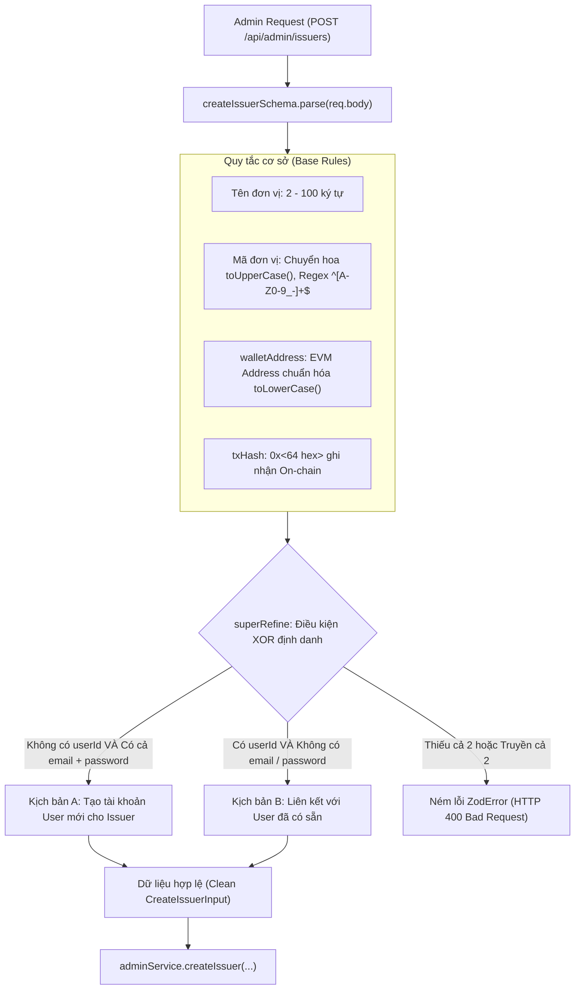

# Kiến Trúc và Logic Xác Thực Đơn Vị Cấp Phát (Issuer Schema Validation)

Tài liệu này đặc tả chi tiết kiến trúc, các quy tắc bảo mật (Security Invariants), mô hình đăng ký kép có điều kiện loại trừ (Mutual Exclusivity - XOR) và cơ chế thẩm định chứng từ Blockchain được cài đặt tại [backend/src/schemas/issuer.ts](file:///d:/VC_Blockchain/VC/backend/src/schemas/issuer.ts).

---

## 1. Tổng Quan Kiến Trúc (Architecture Overview)

Trong mạng lưới Verifiable Credentials, **Issuer (Đơn vị cấp phát)** là chủ thể nắm giữ quyền tạo và ký số các văn bằng chứng chỉ. Một đơn vị chỉ được coi là hợp lệ khi thỏa mãn đồng thời hai điều kiện:
1. **Định danh hệ thống (Web2 Identity)**: Được liên kết với một tài khoản người dùng (`User`) trong cơ sở dữ liệu MongoDB.
2. **Ủy quyền On-chain (Web3 Role Authorization)**: Địa chỉ ví của đơn vị (`walletAddress`) đã được cấp quyền phát hành thông qua hàm `addIssuer` trên Smart Contract, được chứng minh bằng mã giao dịch `txHash`.



---

## 2. Mô Hình Onboarding Kép Loại Trừ Lẫn Nhau (XOR Logic)

Hệ thống hỗ trợ quản trị viên 2 cách thức khởi tạo Issuer nhưng áp dụng thuật toán `superRefine` để đảm bảo tính toàn vẹn dữ liệu:

### 2.1. Kịch bản A: Tạo mới tài khoản (New Account Onboarding)
- **Áp dụng khi**: Đơn vị cấp phát chưa từng có tài khoản trên hệ thống.
- **Yêu cầu dữ liệu**: Phải cung cấp đầy đủ cả `email` và `password`. Không được truyền `userId`.
- **Cơ chế xử lý**: Hệ thống sẽ tạo một bản ghi `User` mới với `role: "issuer"`, mã hóa mật khẩu bằng `bcrypt`, sau đó gắn `user._id` vào bản ghi `Issuer`.

### 2.2. Kịch bản B: Liên kết tài khoản sẵn có (Existing Account Linking)
- **Áp dụng khi**: Người đại diện đơn vị đã đăng ký tài khoản từ trước.
- **Yêu cầu dữ liệu**: Bắt buộc truyền `userId` (chuỗi 24 hex hợp lệ của MongoDB). Không được phép truyền `email` hoặc `password`.
- **Cơ chế xử lý**: Hệ thống nâng cấp quyền của tài khoản đó thành `role: "issuer"` và liên kết với tổ chức.

### 2.3. Bảng phân tích trạng thái kiểm tra XOR:
| `userId` | `email` | `password` | Kết quả thẩm định | Thông báo lỗi |
| :---: | :---: | :---: | :---: | :--- |
| ❌ Vắng mặt | ✅ Hợp lệ | ✅ Hợp lệ | **Hợp lệ (Kịch bản A)** | — |
| ✅ Hợp lệ | ❌ Vắng mặt | ❌ Vắng mặt | **Hợp lệ (Kịch bản B)** | — |
| ❌ Vắng mặt | ❌ Vắng mặt | ❌ Vắng mặt | **Từ chối (HTTP 400)** | *"Cần email và mật khẩu để tạo tài khoản issuer mới"* |
| ✅ Hợp lệ | ✅ Hợp lệ | ❌ Vắng mặt | **Từ chối (HTTP 400)** | *"Chỉ truyền userId hoặc email/password, không truyền cả hai"* |
| ✅ Hợp lệ | ✅ Hợp lệ | ✅ Hợp lệ | **Từ chối (HTTP 400)** | *"Chỉ truyền userId hoặc email/password, không truyền cả hai"* |

---

## 3. Chi Tiết Các Trường Dữ Liệu & Quy Tắc Chuẩn Hóa

### 3.1. Mã định danh đơn vị (`code`)
```typescript
code: z
  .string()
  .min(2)
  .max(20)
  .regex(/^[A-Z0-9_-]+$/, "Mã đơn vị chỉ gồm A-Z, 0-9, _ và -")
  .transform((value) => value.toUpperCase())
```
- **Chuẩn hóa chữ hoa (Uppercase)**: Tự động chuyển các chuỗi như `"fit"`, `"dt"` thành `"FIT"`, `"DT"`.
- Đảm bảo mã đơn vị luôn đồng nhất khi tạo mã chứng chỉ hoặc hiển thị trên giao diện người dùng.

### 3.2. Bằng chứng giao dịch Blockchain (`txHash`)
- Cả hai thao tác cấp quyền (`createIssuerSchema`) và thu hồi quyền (`deactivateIssuerSchema`) đều bắt buộc phải có `txHash`.
- Điều này bảo đảm mọi thay đổi quyền hạn trong cơ sở dữ liệu backend luôn đồng bộ 100% với trạng thái trên Smart Contract.

### 3.3. Truy vấn danh sách (`issuerListQuerySchema`)
```typescript
active: z
  .enum(["true", "false"])
  .optional()
  .transform((value) => (value === undefined ? undefined : value === "true"))
```
- Query param trên URL luôn là chuỗi ký tự (`?active=true`). Cơ chế `.transform()` tự động chuyển chuỗi `"true"` thành giá trị `true` (kiểu boolean) và `"false"` thành `false`, giúp service truy vấn trực tiếp vào database mà không cần ép kiểu thủ công.

---

## 4. Kiểm Thử Đơn Vị (Unit Testing)

Bộ schema này được kiểm thử toàn diện tại [backend/src/schemas/__tests__/issuer.test.ts](file:///d:/VC_Blockchain/VC/backend/src/schemas/__tests__/issuer.test.ts), bao gồm 5 trường hợp kiểm tra tính đúng đắn của logic XOR, kiểm tra độ mạnh mật khẩu và định dạng dữ liệu đầu vào.
