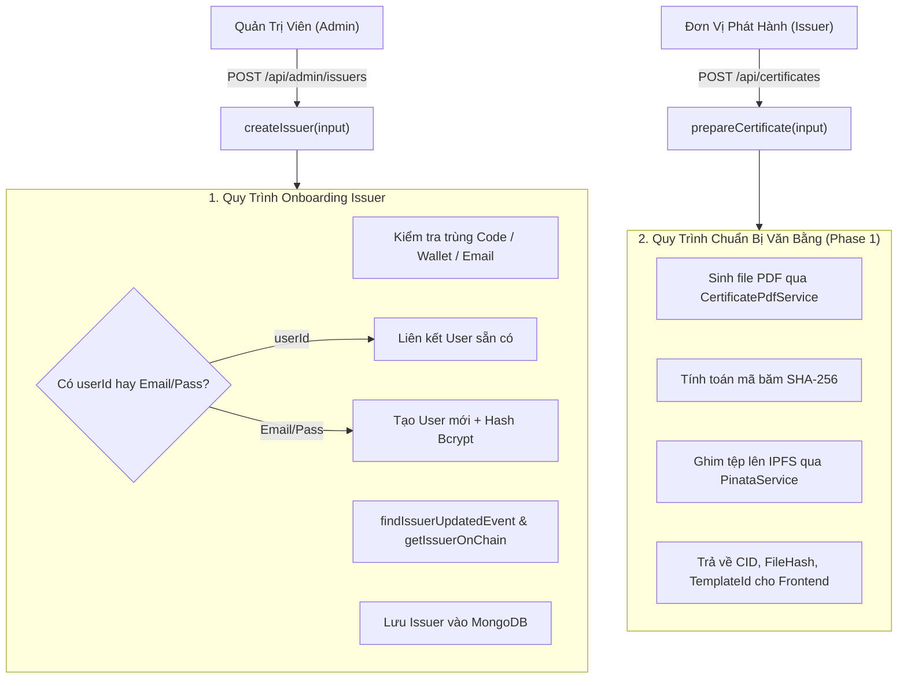
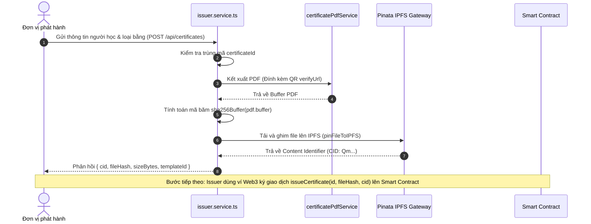

# Kiến Trúc Dịch Vụ Đơn Vị Cấp Phát và Chuẩn Bị Chứng Từ (Issuer Service Architecture & Onboarding)

Tài liệu này đặc tả chi tiết kiến trúc, mô hình đăng ký đơn vị phát hành (Issuer Onboarding), cơ chế giao dịch bồi hoàn (Compensating Transactions) và quy trình chuẩn bị văn bằng số (PDF & IPFS Generation) tại [backend/src/services/issuer.service.ts](file:///d:/VC_Blockchain/VC/backend/src/services/issuer.service.ts).

---

## 1. Tổng Quan Kiến Trúc (Architecture Overview)

Trong giải pháp Verifiable Credentials, [issuer.service.ts](file:///d:/VC_Blockchain/VC/backend/src/services/issuer.service.ts) đảm nhận hai trách nhiệm sống còn của hệ thống:
1. **Quản trị danh tính & phân quyền Đơn vị cấp phát (Issuer Management)**: Đăng ký tổ chức mới, liên kết ví Ethereum, xác thực giao dịch cấp quyền On-chain và vô hiệu hóa khi cần.
2. **Khởi tạo chứng từ kỹ thuật số (Certificate Preparation - Phase 1)**: Chuyển hóa dữ liệu văn bằng nháp thành tệp PDF hoàn chỉnh đính kèm QR Code, tính toán vân tay SHA-256 và ghim lên mạng lưu trữ phân tán IPFS.



---

## 2. Mô Hình Onboarding Đơn Vị Phát Hành (`createIssuer`)

Quy trình onboarding đơn vị phát hành kết hợp đồng thời việc cấp tài khoản đăng nhập (Web2) và kiểm tra quyền trên Smart Contract (Web3).

### 2.1. Hai kịch bản liên kết tài khoản:
- **Kịch bản 1 (Liên kết tài khoản sẵn có)**: Nhận `userId`, kiểm tra người dùng tồn tại, có quyền `role === 'issuer'` và cập nhật địa chỉ ví quản trị.
- **Kịch bản 2 (Tạo mới tài khoản hoàn toàn)**: Nhận `email` và `password`, băm mật khẩu an toàn bằng `bcrypt.hash(password, 10)`, tạo bản ghi `User` mới với `role: 'issuer'`.

### 2.2. Cơ chế giao dịch bồi hoàn (Compensating Transaction Pattern)
Vì MongoDB và Smart Contract không chia sẻ chung một transaction hai pha (2PC), hệ thống áp dụng cơ chế tự động dọn dẹp lỗi (Rollback):
- Nếu quá trình tạo `Issuer` thất bại sau khi đã tạo `User`, hệ thống lập tức thực hiện xóa tài khoản vừa tạo (`User.deleteOne({ _id: createdUserId })`), ngăn chặn hoàn toàn tình trạng tài khoản mồ côi (Orphan records).
- Nếu việc cập nhật ví vào `User` thất bại, hệ thống xóa cả `Issuer` và `User` vừa tạo để giữ cơ sở dữ liệu luôn ở trạng thái nhất quán.

### 2.3. Thẩm tra On-chain bắt buộc:
Hệ thống không kích hoạt Issuer nếu chưa có sự kiện trên chuỗi:
1. `findIssuerUpdatedEvent`: Xác nhận biên lai giao dịch thành công và log sự kiện khớp tên, ví.
2. `getIssuerOnChain(wallet)`: Đọc trực tiếp biến trạng thái trên Smart Contract, bắt buộc `active === true` và `name` khớp 100%.

---

## 3. Quy Trình Chuẩn Bị Văn Bằng (`prepareCertificate` - Phase 1)

Trước khi văn bằng có thể được ký số và mint lên Smart Contract, nó phải trải qua giai đoạn chuẩn bị tệp và bằng chứng mật mã học:



### Chi tiết các bước:
1. **Kiểm tra trùng lặp**: Đảm bảo `certificateId` chưa từng được sử dụng.
2. **Tạo tài liệu PDF**: Gọi `certificatePdfService.generate` với URL thẩm định công khai `verifyUrl = /c/:certificateId` được nhúng trực tiếp dưới dạng mã QR ở góc văn bằng.
3. **Mã băm SHA-256**: Tạo chữ ký vân tay bất biến của tài liệu.
4. **Lưu trữ IPFS**: Tải file lên Pinata để lưu trữ phân tán, đảm bảo tệp có thể tải về từ bất kỳ IPFS gateway công cộng nào.

---

## 4. Vô Hiệu Hóa Đơn Vị Phát Hành (`deactivateIssuer`)

Khi một đơn vị ngừng hoạt động hoặc bị thu hồi quyền cấp chứng chỉ:
1. Quản trị viên thực hiện giao dịch thu hồi quyền trên Smart Contract.
2. API nhận `txHash` và gọi `deactivateIssuer(issuerId, txHash)`.
3. Kiểm tra tính lũy thừa: Nếu đơn vị đã bị vô hiệu hóa trước đó, trả về DTO ngay lập tức.
4. Xác minh sự kiện `IssuerUpdated` với cờ `active: false` và đảm bảo trên chuỗi `onChain.active === false`.
5. Cập nhật `isActive = false`, `onChainActive = false` và lưu vết vào bảng `ChainEvent`.

---

## 5. Mô Hình Kế Thừa Dịch Vụ (`IssuerService extends CertificateService`)

Lớp `IssuerService` được thiết kế kế thừa từ `CertificateService`:

```typescript
export class IssuerService extends CertificateService {
  confirmCertificate = confirmCertificate;
  listIssuerCertificates = listIssuerCertificates;
  prepareCertificate = prepareCertificate;
  lockCertificate = lockCertificate;
  unlockCertificate = unlockCertificate;
}
```

Mô hình này giúp `IssuerService` sở hữu toàn bộ các phương thức tra cứu công khai và xử lý văn bằng của `CertificateService`, đồng thời bổ sung các nghiệp vụ phát hành đặc thù của Issuer.

---

## 6. Ma Trận Phương Thức và Mã Lỗi

| Phương thức | Tham số chính | Trả về | Các mã lỗi thường gặp |
| :--- | :--- | :--- | :--- |
| **`listIssuers`** | `page, limit, q, active` | `IssuerListResult` | — |
| **`createIssuer`** | `CreateIssuerInput` | `IssuerDTO` | 400 (Role không hợp lệ), 404 (User không tồn tại), 409 (Trùng mã/ví/email), 422 (Chưa kích hoạt on-chain) |
| **`deactivateIssuer`** | `issuerId, txHash` | `IssuerDTO` | 404 (Không tìm thấy Issuer), 422 (Issuer vẫn active trên chuỗi) |
| **`prepareCertificate`** | `PrepareCertificateInput, issuer` | `PreparedCertificate` | 409 (Mã chứng chỉ đã tồn tại), 502 (Lỗi kết nối IPFS) |
