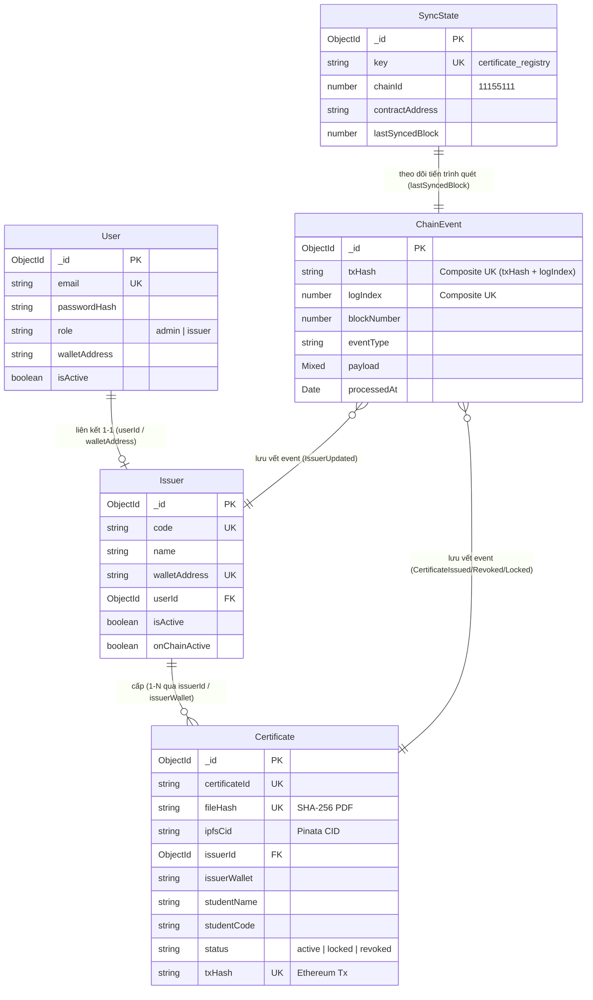

# Giải thích Chi tiết Logic & Mã nguồn `backend/src/models/index.ts`

Tài liệu này giải thích chi tiết kiến trúc, mô hình quan hệ thực thể (ERD), nguyên lý thiết kế Barrel Module và phân tích mã nguồn của file [`backend/src/models/index.ts`](file:///d:/VC_Blockchain/VC/backend/src/models/index.ts).

---

## 1. Vai trò và Vị trí trong Hệ thống

Trong kiến trúc Backend của hệ thống **Verify Certification**, thư mục [`backend/src/models/`](file:///d:/VC_Blockchain/VC/backend/src/models/) chứa toàn bộ các định nghĩa Schema, Interface và Mongoose Model tương tác với cơ sở dữ liệu MongoDB Atlas.

Tệp tin `index.ts` đóng vai trò là **Barrel Module (Điểm xuất khẩu tập trung)** cho toàn bộ lớp Mô hình Dữ liệu (Data Layer / ODM).

### Lợi ích kiến trúc của Barrel Pattern:
1. **Đơn giản hóa đường dẫn Import**:
   - Các tầng nghiệp vụ (Controllers, Services, Middlewares, Scripts) chỉ cần import từ một nguồn duy nhất:
     ```typescript
     // Thay vì phải import phân mảnh từ từng file riêng lẻ:
     import { Certificate } from "../models/Certificate";
     import { Issuer } from "../models/Issuer";
     import { User } from "../models/User";

     // Chỉ cần import tập trung, gọn gàng và dễ bảo trì:
     import { Certificate, Issuer, User } from "../models";
     ```
2. **Kiểm soát Phạm vi Xuất bản (Encapsulation)**:
   - Chỉ xuất khẩu các Model chính, Hydrated Document types và Interface dữ liệu cần thiết. Các helper logic hoặc biến nội bộ trong từng file model được đóng gói kín, không bị lộ ra ngoài.
3. **Phòng tránh Phụ thuộc Vòng (Circular Dependency)**:
   - Giúp việc quản lý quan hệ tham chiếu chéo (`ref: "User"`, `ref: "Issuer"`) giữa các Schema Mongoose diễn ra mượt mà và an toàn trong quá trình khởi tạo ứng dụng.

---

## 2. Sơ đồ Quan hệ Thực thể Tổng thể (Entity-Relationship Diagram - ERD)

Toàn bộ lớp dữ liệu bao gồm 5 mô hình cốt lõi hoạt động đồng bộ giữa dữ liệu Off-chain và trạng thái On-chain:



---

## 3. Phân tích Chi tiết 5 Thành phần được Re-export

Tệp `models/index.ts` tập trung hóa và tái xuất khẩu 5 thành phần nghiệp vụ:

### 3.1. Phân hệ Quản trị & Người dùng (`User`)
- **Tệp nguồn**: [`backend/src/models/User.ts`](file:///d:/VC_Blockchain/VC/backend/src/models/User.ts)
- **Các thành phần xuất khẩu**:
  - `User`: Mongoose Model đại diện cho tài khoản đăng nhập.
  - `IUser`: TypeScript Interface mô tả các trường (email, passwordHash, role, displayName, walletAddress, isActive).
  - `UserDocument`: Kiểu tài liệu Mongoose (`HydratedDocument<IUser>`).
  - `UserRole`: Type alias định nghĩa vai trò người dùng (`"admin" | "issuer"`).
- **Mục đích**: Bảo mật hệ thống, hỗ trợ đăng nhập đa lớp bằng email + mật khẩu kết hợp kiểm tra địa chỉ ví MetaMask khớp với tài khoản.

### 3.2. Phân hệ Đơn vị Cấp văn bằng (`Issuer`)
- **Tệp nguồn**: [`backend/src/models/Issuer.ts`](file:///d:/VC_Blockchain/VC/backend/src/models/Issuer.ts)
- **Các thành phần xuất khẩu**:
  - `Issuer`: Mongoose Model lưu trữ thông tin các Khoa, Viện, Phòng ban.
  - `IIssuer`: TypeScript Interface (tên đơn vị, mã code viết hoa, địa chỉ ví on-chain, website, logo).
  - `IssuerDocument`: Kiểu tài liệu Mongoose.
- **Mục đích**: Theo dõi trạng thái hoạt động song song: `isActive` (quản trị off-chain trong DB) và `onChainActive` (trạng thái thực tế trên Smart Contract).

### 3.3. Phân hệ Văn bằng & Chứng chỉ (`Certificate`)
- **Tệp nguồn**: [`backend/src/models/Certificate.ts`](file:///d:/VC_Blockchain/VC/backend/src/models/Certificate.ts)
- **Các thành phần xuất khẩu**:
  - `Certificate`: Mongoose Model trung tâm của toàn bộ ứng dụng.
  - `ICertificate`: TypeScript Interface chứa hơn 30 trường dữ liệu (PII học viên, mã băm SHA-256 PDF, CID IPFS, dữ liệu giao dịch Ethereum, trạng thái active/locked/revoked).
  - `CertificateDocument`: Kiểu tài liệu Mongoose.
- **Mục đích**: Cung cấp khả năng tra cứu văn bằng đa tiêu chí, bảo vệ quyền riêng tư người học và làm cầu nối đối soát với Blockchain.

### 3.4. Phân hệ Sự kiện Blockchain & Nhật ký Kiểm toán (`ChainEvent`)
- **Tệp nguồn**: [`backend/src/models/ChainEvent.ts`](file:///d:/VC_Blockchain/VC/backend/src/models/ChainEvent.ts)
- **Các thành phần xuất khẩu**:
  - `ChainEvent`: Mongoose Model lưu vết sự kiện smart contract.
  - `IChainEvent`: TypeScript Interface.
  - `ChainEventDocument`: Kiểu tài liệu Mongoose.
  - `ChainEventType`: Type alias chứa danh sách tên sự kiện (`CertificateIssued`, `CertificateRevoked`, `CertificateLocked`, `CertificateUnlocked`, `IssuerUpdated`, `OwnershipTransferred`).
- **Mục đích**: Bảo đảm tính lũy thừa (**Idempotency**) thông qua khóa duy nhất `{ txHash, logIndex }`, ngăn chặn trùng lặp khi quét logs và cho phép phục hồi dữ liệu từ đầu.

### 3.5. Phân hệ Trạng thái Đồng bộ Khối (`SyncState`)
- **Tệp nguồn**: [`backend/src/models/SyncState.ts`](file:///d:/VC_Blockchain/VC/backend/src/models/SyncState.ts)
- **Các thành phần xuất khẩu**:
  - `SyncState`: Mongoose Model lưu vết checkpoint đồng bộ.
  - `ISyncState`: TypeScript Interface.
  - `SyncStateDocument`: Kiểu tài liệu Mongoose.
- **Mục đích**: Lưu giữ `lastSyncedBlock` của hợp đồng trên mạng Sepolia, đảm bảo worker nền (`sync.service.ts`) biết chính xác khối tiếp theo cần quét khi hệ thống khởi động lại.

---

## 4. Mã nguồn Đầy đủ có Chú thích Chi tiết

Dưới đây là mã nguồn của [`backend/src/models/index.ts`](file:///d:/VC_Blockchain/VC/backend/src/models/index.ts):

```typescript
/**
 * Điểm xuất khẩu tập trung (Barrel Module) cho toàn bộ lớp Mô hình Dữ liệu (Data Layer / ODM) của Backend.
 *
 * Tệp tin này gom nhóm và tái xuất khẩu (re-export) tất cả các Mongoose Model, Interface dữ liệu,
 * Hydrated Document type và Type alias từ các mô hình thành phần:
 *
 * 1. User: Quản lý người dùng, phân quyền (admin / issuer), mật khẩu băm và liên kết ví MetaMask.
 * 2. Issuer: Hồ sơ đơn vị cấp văn bằng (Khoa, Viện, Phòng ban), thông tin liên hệ và trạng thái cấp phép on-chain.
 * 3. Certificate: Thực thể trung tâm lưu trữ văn bằng, thông tin sinh viên (PII), mã hash SHA-256 của file PDF, CID IPFS và các cờ trạng thái.
 * 4. ChainEvent: Nhật ký kiểm toán (Audit Trail) lưu vết thô bất biến các sự kiện phát ra từ smart contract, bảo đảm tính lũy thừa (Idempotency).
 * 5. SyncState: Con trỏ trạng thái theo dõi khối blockchain đã quét (lastSyncedBlock) phục vụ worker đồng bộ sự kiện nền.
 */

// --- Quản trị viên & Người dùng hệ thống ---
export {
  User,
  type IUser,
  type UserDocument,
  type UserRole,
} from "./User";

// --- Đơn vị cấp văn bằng / chứng chỉ (Khoa, Viện) ---
export {
  Issuer,
  type IIssuer,
  type IssuerDocument,
} from "./Issuer";

// --- Văn bằng, Chứng chỉ & Hồ sơ học viên ---
export {
  Certificate,
  type ICertificate,
  type CertificateDocument,
} from "./Certificate";

// --- Sự kiện Blockchain & Nhật ký kiểm toán Idempotency ---
export {
  ChainEvent,
  type IChainEvent,
  type ChainEventDocument,
  type ChainEventType,
} from "./ChainEvent";

// --- Trạng thái tiến trình đồng bộ khối Blockchain ---
export {
  SyncState,
  type ISyncState,
  type SyncStateDocument,
} from "./SyncState";
```

---

## 5. Quy chuẩn Lập trình khi Mở rộng Schema mới

Khi hệ thống phát triển thêm các nghiệp vụ mới cần lưu trữ (ví dụ: `AuditLog`, `Notification`, `RevokeRequest`), nhà phát triển cần tuân thủ quy chuẩn 3 bước:
1. **Tạo file Schema riêng biệt**: Ví dụ `backend/src/models/AuditLog.ts`.
2. **Khai báo đầy đủ Type Export**: Luôn xuất khẩu đồng thời Model, Interface dữ liệu (`IAuditLog`) và Hydrated Document type (`AuditLogDocument`).
3. **Đăng ký vào `index.ts`**: Re-export toàn bộ các thành phần trên tại `index.ts` để các module khác trong ứng dụng có thể sử dụng đồng nhất.
