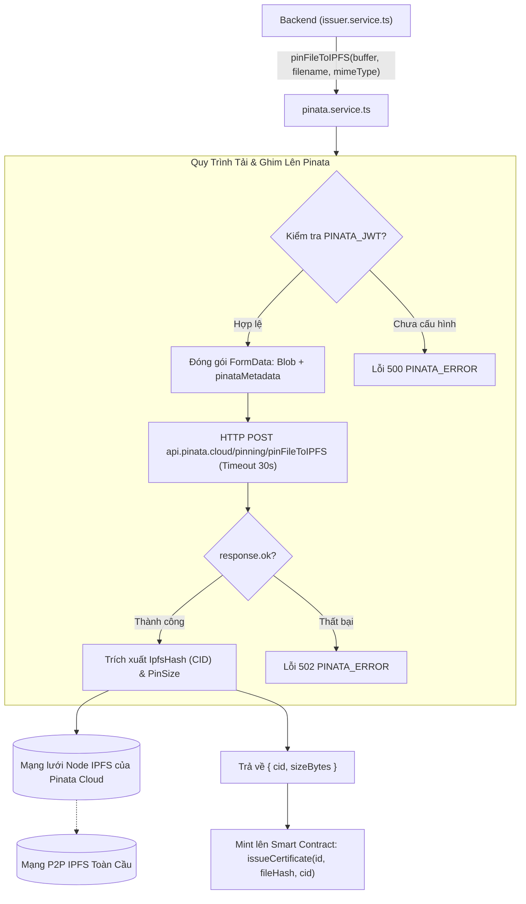

# Kiến Trúc Dịch Vụ Lưu Trữ IPFS và Tích Hợp Pinata Cloud (Pinata Service Architecture)

Tài liệu này đặc tả chi tiết kiến trúc lưu trữ phi tập trung (Decentralized Storage), quy trình ghim tệp phân tán (IPFS Pinning Mechanism), cơ chế xử lý dữ liệu nhị phân và phòng thủ lỗi kết nối tại [backend/src/services/pinata.service.ts](file:///d:/VC_Blockchain/VC/backend/src/services/pinata.service.ts).

---

## 1. Tổng Quan Kiến Trúc (Architecture Overview)

Trong giải pháp văn bằng số trên nền tảng Blockchain (Verifiable Credentials), việc lưu trữ toàn bộ nội dung tệp PDF văn bằng trực tiếp lên Smart Contract (On-chain Storage) là điều bất khả thi do chi phí phí gas (Gas fee) cực kỳ đắt đỏ. 

Thay vào đó, hệ thống áp dụng mô hình **Lưu trữ lai (Hybrid Storage)**:
1. **Lớp dữ liệu On-chain**: Smart Contract chỉ lưu trữ mã băm toàn vẹn (SHA-256 File Hash) và mã định danh nội dung ([IPFS CID](https://docs.ipfs.tech/concepts/content-addressing/)).
2. **Lớp lưu trữ phân tán Off-chain**: Tệp PDF thực tế được lưu trữ trên mạng lưới ngang hàng **IPFS** thông qua dịch vụ ghim dữ liệu chuyên dụng **Pinata Cloud**.



---

## 2. Cơ Chế Ghim Tệp (IPFS Pinning Mechanism)

### 2.1. Tại sao cần Pinning Service?
Trên mạng lưới IPFS, các node tham gia lưu trữ nội dung theo cơ chế bộ nhớ đệm (Caching). Nếu một tệp tin không được truy cập thường xuyên, quy trình thu gom rác (**Garbage Collection**) của các IPFS node sẽ tự động xóa tệp đó để giải phóng dung lượng đĩa.

Dịch vụ **Pinata Cloud** đảm bảo:
- Tệp PDF văn bằng được **ghim vĩnh viễn (Pinned Permanently)** trên các cụm node chuyên dụng có độ sẵn sàng cao ($99.9\%$).
- Tệp tin luôn sẵn sàng để bất kỳ ai trên thế giới cũng có thể truy xuất thông qua các cổng Gateway công cộng mà không lo bị mất dữ liệu.

---

## 3. Phân Tích Logic Nghiệp Vụ (`pinFileToIPFS`)

### 3.1. Đóng gói dữ liệu nhị phân với FormData chuẩn Web API
```typescript
const form = new FormData();
const bytes = new Uint8Array(buffer);
form.append("file", new Blob([bytes], { type: mimeType }), filename);
form.append(
  "pinataMetadata",
  JSON.stringify({ name: filename, keyvalues: { app: "verify-certification" } })
);
```
- Chuyển đổi an toàn từ đối tượng `Buffer` của Node.js sang mảng `Uint8Array` và khởi tạo đối tượng `Blob` với đúng định dạng MIME (`application/pdf`).
- **Gắn nhãn siêu dữ liệu (Metadata)**: Thuộc tính `keyvalues: { app: "verify-certification" }` giúp phân loại, kiểm toán và quản lý dung lượng tệp trực quan trên Bảng điều khiển Pinata.

### 3.2. Bảo vệ kết nối với thời gian chờ (Timeout Protection)
```typescript
response = await fetch("https://api.pinata.cloud/pinning/pinFileToIPFS", {
  method: "POST",
  headers: {
    Authorization: `Bearer ${env.PINATA_JWT}`,
  },
  body: form,
  signal: AbortSignal.timeout(30_000),
});
```
- **Xác thực an toàn**: Sử dụng Scoped JWT (`PINATA_JWT`) thay vì API Key/Secret truyền thống, giúp bảo mật tối đa và dễ dàng thu hồi quyền truy cập.
- **`AbortSignal.timeout(30_000)`**: Giới hạn thời gian chờ tối đa 30 giây. Ngăn chặn hiện tượng nghẽn Event Loop hoặc rò rỉ tài nguyên khi đường truyền quốc tế đến máy chủ Pinata gặp sự cố.

---

## 4. Ma Trận Xử Lý Lỗi (Error Handling Matrix)

| Mã lỗi HTTP | Tên mã lỗi | Điều kiện phát sinh | Ý nghĩa bảo mật / vận hành |
| :---: | :--- | :--- | :--- |
| **`500`** | `PINATA_ERROR` | Biến môi trường `PINATA_JWT` bị bỏ trống | Lỗi cấu hình hệ thống, nhắc nhở quản trị viên khai báo secret |
| **`502`** | `PINATA_ERROR` | Timeout 30s hoặc không kết nối được đến máy chủ Pinata | Lỗi hạ tầng mạng bên ngoài (Bad Gateway) |
| **`502`** | `PINATA_ERROR` | Pinata trả về HTTP status $\ge 400$ (hết quota, token hết hạn) | Ghi log chi tiết lỗi ra console và phản hồi lỗi an toàn cho client |
| **`502`** | `PINATA_ERROR` | Phản hồi JSON không chứa trường `IpfsHash` | Phản hồi từ bên thứ ba bị khiếm khuyết |

---

## 5. Tích Hợp Hệ Thống & Truy Xuất Tệp

### 5.1. Dữ liệu trả về (`PinResult`)
```typescript
export interface PinResult {
  cid: string;       // Ví dụ: "QmUtYcoXUvXcWyAY7wBWHupxfPH4AKADKFeQK5DnbAKN8A"
  sizeBytes: number; // Ví dụ: 456789
}
```

### 5.2. Luồng sử dụng trong toàn bộ hệ thống
1. [issuer.service.ts](file:///d:/VC_Blockchain/VC/backend/src/services/issuer.service.ts): Gọi `pinFileToIPFS` trong hàm `prepareCertificate` để lấy mã `cid`.
2. **Ghi nhận Smart Contract**: Đơn vị phát hành gửi giao dịch kèm `ipfsCid` lên hợp đồng `CertificateRegistry`.
3. **Hiển thị & Tải về phía Client**: Người dùng hoặc nhà tuyển dụng có thể tải trực tiếp file PDF thông qua URL Gateway:
   $$\text{URL} = \text{NEXT\_PUBLIC\_IPFS\_GATEWAY} + \text{cid}$$
   Ví dụ: `https://gateway.pinata.cloud/ipfs/QmUtYcoXUvXcWyAY7wBWHupxfPH4AKADKFeQK5DnbAKN8A`
