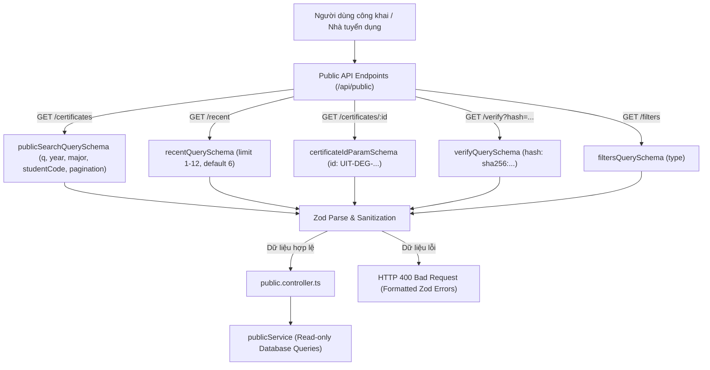

# Kiến Trúc và Logic Xác Thực Cổng Tra Cứu Công Khai (Public Schemas & Verification)

Tài liệu này đặc tả chi tiết kiến trúc, các quy tắc bảo mật (Security Invariants) và cơ chế thẩm định dữ liệu đầu vào cho Cổng tra cứu và thẩm định văn bằng công khai được cài đặt tại [backend/src/schemas/public.ts](file:///d:/VC_Blockchain/VC/backend/src/schemas/public.ts).

---

## 1. Tổng Quan Kiến Trúc (Architecture Overview)

Các endpoint thuộc phân hệ Public (`/api/public/*`) cho phép sinh viên, nhà tuyển dụng và cộng đồng tra cứu, thẩm định chứng chỉ số mà **không yêu cầu đăng nhập (Unauthenticated Endpoints)**.

Do tiếp xúc trực tiếp với người dùng đại chúng trên Internet, các schema tại [public.ts](file:///d:/VC_Blockchain/VC/backend/src/schemas/public.ts) đóng vai trò là **tuyến phòng thủ đầu tiên (First Line of Defense)** nhằm:
1. **Chặn đứng các truy vấn cào dữ liệu (Scraping / Crawling) quá tải**: Thông qua cơ chế phân trang có chặn trần (`limit`).
2. **Ngăn chặn tấn công ReDoS và chèn mã độc**: Giới hạn nghiêm ngặt độ dài chuỗi tìm kiếm và sử dụng Regex an toàn.
3. **Đảm bảo tính hợp lệ của mã băm mật mã học (SHA-256 Fingerprint)** khi thẩm định file chứng chỉ tải lên.



---

## 2. Đặc Tả Chi Tiết Các Schemas

### 2.1. Tra cứu văn bằng đa tiêu chí: `publicSearchQuerySchema`
Mở rộng từ `paginationSchema` (kế thừa `page >= 1`, `1 <= limit <= 20`, mặc định 10):

```typescript
export const publicSearchQuerySchema = paginationSchema.extend({
  q: z.string().trim().max(100).optional(),
  year: z.coerce.number().int().min(2000).max(2100).optional(),
  major: z.string().trim().max(100).optional(),
  studentCode: z
    .string()
    .regex(/^[0-9]{6,12}$/, "MSSV không hợp lệ")
    .optional(),
  status: certificateStatusSchema.optional(),
  type: certificateTypeSchema.optional(),
});
```

#### Ý nghĩa các trường:
- **`q` (Từ khóa tổng hợp)**: Tối đa 100 ký tự, tự động cắt khoảng trắng thừa. Được sử dụng để tìm kiếm full-text hoặc regex tìm tên sinh viên, tên văn bằng.
- **`year` (Năm tốt nghiệp)**: Ép kiểu tự động từ chuỗi URL sang số nguyên (`z.coerce.number`), nằm trong khoảng 2000–2100.
- **`major` (Ngành học)**: Tối đa 100 ký tự, hỗ trợ lọc theo chuyên ngành (ví dụ: "Kỹ thuật phần mềm").
- **`studentCode` (Mã số sinh viên - MSSV)**: Kiểm tra khớp nghiêm ngặt định dạng gồm 6 đến 12 ký tự số (`^[0-9]{6,12}$`).
- **`status` & `type`**: Tái sử dụng Enums chuẩn từ `common.ts` (`active`, `revoked`, `locked` và `degree`, `course`, `credit`, `other`).

---

### 2.2. Danh sách văn bằng phát hành gần đây: `recentQuerySchema`
```typescript
export const recentQuerySchema = z.object({
  limit: z.coerce.number().int().min(1).max(12).default(6),
});
```
- Phục vụ hiển thị trên trang chủ (Landing Page / Hero Section).
- Khống chế số lượng trả về từ 1 đến tối đa 12 bản ghi (mặc định 6 bản ghi), tối ưu hóa thời gian tải trang và tài nguyên mạng.

---

### 2.3. Thẩm định tệp văn bằng: `verifyQuerySchema`
```typescript
export const verifyQuerySchema = z.object({
  hash: fileHashSchema,
});
```
- Khi người dùng tải file PDF lên trình duyệt để xác thực, client sẽ tính toán mã băm SHA-256 cục bộ và gửi lên endpoint `GET /api/public/verify?hash=sha256:...`.
- `fileHashSchema` bắt buộc mã băm phải có cấu trúc `sha256:[a-f0-9]{64}`, ngăn chặn gửi các chuỗi rác hoặc thuật toán băm lỗi thời (như MD5).

---

### 2.4. Tham số định danh trên URL: `certificateIdParamSchema`
```typescript
export const certificateIdParamSchema = z.object({
  id: certificateIdSchema,
});
```
- Xác thực tham số `:id` trong URL route (ví dụ: `/api/public/certificates/:id`, `/api/certificates/:id/pdf`).
- Tái sử dụng quy chuẩn `certificateIdSchema` (`^[A-Z0-9-]+$`, 6–64 ký tự).
- **Tính dùng chung cao**: Được import và sử dụng đồng nhất trong cả 3 controllers:
  - `public.controller.ts`
  - `certificate.controller.ts`
  - `admin.controller.ts`

---

## 3. Bảng Tổng Hợp Tham Số API Công Khai

| Endpoint API | Schema áp dụng | Vị trí dữ liệu | Mục đích bảo vệ |
| :--- | :--- | :--- | :--- |
| `GET /api/public/certificates` | `publicSearchQuerySchema` | `req.query` | Phân trang an toàn, lọc dữ liệu chính xác |
| `GET /api/public/recent` | `recentQuerySchema` | `req.query` | Giới hạn số lượng bản ghi hiển thị landing page |
| `GET /api/public/certificates/:id` | `certificateIdParamSchema` | `req.params` | Chống chèn ký tự lạ vào đường dẫn URL |
| `GET /api/public/verify` | `verifyQuerySchema` | `req.query` | Xác minh tính toàn vẹn của mã băm SHA-256 |
| `GET /api/public/filters` | `filtersQuerySchema` | `req.query` | Lọc danh mục theo loại chứng chỉ |
