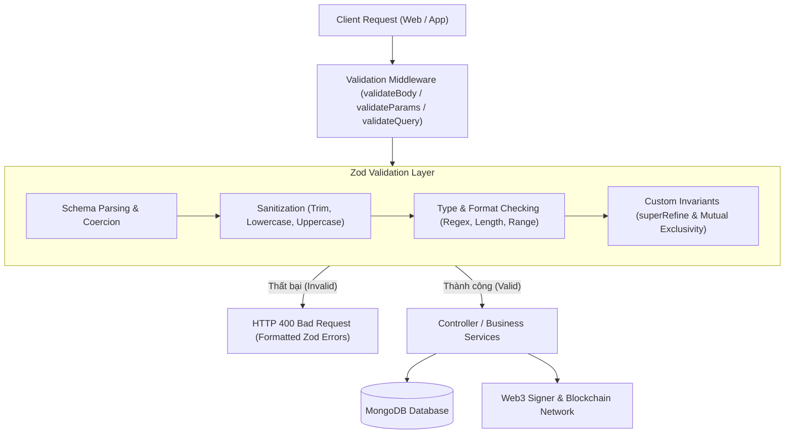
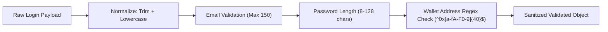
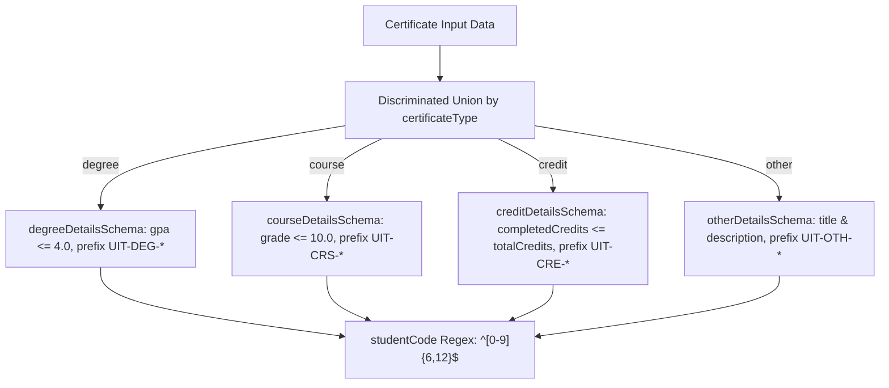
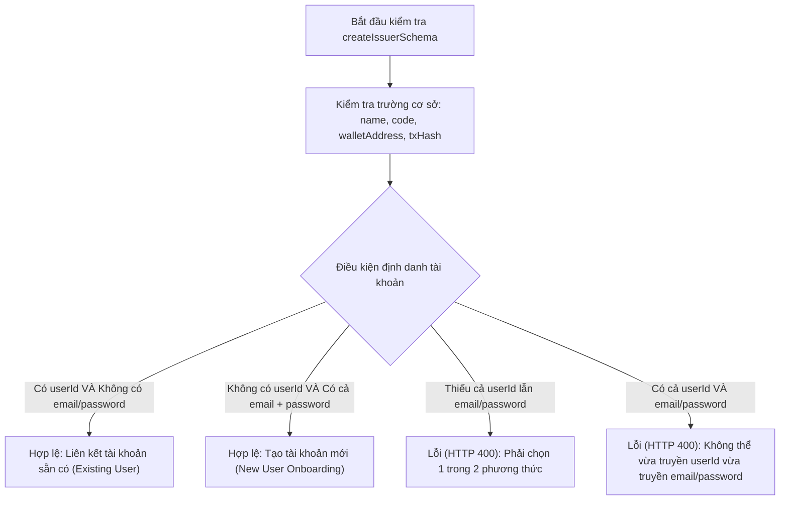

# Kiến Trúc và Logic Kiểm Thử Xác Thực Dữ Liệu (Schema Validation & Unit Testing)

Tài liệu này phân tích chi tiết thiết kế kiến trúc, các quy tắc nghiệp vụ (Business Rules), cơ chế chuẩn hóa dữ liệu (Sanitization & Normalization), và logic kiểm thử đơn vị (Unit Tests) trong bộ ba file kiểm thử schema tại thư mục `backend/src/schemas/__tests__/`:
1. [auth.test.ts](file:///d:/VC_Blockchain/VC/backend/src/schemas/__tests__/auth.test.ts)
2. [certificate.test.ts](file:///d:/VC_Blockchain/VC/backend/src/schemas/__tests__/certificate.test.ts)
3. [issuer.test.ts](file:///d:/VC_Blockchain/VC/backend/src/schemas/__tests__/issuer.test.ts)

---

## 1. Tổng Quan Kiến Trúc Xác Thực (Validation Architecture)

Trong hệ thống xác minh văn bằng dựa trên Blockchain (**Verifiable Credentials**), dữ liệu khi đã được ghi lên Smart Contract hoặc phân phối phi tập trung qua IPFS thì **không thể sửa đổi (Immutable)**. Do đó, việc xác thực dữ liệu ngay tại ranh giới tiếp nhận (API Gateway / Route Handlers) đóng vai trò sống còn:



### Ưu điểm của mô hình Schema Validation với Zod:
- **Type Safety từ Runtime tới Compile-time**: Tự động suy diễn kiểu TypeScript tĩnh thông qua `z.infer<typeof schema>`, loại bỏ nguy cơ lệch pha giữa kiểu dữ liệu code và dữ liệu thực tế.
- **Fail-Fast Boundary**: Chặn đứng mọi dữ liệu rác, chuỗi mã độc injection hoặc định dạng không hợp lệ trước khi chạm tới cơ sở dữ liệu hay thư viện Web3.
- **Data Normalization Tự động**: Tự động chuyển đổi định dạng (ví dụ: chuyển địa chỉ ví về chữ thường, cắt bỏ khoảng trắng vô nghĩa trong email).

---

## 2. Phân Tích Logic Kiểm Thử Chi Tiết

### 2.1. Kiểm thử xác thực đăng nhập: `auth.test.ts`
Kiểm thử bộ quy tắc [loginSchema](file:///d:/VC_Blockchain/VC/backend/src/schemas/auth.ts) dành cho endpoint xác thực kết hợp định danh kép (Web2 + Web3).



#### Các kịch bản kiểm thử:
| Test Case | Kịch bản kiểm tra | Kỳ vọng | Mục đích nghiệp vụ |
| :--- | :--- | :--- | :--- |
| **Normalizes email and wallet addresses** | Nhập email có khoảng trắng đầu/cuối và viết hoa (`" Admin@VerifyCert.Local "`), địa chỉ ví viết hoa chữ cái hex (`0x9B8DF...`). | `email` chuyển về `"admin@verifycert.local"`, `walletAddress` chuyển về `"0x9b8df..."`. | Đảm bảo dữ liệu truy vấn cơ sở dữ liệu không bị lệch do khoảng trắng thừa hay tính phân biệt hoa thường của chuỗi hex. |
| **Requires a wallet address** | Payload chỉ có `email` và `password`, thiếu trường `walletAddress`. | `safeParse.success === false`. | Bắt buộc cơ chế xác thực danh tính kép; người dùng luôn phải liên kết với một địa chỉ ví cụ thể. |
| **Rejects a malformed wallet address** | Trường `walletAddress` truyền chuỗi không hợp lệ `"not-a-wallet"`. | `safeParse.success === false`. | Chặn các địa chỉ ví không tuân thủ chuẩn địa chỉ Ethereum 20 bytes (40 ký tự hex). |

---

### 2.2. Kiểm thử xác thực văn bằng chứng chỉ: `certificate.test.ts`
Kiểm thử hai bộ schema trung tâm:
1. `prepareCertificateSchema`: Xác thực dữ liệu nháp của văn bằng theo mô hình đa hình (Polymorphism).
2. `confirmCertificateSchema`: Xác thực dữ liệu hoàn tất phát hành lên IPFS và Blockchain.



#### Các kịch bản kiểm thử:
| Test Suite | Test Case | Dữ liệu đầu vào tiêu biểu | Kết quả | Giải thích quy tắc |
| :--- | :--- | :--- | :--- | :--- |
| **prepareCertificateSchema** | *Accepts valid degree* | `certificateType: 'degree'`, `certificateId: 'UIT-DEG-2026-0001'`, `gpa: 3.45` | `true` | Cấu trúc đầy đủ thông tin bằng cử nhân. |
| | *Accepts valid course* | `certificateType: 'course'`, `certificateId: 'UIT-CRS-2026-0142'`, `grade: 8.5` | `true` | Đầy đủ thông tin môn học, thang điểm 10. |
| | *Accepts valid credit* | `certificateType: 'credit'`, `certificateId: 'UIT-CRE-2026-0035'`, `completedCredits: 128` | `true` | Đầy đủ thông tin chứng chỉ tích lũy tín chỉ. |
| | *Accepts valid other* | `certificateType: 'other'`, `certificateId: 'UIT-OTH-2026-0007'`, `title: '...'` | `true` | Dành cho chứng chỉ hội thảo, hoạt động ngoại khóa. |
| | *Rejects wrong prefix* | `certificateType: 'degree'`, nhưng mã là `'UIT-CRS-2026-0001'` | `false` | Loại văn bằng nào phải đi với tiền tố mã số tương ứng. |
| | *Rejects GPA above 4* | `gpa: 4.5` (trong hệ thống tín chỉ thang điểm 4.0) | `false` | Giới hạn cận trên của GPA đại học. |
| | *Rejects grade above 10* | `grade: 11` (với thang điểm hệ 10) | `false` | Điểm số môn học tối đa là 10.0. |
| | *Rejects invalid credits* | `totalCredits: 100`, `completedCredits: 120` | `false` | Số tín chỉ đã hoàn thành không được lớn hơn tổng số tín chỉ chương trình. |
| | *Rejects short studentCode*| `studentCode: '123'` | `false` | MSSV bắt buộc phải từ 6 đến 12 ký tự số. |
| **confirmCertificateSchema** | *Accepts full confirmation* | Kèm `fileHash` (SHA-256), `ipfsCid`, `txHash`, `sizeBytes`, `mimeType` | `true` | Đầy đủ bằng chứng kỹ thuật để lưu trữ và xác minh On-chain. |
| | *Rejects invalid fileHash* | `fileHash: 'md5:abc'` | `false` | Bắt buộc phải là băm SHA-256 (`sha256:[a-f0-9]{64}`). |

---

### 2.3. Kiểm thử xác thực đơn vị cấp chứng chỉ: `issuer.test.ts`
Kiểm thử bộ quy tắc [createIssuerSchema](file:///d:/VC_Blockchain/VC/backend/src/schemas/issuer.ts). Điểm đặc biệt của schema này là sử dụng hàm `superRefine` để thực hiện kiểm tra logic **Loại trừ lẫn nhau (Exclusive OR - XOR)** giữa hai cơ chế onboard tài khoản.



#### Các kịch bản kiểm thử:
| Test Case | Dữ liệu kiểm thử | Kết quả | Ý nghĩa nghiệp vụ |
| :--- | :--- | :--- | :--- |
| **Accepts new account** | Có `name`, `code`, `walletAddress`, `txHash` + `email` + `password` (không có `userId`). | `true` | Đăng ký một Issuer hoàn toàn mới cùng tài khoản đăng nhập lần đầu. |
| **Accepts existing user** | Có các trường cơ sở + `userId` (không có `email`, `password`). | `true` | Nâng cấp quyền đơn vị cho một User đã đăng ký tài khoản từ trước. |
| **Rejects missing both** | Chỉ có các trường cơ sở, thiếu cả `userId` lẫn `email`/`password`. | `false` | Chặn tình trạng tạo đơn vị mà không gắn liền với bất kỳ tài khoản đại diện nào. |
| **Rejects providing both** | Cung cấp đồng thời cả `userId` và cặp `email`/`password`. | `false` | Chặn mâu thuẫn dữ liệu: hệ thống không thể vừa liên kết tài khoản cũ vừa tạo tài khoản mới. |
| **Rejects weak password** | Cung cấp `password: '123'`. | `false` | Yêu cầu mật khẩu tối thiểu 8 ký tự để đảm bảo an toàn truy cập. |

---

## 3. Tổng Hợp Ma Trận Kiểm Thử (Test Execution Summary)

Kết quả thực thi tự động qua Jest Runner:

| File Kiểm Thử | Số lượng Tests | Trạng thái | Thời gian thực thi |
| :--- | :---: | :---: | :---: |
| [auth.test.ts](file:///d:/VC_Blockchain/VC/backend/src/schemas/__tests__/auth.test.ts) | 3 | **PASSED** | ~1.5s |
| [certificate.test.ts](file:///d:/VC_Blockchain/VC/backend/src/schemas/__tests__/certificate.test.ts) | 11 | **PASSED** | ~2.0s |
| [issuer.test.ts](file:///d:/VC_Blockchain/VC/backend/src/schemas/__tests__/issuer.test.ts) | 5 | **PASSED** | ~1.5s |
| **Tổng cộng** | **19 tests** | **100% Passed** | **~5.0s** |

---

## 4. Hướng Dẫn Chạy Kiểm Thử Cục Bộ

Để chạy bộ kiểm thử schema trên môi trường phát triển:

```powershell
# Di chuyển vào thư mục backend
cd backend

# Chạy riêng bộ kiểm thử schema
npx jest src/schemas/__tests__

# Chạy có theo dõi độ phủ code (coverage)
npx jest src/schemas/__tests__ --coverage
```
