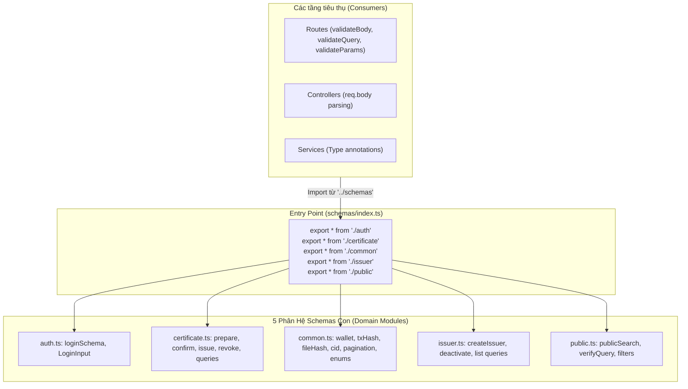

# Kiến Trúc Mô-đun Xác Thực và Thiết Kế Barrel Pattern (Schemas Module Architecture)

Tài liệu này đặc tả chi tiết kiến trúc tổng thể của tầng Schema Validation, vai trò của tệp trung tâm [backend/src/schemas/index.ts](file:///d:/VC_Blockchain/VC/backend/src/schemas/index.ts), nguyên lý thiết kế **Barrel Pattern (Facade)** và ma trận danh mục schema trong toàn bộ hệ thống Verifiable Credentials.

---

## 1. Tổng Quan Kiến Trúc (Architecture Overview)

Trong kiến trúc ứng dụng Node.js/TypeScript theo tiêu chuẩn Clean Architecture hoặc Modular Monolith, tầng Schema đóng vai trò là **lớp ranh giới bảo vệ (Validation Boundary)** giữa thế giới bên ngoài (HTTP Requests) và logic nghiệp vụ bên trong (Controllers, Services, Database, Smart Contracts).

Tệp `index.ts` được thiết kế theo mẫu **Barrel Pattern**:
- Hoạt động như một **Cổng giao tiếp duy nhất (Unified Public API)** tập hợp và tái xuất bản (re-export) toàn bộ schemas và types từ các phân hệ con.
- Ngăn chặn các thành phần bên ngoài (routes, controllers) phải phụ thuộc vào đường dẫn chi tiết của từng tệp nội bộ.

---

## 2. Chi Tiết Các Phân Hệ Được Tái Xuất Bản (Re-exported Modules)

### 2.1. Phân hệ [common.ts](file:///d:/VC_Blockchain/VC/backend/src/schemas/common.ts) (Tầng nguyên tử - Foundation Primitives)
Là nền móng cho tất cả các schema còn lại:
- **Chuẩn hóa Web3 & Crypto**: `walletAddressSchema` (hạ chữ thường, 20 bytes), `txHashSchema` (32 bytes Keccak-256), `fileHashSchema` (SHA-256 `sha256:...`), `cidSchema` (IPFS CIDv0/v1).
- **Cơ sở dữ liệu & Nghiệp vụ**: `objectIdSchema` (MongoDB 24 hex), `certificateIdSchema` (`^[A-Z0-9-]+$`), `paginationSchema` (giới hạn cứng `limit <= 20` chống DoS).
- **Enums dùng chung**: `artifactTypeSchema` (`pdf`, `image`, `web`), `certificateStatusSchema` (`active`, `revoked`, `locked`), `certificateTypeSchema` (`degree`, `course`, `credit`, `other`).

### 2.2. Phân hệ [auth.ts](file:///d:/VC_Blockchain/VC/backend/src/schemas/auth.ts) (Xác thực đăng nhập - Hybrid Identity)
- Quản lý định danh kép kết hợp Web2 (`email` chuẩn hóa lowercase + `password` tối thiểu 8 ký tự, tối đa 128 ký tự chống Bcrypt DoS) và Web3 (`walletAddress` định dạng EVM).
- Xuất bản kiểu tĩnh `LoginInput`.

### 2.3. Phân hệ [certificate.ts](file:///d:/VC_Blockchain/VC/backend/src/schemas/certificate.ts) (Văn bằng & Chứng chỉ số - Core Assets)
- **Xác thực đa hình (Discriminated Union)**: `prepareCertificateSchema` theo `certificateType` cho 4 loại bằng (`degree`, `course`, `credit`, `other`).
- **Ràng buộc tiền tố**: Tự động kiểm tra `UIT-DEG`, `UIT-CRS`, `UIT-CRE`, `UIT-OTH`.
- **Chứng từ phát hành**: `confirmCertificateSchema` kết hợp chữ ký băm file, IPFS CID, Transaction Hash và giới hạn file 10MB.
- **Vòng đời & Quản trị**: `revokeCertificateSchema`, `certificateListQuerySchema`, `adminCertificateListQuerySchema`.

### 2.4. Phân hệ [issuer.ts](file:///d:/VC_Blockchain/VC/backend/src/schemas/issuer.ts) (Đơn vị cấp phát - Issuer Management)
- **Điều kiện loại trừ lẫn nhau (Mutual Exclusivity - XOR)** qua `superRefine`: Hoặc tạo mới tài khoản (`email` + `password`), hoặc gán quyền cho tài khoản sẵn có (`userId`), từ chối khi thiếu cả hai hoặc truyền cả hai.
- Quản lý truy vấn danh sách và vô hiệu hóa (`deactivateIssuerSchema`).

### 2.5. Phân hệ [public.ts](file:///d:/VC_Blockchain/VC/backend/src/schemas/public.ts) (Tra cứu & Thẩm định công khai)
- `publicSearchQuerySchema`: Tra cứu đa tiêu chí dành cho nhà tuyển dụng/cộng đồng (MSSV, năm tốt nghiệp, chuyên ngành, loại bằng, từ khóa `q`).
- `verifyQuerySchema`: Xác minh tính toàn vẹn và hợp lệ của file PDF thông qua mã băm `hash`.
- `certificateIdParamSchema` & `filtersQuerySchema`.

---

## 3. Lợi Ích Của Barrel Pattern Trong Dự Án

| Tiêu chí | Trước khi dùng Barrel Pattern | Sau khi áp dụng Barrel Pattern (`index.ts`) |
| :--- | :--- | :--- |
| **Độ dài và độ phức tạp Import** | `import { loginSchema } from "../schemas/auth";` `import { walletAddressSchema } from "../schemas/common";` | `import { loginSchema, walletAddressSchema } from "../schemas";` |
| **Độ phụ thuộc cấu trúc thư mục** | Bên ngoài bị gắn chặt (tightly coupled) với tên tệp nội bộ. Khi đổi tên tệp con phải sửa hàng chục imports. | Các tệp con có thể tái cấu trúc tự do; bên ngoài chỉ cần phụ thuộc vào `index.ts`. |
| **Bảo trì và mở rộng** | Dễ import nhầm tệp riêng tư hoặc không thống nhất kiểu. | Toàn bộ types và schemas được phân phối nhất quán, tận dụng tối đa IntelliSense và Tree-shaking. |

---

## 4. Ma Trận Tổng Hợp Schemas & Types Trong Dự Án

| Tên Schema / Type | Nguồn định nghĩa | Kiểu dữ liệu / Phân loại | Mục đích áp dụng |
| :--- | :--- | :--- | :--- |
| **`loginSchema`** | `auth.ts` | Zod Object | Xác thực dữ liệu đăng nhập |
| **`LoginInput`** | `auth.ts` | TypeScript Type | Kiểu tĩnh suy diễn từ `loginSchema` |
| **`prepareCertificateSchema`** | `certificate.ts` | Discriminated Union | Tạo bản ghi văn bằng nháp |
| **`confirmCertificateSchema`** | `certificate.ts` | Zod Intersection (`.and`) | Xác nhận phát hành On-chain & IPFS |
| **`revokeCertificateSchema`** | `certificate.ts` | Zod Object | Thu hồi văn bằng qua `txHash` |
| **`certificateListQuerySchema`** | `certificate.ts` | Extended Object | Phân trang & lọc chứng chỉ |
| **`walletAddressSchema`** | `common.ts` | Zod String Transform | Địa chỉ ví EVM chuẩn hóa lowercase |
| **`txHashSchema`** | `common.ts` | Zod String Transform | Mã băm giao dịch Ethereum |
| **`fileHashSchema`** | `common.ts` | Zod String Regex | Mã băm SHA-256 của tệp |
| **`cidSchema`** | `common.ts` | Zod String Length | Content Identifier trên IPFS |
| **`objectIdSchema`** | `common.ts` | Zod String Regex | Mã ID đối tượng MongoDB |
| **`paginationSchema`** | `common.ts` | Zod Object Coerced | Phân trang an toàn (`limit <= 20`) |
| **`createIssuerSchema`** | `issuer.ts` | Refined Object | Đăng ký/Onboard đơn vị cấp phát |
| **`publicSearchQuerySchema`** | `public.ts` | Extended Object | Tra cứu văn bằng công khai |
| **`verifyQuerySchema`** | `public.ts` | Zod Object | Thẩm định văn bằng qua file hash |
