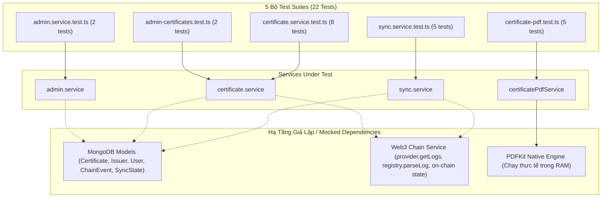
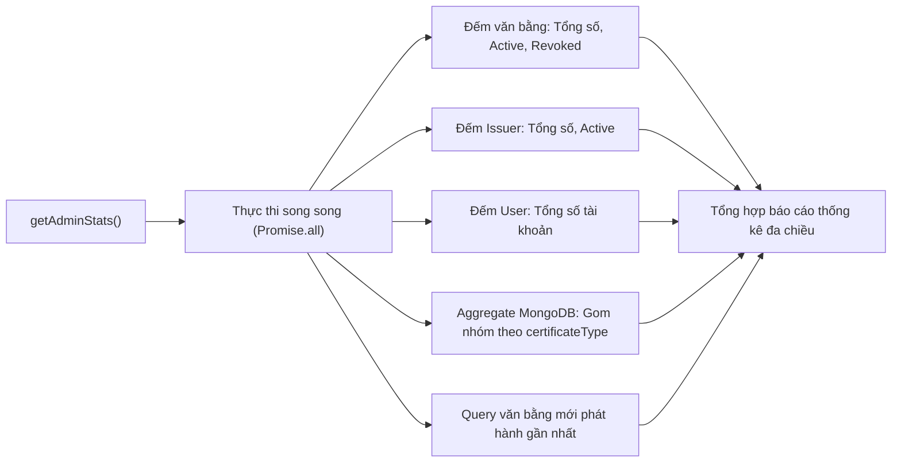
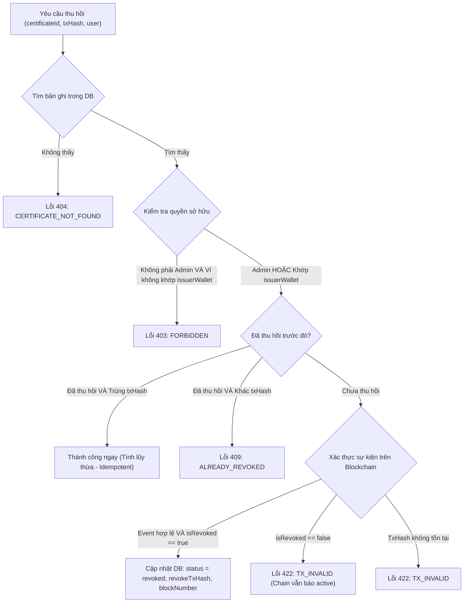
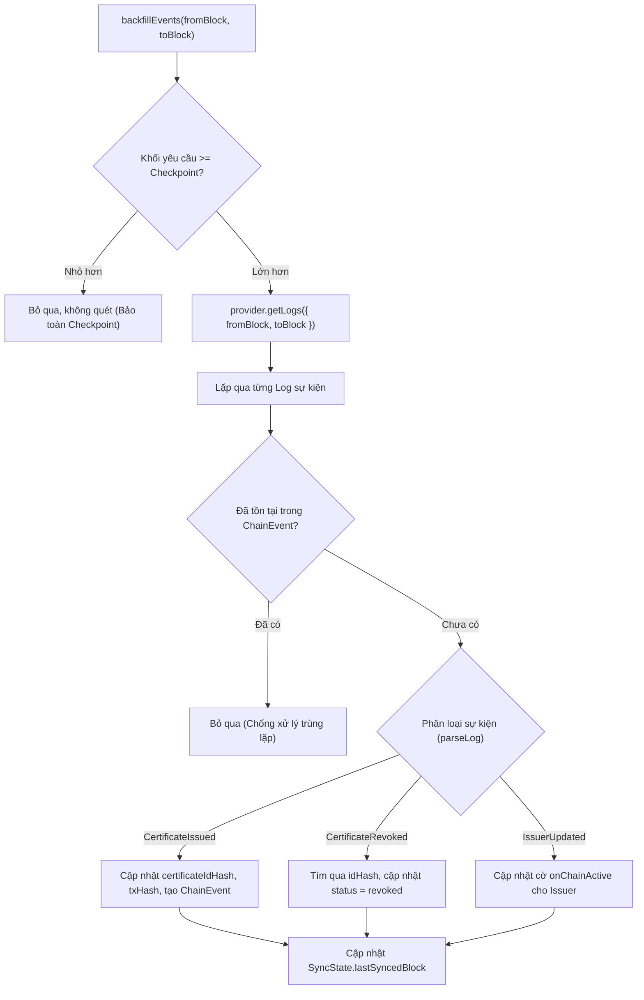

# Kiến Trúc và Logic Kiểm Thử Tầng Dịch Vụ (Services Test Suites & Business Logic)

Tài liệu này đặc tả chi tiết kiến trúc kiểm thử, logic nghiệp vụ, cơ chế giả lập dữ liệu (Mocking Strategy), và phân tích chuyên sâu 5 bộ kiểm thử tại thư mục `backend/src/services/__tests__/`:
1. [admin-certificates.test.ts](file:///d:/VC_Blockchain/VC/backend/src/services/__tests__/admin-certificates.test.ts): Tra cứu và lọc văn bằng phía quản trị viên.
2. [admin.service.test.ts](file:///d:/VC_Blockchain/VC/backend/src/services/__tests__/admin.service.test.ts): Thống kê đa chiều và tổng hợp báo cáo.
3. [certificate-pdf.test.ts](file:///d:/VC_Blockchain/VC/backend/src/services/__tests__/certificate-pdf.test.ts): Kết xuất tài liệu PDF văn bằng chuẩn đồ họa.
4. [certificate.service.test.ts](file:///d:/VC_Blockchain/VC/backend/src/services/__tests__/certificate.service.test.ts): Quy trình thu hồi văn bằng và phân quyền truy cập.
5. [sync.service.test.ts](file:///d:/VC_Blockchain/VC/backend/src/services/__tests__/sync.service.test.ts): Đồng bộ và lập chỉ mục sự kiện Blockchain về Database.

---

## 1. Tổng Quan Kiến Trúc Kiểm Thử (Testing Architecture)

Tầng Dịch Vụ (**Service Layer**) là nơi chứa đựng toàn bộ quy tắc nghiệp vụ cốt lõi (Business Rules), giao tiếp với cơ sở dữ liệu MongoDB, tương tác với mạng lưới Ethereum qua JSON-RPC Provider, và điều phối các công cụ đồ họa (PDFKit). 

Để kiểm thử tầng này một cách nhanh chóng, ổn định và độc lập với hạ tầng bên ngoài, hệ thống áp dụng hai mô hình kiểm thử chính:
- **Unit Testing với Mocking sâu (Isolated Unit Tests)**: Áp dụng cho các dịch vụ phụ thuộc vào Blockchain hoặc Database (`admin`, `certificate`, `sync`), giả lập hành vi của Mongoose Models và Ethers Provider.
- **Integration Testing thực tế (In-Memory Engine)**: Áp dụng cho dịch vụ kết xuất PDF (`certificate-pdf`), chạy trực tiếp thư viện PDFKit trên bộ nhớ đệm (Buffer) để xác thực tính toàn vẹn của tệp và khả năng hiển thị tiếng Việt có dấu.



---

## 2. Phân Tích Chi Tiết Từng Bộ Kiểm Thử

### 2.1. Tra cứu và phân trang quản trị: `admin-certificates.test.ts`
Kiểm tra hàm [listAllCertificates](file:///d:/VC_Blockchain/VC/backend/src/services/certificate.service.ts) dành cho màn hình Quản lý văn bằng của Quản trị viên.

#### Cơ chế Mocking Mongoose Query Chain:
Mongoose sử dụng mô hình gọi hàm nối tiếp (`find().sort().skip().limit()`). Bộ test giả lập chính xác chuỗi Promise này:
```typescript
find.mockReturnValue({
  sort: jest.fn().mockReturnValue({
    skip: jest.fn().mockReturnValue({
      limit: jest.fn().mockResolvedValue([doc]),
    }),
  }),
});
```

#### Các kịch bản kiểm thử:
1. **Áp dụng đầy đủ bộ lọc và tính toán phân trang (`applies admin filters and pagination`)**:
   - Đầu vào: `q: "nguyen"`, `status: "active"`, `type: "degree"`, `issuerWallet: "0xf009..."`, `year: 2026`, `page: 2`, `limit: 10`.
   - Kỳ vọng: `find` được gọi với đối tượng chứa `$or` (tìm kiếm theo tên, MSSV, mã chứng chỉ), khớp chính xác các trường lọc, và tính toán đúng siêu dữ liệu phân trang:
     $$\text{totalPages} = \lceil \text{total} / \text{limit} \rceil = \lceil 1 / 10 \rceil = 1$$
2. **Bỏ qua các bộ lọc tùy chọn (`omits optional filters when not provided`)**:
   - Khi chỉ truyền `page` và `limit`, đối tượng điều kiện truy vấn phải là rỗng `{}` để quét toàn bộ văn bằng.

---

### 2.2. Dịch vụ thống kê tổng quan: `admin.service.test.ts`
Kiểm tra hàm [getAdminStats](file:///d:/VC_Blockchain/VC/backend/src/services/admin.service.ts) phục vụ Bảng điều khiển (Admin Dashboard).



#### Các kịch bản kiểm thử:
1. **Tổng hợp số liệu thống kê (`returns certificate, issuer and user totals with recent items`)**:
   - Giả lập: 10 văn bằng (7 active, 3 revoked), 4 đơn vị (3 active), 5 người dùng, 6 degree, 4 course.
   - Kỳ vọng: Trả về đối tượng `byType` tự động bổ sung giá trị 0 cho các loại chưa có (`credit: 0`, `other: 0`), cùng danh sách văn bằng gần đây.
2. **Khởi tạo giá trị mặc định khi chưa có dữ liệu (`returns zeroed type counts when there are no certificates`)**:
   - Khi cơ sở dữ liệu trống hoàn toàn, hệ thống không bị lỗi `undefined` mà tự động đưa tất cả chỉ số `byType` về `0` và `recent` thành mảng rỗng `[]`.

---

### 2.3. Kết xuất tệp PDF văn bằng: `certificate-pdf.test.ts`
Kiểm tra dịch vụ [CertificatePdfService](file:///d:/VC_Blockchain/VC/backend/src/services/certificate-pdf/index.ts). Đây là bộ kiểm thử tích hợp không mock thư viện, trực tiếp sinh file PDF vào bộ nhớ RAM.

#### Các kịch bản kiểm thử:
1. **Kiểm tra 4 định dạng văn bằng (`generates a valid $certificateType PDF`)**:
   Sử dụng `it.each` để kiểm tra lần lượt 4 mẫu: `degree`, `course`, `credit`, `other`.
   - **Xác thực Magic Bytes**: Kiểm tra 5 bytes đầu tiên của buffer luôn là `%PDF-` theo đúng đặc tả ISO 32000-1 của tài liệu PDF:
     ```typescript
     expect(result.buffer.subarray(0, 5).toString("ascii")).toBe("%PDF-");
     ```
   - **Kích thước tài liệu**: Buffer phải lớn hơn $10,000\text{ bytes}$ (đảm bảo chứa đầy đủ layout đồ họa, khung viền, font chữ nhúng và mã QR xác thực).
   - **Metadata chuẩn**: `templateId` có dạng `<type>-v1`, `templateVersion: "1.0.0"`, tên tệp `<certificateId>.pdf`.
2. **Hỗ trợ tiếng Việt có dấu (`renders Vietnamese diacritics without throwing`)**:
   - Kiểm tra các chuỗi ký tự tiếng Việt phức tạp như *"Nguyễn Văn An"*, *"Cử nhân"*, *"Kỹ thuật phần mềm"*, *"Giỏi"* được render thành công mà không phát sinh ngoại lệ mã hóa ký tự (encoding errors).

---

### 2.4. Quy trình thu hồi văn bằng: `certificate.service.test.ts`
Kiểm tra hàm [revokeCertificate](file:///d:/VC_Blockchain/VC/backend/src/services/certificate.service.ts) - một quy trình nghiệp vụ nhạy cảm liên quan đến thu hồi tài sản số trên Blockchain.



#### Các kịch bản kiểm thử (8 test cases):
| Kịch bản kiểm thử | Mô tả điều kiện | Kết quả kỳ vọng |
| :--- | :--- | :--- |
| **404 Not Found** | Không tìm thấy mã chứng chỉ trong MongoDB | Ném lỗi 404 `CERTIFICATE_NOT_FOUND` |
| **Issuing Wallet Permitted** | Người gọi có `walletAddress` trùng với `doc.issuerWallet` | Cập nhật `status = 'revoked'`, lưu transaction hash |
| **Stranger Forbidden** | Người gọi là một Issuer khác có địa chỉ ví lạ | Ném lỗi 403 `FORBIDDEN`, không cho phép lưu thay đổi |
| **Admin Permitted** | Người gọi có vai trò `admin` (không phụ thuộc vào ví) | Cho phép thu hồi thành công bất kỳ chứng chỉ nào |
| **Idempotency** | Gửi lại cùng một transaction hash đã thu hồi trước đó | Trả về thành công ngay lập tức, không ghi đè lại DB |
| **Conflict 409** | Gửi yêu cầu thu hồi với transaction hash mới khi bằng đã bị hủy | Ném lỗi 409 `ALREADY_REVOKED` để bảo toàn lịch sử |
| **Chain Inconsistency** | Smart Contract báo `isRevoked: false` dù có log | Ném lỗi 422 `TX_INVALID`, ngăn ngừa lệch pha trạng thái |
| **Invalid Transaction** | Mã băm giao dịch không tồn tại hoặc revert | Lan truyền đúng lỗi 422 `TX_INVALID` |

---

### 2.5. Đồng bộ sự kiện Blockchain: `sync.service.test.ts`
Kiểm tra hàm [backfillEvents](file:///d:/VC_Blockchain/VC/backend/src/services/sync.service.ts) chịu trách nhiệm quét các khối dữ liệu (Block Range) trên mạng lưới Ethereum, bóc tách các sự kiện (Events) và lập chỉ mục vào cơ sở dữ liệu.



#### Các kịch bản kiểm thử:
1. **Xử lý sự kiện `CertificateIssued` (`processes CertificateIssued and fills missing hash/tx fields`)**:
   - Bóc tách: `idHash`, `certificateId`, `fileHash`, `issuer`, `issuedAt`.
   - Cập nhật bản ghi MongoDB: điền `certificateIdHash` và `txHash`.
   - Tạo sự kiện bất biến `ChainEvent` và cập nhật điểm kiểm soát `lastSyncedBlock`.
2. **Xử lý sự kiện `CertificateRevoked` (`processes CertificateRevoked by idHash`)**:
   - Tìm kiếm văn bằng qua `certificateIdHash: idHash`.
   - Đổi trạng thái sang `revoked`, gán `revokeTxHash` và `revokeBlockNumber`.
3. **Xử lý sự kiện `IssuerUpdated` (`processes IssuerUpdated and toggles onChainActive`)**:
   - Cập nhật thuộc tính `onChainActive: true` cho ví đơn vị phát hành.
4. **Cơ chế chống trùng lặp sự kiện (`skips events already recorded in chain_events`)**:
   - Khi `ChainEvent.exists()` trả về `true`, sự kiện bị bỏ qua (`skipped = 1`), không ghi đè vào database.
5. **Bảo vệ điểm kiểm soát (`does not scan when the requested range is behind the checkpoint`)**:
   - Nếu dải khối yêu cầu nằm phía trước checkpoint đã đồng bộ, hệ thống lập tức dừng lại mà không gửi truy vấn `getLogs` lên RPC node, tiết kiệm tài nguyên mạng.

---

## 3. Tổng Hợp Ma Trận Kiểm Thử (Test Execution Summary)

Kết quả thực thi tự động qua Jest Test Runner:

| STT | Tệp Kiểm Thử | Số lượng Tests | Trạng thái | Thời gian thực thi |
| :---: | :--- | :---: | :---: | :---: |
| 1 | [admin-certificates.test.ts](file:///d:/VC_Blockchain/VC/backend/src/services/__tests__/admin-certificates.test.ts) | 2 | **PASSED** | ~6.5s |
| 2 | [admin.service.test.ts](file:///d:/VC_Blockchain/VC/backend/src/services/__tests__/admin.service.test.ts) | 2 | **PASSED** | ~6.4s |
| 3 | [certificate-pdf.test.ts](file:///d:/VC_Blockchain/VC/backend/src/services/__tests__/certificate-pdf.test.ts) | 5 | **PASSED** | ~9.5s |
| 4 | [certificate.service.test.ts](file:///d:/VC_Blockchain/VC/backend/src/services/__tests__/certificate.service.test.ts) | 8 | **PASSED** | ~6.6s |
| 5 | [sync.service.test.ts](file:///d:/VC_Blockchain/VC/backend/src/services/__tests__/sync.service.test.ts) | 5 | **PASSED** | ~6.3s |
| **Tổng** | **5 Test Suites** | **22 Tests** | **100% Passed** | **~10.8s** |

---

## 4. Hướng Dẫn Chạy Kiểm Thử Cục Bộ

Để chạy bộ kiểm thử tầng dịch vụ trên máy phát triển:

```powershell
# Chuyển vào thư mục backend
cd backend

# Chạy toàn bộ 5 test suites của services
npx jest src/services/__tests__

# Chạy riêng từng file test cụ thể
npx jest src/services/__tests__/certificate.service.test.ts
npx jest src/services/__tests__/certificate-pdf.test.ts
npx jest src/services/__tests__/sync.service.test.ts

# Chạy kèm theo dõi độ phủ mã nguồn (Coverage Report)
npx jest src/services/__tests__ --coverage
```

