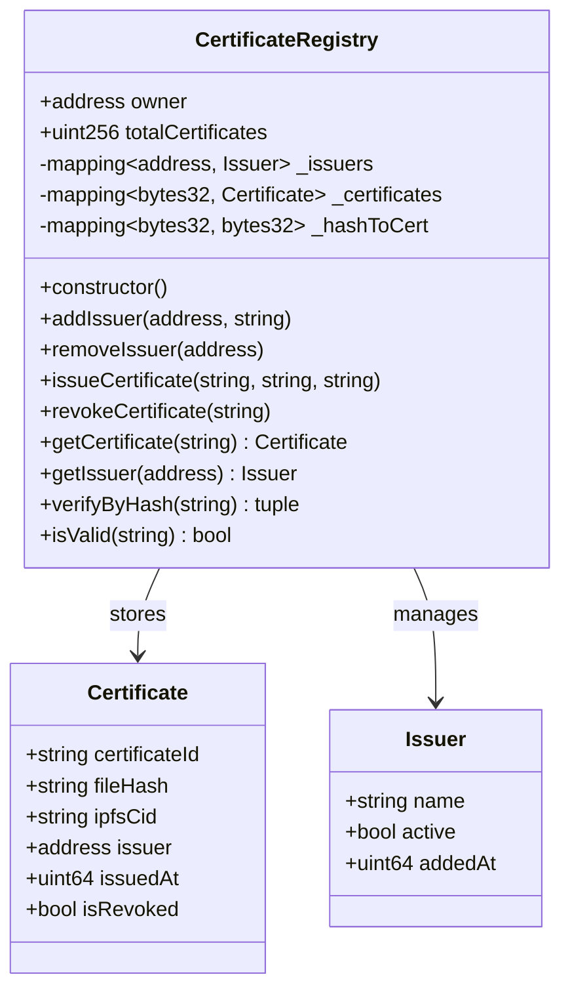

# Phân tích thiết kế Smart Contract — Verify Certification

> Phạm vi: **một trường đại học** · Solidity `^0.8.24` · Ethereum Sepolia
>
> Mục tiêu: chứng chỉ do trường cấp, bất biến, ai cũng kiểm tra được, không lưu dữ liệu cá nhân on-chain.

---

## 1. Phạm vi & tác nhân

Hệ thống chỉ phục vụ **một trường**, không phải nền tảng multi-tenant. Điều này quyết định thiết kế: **một owner duy nhất** đại diện trường, nhiều **issuer** là các khoa/phòng ban.

| Tác nhân | Ví | Quyền |
|---|---|---|
| **Owner** — Phòng đào tạo | ví admin của trường | Thêm/gỡ issuer, thu hồi chứng chỉ khẩn cấp |
| **Issuer** — Khoa/Trung tâm | ví của khoa | Cấp chứng chỉ, thu hồi chứng chỉ do chính mình cấp |
| **Verifier** — Nhà tuyển dụng | không cần ví | Đọc dữ liệu công khai |
| **Student** | không bắt buộc | Nhận chứng chỉ off-chain (v1 chưa dùng NFT) |

**Không có trong v1:** học sinh tự quản lý chứng chỉ on-chain, trường khác xác thực chéo, chuyển nhượng chứng chỉ.

---

## 2. Solidity không có “class”

Các khái niệm tương đương:

| OOP | Solidity | Deploy được? |
|---|---|---|
| Class | `contract` | ✅ |
| Data class / DTO | `struct` | ❌ (nằm trong contract) |
| Interface | `interface` | ❌ |
| Utility class | `library` | ❌ |
| Abstract class | `abstract contract` | ❌ |
| Hằng số nhóm | `enum` | ❌ |

Với đồ án này, **chỉ cần 1 contract deploy được**, cộng thêm 1 interface tùy chọn.

---

## 3. Kiến trúc contract: 1 hay nhiều?

### Phương án A — Một contract `CertificateRegistry` (khuyến nghị)

```
CertificateRegistry
├─ quản lý issuer
├─ cấp / thu hồi chứng chỉ
└─ tra cứu
```

- Một địa chỉ duy nhất, backend/frontend cấu hình đơn giản.
- Không có cross-contract call → ít lỗi, ít gas.
- Dễ giải thích trong báo cáo.

### Phương án B — Tách `IssuerRegistry` + `CertificateRegistry`

- Tách trách nhiệm rõ hơn.
- Nhưng phải deploy 2 contract, truyền địa chỉ, gọi chéo, tăng gas và độ phức tạp.
- Với **một trường**, lợi ích không đáng kể.

### Phương án C — Dùng OpenZeppelin `AccessControl`

- Linh hoạt nếu có nhiều role phức tạp.
- Đồ án chỉ có 2 role → `Ownable + mapping` dễ hiểu hơn.

### Phương án D — Chứng chỉ là Soulbound NFT (ERC-721)

- Đẹp về mặt học thuật, nhưng thêm ~300 dòng, gas cao, phải xử lý transfer lock.
- Để **P2 mở rộng**, không làm ở v1.

**Quyết định:** Phương án A.

---

## 4. Danh sách contract / interface

```
contracts/
├─ contracts/
│  ├─ CertificateRegistry.sol        ← contract chính, deploy
│  └─ interfaces/
│     └─ ICertificateRegistry.sol    ← interface, không deploy
├─ scripts/deploy.ts
└─ test/CertificateRegistry.test.ts
```

### 4.1 `CertificateRegistry.sol`

Chứa toàn bộ logic:

- `address public owner`
- `mapping(address => Issuer) private _issuers`
- `mapping(bytes32 => Certificate) private _certificates`
- `mapping(bytes32 => bytes32) private _hashToCert`
- `uint256 public totalCertificates`
- `mapping(address => uint256) public issuedCount`

### 4.2 `ICertificateRegistry.sol` (tùy chọn)

Khai báo các hàm public để:

- Backend/frontend dùng ABI gọn hơn.
- Thể hiện tư duy thiết kế interface trong báo cáo.

Không bắt buộc, nhưng nên có.

### 4.3 Không cần tách thêm

| Thành phần | Có cần? | Lý do |
|---|---|---|
| `CertificateLib` library | ❌ | Logic quá nhỏ, tách chỉ tăng phức tạp |
| `Errors.sol` riêng | ❌ | Vài custom error, để chung contract |
| `Ownable.sol` của OZ | 🟡 | Có thể dùng, nhưng tự viết 10 dòng cũng được |
| `Pausable` | ❌ | Không cần dừng khẩn cấp ở đồ án |
| Proxy upgradeable | ❌ | Bất biến là ưu điểm; nâng cấp làm mất tính chất này |

---

## 5. Mô hình dữ liệu

### 5.1 `Certificate`

```solidity
struct Certificate {
    string  certificateId; // "UIT-2024-CS-0001", ≤ 64 bytes
    string  fileHash;      // "sha256:<hex>", ≤ 80 bytes
    string  ipfsCid;       // CID Pinata, ≤ 100 bytes
    address issuer;        // ví khoa đã ký
    uint64  issuedAt;      // block.timestamp
    bool    isRevoked;     // false = còn hiệu lực
}
```

**Quy ước:** `issuer == address(0)` nghĩa là chứng chỉ **không tồn tại**. Vì vậy không cần thêm mapping `exists`.

### 5.1.1 `fileHash` là hash của PDF gốc

Chứng chỉ được phân phối dưới **hai hình thức**, nhưng chỉ **một** được neo on-chain:

| Hình thức | Lưu | Có hash on-chain? |
|---|---|---|
| Link tra cứu `/c/<id>` | Không lưu (render động) | ❌ |
| File PDF tải về | IPFS | ✅ |

Vì vậy `fileHash` = SHA-256 của **file PDF**, `ipfsCid` = CID của PDF. Trang web chỉ là giao diện đọc dữ liệu, không phải artifact, nên không thể băm và không cần băm.

**Hệ quả thiết kế:**

- Contract không cần biết chứng chỉ là web hay PDF — ABI giữ nguyên.
- Không tốn thêm dung lượng Pinata cho HTML snapshot.
- Trạng thái hiệu lực **không** in cố định vào PDF; trang `/c/[id]` luôn đọc `isValid(id)` từ chain.

**Nếu sau này muốn đóng băng bản web thành artifact riêng** (P2): thêm một artifact HTML với hash riêng. Khi đó cần manifest hash hoặc chấp nhận chỉ một bản được neo.

### 5.2 `Issuer`

```solidity
struct Issuer {
    string name;      // "Khoa Công nghệ Thông tin"
    bool   active;    // false = bị gỡ quyền
    uint64 addedAt;
}
```

**Quy tắc quan trọng:** gỡ issuer **không** làm chứng chỉ cũ mất hiệu lực. Chứng chỉ vẫn tra cứu bình thường, chỉ là issuer không cấp mới được nữa.

### 5.3 Ánh xạ

| Mapping | Key | Value | Mục đích |
|---|---|---|---|
| `_certificates` | `keccak256(bytes(certificateId))` | `Certificate` | Tra theo mã |
| `_hashToCert` | `keccak256(bytes(fileHash))` | `keccak256(bytes(certificateId))` | Tra ngược từ file |
| `_issuers` | `address` | `Issuer` | Quản lý quyền cấp |

---

## 6. Sơ đồ lớp



---

## 7. Đặc tả hàm

### 7.1 Quản trị

| Hàm | Quyền | Mô tả | Revert khi |
|---|---|---|---|
| `addIssuer(address who, string name)` | owner | Thêm mới hoặc kích hoạt lại issuer | `who == 0`, tên rỗng/quá dài |
| `removeIssuer(address who)` | owner | Gỡ quyền cấp chứng chỉ | `who == 0`, chưa từng là issuer, đã inactive |
| `transferOwnership(address newOwner)` | owner | Chuyển quyền admin (P1) | `newOwner == 0` |

### 7.2 Cấp & thu hồi

| Hàm | Quyền | Mô tả | Revert khi |
|---|---|---|---|
| `issueCertificate(string id, string fileHash, string cid)` | issuer active | Tạo chứng chỉ mới | id/hash/cid rỗng, quá dài, id tồn tại, hash đã dùng, issuer inactive |
| `revokeCertificate(string id)` | issuer của cert **hoặc** owner | Đánh dấu thu hồi | cert không tồn tại, đã thu hồi |

### 7.3 Đọc dữ liệu

| Hàm | Trả về | Ghi chú |
|---|---|---|
| `getCertificate(string id)` | `Certificate` | Revert `CertificateNotFound` nếu không có |
| `verifyByHash(string fileHash)` | `(exists, valid, id, issuer, issuedAt)` | **Không revert** khi không tìm thấy — trả `exists=false` |
| `isValid(string id)` | `bool` | `false` nếu không tồn tại hoặc đã thu hồi |
| `getIssuer(address)` | `Issuer` | Trả struct rỗng nếu chưa từng là issuer |
| `totalCertificates()` | `uint256` | Biến public |
| `issuedCount(address)` | `uint256` | Mapping public |

**Vì sao `verifyByHash` không revert?** Vì “không tìm thấy” là kết quả hợp lệ của tra cứu, không phải lỗi. Frontend hiển thị ⚠️ thay vì bắt exception.

---

## 8. Event & custom error

### Event

```solidity
event CertificateIssued(
    bytes32 indexed idHash,
    string certificateId,
    string fileHash,
    address indexed issuer,
    uint64 issuedAt
);

event CertificateRevoked(
    bytes32 indexed idHash,
    address indexed issuer,
    uint64 revokedAt
);

event IssuerUpdated(address indexed issuer, string name, bool active);
event OwnershipTransferred(address indexed from, address indexed to);
```

Backend dùng event để đồng bộ, tránh quét toàn bộ state.

### Custom error

```solidity
error NotOwner();
error NotIssuer();
error IssuerInactive();
error ZeroAddress();
error EmptyField();
error FieldTooLong();
error CertificateExists();
error CertificateNotFound();
error HashAlreadyUsed();
error AlreadyRevoked();
```

Dùng custom error thay `require("...")` để tiết kiệm gas và ABI rõ ràng.

---

## 9. Bất biến & quy tắc nghiệp vụ

1. `certificateId` là duy nhất; không thể cấp lại cùng mã.
2. `fileHash` là duy nhất; một file không thể gắn cho hai chứng chỉ.
3. `issuer` trong `Certificate` luôn khác `address(0)`.
4. `isRevoked` chỉ chuyển `false → true`, không bao giờ quay lại.
5. Gỡ issuer không ảnh hưởng chứng chỉ đã cấp.
6. Owner có thể thu hồi mọi chứng chỉ (quyền khẩn cấp) — ghi rõ trong báo cáo.
7. Không lưu tên, MSSV, điểm, ảnh trên chain.

---

## 10. Bảo mật

| Rủi ro | Cách xử lý |
|---|---|
| Gas griefing do string dài | Giới hạn độ dài từng trường |
| Cấp trùng | Kiểm tra `issuer != 0` trước khi ghi |
| Hash trùng | Kiểm tra `_hashToCert` |
| Issuer bị gỡ vẫn revoke | Chỉ issuer của cert hoặc owner; issuer inactive vẫn revoke được cert cũ (hợp lý) |
| Reentrancy | Không có external call → không áp dụng |
| Owner độc quyền | Ghi nhận trade-off; có thể nâng lên 2/3 multisig (P2) |
| Lộ PII | Không đưa PII lên chain; metadata ở MongoDB |
| Contract lỗi | Không upgradeable; deploy lại và cập nhật địa chỉ |

**Thứ tự kiểm tra trong `issueCertificate`:**

```
1. onlyIssuer (modifier)
2. validate độ dài
3. kiểm tra id chưa tồn tại
4. kiểm tra hash chưa dùng
5. ghi certificate
6. cập nhật _hashToCert
7. tăng counter
8. emit event
```

---

## 11. On-chain vs off-chain

| Dữ liệu | Nơi lưu | Lý do |
|---|---|---|
| `certificateId` | On-chain | Định danh công khai |
| `fileHash` | On-chain | Bằng chứng toàn vẹn artifact gốc (HTML/PDF/ảnh) |
| `ipfsCid` | On-chain | Tìm file gốc |
| `issuer` | On-chain | Ai cấp |
| `issuedAt` | On-chain | Thời điểm |
| `isRevoked` | On-chain | Trạng thái hiệu lực |
| Tên SV, MSSV, ngành, GPA | MongoDB | PII, tìm kiếm |
| File PDF | IPFS | Nội dung lớn |

**Hệ quả:** blockchain chứng minh **file** và **trạng thái**, không chứng minh **tên/điểm**. Nếu muốn bind cả metadata, thêm `metadataHash` (P1) — hash của JSON metadata, lưu on-chain.

---

## 12. Những gì cố ý không làm

| Tính năng | Lý do bỏ |
|---|---|
| Multi-school | Phạm vi chỉ một trường |
| Soulbound NFT | Tăng độ phức tạp, không cần cho demo |
| Upgradeable proxy | Làm mất tính bất biến, tăng rủi ro |
| On-chain PII | Vi phạm riêng tư, tốn gas |
| Token/coin | Không có nhu cầu kinh tế |
| DAO governance | Không phù hợp đồ án môn học |
| Pause khẩn cấp | Owner đã có quyền revoke |

---

## 13. Checklist triển khai contract

- [ ] `CertificateRegistry.sol` với struct, mapping, modifier
- [ ] Custom error + event
- [ ] Giới hạn độ dài string
- [ ] `ICertificateRegistry.sol` (tùy chọn)
- [ ] Test happy path: add → issue → get → verify → revoke
- [ ] Test revert: trùng id, trùng hash, không phải issuer, revoke 2 lần
- [ ] Test phân quyền: issuer A không revoke cert của B
- [ ] Test gỡ issuer: cert cũ vẫn valid, không cấp mới được
- [ ] Deploy Sepolia + verify Etherscan
- [ ] Export ABI + ghi `CONTRACT_ADDRESS`, `DEPLOY_BLOCK`

---

## 14. Kết luận

Thiết kế gọn nhất cho đồ án:

> **Một contract `CertificateRegistry` + một interface tùy chọn.**
>
> Bốn nhóm chức năng: quản lý issuer, cấp chứng chỉ, thu hồi, tra cứu.
>
> Dữ liệu on-chain chỉ gồm: mã, hash file, CID, ví cấp, thời gian, trạng thái.

Đủ để chứng minh giá trị blockchain (bất biến, minh bạch, không cần tin server trung tâm) mà không sa vào phức tạp không cần thiết.
