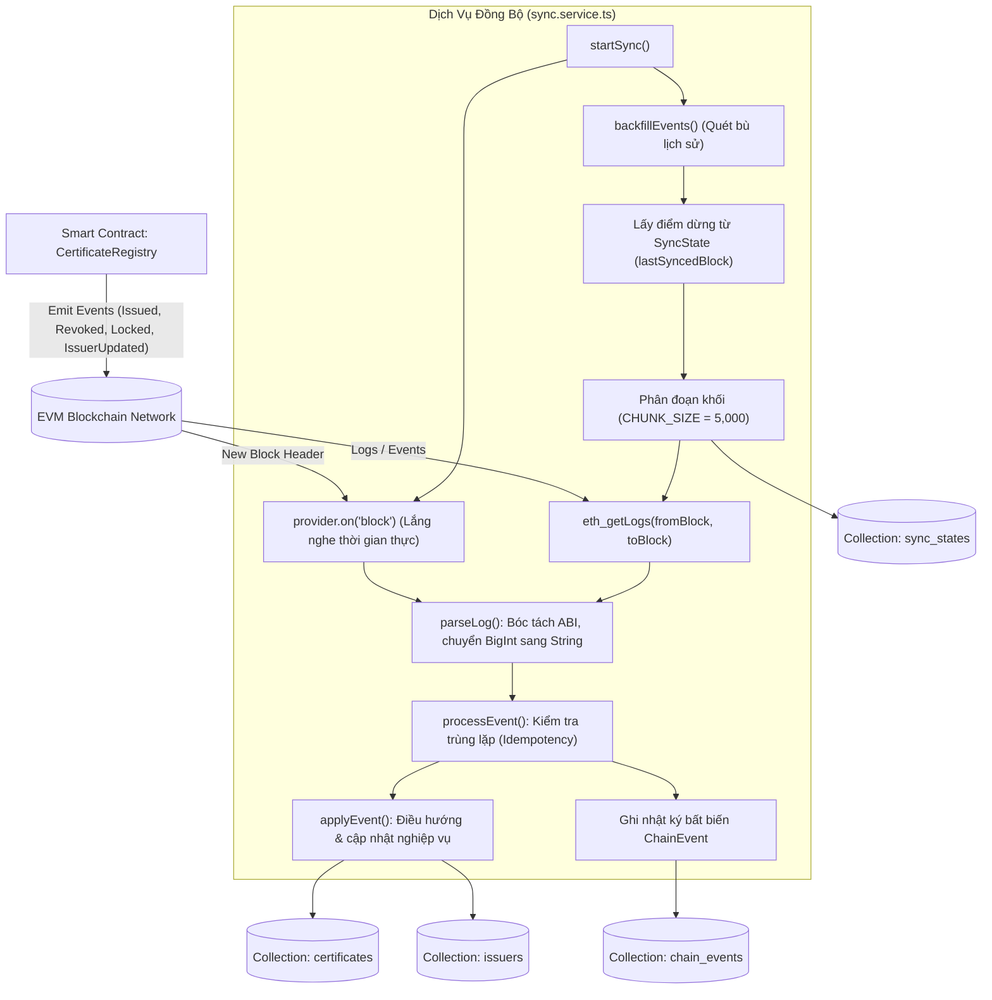

# Kiến Trúc Dịch Vụ Đồng Bộ Sự Kiện Blockchain (Blockchain Event Indexing Architecture)

Tài liệu này đặc tả chi tiết kiến trúc của bộ lập chỉ mục sự kiện chuỗi khối (Blockchain Event Indexer), cơ chế đồng bộ lai (Hybrid Sync: Backfill & Real-time Listener), chiến lược phân đoạn khối (Chunking & Checkpoint), cùng quy trình xử lý dữ liệu bất biến và chống trùng lặp tại [backend/src/services/sync.service.ts](file:///d:/VC_Blockchain/VC/backend/src/services/sync.service.ts).

---

## 1. Tổng Quan Kiến Trúc (Architecture Overview)

Trong các ứng dụng phi tập trung (Web3 / DApp), việc truy vấn trực tiếp dữ liệu lịch sử hoặc tìm kiếm, lọc, phân trang từ Smart Contract trên Blockchain thông qua mạng lưới RPC có chi phí tài nguyên rất lớn và độ trễ cao ($1\text{s} - 5\text{s}$ cho mỗi truy vấn).

Để tối ưu hóa trải nghiệm người dùng với tốc độ phản hồi tính bằng mili-giây ($<50\text{ms}$), hệ thống áp dụng mẫu kiến trúc **CQRS (Command Query Responsibility Segregation)** kết hợp **Event Sourcing**:
1. **Lớp Ghi (Write Side - On-chain)**: Mọi thao tác thay đổi trạng thái có tính pháp lý (cấp bằng, thu hồi, tạm khóa văn bằng, kích hoạt đơn vị phát hành) đều được thực thi thông qua giao dịch trên Smart Contract `CertificateRegistry`.
2. **Lớp Đọc (Read Side - Off-chain Indexer)**: `SyncService` đóng vai trò như một **Event Indexer** chuyên dụng, liên tục lắng nghe và phân tích các log sự kiện từ chuỗi khối để cập nhật vào cơ sở dữ liệu MongoDB phục vụ các API tìm kiếm và xác minh công khai.



---

## 2. Chiến Lược Phân Đoạn Khối & Điểm Kiểm Soát (Chunking & Checkpoint)

### 2.1. Giới Hạn Của Node RPC & Cơ Chế Phân Đoạn (Chunking)
Các nhà cung cấp node RPC (như Infura, Alchemy, Ankr, hoặc node nội bộ) đều giới hạn số lượng khối tối đa cho mỗi yêu cầu `eth_getLogs` (thường là $1,000 - 10,000$ khối) để tránh quá tải bộ nhớ và nghẽn băng thông.

Để khắc phục rào cản này, `SyncService` chia nhỏ dải khối cần đồng bộ thành từng đoạn cố định:
```typescript
const CHUNK_SIZE = 5_000;
```
Quá trình lặp qua từng dải khối:
$$\text{from} \rightarrow \min(\text{from} + \text{CHUNK\_SIZE} - 1, \text{latest})$$

### 2.2. Điểm Kiểm Soát Bền Vững (Persistent Checkpoint - `SyncState`)
Trạng thái tiến độ đồng bộ được lưu trữ bền vững trong bảng `SyncState`:
- Khóa định danh: `key = "certificate_registry"`.
- Trường `lastSyncedBlock`: Đánh dấu khối cuối cùng đã hoàn tất đồng bộ toàn bộ sự kiện.
- Điểm xuất phát: Khối triển khai hợp đồng (`env.DEPLOY_BLOCK`), ngăn hệ thống quét lãng phí hàng triệu khối trống trước khi hợp đồng ra đời.
- **Tính an toàn**: `state.lastSyncedBlock = to; await state.save();` chỉ được gọi sau khi toàn bộ log trong dải khối của phân đoạn đó đã được xử lý xong.

---

## 3. Phân Tích Logic Bóc Tách & Chuẩn Hóa Dữ Liệu

### 3.1. Giải Mã Log Sự Kiện (`parseLog`)
Hàm `parseLog` thực hiện:
1. **Lọc địa chỉ hợp đồng**: Xác nhận `log.address` trùng khớp với `env.CONTRACT_ADDRESS`.
2. **Giải mã ABI**: Sử dụng `registry.interface.parseLog(log)` từ Ethers.js.
3. **Chuẩn hóa BigInt**: Kiểu dữ liệu `bigint` trong Ethers v6 không thể trực tiếp tuần tự hóa sang JSON hoặc lưu trữ an toàn trong MongoDB BSON nếu vượt giới hạn. `parseLog` chuyển đổi toàn bộ `bigint` thành `string`:
```typescript
const args: Record<string, unknown> = {};
parsed.fragment.inputs.forEach((input, index) => {
  const value = parsed.args[index];
  args[input.name] = typeof value === "bigint" ? value.toString() : value;
});
```

### 3.2. Tiền Chuẩn Hóa Hash Văn Bằng (`ensureCertificateIdHashes`)
Các bản ghi văn bằng cũ chỉ lưu `certificateId` dạng bản rõ. Để khớp nối nhanh chóng với các sự kiện Blockchain vốn đánh chỉ mục theo `keccak256(certificateId)` (tham số `idHash`), hàm `ensureCertificateIdHashes` quét và bổ sung trường `certificateIdHash` cho mọi bản ghi chưa có:
```typescript
keccak256(toUtf8Bytes(doc.certificateId))
```

---

## 4. Ma Trận Xử Lý Nghiệp Vụ Theo Sự Kiện (`applyEvent`)

Khi sự kiện hợp lệ được tiếp nhận, `applyEvent` sẽ cập nhật trực tiếp vào các mô hình dữ liệu tương ứng:

| Tên Sự Kiện | Nguồn Dữ Liệu | Thao Tác MongoDB | Quy Tắc Nghiệp Vụ & Phòng Vệ |
| :--- | :--- | :--- | :--- |
| `CertificateIssued` | `args.certificateId`, `args.idHash`, `log.transactionHash` | Cập nhật `Certificate`: `certificateIdHash`, `txHash`, `blockNumber`, `logIndex` | Bổ sung thông tin giao dịch on-chain vào bản ghi văn bằng đã tạo trước đó ở backend. Bỏ qua nếu chưa có bản ghi metadata. |
| `CertificateRevoked` | `args.idHash`, `args.revokedAt`, `log.transactionHash` | Cập nhật `Certificate`: `status: "revoked"`, `revokedAt`, `revokeTxHash`, `revokeBlockNumber`, xóa sạch các trường khóa (`lockedAt: null`) | Khi văn bằng đã bị thu hồi vĩnh viễn, toàn bộ thông tin khóa trước đó sẽ bị vô hiệu hóa. |
| `CertificateLocked` | `args.idHash`, `args.lockedAt`, `log.transactionHash` | Cập nhật `Certificate`: `status: "locked"`, `lockedAt`, `lockTxHash`, `lockBlockNumber` | **Chặn cập nhật nếu `status === "revoked"`**. Không cho phép tạm khóa một văn bằng đã bị thu hồi. |
| `CertificateUnlocked` | `args.idHash` | Cập nhật `Certificate`: `status: "active"`, `$unset: { lockedAt, lockTxHash, lockBlockNumber }` | **Chặn cập nhật nếu `status === "revoked"`**. Khôi phục trạng thái hoạt động bình thường cho văn bằng. |
| `IssuerUpdated` | `args.issuer`, `args.active`, `args.name` | Cập nhật `Issuer`: `onChainActive`, `isActive`, `name`, `chainAddedAt` | Đồng bộ trạng thái cấp phép trên chuỗi của cơ sở đào tạo/đơn vị cấp bằng. |

---

## 5. Cơ Chế Bất Biến & Chống Trùng Lặp (Idempotency & Deduplication)

Một trong những thách thức lớn nhất của hệ thống phân tán là khả năng một sự kiện bị nhận lại nhiều lần (At-least-once delivery, tái quét mạng, hoặc Reorg nhẹ).

`SyncService` thiết lập cơ chế phòng thủ 2 lớp:
1. **Lớp Kiểm Tra (Pre-check)**:
   ```typescript
   const existing = await ChainEvent.exists({
     txHash: log.transactionHash.toLowerCase(),
     logIndex: log.index,
   });
   if (existing) return false;
   ```
2. **Lớp Khóa Trùng Lặp Cấp Cơ Sở Dữ Liệu (Compound Index)**:
   Bộ sưu tập `ChainEvent` được đánh chỉ mục phức hợp duy nhất trên cặp `(txHash, logIndex)`. Nếu xảy ra trường hợp ghi đồng thời giữa tiến trình quét bù và lắng nghe thời gian thực, lỗi `duplicate key` sẽ được bắt và bỏ qua an toàn:
   ```typescript
   catch (error) {
     const message = error instanceof Error ? error.message : String(error);
     if (!message.includes("duplicate key")) {
       throw error;
     }
   }
   ```

---

## 6. Lắng Nghe Thời Gian Thực & Khóa Mutex (Real-time Concurrency)

Để bắt kịp các sự kiện ngay khi block mới được đào mà không cần chờ tác vụ định kỳ (Cron Job), `SyncService` đăng ký lắng nghe sự kiện sinh khối mới:
```typescript
provider.on("block", blockHandler);
```

### Cơ chế Mutex ngăn chặn Race Condition:
Vì các khối có thể được sinh ra liên tiếp trong thời gian ngắn (ví dụ: mạng thử nghiệm hoặc các L2 có block time $1\text{s} - 2\text{s}$), nếu không có cơ chế khóa, nhiều hàm `backfillEvents` sẽ chạy song song, gây lãng phí kết nối RPC và nguy cơ xung đột dữ liệu:
```typescript
let syncing = false;

async function onBlock(blockNumber: number): Promise<void> {
  if (syncing) return; // Bỏ qua nếu lượt quét trước chưa hoàn tất
  syncing = true;
  try {
    await backfillEvents(undefined, blockNumber);
  } finally {
    syncing = false; // Luôn giải phóng cờ trong khối finally
  }
}
```

---

## 7. Quản Lý Vòng Đời & Kiểm Tra Sức Khỏe (Lifecycle & Health Check)

Lớp `SyncService` cung cấp giao diện quản lý toàn diện:
- `startSync()`: Khởi động quy trình — tiến hành quét bù toàn bộ sự kiện từ điểm dừng lịch sử đến khối hiện tại, sau đó kích hoạt listener thời gian thực.
- `stopSync()`: Hủy đăng ký listener `provider.off("block", blockHandler)` phục vụ kịch bản Graceful Shutdown hoặc Testing.
- `getSyncStatus()`: Trả về trạng thái chi tiết gồm `lastSyncedBlock`, `currentBlock`, `contractAddress`, `chainId`, cho phép Dashboard Admin hoặc hệ thống cảnh báo (Prometheus/Grafana) tính toán độ trễ đồng bộ:
  $$\text{Lag} = \text{currentBlock} - \text{lastSyncedBlock}$$
