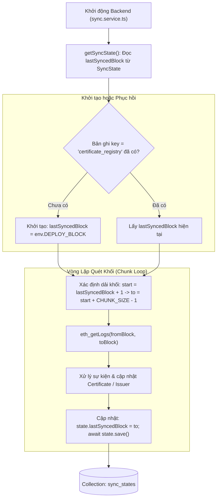

# Kiến Trúc Mô Hình Điểm Kiểm Soát Đồng Bộ Chuỗi Khối (SyncState Model & Checkpoint Architecture)

Tài liệu này đặc tả chi tiết thiết kế mô hình dữ liệu Mongoose cho điểm kiểm soát đồng bộ chuỗi khối (Blockchain Sync Checkpoint / High-Water Mark), cơ chế duy trì con trỏ khối, khả năng phục hồi lỗi (Fault Tolerance) và cách tính toán độ trễ đồng bộ (Sync Lag) tại [backend/src/models/SyncState.ts](file:///d:/VC_Blockchain/VC/backend/src/models/SyncState.ts).

---

## 1. Tổng Quan Kiến Trúc (Architecture Overview)

Trong các ứng dụng Web3 lập chỉ mục dữ liệu sự kiện chuỗi khối (Blockchain Event Indexing), việc quét log thông qua hàm `eth_getLogs` của nút RPC đòi hỏi một cơ chế ghi nhớ bền vững mốc khối đã xử lý.

Nếu không có con trỏ kiểm soát trạng thái:
- Mỗi khi máy chủ Backend khởi động lại, worker đồng bộ sẽ phải quét lại từ khối triển khai hợp đồng (`DEPLOY_BLOCK`), dẫn đến lãng phí hàng nghìn yêu cầu gọi RPC, làm chậm quá trình khởi động và có nguy cơ bị nhà cung cấp RPC chặn (Rate Limiting).
- Hệ thống không thể biết chính xác tiến trình off-chain đang chạy chậm hơn chuỗi khối bao nhiêu khối để cảnh báo.

Mô hình `SyncState` giải quyết triệt để vấn đề này bằng cách hoạt động như một **Con trỏ kiểm soát tiến độ (High-Water Mark / Checkpoint Cursor)** được lưu bền vững trong MongoDB.



---

## 2. Đặc Tả Dữ Liệu & Quy Tắc Xác Thực (Schema & Validation Rules)

Mô hình `syncStateSchema` được thiết kế gọn nhẹ, tập trung vào tính toàn vẹn của con trỏ:

| Thuộc Tính | Kiểu Dữ Liệu | Ràng Buộc & Định Dạng | Ý Nghĩa Kỹ Thuật |
| :--- | :--- | :--- | :--- |
| `key` | `String` | Bắt buộc, `trim: true`, tối đa 100 ký tự | Khóa định danh duy nhất của tiến trình đồng bộ (VD: `"certificate_registry"`). Cho phép mở rộng hỗ trợ nhiều hợp đồng khác nhau trong tương lai. |
| `chainId` | `Number` | Bắt buộc, `min: 1` | Mã định danh chuỗi khối (Chain ID). Ví dụ: `11155111` cho Ethereum Sepolia, `1` cho Ethereum Mainnet. |
| `contractAddress` | `String` | Bắt buộc, chữ thường, Regex `^0x[a-f0-9]{40}$` | Địa chỉ ví hợp đồng thông minh `CertificateRegistry` đang được giám sát sự kiện. |
| `lastSyncedBlock` | `Number` | Bắt buộc, `min: 0`, mặc định `0` | Số hiệu khối cao nhất đã quét và hoàn tất toàn bộ xử lý nghiệp vụ. |
| `createdAt` | `Date` | Tự động sinh | Thời điểm tạo con trỏ lần đầu tiên. |
| `updatedAt` | `Date` | Tự động cập nhật | Thời điểm cập nhật mốc khối gần nhất (được cập nhật sau mỗi phân đoạn khối thành công). |

---

## 3. Khả Năng Phục Hồi Lỗi & Nguyên Lý Bền Vững (Fault Tolerance)

### 3.1. Trình Tự Ghi Nhận Điểm Kiểm Soát (Commit-After-Process)
Trong `sync.service.ts`, điểm kiểm soát chỉ được lưu trữ **sau khi** toàn bộ các sự kiện trong phân đoạn `[from, to]` đã được lưu vết thành công:
```typescript
for (let from = start; from <= latest; from += CHUNK_SIZE) {
  const to = Math.min(from + CHUNK_SIZE - 1, latest);
  // 1. Quét logs từ RPC
  const logs = await provider.getLogs({ ... });
  // 2. Xử lý từng event
  for (const log of logs) {
    await processEvent(event, log);
  }
  // 3. Chỉ lưu checkpoint khi toàn bộ logs trong chunk đã hoàn thành
  state.lastSyncedBlock = to;
  await state.save();
}
```

### 3.2. An Toàn Khi Sự Cố Sập Nguồn (Crash Safety)
- Nếu hệ thống bị sập nguồn hoặc tắt đột ngột ở bước 2 (đang xử lý log dở dang trong một phân đoạn):
  - `state.lastSyncedBlock` vẫn giữ nguyên giá trị của phân đoạn trước.
  - Khi hệ thống khởi động lại, nó sẽ quét lại phân đoạn bị gián đoạn.
  - **Không xảy ra trùng lặp dữ liệu**: Do bảng `chain_events` có khóa phức hợp duy nhất `{ txHash: 1, logIndex: 1 }`, các sự kiện đã được xử lý trước khi sập nguồn sẽ bị bỏ qua một cách an toàn (Idempotency).

---

## 4. Giám Sát Độ Trễ Đồng Bộ (Sync Lag Monitoring)

`SyncState` cung cấp cơ sở dữ liệu để hàm `getSyncStatus()` tính toán độ trễ thời gian thực giữa cơ sở dữ liệu off-chain và chuỗi khối on-chain:

$$\text{Sync Lag} = \text{Current Block Number} - \text{lastSyncedBlock}$$

- **Độ trễ lý tưởng**: $\text{Sync Lag} \le 1$ khối (hệ thống bám sát thời gian thực theo từng block mới sinh).
- **Cảnh báo vận hành**: Nếu $\text{Sync Lag} > 50$ khối, hệ thống giám sát (Prometheus/Alertmanager) có thể phát tín hiệu cảnh báo RPC gặp sự cố hoặc tiến trình worker bị nghẽn mạng.

---

## 5. Chiến Lược Đánh Chỉ Mục (Indexing Strategy)

```typescript
syncStateSchema.index({ key: 1 }, { unique: true });
```
- Khóa `key` được đánh chỉ mục duy nhất (`unique: true`), đảm bảo mỗi tiến trình đồng bộ (như `"certificate_registry"`) chỉ tồn tại đúng một bản ghi trạng thái duy nhất trong MongoDB, loại bỏ hoàn toàn nguy cơ phân mảnh hoặc xung đột con trỏ.
