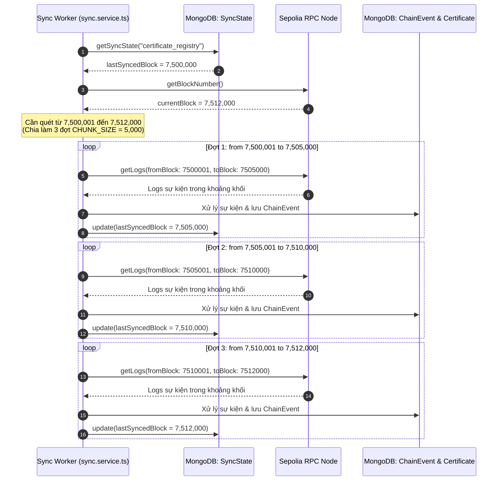

# Giải thích Chi tiết Logic & Mã nguồn `backend/src/models/SyncState.ts`

Tài liệu này giải thích chi tiết vai trò, kiến trúc dữ liệu, cơ chế con trỏ điểm kiểm tra (Checkpoint / Watermark) và phân tích mã nguồn của file [`backend/src/models/SyncState.ts`](file:///d:/VC_Blockchain/VC/backend/src/models/SyncState.ts).

---

## 1. Vai trò và Vị trí trong Hệ thống

Trong các hệ thống phân tán kết nối với Blockchain, việc duy trì tính nhất quán giữa dữ liệu On-chain và cơ sở dữ liệu Off-chain (MongoDB) đòi hỏi một tiến trình lắng nghe và quét sự kiện (Event Indexer / Sync Worker).

File `SyncState.ts` định nghĩa mô hình **Lưu trữ Điểm kiểm tra Đồng bộ (Sync Checkpoint / Watermark)**:
1. **Ghi nhớ Tiến trình Khối (Block Progress Tracking)**:
   - Lưu trữ số hiệu khối cao nhất (`lastSyncedBlock`) mà hệ thống đã quét và đồng bộ thành công vào MongoDB.
2. **Tối ưu hóa Tài nguyên RPC & Khởi động Nhanh**:
   - Khi Backend khởi động lại, worker nền [`sync.service.ts`](file:///d:/VC_Blockchain/VC/backend/src/services/sync.service.ts) sẽ đọc `lastSyncedBlock` từ bảng này để tiếp tục quét từ khối tiếp theo (`lastSyncedBlock + 1`), **không cần quét lại từ đầu** (`DEPLOY_BLOCK`).
   - Tránh việc gửi hàng ngàn truy vấn `eth_getLogs` dư thừa lên các RPC Node công khai của Ethereum Sepolia, giúp tránh bị giới hạn lưu lượng (Rate Limit) và tiết kiệm chi phí hạ tầng.
3. **Khả năng mở rộng Đa Hợp đồng / Đa Mạng (Multi-chain & Multi-contract Ready)**:
   - Thông qua trường `key`, hệ thống có thể quản lý nhiều tiến trình đồng bộ độc lập cho các smart contract hoặc các mạng blockchain khác nhau trong tương lai.

---

## 2. Cơ chế Đồng bộ Phân đoạn (Chunked Syncing Workflow)

Mỗi khi worker đồng bộ chạy, dữ liệu khối được quét theo từng phân đoạn (batch) với kích thước `CHUNK_SIZE = 5_000` blocks:



> [!NOTE]
> Mốc `lastSyncedBlock` được cập nhật và lưu ngay sau khi **mỗi phân đoạn (chunk)** xử lý hoàn tất. Nếu hệ thống gặp sự cố mất điện hoặc crash giữa chừng, lần khởi động tiếp theo chỉ cần quét lại từ phân đoạn đang dang dở mà không bị mất dấu.

---

## 3. Phân tích Cấu trúc Dữ liệu `ISyncState`

Mỗi bản ghi trong collection `syncstates` quản lý một mốc con trỏ tiến trình:

| Tên trường | Kiểu dữ liệu | Bắt buộc | Ràng buộc kỹ thuật | Ý nghĩa & Vai trò |
|---|---|---|---|---|
| `key` | `string` | Có | `maxlength: 100`, `trim: true` | Khóa định danh của tiến trình đồng bộ (VD: `"certificate_registry"`). Được đánh chỉ mục duy nhất. |
| `chainId` | `number` | Có | `min: 1` | Mã định danh mạng blockchain (Sepolia: `11155111`, Ethereum Mainnet: `1`). Đảm bảo không đồng bộ nhầm dữ liệu giữa testnet và mainnet. |
| `contractAddress` | `string` | Có | `lowercase: true`, `/^0x[a-f0-9]{40}$/` | Địa chỉ smart contract mà worker đang theo dõi các event log. |
| `lastSyncedBlock` | `number` | Có | `min: 0`, `default: 0` | Số hiệu khối cao nhất đã được đọc, phân tích và cập nhật thành công vào MongoDB. |
| `createdAt` / `updatedAt` | `Date` | Tự động | Mongoose timestamps | `updatedAt` thể hiện thời điểm hệ thống vừa quét xong một đợt khối mới nhất. |

---

## 4. Chiến lược Đánh Chỉ mục (Indexing Strategy)

```typescript
syncStateSchema.index({ key: 1 }, { unique: true });
```

- **Chỉ mục Unique `{ key: 1 }`**:
  - Đảm bảo mỗi tiến trình (ví dụ: `"certificate_registry"`) chỉ tồn tại đúng một bản ghi điểm kiểm tra duy nhất trong toàn bộ cơ sở dữ liệu.
  - Phép tìm kiếm `findOne({ key: "certificate_registry" })` hoặc cập nhật `updateOne({ key }, ...)` đạt tốc độ truy xuất tối ưu $O(1)$.

---

## 5. Mã nguồn Đầy đủ có Chú thích Chi tiết

Dưới đây là mã nguồn của [`backend/src/models/SyncState.ts`](file:///d:/VC_Blockchain/VC/backend/src/models/SyncState.ts) với hệ thống chú thích đầy đủ:

```typescript
import {
  Schema,
  model,
  type HydratedDocument,
  type Model,
} from "mongoose";

/**
 * Interface định nghĩa dữ liệu trạng thái đồng bộ khối Blockchain (Sync Checkpoint / Watermark).
 *
 * Mô hình này lưu trữ tiến trình quét sự kiện smart contract từ mạng Ethereum Sepolia vào MongoDB:
 * - Lưu số hiệu khối cao nhất đã quét và đồng bộ thành công (lastSyncedBlock).
 * - Khi backend khởi động lại, worker nền sẽ đọc mốc này để tiếp tục quét khối mới mà không cần quét lại từ đầu.
 * - Giảm tải số lượng yêu cầu gọi RPC lên mạng Ethereum, tối ưu chi phí và tăng tốc độ khởi động hệ thống.
 */
export interface ISyncState {
  /** Tên định danh tiến trình đồng bộ (VD: "certificate_registry"), duy nhất trên toàn hệ thống */
  key: string;
  /** Chain ID của mạng blockchain đang theo dõi (VD: 11155111 ứng với Ethereum Sepolia) */
  chainId: number;
  /** Địa chỉ smart contract được quét sự kiện (dạng 20 bytes hex chữ thường) */
  contractAddress: string;
  /** Số hiệu khối (block number) cao nhất đã được quét và xử lý thành công */
  lastSyncedBlock: number;
  /** Thời điểm bản ghi được tạo trong MongoDB */
  createdAt: Date;
  /** Thời điểm cập nhật mốc khối gần nhất */
  updatedAt: Date;
}

export type SyncStateDocument = HydratedDocument<ISyncState>;

/**
 * Mongoose Schema định nghĩa cấu trúc và ràng buộc cho SyncState.
 */
const syncStateSchema = new Schema<ISyncState>(
  {
    // Khóa định danh tiến trình đồng bộ (VD: "certificate_registry")
    key: {
      type: String,
      required: true,
      trim: true,
      maxlength: 100,
    },
    // ID mạng blockchain (Sepolia = 11155111, Mainnet = 1)
    chainId: {
      type: Number,
      required: true,
      min: 1,
    },
    // Địa chỉ hợp đồng thông minh CertificateRegistry (40 ký tự hex bắt đầu bằng 0x)
    contractAddress: {
      type: String,
      required: true,
      lowercase: true,
      match: /^0x[a-f0-9]{40}$/,
    },
    // Khối blockchain cuối cùng đã đồng bộ xong dữ liệu
    lastSyncedBlock: {
      type: Number,
      required: true,
      min: 0,
      default: 0,
    },
  },
  {
    timestamps: true, // Tự động cập nhật createdAt và updatedAt mỗi khi lưu mốc block mới
    versionKey: false, // Bỏ trường __v không cần thiết
  }
);

// -----------------------------------------------------------------------------
// CHIẾN LƯỢC ĐÁNH CHỈ MỤC (INDEXING STRATEGY)
// -----------------------------------------------------------------------------

// Chỉ mục Unique theo khóa định danh: Đảm bảo mỗi tiến trình đồng bộ chỉ có đúng 1 con trỏ trạng thái duy nhất
syncStateSchema.index({ key: 1 }, { unique: true });

export const SyncState: Model<ISyncState> = model<ISyncState>(
  "SyncState",
  syncStateSchema
);
```

---

## 6. Mối quan hệ giữa `SyncState` và `ChainEvent`

| Tiêu chí | `SyncState` | `ChainEvent` |
|---|---|---|
| **Cấp độ quản lý** | Cấp độ vĩ mô (Macro-level): Phạm vi khối | Cấp độ vi mô (Micro-level): Từng log event chi tiết |
| **Câu hỏi giải quyết** | "Hệ thống đã quét đến khối nào?" | "Event này trong transaction nào đã được xử lý chưa?" |
| **Tần suất cập nhật** | Cập nhật sau mỗi đợt quét batch (5,000 blocks) | Ghi nhận mỗi khi có một event log hợp lệ phát ra |
| **Mô hình ghi** | Ghi đè cập nhật mốc (`updateOne` / `save`) | Thêm mới bất biến (`Append-Only`, không sửa) |
| **Khóa chống trùng** | `{ key: 1 }` (Unique) | `{ txHash: 1, logIndex: 1 }` (Unique) |

Sự kết hợp giữa `SyncState` (quản lý phạm vi quét) và `ChainEvent` (quản lý tính lũy thừa từng sự kiện) giúp hệ thống đồng bộ blockchain đạt độ tin cậy tuyệt đối và hiệu năng vượt trội.
