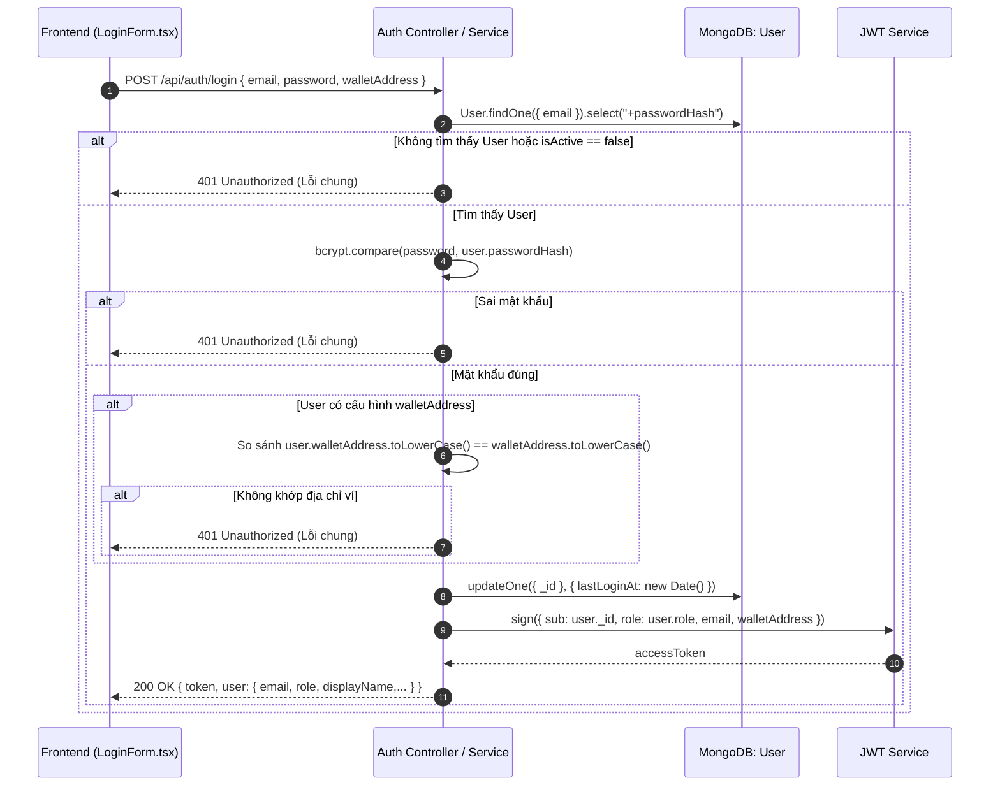

# Giải thích Chi tiết Logic & Mã nguồn `backend/src/models/User.ts`

Tài liệu này giải thích chi tiết vai trò, kiến trúc dữ liệu, cơ chế bảo mật xác thực lai (Hybrid Web2 + Web3), chiến lược đánh chỉ mục và phân tích mã nguồn của file [`backend/src/models/User.ts`](file:///d:/VC_Blockchain/VC/backend/src/models/User.ts).

---

## 1. Vai trò và Vị trí trong Hệ thống

Trong hệ thống **Raccoon University — Verify Certification**, file `User.ts` định nghĩa mô hình quản lý tài khoản người dùng, chịu trách nhiệm cho tầng **Xác thực (Authentication)** và **Phân quyền dựa trên vai trò (Role-Based Access Control - RBAC)**.

### Kiến trúc Xác thực Lai (Hybrid Web2 + Web3 Authentication):
Hệ thống kết hợp cơ chế xác thực truyền thống và kiểm tra địa chỉ ví blockchain:
1. **Lớp Web2 (Email & Password)**:
   - Người dùng đăng nhập bằng Email và Mật khẩu. Mật khẩu được băm an toàn bằng thuật toán `bcryptjs` với salt rounds chuẩn.
2. **Lớp Web3 (MetaMask Wallet Binding)**:
   - Tài khoản có thể liên kết với một địa chỉ ví Ethereum (`walletAddress`).
   - Khi đăng nhập vào cổng quản trị hoặc cổng đơn vị cấp, người dùng bắt buộc phải **kết nối ví MetaMask** và địa chỉ ví này phải **khớp chính xác** với `walletAddress` đã đăng ký trong hồ sơ tài khoản.
3. **Chống dò quét thông tin (Anti-Enumeration Defense)**:
   - Nếu sai email, sai mật khẩu, hoặc địa chỉ ví không khớp, backend luôn trả về một mã lỗi và thông báo chung: *"Thông tin đăng nhập không chính xác"*. Điều này ngăn kẻ tấn công phát hiện được email hay ví nào đang tồn tại trong hệ thống.

---

## 2. Sơ đồ Luồng Đăng nhập & Xác thực



---

## 3. Phân tích Cấu trúc Dữ liệu `IUser`

Mỗi bản ghi đại diện cho một tài khoản người dùng có quyền truy cập vào hệ thống:

| Tên trường | Kiểu dữ liệu | Bắt buộc | Ràng buộc kỹ thuật | Ý nghĩa & Vai trò |
|---|---|---|---|---|
| `email` | `string` | Có | `lowercase: true`, `maxlength: 150`, `/^[^\s@]+@[^\s@]+\.[^\s@]+$/` | Email đăng nhập, được đánh chỉ mục duy nhất (`unique: true`). |
| `passwordHash` | `string` | Có | `select: false` | Chuỗi băm mật khẩu bcrypt. Thuộc tính `select: false` ngăn việc Mongoose vô tình đọc trường này ra trong các query thông thường. |
| `role` | `UserRole` | Có | `enum: ["admin", "issuer"]` | Vai trò của người dùng trong hệ thống (xem chi tiết mục phân quyền). |
| `displayName` | `string` | Có | `maxlength: 100`, `trim: true` | Tên hiển thị trên thanh Header và Dashboard. |
| `walletAddress` | `string?` | Không | `lowercase: true`, `default: null` | Địa chỉ ví Ethereum dùng để đối soát danh tính khi đăng nhập Web3. |
| `isActive` | `boolean` | Có | `default: true` | Cờ trạng thái tài khoản. Nếu `false`, người dùng bị từ chối đăng nhập ngay lập tức. |
| `lastLoginAt` | `Date?` | Không | `default: null` | Ghi nhận thời điểm đăng nhập thành công gần nhất phục vụ kiểm toán bảo mật. |
| `createdAt` / `updatedAt` | `Date` | Tự động | Mongoose timestamps | Thời điểm tạo và cập nhật tài khoản. |

---

## 4. Phân quyền Người dùng (Role-Based Access Control)

Hệ thống phân định 2 nhóm vai trò với phạm vi nghiệp vụ rõ ràng:

| Quyền hạn | `admin` (Quản trị viên) | `issuer` (Đơn vị cấp văn bằng) |
|---|---|---|
| **Cổng truy cập** | `/admin` | `/issuer` |
| **Quản lý Issuer** | Thêm mới on-chain/off-chain, vô hiệu hóa, kích hoạt lại | ❌ Không có quyền |
| **Cấp văn bằng** | ❌ Không trực tiếp cấp | ✅ Nhập thông tin, tạo PDF và ký giao dịch cấp |
| **Xem danh sách văn bằng** | Xem toàn bộ chứng chỉ của tất cả các khoa | Chỉ xem chứng chỉ do chính khoa mình cấp |
| **Thu hồi văn bằng** | ✅ Quyền thu hồi khẩn cấp toàn trường | Chỉ thu hồi chứng chỉ do khoa mình phát hành |
| **Khóa / Mở khóa văn bằng** | ✅ Quyền mở khóa khẩn cấp | Khóa/Mở khóa chứng chỉ của khoa mình |

---

## 5. Chiến lược Bảo mật & Đánh Chỉ mục (Security & Indexing)

### 5.1. Hai tầng bảo vệ chống rò rỉ `passwordHash`
1. **Tầng Query Database**: Cấu hình `select: false` trong Schema. Mọi câu lệnh `User.find()`, `User.findOne()` hay `User.findById()` đều tự động loại trừ `passwordHash`, trừ khi nhà phát triển gọi tường minh `.select("+passwordHash")`.
2. **Tầng Serialize JSON**: Cấu hình hook `toJSON`:
   ```typescript
   userSchema.set("toJSON", {
     transform: (_doc, ret) => {
       delete ret.passwordHash;
       return ret;
     },
   });
   ```
   Kể cả khi câu query có lấy ra `passwordHash`, khi controller chuyển đổi đối tượng trả về response JSON cho client, trường này vẫn bị loại bỏ triệt để.

### 5.2. Chỉ mục `{ email: 1 }` (Unique)
- Đảm bảo mỗi địa chỉ email chỉ đăng ký một tài khoản duy nhất trên toàn hệ thống.

### 5.3. Chỉ mục `{ walletAddress: 1 }` (Unique + Partial Filter Index)
- **Bài toán**: Nhiều tài khoản (ví dụ Admin hệ thống) có thể chưa gắn ví MetaMask (`walletAddress: null`).
- **Giải pháp**:
  ```typescript
  userSchema.index(
    { walletAddress: 1 },
    {
      unique: true,
      partialFilterExpression: { walletAddress: { $type: "string" } },
    }
  );
  ```
  MongoDB chỉ áp dụng ràng buộc duy nhất cho các bản ghi có `walletAddress` thực sự là chuỗi ký tự, hoàn toàn không phát sinh lỗi trùng lặp đối với các giá trị `null`.

---

## 6. Mã nguồn Đầy đủ có Chú thích Chi tiết

Dưới đây là mã nguồn của [`backend/src/models/User.ts`](file:///d:/VC_Blockchain/VC/backend/src/models/User.ts) với hệ thống chú thích đầy đủ:

```typescript
import {
  Schema,
  model,
  type HydratedDocument,
  type Model,
} from "mongoose";

/**
 * Vai trò người dùng trong hệ thống:
 * - admin: Quản trị viên trường học (quản lý danh sách issuer, xem toàn bộ chứng chỉ, thu hồi khẩn cấp).
 * - issuer: Cán bộ đại diện cho khoa/viện có thẩm quyền tạo và ký cấp phát hành văn bằng.
 */
export type UserRole = "admin" | "issuer";

/**
 * Interface định nghĩa dữ liệu tài khoản Người dùng (User) trong MongoDB.
 *
 * Mô hình này quản lý danh tính, phân quyền và cơ chế xác thực kết hợp Web2 + Web3:
 * - Đăng nhập truyền thống: Email + Mật khẩu băm (bcrypt).
 * - Xác thực kết hợp Web3: Liên kết địa chỉ ví Ethereum (walletAddress). Khi đăng nhập, ví kết nối
 *   phải khớp chính xác với ví đã đăng ký của tài khoản.
 * - Bảo mật thông tin: Mật khẩu băm được ẩn mặc định (select: false) và tự động xóa khi serialize JSON.
 */
export interface IUser {
  /** Địa chỉ email đăng nhập duy nhất của người dùng */
  email: string;
  /** Mật khẩu đã băm an toàn bằng thuật toán bcryptjs (ẩn mặc định khi truy vấn) */
  passwordHash: string;
  /** Quyền hạn của người dùng trong hệ thống (admin | issuer) */
  role: UserRole;
  /** Tên hiển thị của người dùng (VD: "Phòng Quản lý Đào tạo", "Khoa CNTT") */
  displayName: string;
  /** Địa chỉ ví Ethereum liên kết với tài khoản (chữ thường, dùng đối soát đăng nhập Web3) */
  walletAddress?: string | null;
  /** Trạng thái hoạt động của tài khoản (true: cho phép đăng nhập, false: bị khóa) */
  isActive: boolean;
  /** Thời điểm đăng nhập thành công gần nhất */
  lastLoginAt?: Date | null;
  /** Thời điểm tạo tài khoản */
  createdAt: Date;
  /** Thời điểm cập nhật thông tin tài khoản gần nhất */
  updatedAt: Date;
}

export type UserDocument = HydratedDocument<IUser>;

/**
 * Mongoose Schema định nghĩa cấu trúc, bảo mật và ràng buộc cho User.
 */
const userSchema = new Schema<IUser>(
  {
    // Địa chỉ email chuẩn hóa viết thường, kiểm tra regex định dạng email
    email: {
      type: String,
      required: true,
      lowercase: true,
      trim: true,
      maxlength: 150,
      match: /^[^\s@]+@[^\s@]+\.[^\s@]+$/,
    },
    // Mật khẩu băm: select: false để không bao giờ vô tình trả về hash mật khẩu trong API queries
    passwordHash: {
      type: String,
      required: true,
      select: false,
    },
    // Vai trò người dùng: chỉ cho phép 2 quyền chuẩn
    role: {
      type: String,
      required: true,
      enum: ["admin", "issuer"],
    },
    // Tên hiển thị người dùng
    displayName: {
      type: String,
      required: true,
      trim: true,
      maxlength: 100,
    },
    // Địa chỉ ví Ethereum liên kết (tùy chọn, viết thường 40 ký tự hex)
    walletAddress: {
      type: String,
      lowercase: true,
      trim: true,
      default: null,
    },
    // Cờ trạng thái cho phép đăng nhập
    isActive: {
      type: Boolean,
      default: true,
    },
    // Lưu vết thời điểm đăng nhập gần nhất
    lastLoginAt: {
      type: Date,
      default: null,
    },
  },
  {
    timestamps: true, // Tự động tạo createdAt và updatedAt
    versionKey: false, // Bỏ trường __v
  }
);

// -----------------------------------------------------------------------------
// CHIẾN LƯỢC ĐÁNH CHỈ MỤC (INDEXING STRATEGY)
// -----------------------------------------------------------------------------

// 1. Chỉ mục Unique theo Email: Đảm bảo không thể đăng ký trùng email
userSchema.index({ email: 1 }, { unique: true });

// 2. Chỉ mục Unique có điều kiện (Partial Filter Index) theo ví Ethereum:
// Đảm bảo mỗi địa chỉ ví chỉ gắn với 1 tài khoản User, nhưng cho phép nhiều User có walletAddress = null
userSchema.index(
  { walletAddress: 1 },
  {
    unique: true,
    partialFilterExpression: { walletAddress: { $type: "string" } },
  }
);

// -----------------------------------------------------------------------------
// HOOKS & TRANSFORMS BẢO MẬT
// -----------------------------------------------------------------------------

// Tự động xóa passwordHash khi document được chuyển đổi sang đối tượng JSON
// Ngăn chặn hoàn toàn việc rò rỉ hash mật khẩu ra các response API của client
userSchema.set("toJSON", {
  transform: (_doc, ret) => {
    delete (ret as { passwordHash?: string }).passwordHash;
    return ret;
  },
});

export const User: Model<IUser> = model<IUser>("User", userSchema);
```

---

## 7. Mối quan hệ giữa `User` và `Issuer`

- Một tài khoản `User` có `role === "issuer"` thường được liên kết với một bản ghi `Issuer` thông qua trường `Issuer.userId` và cùng mang chung một địa chỉ ví `walletAddress`.
- Mô hình này phân tách rành mạch:
  - `User`: Chịu trách nhiệm về **danh tính đăng nhập và phiên làm việc (Session/JWT)**.
  - `Issuer`: Chịu trách nhiệm về **thẩm quyền pháp lý và giao dịch ký phát hành văn bằng on-chain**.
